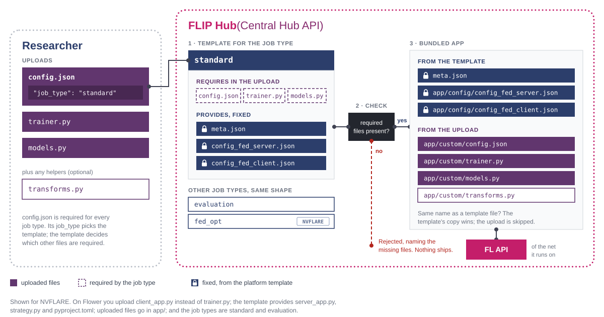

..  Copyright (c) 2026 Guy's and St Thomas' NHS Foundation Trust & King's College London
    Licensed under the Apache License, Version 2.0 (the "License");
    you may not use this file except in compliance with the License.
    You may obtain a copy of the License at
        http://www.apache.org/licenses/LICENSE-2.0
    Unless required by applicable law or agreed to in writing, software
    distributed under the License is distributed on an "AS IS" BASIS,
    WITHOUT WARRANTIES OR CONDITIONS OF ANY KIND, either express or implied.
    See the License for the specific language governing permissions and
    limitations under the License.

.. _fl-jobs:

#########################
FL jobs and configuration
#########################

An FL **job** is your uploaded files bundled with a fixed, platform-owned template for the job type. The Central
Hub builds the bundle when the scheduler picks the job up and sends it to a net (see :doc:`component-fl-nets`).

This page is for model developers and the engineers supporting them. It lists the job types per backend, the
files each one requires, the settings in ``config.json`` and the ``flip`` package calls your code uses.

.. contents:: On this page
   :local:
   :depth: 2

*********
Job types
*********

For security, FLIP users cannot control what runs on the FL server. You write the client side (data loading,
training loop, model architecture); for the server side, you choose a **job type**:

.. list-table::
   :header-rows: 1
   :widths: 22 48 15 15

   * - Job type
     - What the server does
     - FLARE
     - Flower
   * - ``standard``
     - Federated averaging.
     - Yes
     - Yes
   * - ``evaluation``
     - Evaluates a model at each Trust and collects the metrics.
     - Yes
     - Yes
   * - ``diffusion_model``
     - Two-stage diffusion model training (autoencoder, then diffusion model).
     - Yes
     - No
   * - ``fed_opt``
     - Federated optimisation. Same client contract as ``standard``; only the server-side optimiser differs.
     - Yes
     - No

Every FLARE job type runs your code through the **FLARE Client API**: a plain training or evaluation script
that uses ``nvflare.client``. Every Flower job type runs your ``client_app.py``.

How to choose a job type
========================

Set the job type with the ``job_type`` key in the app's ``config.json``, on both backends:

- a missing key means ``standard``;
- ``config.json`` itself is required for every job type;
- an unknown job type, or a missing required file, fails the model when the hub bundles it at training start,
  with a message naming the problem. Nothing is sent to a Trust.

After you upload files, the UI shows which files the job type requires. The hub then bundles your files together
with the job type's template files.

         config.json selects a template, which lists the files it requires and provides fixed
         server-side files. If a required file is missing the submission is rejected; otherwise the
         template's files and the researcher's files are bundled into one app and submitted to the
         net's FL API.
   :align: center
   :width: 100%

   From uploaded files to a submitted app. The job type decides which files you must supply; the
   server side always comes from the platform's template.

The templates are under :gh:`fl-apps/ <fl-apps>`, and the worked tutorials under :gh:`fl-tutorials/ <fl-tutorials>`.
To list the tutorials for each backend:

.. code-block:: shell

   make -C fl-tutorials list-tutorials                    # NVIDIA FLARE
   make -C fl-tutorials list-tutorials FL_BACKEND=flower

A job type describes the federated algorithm, not the data: the same ``standard`` job type runs imaging and
tabular apps alike. What to fetch is your script's decision (an imaging app calls ``flip.get_by_accession_number``,
a tabular one only ``flip.get_dataframe``).

Evaluation metrics
==================

On both backends the FL server sends each Trust's returned metrics to the hub, so they appear on the model page
as one point per Trust (at round 0 on FLARE, round 1 on Flower). Aggregate metrics are forwarded with
upper-cased names, leaving out undefined values such as NaN.

- **FLARE**: evaluation code needs nothing extra, and nested metric keys are joined with ``/``. An evaluator can
  also keep results out of the plots and in the results file only; see the evaluation template's README.
- **Flower**: the client must name itself with ``client_name`` (or ``site``) in its reply config.

.. _fl-required-files:

***************************
Required files per job type
***************************

Each job type has its own set of required files. The manifests below are included **directly from the
repository**, so this page always matches the platform. Each key is a job type and its array is the exact set of
files it requires. The FLIP UI shows the same list on the model page.

.. literalinclude:: ../../../fl-apps/nvflare/required_files.json
   :language: json
   :caption: ``fl-apps/nvflare/required_files.json`` — required files per FLARE job type

.. literalinclude:: ../../../fl-apps/flower/required_files.json
   :language: json
   :caption: ``fl-apps/flower/required_files.json`` — required files per Flower job type

.. note::

   Every job type lists ``config.json``, because its ``job_type`` key selects the job type. On FLARE it also
   holds the training configuration below. On Flower it holds nothing else: Flower apps take their run
   configuration from ``config.toml``.

What ends up in the bundle
==========================

Your upload is intentionally minimal; the rest of the app comes from the template. Other files you upload are
bundled too, which is how apps ship helper modules and transforms, with these exceptions:

- **A file whose name matches one the template already provides is dropped.** The template's copy wins, and the
  only trace is a server-side log line; no error reaches the UI. On Flower this covers ``server_app.py``,
  ``strategy.py`` and ``__init__.py`` (the Flower tutorials ship all three in their app directories).
- **A Flower** ``pyproject.toml`` **always comes from the template.** One you upload is bundled but never used as
  the app's project file. Put per-run overrides in ``config.toml`` instead (see `Flower run configuration`_).
- **On FLARE, a checkpoint declared for server-side use is not sent to the Trusts.** A file named by
  ``SERVER_CHECKPOINT``, or by an evaluation job's ``models`` entries, is staged on the FL server instead. This
  keeps large weights off the client deployment path.

To see what a fully bundled app looks like, browse the per-job-type templates under :gh:`fl-apps/ <fl-apps>`.

.. _fl-training-configuration:

**********************
Training configuration
**********************

FLARE ``config.json``
=======================

For FLARE job types, ``config.json`` holds the job type and the training settings the platform recognises.
Every setting has a default, so an app that declares only ``job_type`` is valid.

.. code-block:: json

    {
      "job_type": "standard",
      "GLOBAL_ROUNDS": 5,
      "LOCAL_ROUNDS": 2,
      "IGNORE_RESULT_ERROR": false,
      "AGGREGATOR": "InTimeAccumulateWeightedAggregator",
      "AGGREGATION_WEIGHTS": {
         "Trust_1": 1.0,
         "Trust_2": 0.5
      }
    }

.. list-table::
   :header-rows: 1
   :widths: 24 56 20

   * - Key
     - What it sets
     - Default
   * - ``GLOBAL_ROUNDS``
     - Server rounds: how many times the server sends out the global model, collects the client updates and
       aggregates them. 1–1000.
     - 1
   * - ``LOCAL_ROUNDS``
     - Local training iterations at each client per global round. 1–1000.
     - 1
   * - ``IGNORE_RESULT_ERROR``
     - Whether training continues when a client returns an error.
     - ``false``
   * - ``AGGREGATOR``
     - How client updates are combined: ``InTimeAccumulateWeightedAggregator`` or
       ``AccumulateWeightedAggregator``. Any other value fails the job.
     - ``InTimeAccumulateWeightedAggregator``
   * - ``AGGREGATION_WEIGHTS``
     - Object mapping a client's **FL kit slot name** to the weight of its update, from 0 to 1. A non-object
       value or an out-of-range weight fails the job.
     - 1.0 for every client
   * - ``AGGREGATE_ONLY_REGEX``
     - Regular expression for the model-parameter names each client sends. A fine-tune with a frozen backbone
       can send just its head, for example. Must be a valid regular expression.
     - Unset: the full update is sent
   * - ``BEST_MODEL_METRIC``
     - Validation-metric label used to pick the best global model, saved alongside the final one. Your trainer
       must report a metric under this label. Needs ``GLOBAL_ROUNDS`` of at least 2.
     - Unset: only the final model is saved
   * - ``BEST_MODEL_METRIC_MINIMIZE``
     - ``true`` for loss-like metrics where lower is better. Rejected without ``BEST_MODEL_METRIC``.
     - ``false``

.. warning::

   ``AGGREGATION_WEIGHTS`` keys are **FL kit slot names** (``Trust_1``, ``Trust_2``, …), which is how the FL
   server knows each client; not the Trust's hub-side name or code. A key that matches no participating client is
   ignored, so a typo gives no error and no effect.

.. note::

   An invalid ``GLOBAL_ROUNDS`` or ``LOCAL_ROUNDS`` (not a number, or out of range) is **discarded without an
   error**, with different effects:

   - **GLOBAL_ROUNDS** is read by the platform, so an invalid value gives a **one-round run**. If training
     finishes sooner than expected, check this value. With ``BEST_MODEL_METRIC`` set, an invalid value fails the
     job instead.
   - **LOCAL_ROUNDS** is read by your own trainer. The default is filled in only when the key is *absent*; a
     present but invalid value reaches your trainer unchanged, so ``"LOCAL_ROUNDS": 5000`` runs 5000 local
     iterations.

   Neither key is rewritten in the deployed ``config.json``, so code that reads ``GLOBAL_ROUNDS`` from that file
   sees what you wrote, not what the server uses.

Some further keys are used by FLIP's FLARE components but are **not validated**:

- ``SERVER_CHECKPOINT``: a model file (string, or list of strings) to stage on the FL server instead of bundling
  it into the app.
- ``GLOBAL_ROUNDS_AE`` and ``GLOBAL_ROUNDS_DM``: per-stage round counts for the ``diffusion_model`` job type.
- ``models``: the checkpoints an evaluation job loads, each entry naming a ``checkpoint`` file.

**Any other key is passed through untouched** for your code to read at run time, such as ``LEARNING_RATE`` or
``VAL_SPLIT`` in the tutorials. These are neither validated nor defaulted, so a misspelled key is simply absent.

``FLIP_MODEL_ID`` is written by the platform: when training starts, the FL API sets it to the hub's model id,
replacing any value you set.

.. _fl-nvflare-meta-json:

FLARE ``meta.json``
=====================

A FLARE job's ``meta.json`` states what the job needs at each site. Upload a ``meta.json`` with your model files
and it replaces the template's. Write it by hand, or export it from a recipe or ``FedJob`` (``export_job``), as you
would for ``nvflare job submit``. FLIP keeps two keys and writes the rest from the run:

**resource_spec**
   What the job needs at every participating Trust, as FLARE's portable ``@default`` block:

   .. code-block:: json

      {"resource_spec": {"@default": {"num_of_gpus": 1}}}

   - ``num_of_gpus`` is a whole number from 0 to 8. The FL server holds the job until every Trust can provide the
     GPUs (see "GPU requirements and FLARE's scheduler" on :doc:`component-fl-nets`).
   - ``num_of_cpus`` (a whole number, at least 1) and ``memory`` (such as ``"32Gi"``) are accepted too. Only
     FLARE's container job launchers (Docker, Kubernetes) use them.
   - A block naming a site is refused, because a job cannot know the Trusts' site names. So is
     ``mem_per_gpu_in_GiB``, which FLARE's portable block does not accept.

   A researcher can override the GPU count for one run when starting training (see the
   :ref:`user guide <initiate-training>`). FLIP's templates ship an empty ``resource_spec``.

**custom_props**
   Kept as written, for your own components. FLIP drops any ``model_id`` in it (the recipes leave a placeholder
   there for local runs).

**name**, **deploy_map**, **min_clients**, **mandatory_clients**
   Written by FLIP from the run: the job is named after the model, and every selected Trust must take part.

**Any other key fails the job** when training starts, including ``launcher_spec``, ``study`` and ``scope``. These
choose how a Trust runs the job (its container image, data and privacy scope), which is the Trust's decision.

Flower apps have no ``meta.json``.

Flower run configuration
========================

Flower apps do not use the FLARE keys above. Their run configuration lives in the ``[tool.flwr.app.config]``
table of the template's ``pyproject.toml``.

To override those values, upload a ``config.toml`` with your code. The FL API passes it to ``flwr run
--run-config`` and adds the FLIP runtime values itself (model id, project id, cohort query, job directory and the
number of selected Trusts).

- ``config.toml`` can only override keys the template's ``pyproject.toml`` already declares; it cannot add new
  ones.
- Round counts use Flower's names: ``num-server-rounds`` (global rounds) and ``local-epochs`` (local rounds).
- Best-model selection uses ``best-model-metric`` and ``best-model-metric-minimize``.

.. seealso::

   :doc:`/working-with-flip-apps/create-flip-app-from-flower` for worked examples of both files.

****************************************************
Data access and communication with external services
****************************************************

Your training code must access data through the **FLIP package** (:gh:`flip-utils/flip/ <flip-utils/flip>`),
which is installed on every FL client and server.

**Data access:**

``flip.get_dataframe(project_id, query)``
   Returns the dataframe for the project's cohort query, from the Trust's OMOP database (through the Data Access
   API).

``flip.get_by_accession_number(project_id, accession_id, resource_type)``
   Returns data of a given type (such as NIfTI) for an accession ID, from the project's XNAT (through the Imaging
   API). ``resource_type`` defaults to ``ResourceType.NIFTI`` and can be one type or a list.

The first ``get_by_accession_number`` call for a given project, accession and resource type downloads the full
study onto the Trust host. The Imaging API caches it, so later calls (for example the same loop in the next FL
round) return the local copy after a small check with XNAT, which downloads again only if the study has changed.
**Call it every round** rather than building your own on-disk caching.

.. tip::

   To force a re-download (for example a file replaced by one of the same size), the Imaging API's download route
   accepts ``force_refresh=true``. Uploads through ``flip.add_resource`` invalidate the cache automatically.

**Communication with the Central Hub:**

``flip.update_status(model_id, new_model_status)``
   Updates the hub on the status of the running model, such as training started, or an error.

``flip.send_metrics(client_name, model_id, label, value, global_round, x_value=None, x_label=None)``
   Sends a metric to the hub for plotting.

   - ``global_round`` is always the FL global round the metric is reported in.
   - ``x_value`` and ``x_label`` set where the point is plotted: the x-coordinate (any float, such as an epoch
     counter) and the x-axis name (such as ``"epoch"``). Both default to the global round on the "Global Rounds"
     axis.
   - A plot is identified by ``(label, x_label)``, so one metric logged against two x-labels gives two plots.

**Round progress** (round started, a client's result received, round aggregated) appears in the model page's Live
activity feed. Your training code never sends it: the FL server does.

- On **FLARE**, FLIP's server components send it for every app.
- On **Flower**, the app's strategy must subclass FLIP's ``flip.flower.strategy.FlipFedAvg``, as the templates do.
  An app whose strategy subclasses stock ``FedAvg`` still works but shows no round progress.

The FL server also uses the package to update the model's status and, at the end of training, to upload the
results that users download.
