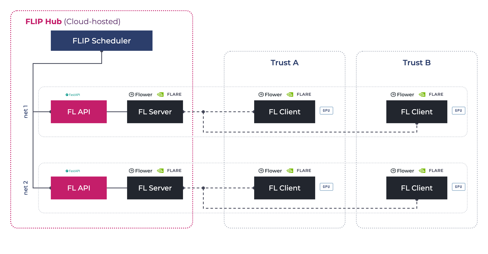

.. _flip-fl-nets:
.. _flip-fl-nodes:

#######
FL nets
#######

FLIP runs federated learning on :term:`NVIDIA FLARE` or the :term:`Flower Framework`, deployed as a set of
**nets**. A net is one FL API and one FL server on the Central Hub, plus one FL client at every participating
Trust. The hub's scheduler hands each queued training job to a free net.

This page is for engineers deploying or operating FLIP. It covers what a net is made of, how a job reaches one,
and what holds a job back. Two companion pages cover the rest:

- :doc:`component-fl-jobs`: job types, required files, ``config.json`` and the ``flip`` package your code calls.
- :doc:`component-fl-privacy`: the privacy filters on model updates, and the controls a Trust sets for itself.

.. contents:: On this page
   :local:
   :depth: 2

**********************
Nets and the scheduler
**********************

         server on the hub and an FL client with a GPU at Trust A and at Trust B, on either backend.

   The FLIP scheduler assigns queued jobs to a free net. Each net is one FL API and FL server on the hub and
   one FL client per participating Trust, running either backend.

What a net is made of
=====================

.. list-table::
   :header-rows: 1
   :widths: 16 44 20 20

   * - Component
     - What it does
     - FLARE
     - Flower
   * - **FL server**
     - Orchestrates training across sites, aggregates the weights and uploads the results at the end.
     - FLARE server
     - SuperLink
   * - **FL client**
     - Trains locally on its site's data and sends weight updates to the server. One per Trust per net. The
       only component that runs deep learning, so the only one that needs a GPU.
     - FLARE client holding the Trust's signed startup kit
     - SuperNode
   * - **FL API**
     - A small FastAPI service in front of the server that launches jobs and reports their status. The only FL
       component the Central Hub API talks to.
     - Wraps the FLARE admin session
     - Wraps the ``flwr`` command line

The FL API and server run on the Central Hub. FL clients run at the Trusts, in the cloud or on-premises. Service
names follow the net: ``fl-api-net-N`` and ``fl-server-net-N`` on the hub, ``fl-client-net-N`` at each Trust.

Each net has its own FL network (``fl-net-N``) whose only members are that net's server and clients. The Central
Hub API and the FL API are not on it, and an FL client has no hub URL or hub credential. Trusts connect
**outbound** to the server, over TLS:

- **FLARE** uses mutual TLS with the per-participant certificates in the provisioned kits.
- **Flower** checks the SuperLink's certificate, and each SuperNode authenticates with its own key pair. A
  one-shot job registers the SuperNodes' public keys with the SuperLink when the net starts.

.. warning::

   **FL apps must work offline.** Neither the FL server nor a Trust's training host can be assumed to reach the
   public internet: on a platform-managed estate the server's egress allows only the platform's own endpoints,
   and Trust hosts sit behind the Trust's firewall. Everything an app needs (weights, checkpoints, auxiliary
   networks) must arrive as uploaded model files, never as a run-time download (see *Model files* in the
   :ref:`user guide <model-files>`).

   A ``pretrained=True`` or ``torch.hub`` call hangs the job on the server. On FLARE the Trust then reports
   ``cannot sync with server Runner``; on Flower the run never starts a round. Either way the model stays
   ``INITIATED`` and the net ``BUSY``.

Kit slots and client names
==========================

The FL server knows a client by the name in its credentials, not by the Trust's hub-side name. These names are
the **FL kit slots** (``Trust_1``, ``Trust_2``, …): a fixed pool provisioned once per net, from which each Trust
claims one when it registers with the hub. The slot name is what appears in FL logs, and what an app's
``AGGREGATION_WEIGHTS`` keys must use (see :ref:`fl-training-configuration`).

How a job reaches a net
=======================

Starting training on a model creates a **job** in the hub's queue. On each scheduler tick the Central Hub API:

#. frees any net whose job has finished or been deleted;
#. stops here if **deployment mode** is on (see below);
#. locks one ``AVAILABLE`` net and marks it ``BUSY``;
#. takes the oldest ``QUEUED`` job and marks it ``IN_PROGRESS``, retiring any job whose Trusts are no longer
   approved for the model; if the queue is empty, it releases the net again;
#. bundles the app from the platform's template for the job type and the researcher's uploaded files (see
   :doc:`component-fl-jobs`), uploads it to that net's FL API and submits it.

Each net trains one job at a time. The queue is first-come, first-served, and the UI shows a waiting model's
queue position. Each net's backend is recorded on the hub when the nets are seeded and decides which template
is bundled: **the deployment chooses the backend, not the model**.

Any problem with the app itself (an unknown job type, a missing required file, invalid settings) is found while
bundling or submitting. The model is then set to ``ERROR`` with the reason in its log, and the net is freed.

**Which clients train** differs by backend:

- **FLARE** trains on exactly the Trusts selected for the run, and every one of them is mandatory. Before
  submitting, the hub checks that all of them are connected; if one is not, the model fails straight away with
  *Clients unavailable* and the Trust's slot name.
- **Flower** waits until at least as many SuperNodes are connected as Trusts were selected, then trains on
  **every SuperNode connected to the net**, selected or not. The hub only logs a warning about a selected Trust
  that is not connected.

When a job dies without reporting
---------------------------------

A job's server-side process reports the model's final status to the hub itself. If that process dies first (out
of memory, killed, or lost in a server restart), the hub's **job watchdog** catches it. It compares each running
job with its net's job list; a job the FL server has ended or no longer has, while the model is still running,
is set to ``ERROR`` after several checks in a row. The model's log records what the FL server reported, and the
net moves on to the next queued job. A job still being prepared after a timeout is treated the same way.

An FL API the hub cannot reach fails nothing: the net shows as offline on the Connection Status page instead.

Scheduler settings
------------------

These are Central Hub API settings. All are in minutes except the strike count.

.. list-table::
   :header-rows: 1
   :widths: 40 45 15

   * - Setting
     - What it controls
     - Default
   * - ``SCHEDULER_RUN_JOBS_RATE``
     - How often the scheduler runs the steps above.
     - 1
   * - ``SCHEDULER_FL_JOB_WATCHDOG_RATE``
     - How often the watchdog checks running jobs.
     - 1
   * - ``FL_JOB_WATCHDOG_STRIKES``
     - Consecutive failed checks before a job is set to ``ERROR``.
     - 3
   * - ``FL_JOB_PREPARE_TIMEOUT_MINUTES``
     - How long a job may stay in preparation after pickup.
     - 30

GPU requirements and FLARE's scheduler
========================================

On FLARE, a job states how many GPUs it needs at each Trust (``num_of_gpus`` in its ``meta.json``; see
:ref:`fl-nvflare-meta-json`). The count comes from, first match wins:

#. an override the researcher sets when starting training;
#. the job's own ``meta.json``;
#. the FL API's default, ``JOB_RESOURCE_SPEC_NUM_GPUS`` (0 unless the deployment changes it).

Each Trust's FL client states what it has, from ``NUM_AVAILABLE_GPUS`` in its kit. Before starting a job, the
FL server asks every Trust whether it can provide its share. **FLIP never lowers the request to fit a Trust**,
because that would quietly train a GPU job on a CPU.

If a Trust cannot provide the GPUs, FLARE holds the job and retries with a growing delay (10 s, doubling up to
10 minutes). After 10 tries (about 40 minutes) it gives up and marks the job ``FINISHED:CAN_NOT_SCHEDULE``. Each
refusal appears in the model's activity feed, against the Trust that could not provide the resources:

- while FLARE keeps trying: *Waiting for resources · this trust cannot provide 1 GPU · try 2 of 10*;
- on the last try: *Training could not start · … · FLARE gave up after 10 tries*. The model then turns
  ``ERROR`` and the net is freed. This final update is retried for about a minute until the hub accepts it; if
  the hub is unreachable for longer, the job watchdog fails the model once FLARE lists the job as failed.

A CPU-only Trust (``NUM_AVAILABLE_GPUS=0``) can only take part in jobs that ask for no GPUs. To run a GPU model,
either the Trust adds GPUs or the model goes to Trusts that have them.

.. important::

   If a Trust **disconnects** after the job is submitted but before FLARE starts it, the hub hears nothing.
   FLARE keeps retrying, but lists the job as pending, so the job watchdog does not catch it either. The model
   stays ``INITIATED`` and the net ``BUSY`` until someone clicks **Abort job**.

**Abort job** also removes a job still waiting in the FL server's queue (FLARE marks it ``FINISHED:ABORTED``),
so it cannot start later or report to the model once that model has been queued again.

On Flower, a GPU request is recorded but not enforced: Flower's deployment runtime does not schedule jobs by GPU.

Deployment mode (quiescing the nets)
====================================

Replacing an FL server kills any training run in flight on its net. Before redeploying, an administrator can
switch the hub into **deployment mode**:

- the scheduler stops picking up queued jobs; they keep their place and resume, oldest first, when the mode is
  switched off;
- running jobs finish and free their nets.

``GET /api/fl/quiesce`` reports the mode and whether any net is still ``BUSY``. When no net is busy, it is safe to
redeploy. The admin workflow is in :ref:`deployment-mode`.
