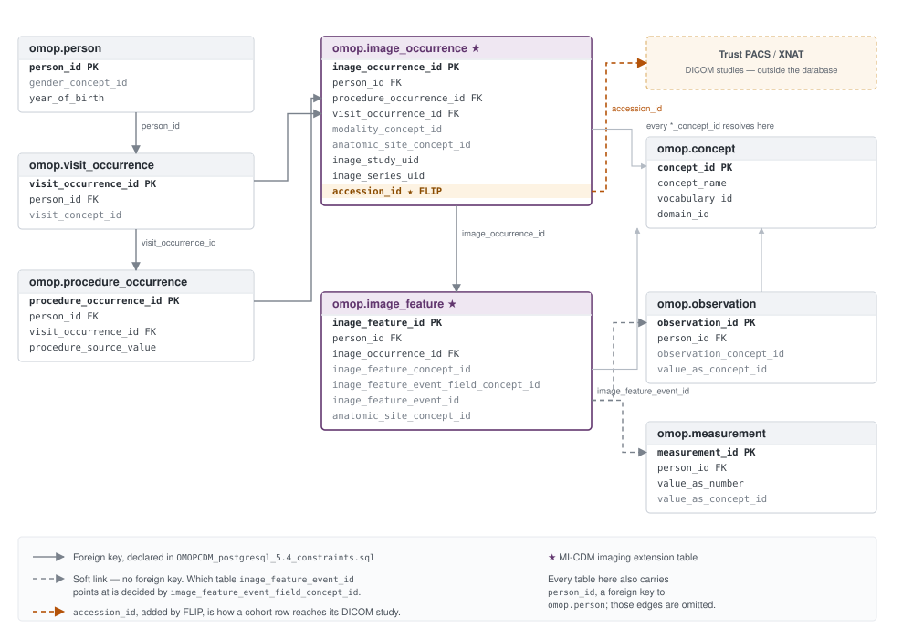

.. _flip-omop:

#############
OMOP Database
#############

FLIP needs every participating Trust to store its data in the same format, so that one query can be federated
across all sites to build a cohort. The platform shows aggregate statistics for the cohort; once a project is
approved, each site retrieves the underlying data for local model training.

The chosen format is the `OHDSI <https://www.ohdsi.org/>`_
`OMOP Common Data Model (CDM) <https://www.ohdsi.org/data-standardization/>`_, so the database in each Trust's
FLIP instance is usually called the *OMOP Database* or just *OMOP*. Trusts receive resources for preparing their
data for it during onboarding.

This page is for Trust data engineers mapping their data into OMOP, researchers writing cohort queries, and FLIP
developers running the mocked database.

.. contents:: On this page
   :local:
   :depth: 2

.. _omop-schema:

******
Schema
******

The database implements `OMOP CDM 5.4 <https://ohdsi.github.io/CommonDataModel/cdm54.html>`_ in the ``omop``
schema: all 39 standard tables, plus the two :ref:`MI-CDM imaging tables <omop-micdm>`. The DDL is the OHDSI
`CommonDataModel <https://github.com/OHDSI/CommonDataModel>`_ PostgreSQL DDL, extended in place.

Most of those 41 tables are unused by FLIP. The diagram shows the part a cohort query can draw on: clinical
context on the left, imaging metadata in the middle, values and vocabulary on the right.

      on, showing person, visit_occurrence and procedure_occurrence linked to the MI-CDM tables
      image_occurrence and image_feature, which reach observation and measurement through a soft
      link and resolve concept ids through the concept table; image_occurrence.accession_id points
      out of the database at the Trust PACS and XNAT.
   :align: center

   The FLIP-relevant subset of OMOP CDM 5.4. Purple tables are the MI-CDM imaging extension;
   ``accession_id`` is a FLIP addition to it.

.. _omop-micdm:

The MI-CDM imaging extension
============================

Standard OMOP has nowhere to record an imaging study. The
`Medical Imaging Common Data Model (MI-CDM) <https://www.ncbi.nlm.nih.gov/pmc/articles/PMC11031512/>`_ is the
OHDSI extension that adds one (it succeeds the earlier R-CDM radiology tables). FLIP implements it with two
tables.

**image_occurrence** holds one row per imaging study *or* per series. FLIP accepts either shape:

- **One row per series** is MI-CDM's reference shape. Each series of a study is its own row, and every row
  carries the study's accession number. The shipped prostate set uses this (three series per study).
- **One row per study** suits single-series data, such as the shipped spleen and chest X-ray sets.

The imaging pull imports each accession once, however many rows carry it. The training dataframe keeps every
row, so an app can pick the series it needs.

.. list-table::
   :widths: 34 22 44
   :header-rows: 1

   * - Column
     - Type
     - Meaning
   * - ``image_occurrence_id``
     - ``serial``
     - Primary key.
   * - ``person_id``
     - ``integer``
     - The patient. Foreign key to ``person``.
   * - ``procedure_occurrence_id``
     - ``integer``
     - The procedure that produced the images, e.g. the chest X-ray. Foreign key.
   * - ``visit_occurrence_id``
     - ``integer``
     - The encounter the imaging belongs to. Foreign key.
   * - ``anatomic_site_concept_id``
     - ``integer``
     - Body part imaged, as a concept id.
   * - ``modality_concept_id``
     - ``integer``
     - DICOM modality, as a concept id, e.g. ``4300757`` is *Computed tomography*.
   * - ``image_study_uid`` / ``image_series_uid``
     - ``varchar(64)``
     - DICOM Study and Series Instance UIDs.
   * - ``wadors_uri`` / ``local_path``
     - ``varchar(512)``
     - MI-CDM's own pointers to the pixel data. FLIP finds images through ``accession_id`` instead and does
       not read these at query time. The spleen tutorial's enrichment step does use ``local_path``, to recover
       each study's MSD case name.
   * - ``image_occurrence_date``
     - ``date``
     - Study date.
   * - ``accession_id``
     - ``varchar(255)``
     - **FLIP addition.** The PACS accession number for the study (DICOM Accession Number ``(0008,0050)``),
       the same value on every series row of that study. Never empty; see :ref:`omop-accession-id`.

**image_feature** holds findings derived from those images, one row per finding rather than per study:

.. list-table::
   :widths: 34 22 44
   :header-rows: 1

   * - Column
     - Type
     - Meaning
   * - ``image_feature_id``
     - ``serial``
     - Primary key.
   * - ``person_id`` / ``image_occurrence_id``
     - ``integer``
     - The patient and the study the finding came from. Foreign keys.
   * - ``image_feature_concept_id``
     - ``integer``
     - *Which* finding this row is about, e.g. ``4215818`` *Effusion*.
   * - ``image_feature_event_field_concept_id``
     - ``integer``
     - Which table holds the finding's **value**. ``1147304`` is the concept for ``observation``.
   * - ``image_feature_event_id``
     - ``integer``
     - The row id in that table. Not a foreign key; see below.
   * - ``image_feature_type_concept_id``
     - ``integer``
     - Provenance of the finding, e.g. read from a report versus produced by an algorithm.
   * - ``image_finding_concept_id``
     - ``integer``
     - The kind of finding the row belongs to, e.g. *nodule*, as a concept id.
   * - ``image_finding_id``
     - ``integer``
     - Groups the ``image_feature`` rows that describe one finding. Locally minted: there is no finding table
       for it to reference.
   * - ``anatomic_site_concept_id``
     - ``integer``
     - Body part the finding concerns.
   * - ``alg_system`` / ``alg_datetime``
     - ``varchar`` / ``timestamp``
     - The algorithm that produced the finding, and when, where applicable.

There is no ``image_study`` table; the study identifier is the ``image_study_uid`` column.

Three things matter when you write a cohort query:

``accession_id`` is how a cohort row reaches its images
   This column is not part of upstream MI-CDM; FLIP adds it. XNAT uses it to pull the study out of the Trust
   PACS, so **every cohort query that wants imaging must select it**. If a query omits it, the imaging step
   fails with an error rather than quietly producing a cohort with no images.

The link from ``image_feature`` to its value is a soft one
   ``image_feature`` does not hold the finding's value. ``image_feature_event_field_concept_id`` names the table
   that does (``observation`` in the tutorial queries, ``measurement`` for numeric values), and
   ``image_feature_event_id`` gives the row id in it. Nothing in the schema enforces or reveals the target, so
   your query must filter on the field concept itself (``= 1147304`` for ``observation``) before joining. The
   image tables' ``*_concept_id`` columns also have no foreign key to ``concept``.

Concept ids mean nothing until they are joined
   Every ``*_concept_id`` resolves through ``omop.concept``. The licensed core vocabulary that fills it is
   loaded by a separate step, not with the data. Until then a join on a SNOMED CT or LOINC id matches nothing,
   even though ``omop.concept`` already has rows (the DICOM vocabulary), so counting its rows proves nothing.
   See :ref:`omop-dev-instance`.

.. _omop-accession-id:

****************************************************
The ``accession_id`` contract for a trust's own OMOP
****************************************************

FLIP's mock databases get ``accession_id`` from the DICOM they are generated with. A Trust bringing its own
OMOP must provide it itself, because no standard DDL or ETL knows about the column.

#. **Add the column.** Run this once against the Trust's OMOP database, after the stock OHDSI 5.4 schema:

   .. code-block:: sql

      ALTER TABLE omop.image_occurrence ADD COLUMN IF NOT EXISTS accession_id varchar(255);

#. **Populate it from the PACS.** For every imaging row, set ``accession_id`` to the DICOM Accession Number
   ``(0008,0050)`` of that study *exactly as the PACS knows it*. XNAT finds the study with a study-level C-FIND
   on this value (see :doc:`component-pacs`), so a value the PACS does not recognise means the study is never
   pulled. With one row per series, every series row of a study carries the same value.

The value must follow these rules:

- **Exactly one study's number: never empty, never a pattern.** To a PACS, an empty C-FIND key matches every
  study, ``*`` and ``?`` are wildcards, and ``\`` separates a list of values. The imaging API therefore drops
  any such value before it reaches the PACS and logs a warning with the count in the Trust's imaging-api log.
  The researcher sees nothing: the row is simply a study that is never pulled. Rows without a study belong in
  the clinical tables, not in ``image_occurrence``.
- **Exact, including case.** A study is imported only when exactly one PACS study matches the value exactly. If
  the PACS matches loosely (Orthanc ignores case) and returns other studies, or holds two studies under one
  accession number, the row is skipped with a warning rather than guessed.
- **Pseudonymise both sides or neither.** If imaging is de-identified on its way into the PACS (in a TRE, for
  instance), OMOP must hold the accession number of the de-identified study, not the original.

.. seealso::

   The dataset converters under ``fl-tutorials/datasets/`` are a working reference: each copies the
   ``AccessionNumber`` of the DICOM it writes into ``accession_id``. Before a dataset is published, FLIP checks
   that the accession numbers in the DICOM and in ``image_occurrence`` are the same set, both ways.

.. _omop-sample-queries:

*********************
Sample cohort queries
*********************

Each tutorial in ``fl-tutorials/`` ships the cohort query it was written against. The three below cover the
range of what a query has to do, shown in full without the licence header. The Flower tutorials use identical
copies: cohort queries do not depend on the FL backend.

Chest X-ray classification — labels out of OMOP
===============================================

.. literalinclude:: ../../../fl-tutorials/nvflare/image_classification/xray_classification/query.sql
   :language: sql
   :start-after: -- limitations under the License.
   :caption: ``fl-tutorials/nvflare/image_classification/xray_classification/query.sql``

This is the general shape of a supervised imaging query:

#. ``feature_observation`` keeps only the ``image_feature`` rows whose value lives in ``observation``
   (``image_feature_event_field_concept_id = 1147304``), which makes ``image_feature_event_id`` safe to join on.
#. ``observation_value`` **pivots**. A study with three findings has three ``image_feature`` rows; the
   ``MAX(CASE WHEN image_feature_concept_id = ... THEN ... END)`` idiom turns them into one row per study with
   one column per finding. The findings here are ``4215818`` *Effusion*, ``4196943`` *Edema* and ``40481136``
   *Lungs in normal arrangement*. This CTE also joins ``omop.concept`` to decode each Yes/No answer, so it is
   the first thing an unseeded vocabulary breaks.
#. The outer ``SELECT`` joins ``omop.concept`` again to turn modality and anatomy ids into names, and aliases
   each pivoted column.

**The aliases must match the app.** ``flip.get_dataframe`` returns columns named exactly as the query outputs
them, and the tutorial matches them by exact string against the ``LESIONS`` map in its ``config.json``
(``"Effusion"``, ``"Edema"``, ``"Lungs in normal arrangement"``).

.. warning::

   Renaming a *lesion* column in the query but not in ``config.json`` makes training fail with a ``KeyError``
   on that lesion. Renaming the *normality* column fails silently: the negative override stops applying and
   every study keeps its per-lesion values.

3D spleen segmentation — labels not in OMOP
===========================================

.. literalinclude:: ../../../fl-tutorials/nvflare/image_segmentation/3d_spleen_segmentation/query.sql
   :language: sql
   :start-after: -- limitations under the License.
   :caption: ``fl-tutorials/nvflare/image_segmentation/3d_spleen_segmentation/query.sql``

Four lines, because there is nothing to pivot. A segmentation mask is a 3D volume and OMOP has no column for
one, so the query only names the studies (``modality_concept_id = 4300757`` is *Computed tomography*) and lets
``SELECT *`` carry ``accession_id`` through. The masks reach the model separately: they are uploaded into XNAT
alongside the converted images during :doc:`data enrichment </user-guides/user-data-enrichment>`.

This gives a simple test for a new app:

- If the label already exists in OMOP, select it as a column. No enrichment is needed.
- If it does not (anything spatial or image-derived), the query only selects the cohort and the labels are
  enriched into XNAT.

EHR risk prediction — no imaging at all
=======================================

.. literalinclude:: ../../../fl-tutorials/nvflare/tabular_classification/ehr_risk_prediction/query.sql
   :language: sql
   :start-after: -- limitations under the License.
   :caption: ``fl-tutorials/nvflare/tabular_classification/ehr_risk_prediction/query.sql``

This cohort has no images. The query never touches ``image_occurrence``: it builds one row per patient from
``person``, ``condition_occurrence`` and ``visit_occurrence``. The label is a later type-2-diabetes diagnosis;
the features are demographics plus the conditions and visits recorded *before* that diagnosis. The FL client
reads the result with ``flip.get_dataframe`` and calls no imaging helper.

Two consequences:

- Everything the model sees comes from this one query, so the window that keeps post-diagnosis history out of
  the features lives in the SQL, not the training code.
- The mocked OMOP database ships **no** ``condition_occurrence`` rows, so on a fresh dev Trust this query
  returns nothing until the Synthea cohort is loaded. See :ref:`omop-synthea-ehr`.

.. note::

   A cohort query must be a single ``SELECT``-shaped statement of at most 10 KiB, using only tables in the
   ``omop`` schema, with literal integer ``LIMIT``/``OFFSET`` values. The Trust's Data Access API enforces
   this: it parses the query, checks it and runs its own re-emitted copy. See :ref:`create-cohort-query` for
   the user workflow.

**************
Access control
**************

The Data Access API runs cohort queries as a **read-only database user** (``DATA_ACCESS_POSTGRES_USER``,
``data_analyst_reader`` by default). Its grants are:

- ``CONNECT`` on the database, ``USAGE`` on the ``omop`` schema, and ``SELECT`` on its tables and sequences;
- ``INSERT``, ``UPDATE``, ``DELETE``, ``TRUNCATE`` and ``CREATE`` explicitly revoked;
- at most five connections and a 300-second statement timeout.

This is the database half of the Data Access API's query validation. Compose and Kubernetes deployments apply
the same grants. Compose applies them when the database is first initialised; the Kubernetes chart re-applies
them on every pod start, so an upgrade also narrows a role created by an older chart.

.. note::

   On Kubernetes, the narrowing comes from the ``omop-db`` image. An image tag older than the fix leaves an
   existing role's wider access in place, and logs a warning saying so. The upgrade path is in the
   :gh:`chart README <trust/deploy/helm/README.md>`. The query validator's ``omop``-schema pin applies either way.

**Results are also gated on the Trust's disclosure threshold** (``COHORT_QUERY_THRESHOLD``, default 10), and a
project's cohort membership is fixed at approval. Both are described on :doc:`component-trust-apis`;
:doc:`/security` covers all the controls around the clinical data boundary.

.. _omop-dev-instance:

*******************************
Mocked instance for development
*******************************

Development and staging Trust stacks run a mocked OMOP database, the ``ghcr.io/londonaicentre/omop-db``
PostgreSQL image built from ``trust/omop-db/``. Its synthetic cohort data is a single canonical CSV dataset on
the public Hugging Face dataset `aicentreflip/trust-data <https://huggingface.co/datasets/aicentreflip/trust-data>`_,
split deterministically across however many mock Trusts you stand up.

Getting the data
================

The container starts with an empty schema. The Trust's slice of the mock projects is then seeded from the
published per-project tables:

- A data version is a git tag on the dataset, pinned in ``trust/.data_version`` (one pin for OMOP and Orthanc).
- The download is anonymous; no AWS credentials are needed.
- Bringing a Trust up seeds it automatically, and later starts reuse the seeded volume. A change to the pinned
  version re-seeds it.
- By default only the chest X-ray project is seeded this way. The spleen and brain MRI projects regenerate their
  DICOM locally, so they are seeded from ``fl-tutorials`` instead, for example with
  ``make -C fl-tutorials seed-spleen KIT=GSTT``. See the :gh:`datasets README <fl-tutorials/datasets/README.md>`.

To seed by hand:

.. code-block:: shell

   make -C trust ensure-seeded KIT=GSTT             # seed unless already seeded at this version
   make -C trust seed KIT=GSTT PROJECTS="…"         # load further published projects

Every row carries a ``source_trust`` column, and N Trusts are a deterministic split of the one dataset.

.. seealso::

   The :gh:`omop-db README <trust/omop-db/README.md>` for the partition modes.

.. _omop-synthea-ehr:

Condition rows for the EHR tutorial
===================================

The seeded data carries the imaging cohorts (persons, visits, ``image_occurrence``) but **no**
``condition_occurrence`` rows, so any query that filters on a diagnosis returns nothing on a fresh dev Trust.
The EHR risk-prediction tutorial adds them with a separate step. It downloads the public 1k-person
Synthea-in-OMOP dataset from the AWS Open Data Registry (anonymous) and appends this Trust's slice.

Run it once per Trust, with the stack up:

.. code-block:: shell

   make -C trust load-synthea-ehr TRUST_INDEX=1 OMOP_DB_PORT=5434   # Trust_1 (GSTT)
   make -C trust load-synthea-ehr TRUST_INDEX=2 OMOP_DB_PORT=5436   # Trust_2 (KCH)

- Each Trust gets a disjoint slice by ``person_id``, so the federated run sees genuinely partitioned cohorts.
- The loader is safe to re-run: it tags its rows in ``person_source_value`` and replaces only those, leaving the
  imaging cohorts untouched.

.. tip::

   A Trust on Kubernetes publishes no host port. Port-forward ``svc/omop-db``, pass the connection as ``make``
   variables, then restart its data-access-api. The recipe is in the
   :gh:`chart README <trust/deploy/helm/README.md>`, "OMOP core vocabulary".

Seeding the vocabulary
======================

The published image and trust data contain **no licensed vocabulary**. SNOMED CT, LOINC, Read v2 and dm+d are
licensed, so each environment loads the bundle it is licensed to use into its own running database, once:

.. code-block:: shell

   make -C trust/omop-db load-omop-vocab                    # Trust_1 (GSTT, port 5434)
   make -C trust/omop-db load-omop-vocab OMOP_DB_PORT=5436  # Trust_2 (KCH)

.. warning::

   Until this has run, **a cohort query that resolves core-vocabulary concepts returns nothing**, including the
   chest X-ray query above. The stack starts cleanly and the result looks like an empty cohort.

   To diagnose it, do not count ``omop.concept`` (it holds the DICOM vocabulary either way). The empty table is
   ``omop.concept_ancestor``. When a cohort comes back empty, the Data Access API checks it and logs an error
   naming this cause and the command to fix it. After loading, restart the Trust's data-access-api: it caches
   query results and would otherwise replay the empty answer.

   The spleen query still works on an unseeded stack: it filters on a concept id but never joins
   ``omop.concept``.

``load-omop-vocab`` needs the bundle unpacked in ``trust/omop-db/data/vocab_aicentre_core_20240916/``. Get it
first, in one of two ways:

- **AI Centre nodes** (FLIP developers with organisation AWS access):
  ``make -C trust/omop-db fetch-vocab-core VOCAB_S3_BUCKET=<bucket>``, naming a bucket your AWS profile can read
  (there is no default). ``load-omop-vocab`` runs this for you when given the same variable; it skips the
  download if the directory exists, and fails without the bucket and AWS access if it does not.
- **Every other site**: build an equivalent export from `OHDSI Athena <https://athena.ohdsi.org/>`_ under your
  own licences and unpack it into that directory, as :ref:`onprem-core-vocabulary` describes.

The DICOM vocabulary is freely redistributable and the trust-data seed already loads it, so it needs no step of
its own.

.. seealso::

   The :gh:`omop-db README <trust/omop-db/README.md>` for the full vocabulary roster, versions and licensing.
