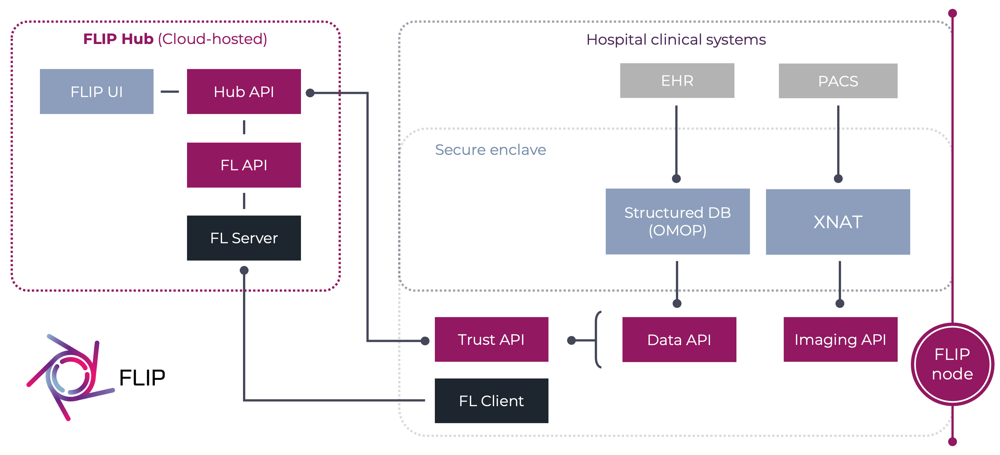

.. _components-overview:

########
Overview
########

This page maps FLIP's components: what runs on the Central Hub, what runs at each Trust, and how the two connect. It
is for engineers evaluating, deploying or operating FLIP. Each component has its own page with the detail.

************
Architecture
************

FLIP has two parts:

1. The **Central Hub**, a cloud-hosted web application. Researchers define projects there, query the Trusts' data
   for a suitable cohort, start training and download results. The hub also runs the federated learning (FL)
   servers that combine the Trusts' model updates into one consensus model.
2. A **FLIP node**, also called the *secure enclave*, at each Trust. It runs inside the Trust's network, next to
   the Trust's imaging archive, its :term:`OMOP` database and its GPUs. Training and evaluation happen there, on the
   Trust's own data, and **only model updates leave**.

   FLIP architecture.

**All connections are outbound from the Trust.** The hub never connects in to a Trust: ``trust-api`` polls the hub
for work over HTTPS, and each FL client opens its own connection to its FL server. A Trust needs no inbound firewall
rule for FLIP, and the hub is the only internet-facing part of the platform.

**********
Components
**********

.. list-table::
   :header-rows: 1
   :widths: 22 14 64

   * - Component
     - Runs on
     - What it does
   * - :doc:`component-central-hub`
     - Hub
     - The web UI (``flip-ui``), the central API (``flip-api``) and its PostgreSQL database, object storage for
       model files and results, and the identity provider users sign in with.
   * - :doc:`FL nets <component-fl-nets>`
     - Hub and Trust
     - Federated learning on :term:`NVIDIA FLARE` or :term:`Flower Framework`. Each net is an FL API and an FL
       server on the hub plus one FL client at each Trust. The hub's scheduler gives each queued training job to a
       free net.
   * - :doc:`Trust APIs <component-trust-apis>`
     - Trust
     - ``trust-api`` fetches tasks from the hub and reports results. ``imaging-api`` drives XNAT.
       ``data-access-api`` runs validated, read-only cohort queries against OMOP and serves cohort data to training.
   * - :doc:`OMOP database <component-omop-database>`
     - Trust
     - The Trust's clinical data in the `OMOP <https://www.ohdsi.org/data-standardization/>`_ Common Data Model,
       plus the MI-CDM imaging tables that link records to accession numbers. One cohort query runs unchanged at
       every Trust.
   * - :doc:`XNAT <component-xnat>`
     - Trust
     - Retrieves a project's studies from PACS, removes identifying fields from the image headers, converts them to
       NIfTI and stores them for training.
   * - :doc:`PACS <component-pacs>`
     - Trust
     - The Trust's own image archive. FLIP never holds a copy of it. In development, a mock Orthanc server stands
       in for it.
   * - :doc:`Logging stack <component-logging-stack>`
     - Trust
     - Collects the trust services' structured logs into Loki, for viewing in Grafana, without them leaving the
       Trust.

******************
Deployment targets
******************

The Central Hub runs on AWS, provisioned with Terraform/OpenTofu, either self-contained in one account or on a
Landing Zone Accelerator estate. See :ref:`deploy-central-hub`.

A FLIP node runs in one of three ways:

- as a Docker Compose stack on a host inside the Trust: :doc:`/deploy-flip/deploy-flip-node-on-prem`;
- inside a Trusted Research Environment: :doc:`/deploy-flip/deploy-flip-node-in-tre`;
- on Kubernetes, from the Helm chart: :ref:`deploy-flip-node-kubernetes`.

The mock Trusts used for staging run the same Compose stack on an EC2 instance.
