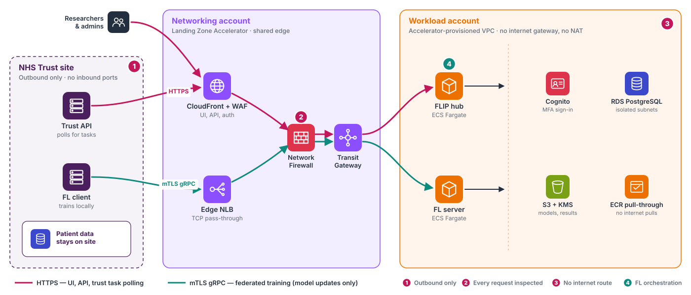

.. _deploy-central-hub-aws-lza:

####################################
Deploy the Central Hub on AWS (LZA)
####################################

The Central Hub deploys onto an AWS estate governed by the
`Landing Zone Accelerator <https://aws.amazon.com/solutions/implementations/landing-zone-accelerator-on-aws/>`_
(LZA). A platform team owns the network, the guardrails and a shared edge, and FLIP's workload account is not
allowed to create network resources (FLIP#749). It is the only shape the Terraform root supports: the
self-contained single-account mode was removed in FLIP#1479.

This page explains **the architecture, what the estate must provide, and how to bring a workload account up**.

.. seealso::

   :ref:`deploy-central-hub` — prerequisites, IAM permissions, registering trusts, deploys and rollback, schema
   changes and email setup.

.. contents:: On this page
   :local:
   :depth: 2

************
Architecture
************

         client connects over mutual-TLS gRPC. In the networking account, CloudFront with WAF and an edge NLB
         feed a Network Firewall and a Transit Gateway. In the workload account, with no internet gateway or NAT,
         the FLIP hub and FL server run on ECS Fargate next to Cognito, RDS PostgreSQL, S3 with KMS and an ECR
         pull-through cache.

   At a glance: three zones and two paths. Every request crosses the platform team's inspected edge, and the
   workload account has no internet route of its own. The generated diagrams below show every resource.

The diagrams are generated when this documentation is built, by a script kept next to the Terraform it depicts. A
test in that tree pins every drawn node to a resource in the ``.tf`` files, and every load-bearing resource to a
drawn node, so the diagrams cannot quietly fall out of step with the infrastructure. The networking account's edge
and the Transit Gateway belong to the platform team and are drawn from the handoff contract, not from FLIP's
Terraform. The security controls are on :ref:`security`.

.. figure:: ../assets/generated/central-hub-aws-lza-network.png
   :align: center
   :alt: Users and Trust nodes outside AWS; in the networking account an edge CloudFront with WAF, a web
         relay NLB, an internet-facing edge NLB, and a Network Firewall in front of a Transit Gateway; in
         the workload account the accelerator-provisioned VPC with app subnets holding one internal NLB,
         three Fargate services, Cloud Map, an SSM bastion and an optional mock Trust, a private hosted
         zone, the UI bucket, the SSM handoff parameters and an ECR pull-through cache reaching GHCR.

   Request and FL paths on an LZA estate.

**The front door is in the estate's networking account**, run by the platform team:

Web and API traffic (browsers and each Trust's ``trust-api``)
   HTTPS through a **CloudFront** distribution with a WAF. It serves the UI from FLIP's bucket and forwards
   ``/api/*`` through a relay load balancer in the networking account.

FL traffic (each Trust's FL client)
   An internet-facing **edge NLB**, on TCP port **8002 for production** and **8003 for staging** (the two share one
   listener set).

Both paths then cross the estate's **Transit Gateway** and central **Network Firewall** into the workload account.

**One internal NLB receives both.** The workload VPC has no internet gateway or NAT, so nothing in it can be
public. A single internal network load balancer, with a fixed IP address in each subnet (``.251``), forwards
``:443`` to ``flip-api`` and passes ``:8002`` (mutual-TLS gRPC) through untouched to the FL server. Because the
addresses never change, the edge registers them once. A private hosted zone resolves the FL server's name to the
same addresses inside the VPC.

**No internet egress.** Container images come from an in-account **ECR pull-through cache** that mirrors GHCR and
ECR Public, reached over the estate's central ECR endpoints. The platform team's interface endpoints serve Secrets
Manager, Cognito, SES, SSM and CloudWatch Logs. Operators still connect through Session Manager to the bastion;
port 22 is never open.

.. figure:: ../assets/generated/central-hub-aws-lza-data.png
   :align: center
   :alt: The three Fargate services with EFS and RDS Proxy in the app subnets and RDS PostgreSQL in the
         isolated data subnets of the accelerator-provisioned VPC; central interface endpoints in the
         networking account; five S3 buckets; and Cognito, KMS, CloudWatch Logs, SES, Parameter Store,
         Secrets Manager and an ACM certificate as regional services.

   Data and platform services on an LZA estate.

**Compute is ECS Fargate in the app subnets.** ``flip-api``, ``fl-api-net-1`` and ``fl-server-net-1`` run as Fargate
tasks with no public IPs, discovered by name through a Cloud Map private DNS namespace (``flip.local``).

**State lives in managed services.** ``flip-api`` reaches PostgreSQL through **RDS Proxy** with a short-lived IAM
token minted per connection: the application holds no database password, and rotating the master secret is not an
outage. The database sits in the accelerator's isolated **data subnets**, which have only local routes. The FL tasks
share **EFS** access points for their workspaces, certificates and job directories; the provisioning task copies each
net's participant kits there from the kits bucket. The **S3** buckets separate the model-file staging and scanned
prefixes, FL results, bundled apps and participant kits, all encrypted with the hub's KMS key. **Cognito** is the user
pool (with TOTP MFA); **Secrets Manager** holds the ``FLIP_API`` secret (AES key and internal service key);
**Parameter Store** carries the plain configuration tasks read at start-up; **SES** sends the application's own
emails. The interface endpoints are the estate's central ones, not resources in FLIP's account.

*****************************
What the root does not create
*****************************

.. list-table::
   :header-rows: 1
   :widths: 25 75

   * - FLIP's Terraform…
     - Resources
   * - **Does not create**
     - - The VPC, subnets, internet gateway, NAT gateways and DHCP options.
       - VPC endpoints (interface endpoints are central; S3 and DynamoDB gateway endpoints come from the platform).
       - CloudFront, its WAF and the public FL NLB. The estate's edge replaces them.
       - The internal ALB. The internal NLB fronts ``flip-api`` instead.
       - The security-group drift monitor. The organisation baseline covers it.
   * - **Discovers**
     - The accelerator-provisioned VPC and every ``app`` and ``data`` subnet, by Name tag (``LZA_VPC_NAME``).
       Subnets the platform team adds later appear on the next plan.
   * - **Creates**
     - ECS Fargate, RDS and RDS Proxy, EFS, Cloud Map, Cognito, S3 with the hub's KMS key, Secrets Manager,
       Parameter Store and SES.

Fronting ``flip-api`` with an NLB rather than an ALB has two consequences:

- **No path filtering at the load balancer.** It does not restrict traffic to ``/api`` or answer a default 404.
  CloudFront and the WAF are the only layer-7 gate, so the workload load balancer must stay reachable only from
  the edge.
- **Idle connections time out after 350 seconds**, not 60.

***********************************
What the platform team must provide
***********************************

*Who: the platform team operating the estate.*

.. important::

   Each FLIP environment needs its **own workload account**. Resource names and handoff parameters are fixed per
   account, so two environments cannot share one.

Before the first ``plan``, provide:

- **Network:** a VPC with ``app`` and ``data`` subnets across two availability zones, a Transit Gateway attachment
  spanning both, and a route from the app subnets to the Transit Gateway.
- **Endpoints**, reachable from the app subnets: central interface endpoints for ``ecr.api`` and ``ecr.dkr``,
  Secrets Manager, Cognito, SES, SSM and CloudWatch Logs; plus S3 and DynamoDB gateway endpoints.
- **Edge**, in the networking account: the CloudFront distribution with its relay, the edge NLB with a listener
  port for this environment, and firewall rules admitting the edge's address ranges to the workload load
  balancer's web and FL ports.
- **ECR pull-through cache rules:** ``ghcr/`` (backed by a read-only GHCR token in Secrets Manager) and
  ``ecr-public/``. See :ref:`deploy-central-hub-aws-lza-account`.
- **Terraform CI bootstrap:** the state bucket, the GitHub OIDC provider and the CI plan and apply roles, applied
  from FLIP's ``terraform_ci_bootstrap`` module pinned to a FLIP commit. FLIP's roles carry the accelerator's own
  permissions boundary, ``AICentre-WorkloadRoleBoundary``, which an SCP requires and the Makefile selects by
  default. The module configures the bucket (versioned, public access blocked, TLS only, encrypted).
- **Operator access:** an Identity Center permission set, with a matching ``prod`` or ``stag`` profile in
  the operator's ``~/.aws/config``.

This platform layer (Transit Gateway, central firewall, endpoints, NAT and edge) is a shared cost billed to the
platform team's accounts, not the workload account. :ref:`deploy-central-hub-costs` gives its rough size.

.. _deploy-central-hub-aws-lza-account:

****************************
Preparing a workload account
****************************

*Who: whoever administers the workload account, before its first* ``plan``.

1. **Create the GHCR credential secret first.** The account has no internet egress, so images come from in-account
   ECR mirrors. The ``ghcr/`` mirror authenticates to GHCR with a read-only GitHub token kept in the
   ``ecr-pullthroughcache/ghcr`` secret. Never echo the token; write it through a private temporary file. To copy
   the token from another account you administer:

   .. code-block:: shell

      TMP=$(mktemp) && chmod 600 "$TMP"
      aws secretsmanager get-secret-value --profile <source-profile> \
        --secret-id ecr-pullthroughcache/ghcr --query SecretString --output text > "$TMP"
      aws secretsmanager create-secret --profile <target-profile> \
        --name ecr-pullthroughcache/ghcr --secret-string "file://$TMP" --query ARN --output text
      shred -u "$TMP"

   Or mint a fresh read-only token for each account, for tighter isolation.

   .. important::

      Create this secret **before the first** ``plan``. On an account that has never held a secret, the plan
      computes cleanly and then fails with ``reading KMS Alias (alias/aws/secretsmanager): empty result``. AWS
      creates that key the first time the account uses Secrets Manager, so creating any secret fixes it.

2. **Create the two pull-through cache rules**, using the secret's ARN from step 1:

   .. code-block:: shell

      aws ecr create-pull-through-cache-rule --profile <target-profile> \
        --ecr-repository-prefix ghcr --upstream-registry-url ghcr.io --credential-arn <secret-arn>
      aws ecr create-pull-through-cache-rule --profile <target-profile> \
        --ecr-repository-prefix ecr-public --upstream-registry-url public.ecr.aws

   Nothing is pre-populated: the first pull of each image fetches it from upstream. Cached mutable tags can be up
   to about 24 hours stale, which is one reason deploys pin immutable ``sha-`` tags.

3. **Add the operator profile.** Run ``aws configure sso`` against the account's Identity Center permission set and
   rename the profile ``prod`` or ``stag`` (override with ``PROD_AWS_PROFILE`` / ``STAG_AWS_PROFILE``).

The Terraform state bucket comes from the platform's CI bootstrap; there is nothing to create for it here.

The environment file
====================

``.env.prod`` (or ``.env.stag``) carries the keys of the shipped example env file; start from it. These values are
specific to the estate:

.. code-block:: shell

   # Terraform backend and region
   FLIP_TFSTATE_BUCKET_NAME=<state bucket from the CI bootstrap>
   AWS_REGION=eu-west-2

   # Images come from the ghcr/ pull-through cache, never ghcr.io directly
   DOCKER_REGISTRY=<account-id>.dkr.ecr.<region>.amazonaws.com/ghcr/londonaicentre/
   EFS_PROVISION_IMAGE=<account-id>.dkr.ecr.<region>.amazonaws.com/ecr-public/aws-cli/aws-cli:<version>

   # Bucket names are global: give this account its own names
   FLIP_MODEL_FILES_UPLOADS_BUCKET_NAME=<name>
   FLIP_FL_RESULTS_BUCKET_NAME=<name>
   FLIP_APP_BUNDLES_BUCKET_NAME=<name>
   AICENTRE_BUCKET_NAME=<name>
   FLIP_UI_BUCKET_NAME=<name>
   ACCESS_LOGS_BUCKET_NAME=<name>

   # DNS: false until the account has a hosted zone (see below)
   MANAGE_DNS=false
   ALB_SUBDOMAIN=<ui name>
   NLB_SUBDOMAIN=<fl name>

   # From the networking account, passed straight to Terraform
   export TF_VAR_networking_ingress_cidrs=["<ingress-vpc-cidr>"]
   # Empty on the first apply; filled in once the edge exists (see the edge handoff)
   export TF_VAR_lza_web_edge_domain=
   export TF_VAR_lza_web_edge_distribution_arn=

   # Optional on HUB=prod, required on HUB=stag
   LZA_VPC_NAME=<Name tag of the accelerator VPC>

- ``ALB_SUBDOMAIN`` and ``NLB_SUBDOMAIN`` keep their final values even while ``MANAGE_DNS=false``; they are also
  used to name resources.
- **Staging only:** the edge serves staging FL traffic on port 8003, while the staging FL server still listens on
  8002. Keep ``FL_SERVER_PORT=8002`` and set ``FL_EDGE_PORT=8003`` in ``.env.stag``; ``sync-trust-kit`` copies
  it into each kit and refuses to run on ``HUB=stag`` without it. FLARE kits take the port from the staging
  provisioning file instead (``connect_to`` in ``fl-services/nvflare/provision/net-1_project_stag.yml``).
- Mint the secrets (``AES_KEY_BASE64``, the internal service key, ``ADMIN_USER_PASSWORD``) for the account. Do not
  reuse another account's Secrets Manager secret.

First bring-up without a hosted zone
====================================

With ``MANAGE_DNS=false``, Terraform skips the hosted-zone lookup, every Route 53 record and both DNS-validated
certificates, so the stack applies in an account with no zone yet. Until the zone exists:

- The UI is reached on the edge distribution's default ``*.cloudfront.net`` domain
  (``TF_VAR_lza_web_edge_domain``). Bucket CORS and the Cognito sign-in URLs follow it automatically.
- Build the UI with ``CENTRAL_HUB_API_URL`` pointing at that domain, and give trusts the same URL.
- The leg from the edge's relay to the workload's internal load balancer is plain TCP rather than TLS, because a
  certificate cannot be issued without DNS validation. Viewer traffic is still HTTPS at the edge, and that leg stays
  on the Transit Gateway and central-firewall path.

Once the zone lands, set ``MANAGE_DNS=true`` and apply again. Switching the web listener to TLS is a **two-sided
change**: the edge's origin in the networking account must switch to HTTPS, with a host name matching the new
certificate, at the same time.

Attaching the real domain
-------------------------

*Who: platform team, in the networking account.* CloudFront is never addressed by IP, so the domain is wired up in
DNS:

1. Create a public Route 53 hosted zone for the FLIP subdomain in the networking account.
2. Issue a DNS-validated ACM certificate for the names **in us-east-1** (a CloudFront requirement) and attach it to
   the edge distribution as its alternate domain names.
3. Add an alias record from the UI name to the distribution (an alias, never an IP address), and the same for the FL
   name to the edge NLB.
4. Delegate the subdomain from the parent domain to the zone's name servers.

**********************
Two-phase edge handoff
**********************

The edge is built from the workload stack's outputs, so the two are always applied in this order:

1. **Apply the workload stack.** *Who: FLIP admin (or CI).*

   The first ``apply`` publishes the handoff parameters under ``/flip/networking/*``: the internal NLB's fixed IP
   addresses, the web and FL ports, and its DNS name. Leave ``TF_VAR_lza_web_edge_domain`` and
   ``TF_VAR_lza_web_edge_distribution_arn`` empty. Until they are set, the UI bucket grants no one access and the UI
   origin is a placeholder.

2. **Apply the edge.** *Who: platform team.*

   The edge stack in the networking account reads the handoff parameters.

3. **Point the workload stack at the edge.** *Who: FLIP admin (or CI).*

   Set the two variables to the edge distribution's domain and ARN in the env file, then apply again. This grants
   the edge read access to the UI bucket and points bucket CORS and the Cognito callback URLs at the edge.

Later changes to the workload load balancer follow the same order, networking stack first.

*********
Deploying
*********

**CI applies this estate**, authenticated by GitHub OIDC with no long-lived AWS keys:

- every pull request into ``main`` or ``develop`` that touches ``deploy/providers/AWS/**`` plans LZA staging;
- a push to ``develop`` applies LZA staging;
- a merge to ``main`` applies **LZA production**;
- a nightly plan reports drift.

To point a GitHub environment at another account, change its values (the ``TF_HUB`` variable and the two role ARNs);
see "Repointing CI at the LZA accounts" in :gh:`deploy/providers/AWS/README.md`.

.. list-table::
   :header-rows: 1
   :widths: 20 40 40

   * - Setting
     - ``HUB=prod``
     - ``HUB=stag``
   * - Env file
     - ``.env.prod``
     - ``.env.stag``
   * - Semantics
     - Production (RDS deletion protection and final snapshot on)
     - Staging
   * - Deploys from
     - ``origin/main``
     - ``origin/develop``
   * - Trust kit files
     - ``trust/.env.<CODE>.prod``
     - ``trust/.env.<CODE>.stag``

Break-glass deploy from a laptop
================================

*Who: FLIP admin, only when CI is unavailable, or for the one-off account bootstrap before the first CI plan.*

.. code-block:: shell

   cd deploy/providers/AWS
   export AWS_PROFILE=stag   # or: prod
   export HUB=stag               # or: prod

   make init
   make plan
   make apply
   make deploy-centralhub
   make deploy-ui

The Makefile refuses to run when ``AWS_PROFILE`` does not match ``HUB``, and needs that estate's env file locally.

.. warning::

   On an account CI applies, the next pipeline run reverts a laptop ``apply``, and the nightly drift check reports
   it until then. Apply from a laptop only when:

   - **CI is broken**, for example its role. The CI roles belong to the platform repositories, so a bad apply here
     cannot lock CI out; a broken role is fixed there.
   - **The change must not go through CI**, such as a one-off targeted apply during account bring-up.

.. note::

   A laptop ``plan`` reads the EC2 key pair's public key from ``~/.ssh/host-aws.pub``. If yours is not this
   account's key, the plan replaces the key pair and, with it, the bastion. CI uses the copy in Parameter Store
   instead; to plan with it locally:

   .. code-block:: shell

      mkdir -p /tmp/lzakey
      aws ssm get-parameter --name /flip/ci/host_aws_public_key --profile <profile> \
        --query Parameter.Value --output text > /tmp/lzakey/host-aws.pub
      LOCK=false make plan TF_VAR_flip_keypair=/tmp/lzakey/host-aws TF_VAR_ec2_public_key_path=/tmp/lzakey/host-aws.pub

.. note::

   - ``full-deploy`` and ``full-deploy-hub-only``, along with ``make status`` and ``make destroy``, are not yet
     exercised on an LZA estate.
   - ``deploy-ui`` does not invalidate a CloudFront cache, because the edge distribution is in another account.
     Instead ``index.html`` is served uncached and the hashed assets as immutable.

***************
Further reading
***************

- :gh:`deploy/providers/AWS/README.md` — maintainer notes: how the stack is built, the Terraform CI pipeline and
  the design rationale.
- :ref:`security` — the "Cloud infrastructure" controls, including the estate-level ones the accelerator adds.
- The AI Centre's estate configuration (``londonaicentre/lza``) and its edge stack
  (``londonaicentre/aicentre-lza-iac``) are private repositories.
