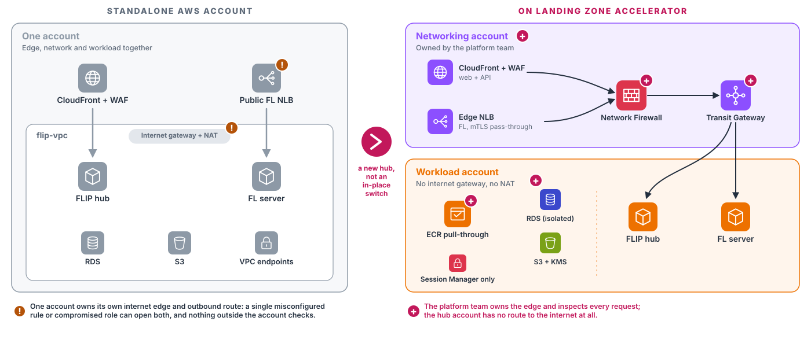

.. _deploy-central-hub:

########################
Deploy the Central Hub
########################

The Central Hub is the cloud-hosted side of FLIP. It manages projects and users, runs the federated learning server
and serves the web UI. It runs on AWS and is provisioned with Terraform (or OpenTofu) from one root module,
``deploy/providers/AWS/``.

This page covers what every hub deployment shares; :doc:`deploy-central-hub-aws-lza` has the architecture and the
runbook. To deploy a trust, see :doc:`deploy-trust-node`.

.. contents:: On this page
   :local:
   :depth: 1

****************
Deployment shape
****************

The hub deploys onto an AWS estate governed by the `Landing Zone Accelerator
<https://aws.amazon.com/solutions/implementations/landing-zone-accelerator-on-aws/>`_, where a platform team owns the
network, the guardrails and a shared edge, and workload accounts are denied VPC-layer creation. FLIP uses the network
it is given instead of building one, and ingress arrives through the estate's own edge over a Transit Gateway, so you
must coordinate with whoever runs the estate. See :doc:`deploy-central-hub-aws-lza`.

The self-contained single-account mode, in which FLIP built its own VPC and in-account edge, is no longer supported
and has been removed (`FLIP#1479 <https://github.com/londonaicentre/FLIP/issues/1479>`_). To move a hub off it,
see :ref:`deploy-central-hub-migrating`.

.. toctree::
   :maxdepth: 1

   deploy-central-hub-aws-lza

.. _deploy-central-hub-costs:

*************
Running costs
*************

These are rough figures for the **Central Hub only** (one hub, one FL net). They were measured from the AI Centre's
own bills in September 2026, in ``eu-west-2``, in US dollars before VAT, at on-demand prices. For a budget, use what
Cost Explorer reports for your account.

.. list-table::
   :header-rows: 1
   :widths: 50 14 36

   * - What bills to the workload account
     - Roughly
     - Notes
   * - ECS Fargate (three tasks), RDS and RDS Proxy, EFS, the internal NLB, CloudWatch, GuardDuty and Security Hub;
       the NAT gateway, endpoints, CloudFront and WAF are the estate's
     - $400 a month
     - Plus a share of the **platform layer**: Transit Gateway attachments, the central
       Network Firewall, central endpoints and NAT, and the shared edge. For the AI
       Centre's estate that layer is of the order of $800 a month in total. It exists
       whether or not FLIP is deployed, so attribute all of it to FLIP only when FLIP is
       the estate's sole workload.

The platform layer's charges land on the platform team's accounts rather than the workload's, so agree with them how
that cost is recharged. Staging costs about the same as production: nothing in the hub scales with the number of
users.

.. note::

   **Trust hosts are not included.** A trust's cost depends on its GPU instance and how long that instance is busy,
   which depends on the projects it joins. The mock trust EC2 Terraform can provision (a ``t3.xlarge`` with no
   GPU) is a test fixture, not a sizing recommendation. For always-on versus on-demand GPUs, see *GPU Resource
   Management* in :doc:`deploy-flip-node-in-tre`.

*************
Prerequisites
*************

1. **AWS CLI with SSO access.** Configure it once with ``aws configure sso``, then sign in with
   ``aws sso login --profile <profile>`` whenever the session expires.
2. **Terraform >= 1.13.1** (or OpenTofu).
3. **Python 3.12 or 3.13** with `UV <https://docs.astral.sh/uv/guides/install-python/>`_.
4. **GitHub CLI** (``gh``), and a **GitHub Container Registry login** to pull the pre-built images. Create a GitHub
   personal access token with the ``read:packages`` scope, then:

   .. code-block:: shell

      echo <GITHUB_PAT> | docker login ghcr.io -u <GITHUB_USERNAME> --password-stdin

5. **An environment file** in the project root for your environment (see the table below).
6. **AWS profiles** in ``~/.aws/config`` named after each environment (see the table below). The Makefile refuses to
   run if the active profile does not match the chosen environment. Use short aliases that point at your SSO
   accounts, one block per environment:

   .. code-block:: ini

      [profile lza-stag]
      sso_session = <sso-session>
      sso_account_id = <staging-account-id>
      sso_role_name = <sso-role-name>
      region = <aws-region>
      output = json

   If your profile names differ, set ``STAG_AWS_PROFILE`` or ``PROD_AWS_PROFILE`` to them, in the env file or on the
   ``make`` command line.
7. For the hub's SSM bastion and the optional mock trust EC2:

   - an **SSH key pair** at ``~/.ssh/host-aws``. Terraform uploads the public key as the EC2 key pair, and you use
     it for SSH over SSM:

     .. code-block:: shell

        ssh-keygen -t ed25519 -f ~/.ssh/host-aws -C "<your email>"

   - the **AWS Session Manager plugin**, needed for ``ssh flip`` and ``make forward-trust``. See
     "Remote Access via SSM Session Manager" in :gh:`deploy/providers/AWS/README.md`.

**Choose the hub with** ``HUB``, which every target in ``deploy/providers/AWS`` requires:

.. list-table::
   :header-rows: 1
   :widths: 18 30 26 26

   * - ``HUB``
     - Environment file
     - AWS profile
     - Treated as
   * - ``stag``
     - ``.env.stag``
     - ``lza-stag``
     - staging
   * - ``prod``
     - ``.env.prod``
     - ``lza-prod``
     - production

Production gets the production-only database safeguards (RDS deletion protection and a final snapshot).

************************
Required IAM permissions
************************

The operator role that provisions the infrastructure needs these managed policies, or custom permissions covering
the same ground:

.. list-table::
   :header-rows: 1
   :widths: 22 46 32

   * - Service
     - Needed for
     - Managed policy
   * - EC2
     - Instances, security groups and key pairs, and reads of the platform's VPC and subnets
     - ``AmazonEC2FullAccess``
   * - ECS and Fargate
     - The cluster, task definitions and services. Task images come through the account's ECR pull-through cache
     - ``AmazonECS_FullAccess``
   * - RDS
     - The database, its subnet group and parameter group
     - ``AmazonRDSFullAccess``
   * - EFS
     - The shared FL workspace volumes
     - ``AmazonElasticFileSystemFullAccess``
   * - CloudWatch Logs
     - ECS task logs
     - ``CloudWatchLogsFullAccess``
   * - Secrets Manager
     - Database credentials and API secrets
     - ``SecretsManagerReadWrite``
   * - IAM
     - Roles for the EC2 hosts and the ECS tasks
     - ``IAMFullAccess``
   * - Load balancing
     - The internal network load balancer, carrying both the ``/api/*`` web leg and FL traffic
     - ``ElasticLoadBalancingFullAccess``
   * - CloudFront
     - The origin access control, function and policies this stack declares (the distribution and its WAF are the
       networking account's)
     - ``CloudFrontFullAccess``
   * - Certificate Manager
     - The ``eu-west-2`` certificate for the internal load balancer's web listener, once ``MANAGE_DNS=true``
     - ``AWSCertificateManagerFullAccess``
   * - Route 53
     - The private hosted zone for the FL server's name, and the certificate's validation records once
       ``MANAGE_DNS=true``
     - ``AmazonRoute53FullAccess``
   * - Cloud Map
     - The private DNS namespace the ECS tasks use to find each other
     - ``AWSCloudMapFullAccess``
   * - Systems Manager
     - AMI lookups and the Parameter Store entries the ECS tasks read
     - ``AmazonSSMFullAccess``
   * - SES (optional)
     - Email templates
     - ``AmazonSESFullAccess``

The deployed hosts and services do not get these broad permissions; each runs with a scoped role:

- **Central Hub bastion:** Session Manager access only. It cannot read FLIP secrets or buckets.
- **Cloud trust EC2:** Session Manager and CloudWatch, plus read-only access to the bucket holding the FL participant
  kits. No access to Cognito, SES, Secrets Manager or the FLIP application buckets.
- **ECS tasks:** each service has its own task role with the application permissions it needs.

The workload account's Identity Center permission set replaces this list, bounded by the estate's service control
policies. Creating network resources is denied there by design.

***********************
Service authentication
***********************

The hub uses three separate keys. See :doc:`/sys-admin` for full details.

.. list-table::
   :header-rows: 1
   :widths: 22 40 38

   * - Key
     - What it protects
     - How it is created
   * - **Trust API key**
     - Each trust's calls to the hub. One key per trust.
     - Minted when you register the trust and written once into its kit file
       (``trust/.env.<CODE>.<hub>``). The hub keeps only a hash.
   * - **Internal service key**
     - Calls from the FL server to the hub API. One key per hub.
     - ``make generate-internal-service-key``
   * - **Trust-internal service key**
     - Calls between services inside one trust. One key per trust; the hub never sees it.
     - Minted alongside the trust API key and written into the trust's kit file.

Generate the internal service key into the active environment file. Existing keys are kept:

.. code-block:: shell

   make generate-internal-service-key

The two per-trust keys are minted when you register the trust; see :ref:`deploy-central-hub-register-trusts`.

.. _deploy-central-hub-register-trusts:

******************
Registering trusts
******************

*Who: FLIP admin, with AWS access to the hub's account.* The hub must already be deployed: registration runs as a
one-off task inside it.

A trust's **kit file**, ``trust/.env.<CODE>.<hub>``, is its identity and its configuration: ``HUB=prod`` reads
``trust/.env.<CODE>.prod``, ``HUB=stag`` ``trust/.env.<CODE>.stag``.

1. **Create the kit file.** From the repository root:

   .. code-block:: shell

      make new-trust TRUST_CODE=<CODE> TRUST_NAME="<trust name>" HUB=<hub>

   The trust's name, code and region are read from this file, never from environment variables.

2. **Register the trust on the hub.**

   .. code-block:: shell

      make -C deploy/providers/AWS register-trusts KIT=<CODE> HUB=<hub>

   Leave out ``KIT`` to register every kit file present for the environment. This writes the trust's
   **credentials** (API key, trust-internal service key and FL kit slot) into the kit file. Of the hub-shared
   settings, only the API key header name and the FL backend are filled in.

3. **Fill in the hub-shared settings.** From the repository root, with your local ``.env.<hub>`` present:

   .. code-block:: shell

      make sync-trust-kit KIT=<CODE> HUB=<hub>

   ``make sync-trust-kits`` does the same for every local kit file.

   .. important::

      Do not skip this step. Without it the kit's encryption key, hub URL, kit dates and image tags stay unfilled,
      and the trust can neither reach the hub nor decrypt a task.

4. **Mint the XNAT passwords.** These are trust-side runtime secrets and are not part of the hub's kit:

   .. code-block:: shell

      make generate-xnat-credentials KIT=<CODE> HUB=<hub>

Registration works the same for both FL backends: the kit takes ``FL_BACKEND`` from the hub, and the slot it claims
maps onto the matching FLARE participant kit or Flower SuperNode key.

**Registration is idempotent.** Running it again for a trust that is already registered issues no new credentials,
because the hub keeps only hashes of them; it logs *already registered* and refreshes the hub-shared settings.
Credentials are written into the kit file on first registration only, and any host-specific edits you made to the
file are kept.

**Getting the kit to the trust host** is a separate, explicit step; nothing copies the kit file anywhere.

- For the cloud trust EC2, ``make -C deploy/providers/AWS deploy-trust KIT=<CODE> HUB=<hub>`` reads the kit
  locally and passes its values to the containers on the host.
- For an on-prem trust, see step 4 of :doc:`onboarding-a-trust`. The packaging is keyed on the slot, not the code:
  pass ``KIT=<slot>`` (for example ``Trust_2``) and the kit above by path; it refuses to run unless the kit's
  ``FL_KIT_SLOT`` equals ``KIT``, and ships it as ``.env.<slot>.<hub>``:

  .. code-block:: shell

     make -C deploy/providers/AWS package-onprem-trust-kit KIT=<slot> KIT_FILE=$PWD/trust/.env.<CODE>.<hub> HUB=<hub>

If registration fails
=====================

- **The error is printed for you.** The command collects the ``ERROR`` and ``WARNING`` lines from the task's log
  and prints them before cleaning up. That is where the remedy is, for example that the FL kit slots have run out.
- **A run over several kits tries every kit** and exits non-zero if any failed, so one bad kit never blocks the
  rest and a partial failure never looks like success.
- **"No trust/.env.*.<hub> kits found"** means no kit file exists for this environment (``.example`` templates
  do not count). Run ``make new-trust`` first. This is only a warning, so a ``full-deploy`` carries on past it.

.. _deploy-central-hub-kit-slots:

Running out of FL kit slots
===========================

Registration fails with ``NoFreeKitSlotError`` ("No FL kit slots available…") when the hub has no claimable FL kit
slot left. One command adds more (FLARE only):

.. code-block:: shell

   make -C deploy/providers/AWS add-fl-kits N=2 HUB=<stag|prod>

``N`` is the number of **extra claimable slots** you want, not the number of kits to create. The command first
activates spare kits that were provisioned earlier but never made claimable, which is quick and needs no
certificates. It mints new kits only for the shortfall: that restores and verifies each net's CA workspace and needs
the FLARE provisioning tools. Existing kits are never touched and no CA is rotated.

It ends with a targeted Terraform plan and apply of the slot list, and pauses for you to confirm both the kit plan
and the Terraform plan (``YES=1`` skips the prompts). Read the plan before you confirm. The hub picks up the new
slots without a restart, so the next ``register-trusts`` can claim one.

.. warning::

   If the final apply fails, recover with ``make -C deploy/providers/AWS apply-fl-kit-slots HUB=<hub>``. Do not
   re-run ``add-fl-kits``: the slot names are already in your env file, and a second run would add another ``N``.

.. seealso::

   :gh:`fl-services/nvflare/README.md` — minting kits by hand, and onboarding a new client onto an existing network.

.. _deploy-central-hub-deploys:

**********************************
Deploying and rolling back the hub
**********************************

*Who: FLIP admin.* This redeploys the hub's three services (``flip-api``, ``fl-api-net-1``, ``fl-server-net-1``)
and publishes the UI. Every deploy pins an immutable image tag.

1. **Pause FL activity.** Replacing the FL server kills any training run in progress and leaves its model stuck at
   ``TRAINING_STARTED``. Enable Deployment Mode (*Admin → Deployments*): queued jobs hold, and only a running job
   needs to finish. Wait until ``GET /fl/quiesce`` reports ``deployment_mode: true`` and ``fl_quiesced: true``.

2. **Deploy.** From a clean checkout of the branch you are deploying:

   .. code-block:: shell

      make -C deploy/providers/AWS deploy-centralhub HUB=<hub>

   This deploys the build of the tip of ``origin/main`` (``HUB=prod``) or ``origin/develop`` (``HUB=stag``), tagged
   ``sha-<short7>``. It checks that every service has an image at that tag **before** changing anything, so a
   missing image deploys nothing. With ``HUB=prod`` it asks you to confirm first. It finishes by building the UI from your working tree and publishing
   it.

3. **Resume.** Disable Deployment Mode.

To deploy a specific build, pass ``TAG=sha-<short7>`` or a release tag, ``TAG=v<X.Y.Z>``. To deploy a feature
branch, first build its images with ``gh workflow run <workflow>.yml --ref <branch>``, wait for the run to pass,
then deploy its ``sha-`` tag.

**If the deploy stops on a missing image**, the build for that commit has not been published. The image builds only
run for the services a merge touched, and the ``flip-api`` build waits for its tests, so right after a merge an image
may be missing or still building. The message names the workflow: run it with ``gh workflow run`` as above, then
deploy again. If the message reports a registry error rather than a missing image (an outage, or an authentication
failure), do not trigger rebuilds. With the account's ECR pull-through cache as the registry, the check is skipped.

Rolling back
============

.. code-block:: shell

   make -C deploy/providers/AWS rollback-centralhub HUB=<hub>

This points each service back at its previous revision in seconds, with no rebuild, and retires the revision it
rolled away from so a later Terraform apply cannot bring it back.

- **The UI does not move.** Re-run ``make -C deploy/providers/AWS deploy-ui HUB=<hub>`` from the matching commit if
  it must.
- **On a FLARE hub** it first resets the FL server's local state on EFS and re-syncs the kit, which takes a
  minute or two. If that step fails, nothing is rolled back. ``SKIP_FL_LOCAL_RESET=1`` skips it.

.. warning::

   Do not roll back after a **partial** deploy (some services moved before a failure). A rollback moves every
   service down one revision, including the ones the failed deploy never touched. Publish the missing build and
   deploy again instead.

.. note::

   **Laptop Terraform applies and deploys interact.** Terraform owns the task-definition skeleton, but a routine
   apply leaves the deployed image in place. Two exceptions:

   - If an apply registers a new task definition, it goes live with the bootstrap image tags from the env file
     (``DOCKER_TAG``, ``DOCKER_FL_TAG``). Run ``deploy-centralhub`` again afterwards.
   - ``make apply`` applies the saved plan. A plan made **before** a ``deploy-centralhub`` rolls the image back, so
     run ``make plan`` again after every deploy.

**********************************************
Upgrading across the payload-encryption change
**********************************************

Task payloads between the hub and its trusts are encrypted with AES-256-GCM. Releases before this change used
AES-CBC, and the two formats are **not compatible**. A hub and every trust registered to it must upgrade together, in
one maintenance window.

*Who: FLIP admin (hub) and every trust operator*

1. **Pause FL activity.** In the UI, enable Deployment Mode (*Admin → Deployments*). Wait until ``GET /fl/quiesce``
   reports ``deployment_mode: true`` and ``fl_quiesced: true``.
2. **Redeploy the hub and every trust** in the same window: ``deploy-centralhub`` for the hub (see
   :ref:`deploy-central-hub-deploys`), and the upgrade command for each trust's platform (``upgrade-onprem-trust``,
   ``upgrade-trust-k8s`` or ``upgrade-trust-ec2``; see :ref:`admin-upgrading-sites`). Do not use ``deploy-trust``
   here: it is a first-install command that re-seeds the trust's data and resets XNAT.
3. **Resume.** Disable Deployment Mode.

.. warning::

   Anything still encrypted in the old format when you upgrade fails afterwards. Step 1 prevents this. If it happens:

   - A task a trust collected before it upgraded stays ``IN_PROGRESS``. Reset it to ``PENDING``.
   - A running FL job fails at the trust's imaging service once that trust upgrades.

.. important::

   ``AES_KEY_BASE64`` must be identical on the hub and on every trust, and decode to exactly 32 bytes. On staging and
   production, the hub's value is the one CI wrote into Secrets Manager, which may differ from your checked-out
   ``.env.<hub>``. Recover the deployed value with ``deploy/providers/AWS/scripts/reconcile_ci_env.py`` before you
   create or refresh trust kits.

   A mismatched key fails closed: the trust reports every task as ``Invalid payload: failed authentication``, and
   the trust's imaging and data-access services answer the FL client with a 400. A 500 from either is a different
   fault (the key could not be loaded, for example), not a mismatch.

***********************
Applying schema changes
***********************

Database migrations apply **automatically**. Every time a ``flip-api`` container starts, it brings the hub database
up to date before serving traffic. If a migration fails, the container refuses to start rather than run against a
schema it does not expect.

- **Development**: ``make restart`` recreates the ``flip-api`` container (``deploy-flip-api-1``), which migrates on
  boot.
- **Staging and production**: a normal redeploy, ``make deploy-centralhub`` from
  ``deploy/providers/AWS/``, migrates before the new task serves traffic.

Migrations alter the existing tables in place, so your data is preserved. There is **no** drop-and-recreate step for
the hub database in routine operation.

.. note::

   For developers: every change to the hub's database models must ship an Alembic revision in the same PR, and CI
   fails otherwise. How to author and review one is in :gh:`flip-api/README.md`.

**********************************
FL image compatibility on upgrade
**********************************

The hub now **requires** FL clients to identify themselves when they report training metrics and logs. FL images built
before this change do not, so the hub and the FL images (``flare-fl-base`` for FLARE, ``flower-fl-base`` for Flower)
must be upgraded together.

.. warning::

   With an old FL image, training appears to complete but the metrics chart and logs stay empty: the hub rejects the
   reports and the client ignores the rejection. Deploy the hub and bump the trust-side FL image tag in the same
   maintenance window, and do not run training in between.

The same release of the ``flip-utils`` package adds the trust-internal service key to the ``flip`` client calls (see
:ref:`trust-internal-service-authentication`).

************
Email setup
************

FLIP sends its own emails through Amazon SES. Before the first deploy:

1. **Verify the sender identity.** Terraform creates the SES identity; click the link in the verification email sent
   to that address.
2. **Check the status.** The identity should show **Verified** in the SES console.

If SES is still in its sandbox, request production access from the SES console. Until then you can only send to
verified addresses.

**If the verification link has expired**, delete the FLIP identity in the SES console (*Configuration → Identities*),
then run ``make -C deploy/providers/AWS plan apply HUB=<hub>`` to create it again and send a new link.

**To check email works end to end**, register a new user in FLIP. The invitation email with the temporary password
comes from Cognito, so this tests the invitation templates in a real mail client.

.. note::

   SES carries only the emails FLIP itself sends: access-request notifications and XNAT credential emails.
   **Cognito sends user invitations and password-reset codes itself**, not through SES. So a broken or sandboxed SES
   identity does not stop invitations or password resets, and fixing SES does not fix them. Cognito's built-in sender
   has its own delivery limits.

.. note::

   Development uses neither service. Emails are written to the ``flip-api`` log instead of being sent, and a local
   Keycloak replaces Cognito for sign-in. The dev Keycloak has no mail server, so a new user gets the shared dev
   password (``ADMIN_USER_PASSWORD``) as a temporary password instead of an invitation. See :doc:`deploy-local-dev`.

.. _deploy-central-hub-mfa-recovery:

*******************************************
Recovering an administrator's lost MFA
*******************************************

Every hub user must sign in with a TOTP authenticator. To reset another user's MFA, use *Reset MFA* in the Admin
area (see :doc:`/sys-admin/admin-project-and-user-management`). That needs a signed-in session, so an administrator
who has lost their **own** authenticator cannot use it.

*Who: another operator with AWS credentials for the hub's account, and permission for*
``cognito-idp:AdminSetUserMFAPreference`` *and* ``cognito-idp:AdminUserGlobalSignOut``.

1. **Find the user pool ID.** It is ``AWS_COGNITO_USER_POOL_ID`` in the environment file (written by
   ``make update-env``), or:

   .. code-block:: shell

      cd deploy/providers/AWS
      USER_POOL_ID=$(terraform output -raw CognitoUserPoolId)

2. **Clear the administrator's TOTP setting.**

   .. code-block:: shell

      aws cognito-idp admin-set-user-mfa-preference \
        --user-pool-id "$USER_POOL_ID" \
        --username <admin email> \
        --software-token-mfa-settings Enabled=false,PreferredMfa=false

3. **Sign out every existing session**, so no session from before the reset keeps working.

   .. code-block:: shell

      aws cognito-idp admin-user-global-sign-out \
        --user-pool-id "$USER_POOL_ID" \
        --username <admin email>

4. **The administrator signs in with their existing password.** FLIP sends them to the MFA enrolment page to
   register a new authenticator. Their password does not change.

.. warning::

   These commands have the same effect as *Reset MFA* in the Admin area, but they bypass FLIP, so the reset is
   **not recorded in FLIP's logs**. Use them only for an administrator locked out of FLIP; for anyone else, use the
   Admin area.

On a local development stack, sign-in uses Keycloak instead: clear the user's OTP credential in the Keycloak admin
console (``http://localhost:8180/admin``).

.. _deploy-central-hub-migrating:

*************************************************
Migrating from a single-account deployment
*************************************************

Before FLIP#1479 the hub could also run self-contained, in one AWS account that built its own VPC, internet gateway,
NAT, CloudFront and WAF, and a public FL load balancer. On the Landing Zone Accelerator the FLIP stack is the same, but
the platform team owns the edge and the network, and the hub's workload account has no internet route.

         internet gateway and NAT around the FLIP hub, FL server, RDS, S3 and VPC endpoints. Right, on the Landing
         Zone Accelerator: a networking account owned by the platform team with CloudFront and WAF, an edge NLB,
         a Network Firewall and a Transit Gateway, and a workload account with no internet gateway or NAT holding
         the FLIP hub, FL server, ECR pull-through cache, isolated RDS, S3 with KMS and Session Manager access.

   Before, one account owned its own edge and outbound route. After, the platform team owns and inspects the edge,
   and the hub account has no internet route.

There is no in-place migration. The Terraform no longer describes the single-account network, so a plan against an
old state would destroy it. Move the hub instead:

1. **Stand up the new hub** in an LZA workload account. Agree the network and the edge with the platform team first:
   see :ref:`deploy-central-hub-aws-lza-account`.
2. **Decide what to keep.** :ref:`admin-backup-and-restore` lists what the hub holds; FLIP has no tool that copies it
   to another account.
3. **Re-onboard each trust** against the new hub (:ref:`onboarding-a-trust`), and rename its kit file to the
   ``HUB`` naming (``trust/.env.<CODE>.prod`` or ``.stag``).
4. **Destroy the old account's stack** once no trust points at it.

