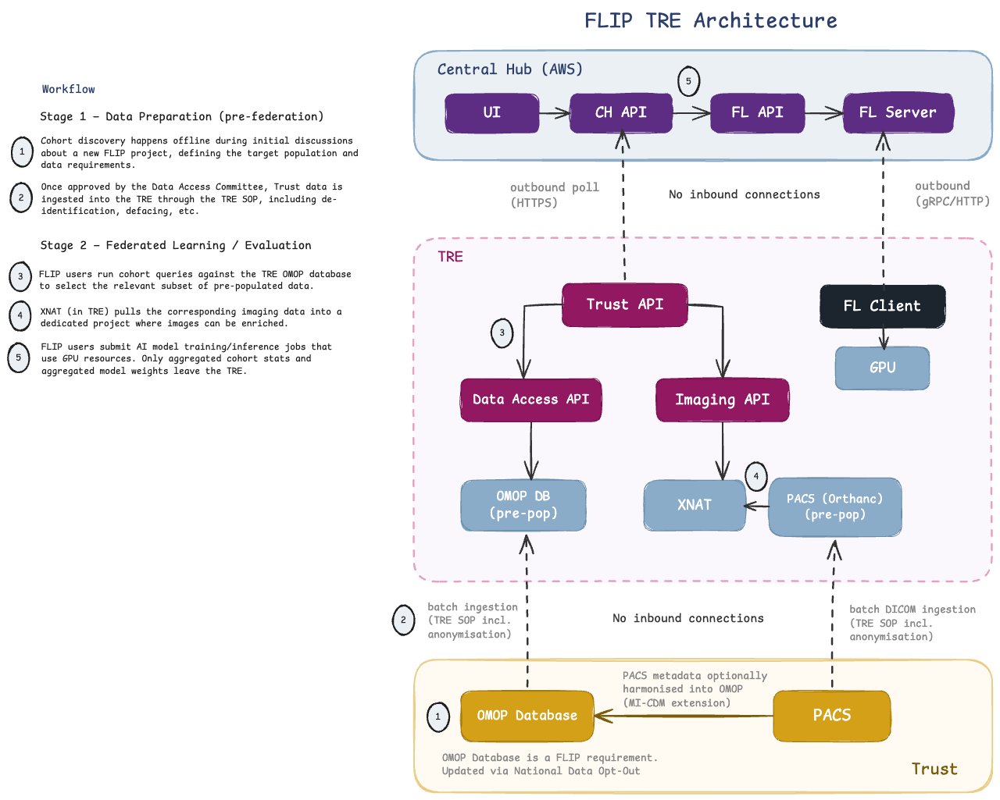

.. _tre-deployment:

===========================
Deploy a FLIP node in a TRE
===========================

.. contents:: Table of Contents
   :local:
   :depth: 3

Overview
========

FLIP supports two deployment modes for trust-side services:

- **On-premise**: The FLIP node runs directly on Trust infrastructure (e.g. NVIDIA DGX)
  with live access to the Trust's OMOP database and PACS. This is the primary deployment
  model and provides full access to the Trust's electronic health records for cohort
  discovery and imaging data.

- **Trusted Research Environment (TRE)**: The FLIP node runs inside a TRE that has been
  pre-populated with a project-specific subset of data. This mode supports Trusts where
  governance or infrastructure constraints require data access through a TRE rather than
  direct on-premise compute.

This guide covers the TRE deployment mode: what the TRE operator provides, how data
reaches the node, and what may leave the TRE. The node itself **installs as a Docker
Compose host**: the FLIP admin and the operator follow :doc:`onboarding-a-trust`, with
step 5 on :doc:`deploy-flip-node-on-prem`. The requirements every node shares are on
:doc:`deploy-trust-node`.

.. note::

   TRE deployment is an alternative to on-premise deployment, not a replacement. The
   on-premise model remains the recommended approach where Trust infrastructure and
   governance permit it.

TRE operator responsibilities
=============================

Deploying FLIP inside a TRE involves coordination between the FLIP team and the TRE
operator. The TRE operator is responsible for:

**Data provisioning (one-off, per project)**

- Ingesting the anonymised OMOP dataset and DICOM imaging data into the TRE via the TRE's
  standard SOP (after DAC approval).
- Provisioning an OMOP PostgreSQL database and a PACS instance (e.g. Orthanc) inside the
  TRE, with consistent pseudonymisation so records can be linked across them.

**Compute provisioning**

- Providing a host that meets the `Prerequisites`_ below.
- Creating the writable host paths the FLIP stack expects under ``/opt/flip/``, for certs,
  FL data, OMOP DB volumes, and observability storage. The
  :gh:`on-prem Ansible playbook <trust/deploy/ansible/onprem.yml>` shows the full list.

**Container images**

FLIP's own images are published to the GitHub Container Registry
(``ghcr.io/londonaicentre/*``). The observability stack and XNAT's Docker socket proxy come
from Docker Hub: ``grafana/loki``, ``grafana/alloy``, ``grafana/grafana`` and
``tecnativa/docker-socket-proxy``, at the tags ``trust/deploy/compose_trust.production.yml``
and ``trust/xnat/docker-compose-stack.yml`` pin.

Where the TRE lets the FLIP host pull directly (CREATE does this for GHCR), allow both hosts of
each registry: each serves its image layers from a second host, so allowing the registry name
alone makes every pull fail.

.. list-table::
   :header-rows: 1
   :widths: 30 70

   * - Registry
     - Hosts to allow (HTTPS, port 443)
   * - GHCR
     - ``ghcr.io`` and ``pkg-containers.githubusercontent.com``
   * - Docker Hub
     - ``registry-1.docker.io``, ``auth.docker.io`` and ``production.cloudfront.docker.com``

Otherwise, TREs typically block direct pulls from public registries,
so images have to come in through the TRE's normal file-ingress process, for example as
``docker save`` tarballs loaded with ``docker load``, or through a TRE-internal registry.

.. important::

   The FLIP make targets do not support this today. A production trust always pulls: the
   production compose files name the ``ghcr.io/londonaicentre`` images directly, the trust
   Makefile fixes the registry to GHCR and starts the stack with ``--pull always``. Without a
   route to GHCR, ``up-onprem-trust`` fails even when the images are already loaded. Running FLIP in an
   air-gapped TRE therefore needs site-specific adaptation; agree it with the FLIP team
   before the TRE build starts.

The Compose stack's XNAT image carries its plugins, so the FLIP host downloads none at start.
(The Kubernetes chart is different: it fetches them from ``xnat.org``, ``api.bitbucket.org``
and GitHub at every start, see :doc:`deploy-flip-node-azure`.)

**Network policy**

- Allow the outbound connections in :ref:`deploy-trust-node-network`: the Central Hub API
  and the FL server are **separate** hosts, and allowlisting the API host alone is not
  sufficient.
- If the TRE's firewall filters by hostname only in HTTP rules (Azure Firewall Basic, for
  example, has no DNS proxy for its network rules), allow the FL Server by its IP address:
  the hub's FL endpoint has a fixed one.
- Do not let a TLS-inspecting proxy re-sign traffic to the FL Server: the FL client checks
  the server's certificate against its kit, and a re-signed connection fails.
- No inbound ports need to be opened on the TRE perimeter.

**Output review**

- Operating the TRE's standard output-checking (airlock) process for the aggregate metrics
  that leave the TRE during federated evaluation.
- Deciding, per project, whether federated training may release model artefacts and on what
  conditions. See `What leaves the TRE, and under what policy`_.

Architecture
============

In the on-premise model, the FLIP node has direct access to the Trust's full OMOP database
and can pull imaging data live from PACS. In the TRE model, the FLIP node operates on a
pre-populated subset of data inside the TRE boundary.

Two communication pathways connect the FLIP node to the Central Hub (hosted on AWS):

1. **Central Hub FLIP API <-> Trust API**: Cohort queries, project creation, imaging project
   management, and status updates.

2. **FL Server <-> FL Client**: Model distribution (for evaluation) and model weight exchange
   (for federated training), orchestrated via the FL framework (e.g. NVIDIA FLARE, Flower).

Both pathways use **outbound-only** connections, making FLIP compatible with TRE network
policies that block inbound traffic.

   FLIP TRE deployment: outbound-only connections from the FLIP node to the Central Hub.

Communication: outbound-only design
-----------------------------------

TREs are "walled garden" environments that block inbound network connections. All
communication from the FLIP node is initiated from inside the TRE outward to the
Central Hub. No inbound ports need to be opened on the TRE side.

**FL Server <-> FL Client**

The FL channel uses a client-pull model. The FL client initiates all communication: it
connects outbound to the FL server, polls for tasks, executes locally, and pushes results
back. The FL server never initiates inbound connections to client sites:

- In NVIDIA FLARE, the FL client sends ``GET_TASK`` requests to the FL server and receives
  tasks in the response, then returns results via ``SUBMIT_RESULT``.

- In Flower, each SuperNode acts as a gRPC client connecting outbound to the SuperLink.
  SuperNodes initiate all requests and do not accept incoming connections.

The TRE need only whitelist outbound gRPC (or HTTP, if using an HTTP/REST transport
fallback) to the FL server endpoint.

**Central Hub FLIP API <-> Trust API**

The Trust API uses an outbound polling model to communicate with the Central Hub. Rather
than the Central Hub pushing requests inbound, the Trust API periodically polls the
Central Hub for new instructions:

- The Trust API calls the Central Hub FLIP API to check for new projects, cohort query
  requests, and status updates.

- When a new project is created on the Central Hub, the Trust API discovers it on its next
  poll cycle and initiates the local workflow (cohort query against OMOP, imaging pull from
  PACS into XNAT).

- Results (cohort statistics, project status) are pushed outbound from the Trust API to the
  Central Hub.

trust-api polls every few seconds (``POLL_INTERVAL_SECONDS``, default 5). The settings it
polls with, and how the hub authenticates it, are on :ref:`trust-authentication`.

Data flow
=========

The key difference between on-premise and TRE deployment is how data enters the FLIP node.

On-premise data flow
--------------------

1. FLIP user submits a cohort query on the Central Hub.
2. The query is federated to all FLIP nodes.
3. The Trust API queries the full OMOP database and returns aggregated cohort statistics.
4. Once the project is approved by the Data Access Committee (DAC), the imaging API pulls
   DICOMs from the Trust's production PACS into a DICOM staging server (e.g. Orthanc).
5. XNAT pulls from the staging server into a dedicated project, where images can be
   enriched.
6. FL training or evaluation jobs run on the local data.

TRE data flow
-------------

The TRE model splits the workflow into two phases:

**Phase 1: Pre-FLIP (TRE data ingestion)**

Before the FLIP user interacts with the system, the Trust's data team:

1. Estimates the cohort size against the full Trust EHR (outside FLIP).
2. Submits and receives DAC approval for the project.
3. Exports anonymised OMOP records and DICOM imaging data through the TRE's standard
   operating procedure (SOP), including anonymisation and defacing where required (e.g.
   brain CT scans).
4. Loads the anonymised data into:

   - An **OMOP database** inside the TRE.
   - A **PACS instance** (e.g. Orthanc) inside the TRE.

.. note::

   The OMOP database and PACS inside the TRE must use consistent pseudonymisation so that
   clinical records and imaging data can be linked within the TRE.

**Phase 2: FLIP workflow (inside the TRE)**

Once data is loaded, the FLIP workflow proceeds largely as normal:

1. When a FLIP project is created on the Central Hub, the Trust API inside the TRE
   discovers it (via outbound polling) and triggers the local workflow.
2. The FLIP user runs a cohort query. The ``data-access-api`` queries the OMOP database
   inside the TRE. This selects from the pre-loaded project subset, not the full Trust
   population.
3. Once the cohort is selected, XNAT pulls DICOMs from the TRE's internal PACS, using the
   same C-FIND/C-MOVE pattern it would use against a production PACS.
4. The FLIP user submits FL training or evaluation jobs.

.. important::

   In the TRE model, cohort queries operate on a **pre-scoped dataset**. The FLIP user can
   refine and select within the approved data, but cannot discover patients beyond what was
   loaded into the TRE. Cohort size estimation across the full Trust population must happen
   before the DAC application, outside FLIP.

Prerequisites
=============

The TRE must provide the following capabilities.

Compute and software
--------------------

The host must meet the prerequisites of a Docker Compose host
(:doc:`deploy-flip-node-on-prem`): Docker in swarm mode with overlay networking, and for
GPU work an NVIDIA driver of 580 or newer with the NVIDIA Container Toolkit. In a TRE you
typically install these yourself rather than with the Ansible playbook:

- Docker Engine (>= 24.0) with Docker Compose (>= 2.40)
- NVIDIA driver (>= 580) and the NVIDIA Container Toolkit
- Python 3.12 or 3.13
- PostgreSQL client libraries (``postgresql-client``)
- Make

At minimum, provide one NVIDIA GPU for inference and evaluation. For FL training, GPU
memory requirements depend on the model architecture.

Networking
----------

The outbound connections in :ref:`deploy-trust-node-network`, and no inbound ones. If the
TRE's network inspection appliances block HTTP/2 (required for gRPC), most FL frameworks
offer HTTP/REST transport fallbacks that work over standard HTTP/1.1 (e.g. NVIDIA FLARE's
HTTP driver, Flower's REST transport).

Data
----

- An **OMOP database** (PostgreSQL) pre-populated with the project's anonymised clinical
  data, in the ``omop`` schema.
- A **PACS instance** (e.g. Orthanc) pre-populated with the project's anonymised DICOM
  imaging data.
- Consistent pseudonymisation between the two, so they can be linked within the TRE. The
  link is the **accession number**, and pseudonymisation must change it in both or neither.

The schema and accession-number rules are the same as for any node; see "Trust data" on
:doc:`deploy-trust-node`.

Observability
-------------

FLIP deploys a log-aggregation stack (Grafana Alloy, Loki, Grafana) alongside the Trust
APIs. Alloy scrapes container stdout via the Docker socket, Loki stores logs with 30-day
retention, and Grafana provides a pre-provisioned dashboard. **The stack runs entirely
inside the TRE boundary**: no log data is sent to the Central Hub. See
:doc:`/components/component-logging-stack` for configuration, ports, and persistent volumes.

Use case 1: federated evaluation
================================

Federated evaluation is the most TRE-compatible FLIP workflow. A pretrained model is
distributed from the Central Hub to FLIP nodes for local evaluation, and only **aggregate
metrics** (AUC, Dice scores, sensitivity, specificity, confusion matrices) are returned.

Why evaluation is TRE-friendly
------------------------------

- **Model ingress**: The pretrained model file is sent from the FL server to the FL client
  inside the TRE. TREs routinely handle data ingress.

- **Metrics-only egress**: Only aggregate evaluation metrics leave the TRE, not model
  weights. These metrics are standard summary statistics that TRE output-checking processes
  (airlocks) are designed to review.

- **Single egress event**: Unlike training, which requires iterative weight exchange across
  many rounds, evaluation produces a single set of results that can go through standard TRE
  output review.

- **No model artefact leaves the TRE**: because no locally-trained model is exported on this
  path, the disclosure risks specific to model artefacts do not arise. Only the summary
  metrics need reviewing.

Evaluation data flow
--------------------

1. A pretrained model is uploaded to the Central Hub.
2. The FL server distributes the model to FL clients at each FLIP node (including TRE
   nodes) via the FL framework's evaluation workflow.
3. Each FL client runs inference on local data and computes evaluation metrics.
4. Only the aggregate metrics are sent back to the FL server.

.. note::

   For TRE nodes, the aggregate metrics leaving the TRE should comply with the TRE's
   output-checking policy. Ensure that subgroup analyses on small populations (fewer than
   the TRE's minimum cell count, typically 5-10) are suppressed before egress.

Use case 2: federated training
==============================

Federated training in a TRE involves iterative exchange of model weights between the FL
client (inside the TRE) and the FL server (on the Central Hub). This is more complex from
a governance perspective than evaluation.

Training data flow
------------------

1. The FL server sends the initial global model to all FL clients.
2. Each FL client trains locally for a number of local rounds.
3. The FL client sends updated model weights back to the FL server.
4. The FL server aggregates weights from all clients (e.g. via FedAvg) and distributes the
   updated global model.
5. Steps 2-4 repeat for the configured number of global rounds until convergence.

What leaves the TRE, and under what policy
------------------------------------------

The weights sent back at step 3 above are what this section calls a **model update**: a set of
numbers derived from the local data, not the records themselves. Two things follow, and they
are what a TRE's output-checking policy has to account for:

- An output checker cannot read a model update and judge whether it is safe to release, the
  way they can read a table or a chart.
- A training run produces one update per round (tens to hundreds of them) rather than one
  output per project.

`SATRE v2.0.1 <https://satre-specification.readthedocs.io/en/v2.0.1/specification.html#satre-3-3-07>`_
addresses this case directly. Requirement **3.3.07** (Mandatory) asks a TRE for a documented
policy covering outputs that cannot be manually checked, and names trained model weights as its
example: the policy "must address whether model artefacts may be exported, and if so, what
technical controls are required before egress is approved". This supersedes the position in
SATRE v1, where declining such egress outright was offered as a complete answer.

FLIP's position, which a TRE operator can adopt or adapt:

- **Federated evaluation releases no model artefact at all.** Only summary metrics leave, and
  they go through your existing output-checking process. Where a project's question can be
  answered by evaluation, this is the path to prefer.

- **Federated training does release model artefacts**, once per round, and is therefore a
  per-project decision taken by the TRE operator together with the Data Access Committee,
  against the controls set out below. It is a decision to be made: neither a blanket
  prohibition nor an automatic approval.

The reason the decision needs controls attached is that a model trained on sensitive records
can retain traces of them. A model update is not equivalent to an aggregate statistic, even
though it looks like a block of numbers.

Controls applied before anything leaves
---------------------------------------

This is the answer to the second half of SATRE 3.3.07: what technical controls apply before
egress is approved. Read the "Who controls it" column closely: some of these are yours to set,
and one of them does nothing until you turn it on.

.. list-table::
   :header-rows: 1
   :widths: 24 14 38 24

   * - What leaves
     - When
     - What constrains it
     - Who controls it
   * - Evaluation results
     - Once per job
     - Aggregate metrics only: accuracy, Dice scores, sensitivity, specificity, confusion
       matrices. Ordinary summary statistics of the kind your output-checking process already
       handles.
     - You, through your existing airlock
   * - Model updates, FLARE backend
     - Every round
     - Each update is reduced before it leaves the node: a share of the values is discarded
       rather than transmitted. FLIP applies this itself, and the researcher's uploaded code
       cannot switch it off or weaken it.
     - FLIP, on every training job
   * - Model updates, Flower backend
     - Every round
     - The equivalent protection is part of the application the researcher uploads, so it is
       assured by reviewing that code before approval rather than by the platform. Establish
       which backend your node runs before approving a training project.
     - Project review, not the platform
   * - Model updates, your own site rule
     - Every round
     - **The control you own.** On the FLARE backend a trust can apply its own reduction to
       every update leaving its node. It is set in the configuration file the trust holds
       locally, no submitted job can override or weaken it, and a node whose setting is
       invalid refuses to start rather than sending updates unprotected.
     - You -- **inactive until enabled**
   * - Cohort results
     - On each query
     - Suppressed below a minimum group size that you set locally. The Central Hub cannot
       lower it, and the suppression runs on your own deployment next to the data.
     - You, in your node's configuration
   * - All of the above
     - Continuously
     - The channel is mutually authenticated and outbound-only. FLIP nodes deliberately hold
       no Central Hub credentials, so a compromised node yields no access to the platform.
     - FLIP

.. admonition:: If you permit training, enable your own site control

   The "your own site rule" row is the one item on this page that needs an action from you. On
   the FLARE backend, set the following in your node's kit file and restart the FL clients:

   .. code-block:: shell

      FL_SITE_PRIVACY_POLICY=percentile

   It is not on by default, so a node that has never been configured for it is sending updates
   constrained only by the platform-side reduction. See
   :doc:`../components/component-fl-nets` for the parameters and exact semantics.

What these controls do not do
-----------------------------

State these alongside the controls when you document your policy. They are the residual risks
that a project-specific approval accepts, or mitigates by other means.

- **The reduction applied on the FLARE backend is not differential privacy.** It lowers how
  much any single update reveals, but it adds no calibrated noise, carries no privacy budget,
  and most of each update still leaves the node. Describing it as differential privacy to an
  ethics committee or information governance panel would misstate it. The Flower backend does
  offer a formal mechanism, but its shipped settings are demonstration values rather than a
  defensible privacy budget, and the cumulative cost of repeated rounds is not accounted for.

- **Updates are not hidden from the aggregating server.** FLIP does not implement secure
  aggregation or homomorphic encryption, so the Central Hub sees each contributing node's
  update. The hub is operated by the platform, not by the other participating sites.

- **FLIP does not inspect results on the way out.** Downloading a trained model is restricted
  to authorised users of that project, but no content check is applied at that point.

- **Researcher-supplied training code runs on your hardware and is not sandboxed at runtime.**
  Uploaded files are scanned before use and the container that runs them is hardened, but the
  accepted control for this class of risk is review of the uploaded code. See :doc:`/security`
  for the full reasoning.

.. admonition:: Approving a training project: a checklist

   Where federated training is proposed, agree the following with the FLIP team and record the
   outcome alongside your usual project documentation:

   1. **Confirm evaluation would not answer the question.** If it would, prefer it: it
      releases no model artefact and needs no new policy.
   2. **Enable your own site control** if your node runs the FLARE backend (see above), and
      note the settings you applied.
   3. **Record the decision**: which controls were applied, what was permitted to leave, and
      who approved it. SATRE 3.3.09 points towards keeping this as a structured,
      machine-readable record linked to the released output. FLIP does not yet produce one
      automatically, so this remains a documentation step on your side.
   4. **Agree the artefact plan before the project starts**, as SATRE 3.1.16 recommends: what
      will be trained, whether the result may be exported, and on what conditions.
   5. **Optionally, test the released model.** SACRO-ML (see below) can simulate attacks
      against a trained model after the fact, which some operators use as supporting evidence
      for a release decision.

Differences from on-premise deployment
======================================

.. list-table::
   :header-rows: 1
   :widths: 25 35 35

   * - Aspect
     - On-Premise
     - TRE
   * - OMOP database
     - Live sync from Trust EHR, updated via National Data Opt-Out
     - Pre-populated with anonymised project subset
   * - PACS
     - Trust production PACS (live pull)
     - Orthanc inside TRE, pre-populated with anonymised DICOMs
   * - Cohort query scope
     - Full Trust population
     - Project-specific subset only
   * - Cohort discovery
     - Via FLIP (step 1 of workflow)
     - Outside FLIP, before DAC application
   * - Data freshness
     - Live / near-real-time
     - Snapshot at time of TRE data load
   * - Networking
     - Outbound-only (HTTPS + gRPC/HTTP to Central Hub)
     - Outbound-only (HTTPS + gRPC/HTTP to Central Hub)
   * - Central Hub <-> Trust API
     - Poll (outbound)
     - Poll (outbound)
   * - Evaluation egress
     - Aggregate metrics via FL channel
     - Aggregate metrics via FL channel (TRE airlock review)
   * - Training egress
     - Model updates via FL channel
     - Model updates via FL channel (**per-project approval; see the egress policy above**)
   * - GPU access
     - Trust-managed DGX / GPU servers (NVIDIA driver >= 580)
     - TRE-provided GPU compute with NVIDIA Container Toolkit (NVIDIA driver >= 580)

UK TRE federation landscape
===========================

Deploying federated learning across TREs is an active area of development in the UK. The
`DARE UK <https://dareuk.org.uk/>`_
`TREvolution programme <https://dareuk.org.uk/trevolution/enable-federation/>`_
(UKRI-funded, launched 2025)
is developing standardised federation capabilities across UK TREs, including reference
architecture, semi-automated output checking, and federated analysis. TREvolution introduces
**Patterns** and **Weaves**: configurable combinations of analysis type, technology
services, and egress rules. The first Weave is the **Five Safes TES**. It adopts the
`GA4GH Task Execution Service (TES) <https://ga4gh.github.io/task-execution-schemas/>`_
standard as the basis for interoperability, so TREs can receive and execute standardised
workflow tasks through a common API.

Related projects include
`TRE-FX <https://trefx.uk/>`_ (which developed the
`Five Safes RO-Crate <https://trefx.uk/5s-crate/>`_ packaging format for governance metadata
around workflow outputs) and
`SACRO <https://github.com/AI-SDC/ACRO>`_ (which provides semi-automated output checking
tools, including an ML extension for attack simulation against trained models).

FLIP's TRE deployment model aligns with this direction. As TREvolution matures, its Patterns
framework could formalise different egress rules for different federated workflows (for
example metrics-only for evaluation, against a protected-update rule for training). That
would build on the policy position that SATRE 3.3.07 already establishes.

SATRE v2 also added a **Federation** pillar. Its requirement 5.6.01 asks a federation to agree
one definition of a safe output that every member implements, covering both data moving between
members and results leaving the federation altogether. That is the shape of a FLIP deployment
spanning several TREs, and a useful frame for operators agreeing terms with each other rather
than only with the platform.

GPU Resource Management
-----------------------

TRE environments may offer the ability to dynamically provision and release GPU resources
based on workload requirements. Unlike on-premise deployments where dedicated GPU hardware
(e.g. DGX systems) is always available, cloud-based TREs can scale GPU compute on demand.

FLIP's architecture supports this: some trust-side services (e.g. the ``data-access-api``
for OMOP queries) do not require GPU, while the FL client only needs GPU resources during
active training or evaluation jobs. TRE operators may wish to:

- Provision GPU instances only when FL jobs are scheduled, and release them between jobs.
- Periodically re-evaluate GPU resource allocation based on model size, training duration,
  and concurrent workload.
- Use spot/preemptible GPU instances for evaluation jobs (which can be restarted) and
  reserved instances for training jobs (which benefit from continuity).

The FLIP Docker Compose configuration separates GPU-dependent services (FL client) from
non-GPU services (Trust API, data access API, XNAT), making it straightforward to run
them on different compute tiers within the TRE.
