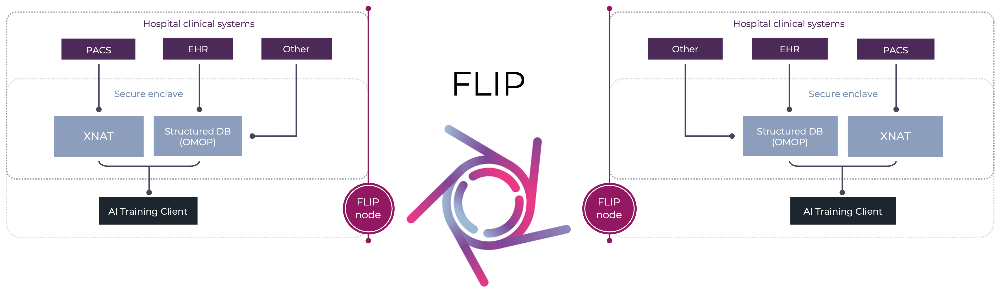

:github_url: https://github.com/londonaicentre/FLIP

FLIP
====

Federated Learning Interoperability Platform

FLIP coordinates federated training and evaluation of medical-imaging AI models
across independently operated healthcare institutions while patient data remains
inside each institution's security boundary.

   A Central Hub coordinating projects across two independently operated FLIP nodes.

Start here
==========

.. list-table::
   :header-rows: 1
   :widths: 35 65

   * - I am…
     - Start with
   * - A **researcher** or model developer
     - :doc:`user-guides/getting-started`, then :doc:`working-with-flip-apps`
   * - A **trust operator** installing FLIP at a hospital or TRE
     - :doc:`deploy-flip/deploy-trust-node`, then :doc:`troubleshooting`
   * - A **FLIP administrator** running the Central Hub
     - :doc:`deploy-flip/deploy-central-hub` and :doc:`sys-admin`
   * - An **information governance**, Caldicott or ethics reviewer
     - :doc:`governance-and-compliance` and :doc:`security`
   * - A **contributor** to FLIP
     - :doc:`deploy-flip/deploy-local-dev` and :gh:`CONTRIBUTING.md`

New to FLIP? Read the :doc:`overview` first.

.. toctree::
   :maxdepth: 2
   :caption: Introduction

   overview
   flip-workflow

.. toctree::
   :maxdepth: 2
   :caption: Using FLIP

   user-guides
   working-with-flip-apps

.. toctree::
   :maxdepth: 2
   :caption: Running FLIP

   deploy-flip
   sys-admin
   troubleshooting

.. toctree::
   :maxdepth: 2
   :caption: Assurance

   security
   governance-and-compliance

.. toctree::
   :maxdepth: 2
   :caption: Research

   paper

.. toctree::
   :maxdepth: 2
   :caption: Reference

   components
   api-reference
   faqs
   glossary
   release-notes
