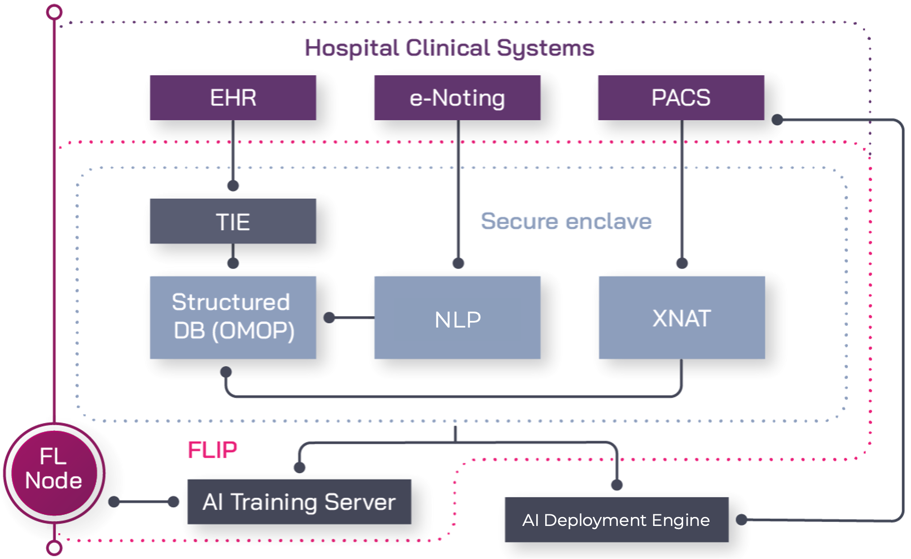

#########
Overview
#########

The Federated Learning Interoperability Platform (FLIP) trains and evaluates medical-imaging AI models across NHS
Trusts without moving patient data. The model goes to each Trust and trains on that Trust's data locally. Only the
model's updates come back, and FLIP combines them into one shared model.

*************
How it works
*************

What FLIP guarantees
====================

- **Patient data stays in the Trust.** Imaging and health records are held and queried on the Trust's own
  infrastructure. Neither is copied to the Central Hub.
- **Each Trust approves each project.** A project uses a Trust's data only after that Trust has approved that
  specific project. A Trust can decline one project and keep taking part in others.
- **Nothing reaches into a Trust.** The Trust's node fetches its work from the Central Hub over outbound HTTPS.
  Neither the internet nor the hub can open a connection into the Trust.

**What leaves a Trust** is limited to aggregate cohort statistics (hidden below the Trust's own minimum group size),
model updates (privacy-filtered before they are sent on FLARE, and on Flower when the researcher's code enables
it) and operational status. The trained model is the project's
deliverable and goes to the research team, so a Trust that approves a project is also approving that.

.. seealso::

   :ref:`governance-and-compliance` for who decides what, and :ref:`security` for the controls behind each
   guarantee.

The two halves of FLIP
======================

**The Central Hub** is the cloud-hosted web application researchers use. They create projects, query cohorts,
upload model code, start training and download results there. The hub also runs the federated learning servers that
combine each round of model updates. See :doc:`components/component-central-hub`.

**The FLIP node**, also called the *secure enclave*, runs inside each participating Trust's firewall, on the Trust's
own hardware. It holds the data and does the training.

   FLIP node at a glance.

Inside a node:

.. list-table::
   :widths: 25 75
   :header-rows: 1

   * - Part
     - What it does
   * - :term:`OMOP` database
     - The Trust's structured clinical data in the OMOP Common Data Model, so the same cohort query runs unchanged
       at every Trust. See :doc:`components/component-omop-database`.
   * - :term:`XNAT`
     - Retrieves a project's images from the Trust's :term:`PACS`, removes identifying fields from the image headers
       as they arrive, and stores the images for training. See :doc:`components/component-xnat`.
   * - Trust APIs
     - Fetch tasks from the hub, run validated, read-only cohort queries, and serve images and cohort data to
       training. See :doc:`components/component-trust-apis`.
   * - FL client
     - Runs the researcher's training code on the Trust's GPUs (or on CPU, more slowly) and sends model updates back
       to the hub. See :doc:`components/component-fl-nets`.

FLIP runs on either of two federated learning frameworks, :term:`NVIDIA FLARE` or :term:`Flower Framework`. For the
full component map, see :doc:`components/overview`.

How a project runs
==================

A researcher writes a cohort query, and every Trust answers with aggregate statistics only. The researcher stages the
project at the Trusts they need, and each Trust approves or declines it. Each approving Trust pulls the cohort's
images from its PACS into its own XNAT, where project members can add labels if the model needs them. The researcher
uploads their training code and starts training, and the code trains on each approving Trust's data. After each
round, the hub combines the Trusts' model updates and sends the combined model back out. When training ends, the final model
and its metrics are available in the FLIP UI.

Each step is drawn as a diagram on :doc:`flip-workflow`. The :doc:`user-guides` show the screens.

Who does what
=============

.. list-table::
   :widths: 25 75
   :header-rows: 1

   * - Role
     - Responsibilities
   * - Researcher (model developer)
     - Creates projects, writes the cohort query, stages the project, adds labels in XNAT where needed, uploads the
       model code, starts training and downloads results. See :doc:`user-guides`.
   * - :term:`Trust Admin`
     - Approves or declines the projects staged at their own Trust. See :ref:`trust-admin-guide`.
   * - FLIP admin
     - Manages users and roles, and approves or declines on behalf of any Trust that has no Trust Admin. See
       :doc:`sys-admin`.
   * - Viewer
     - Has read-only access to the projects they are added to.
   * - Trust operator
     - Site IT staff who install and run the FLIP node and connect it to the Trust's PACS and OMOP data. This is not
       a FLIP account role. See :doc:`deploy-flip`.

The full permission matrix is on :ref:`rbac-roles`.

Federated learning
==================

AI models need diverse training data from many sources to be reliable. Federated learning sends the model to the
data instead of pooling the data in one place.

Training runs in **rounds**. In each round, every participating Trust trains its copy of the model on local data and
sends back the updated model. The hub combines the updates into one model and sends it out for the next round. The
researcher receives the combined model, never a single Trust's update.

.. note::

   On FLARE, model updates are clipped and sparsified before they leave a Trust. This is **not formal differential
   privacy**. On Flower, local differential privacy is available, but the researcher's code must enable it. See
   :ref:`security`.

Interoperability and data harmonisation
=======================================

Health records are stored and coded differently from one hospital to the next. FLIP uses the OMOP Common Data Model
to give every Trust's data the same shape, with imaging linked through the :term:`MI-CDM` extension. A researcher
writes one cohort query and one training app, and both run unchanged at every site.
