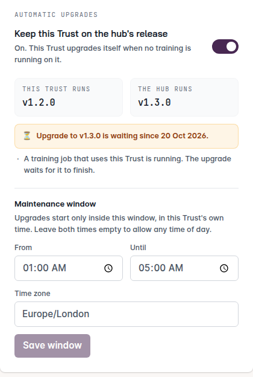
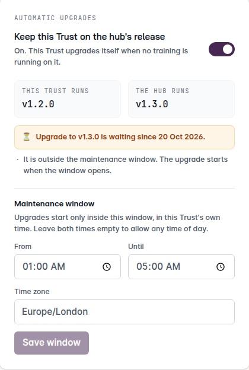
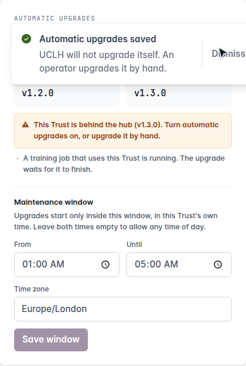
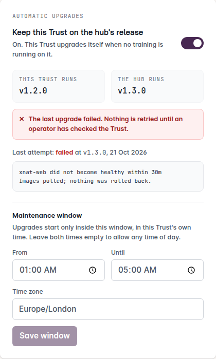

.. Copyright (c) 2026 Guy's and St Thomas' NHS Foundation Trust & King's College London
   Licensed under the Apache License, Version 2.0 (the "License");
   you may not use this file except in compliance with the License.
   You may obtain a copy of the License at
       http://www.apache.org/licenses/LICENSE-2.0
   Unless required by applicable law or agreed to in writing, software
   distributed under the License is distributed on an "AS IS" BASIS,
   WITHOUT WARRANTIES OR CONDITIONS OF ANY KIND, either express or implied.
   See the License for the specific language governing permissions and
   limitations under the License.

.. _admin-trust-auto-upgrade:

##############################
Automatic upgrades for a Trust
##############################

A Trust normally moves to a new FLIP release when its operator runs the upgrade command by hand (see
:ref:`admin-upgrading-sites`). With **automatic upgrades** switched on, a Kubernetes Trust does that itself: a small
agent in the Trust's own namespace notices that the hub has moved to a new release and upgrades the Trust's Helm
release for the operator, when it is safe to.

Automatic upgrades are for **Kubernetes Trusts** (Helm, including AKS and EKS). A Trust on Docker Compose keeps the
manual upgrade, ``make upgrade-onprem-trust``: the switch on My Trust does nothing for it, and its card shows when it
is behind the hub.

The switch lives on the **My Trust** page and belongs to the Trust. A Trust Admin controls it for their own Trust; a
FLIP admin can change it for support. Nothing on the hub can force an upgrade on a Trust that has it switched off.

.. admonition:: Who this page is for
   :class: note

   - **Trust Admins** — what the switch does, and what you see on My Trust in each state.
   - **Site operators and FLIP admins** — how the agent is installed, what it checks before it touches a Trust, and
     what happens on failure.

   Automatic upgrades add *when* an upgrade runs and *who starts it*. The upgrade itself moves the Trust's Helm release
   to the published chart for the target release, keeping the Trust's own values.

.. contents::
   :local:
   :depth: 2

*****************
The short version
*****************

.. list-table::
   :header-rows: 1
   :widths: 22 78

   * - Switch
     - What happens when the hub moves to a new release
   * - **On**
     - The Trust waits until no training job that uses it is running (and, if you set one, until the maintenance
       window opens), then upgrades itself to **the release the hub runs**. It reports the outcome on My Trust.
   * - **Off**
     - Nothing. My Trust shows that the Trust is behind the hub, and an operator upgrades it by hand, as before.

Three rules hold in both states:

- **A Trust never goes ahead of its hub.** The target is always the release the hub reports, never "the latest on
  GitHub". A Trust cannot be upgraded past a hub that has not moved yet.
- **A running training job is never interrupted.** The agent only starts when no job that involves this Trust is
  running. If the Trust is busy it waits and tries again on the next hourly check.
- **Only forward, only to a stable release.** The target is a stable ``vX.Y.Z``, never a release candidate, and
  the agent refuses a target older than what the Trust already runs, so rolling the hub back does not walk the
  Trusts back with it.

Choosing the target
===================

By default the target is the release the hub itself runs. The hub operator can name a different one with
``AUTO_UPGRADE_TARGET_RELEASE`` (a stable ``vX.Y.Z``) in the hub's environment, or, on AWS, the GitHub
environment variable of the same name, which Terraform passes to flip-api. Use it to:

- **Test on staging first.** A staging hub runs ``sha-`` builds, which name no release, so without this setting
  automatic upgrades never act there. Set it to the release under test so staging Trusts exercise the upgrade
  before it reaches production.
- **Hold a release back.** On production, pin the target to the current release while a new hub release beds in,
  then clear it.

A value that is not a stable release tag stops flip-api from starting, rather than being ignored.

***********************
How the three parts fit
***********************

.. mermaid::
   :caption: Who decides what. The hub owns the setting and the target; the Trust's cluster owns the execution.

   sequenceDiagram
       autonumber
       actor TA as Trust Admin
       box rgb(248, 234, 242) Central Hub
           participant Hub as Hub API and UI
       end
       box rgb(234, 237, 242) The Trust's namespace
           participant Agent as Upgrade agent (CronJob)
           participant Stack as Trust release
       end
       TA->>Hub: Switch automatic upgrades on (My Trust)
       Note over Agent: Wakes up every hour
       Agent->>Hub: What is my policy?
       Hub-->>Agent: On, target v1.3.0, window, is a job running?
       Agent->>Hub: Claim the upgrade
       Hub-->>Agent: Granted, no new jobs are sent to this Trust
       Agent->>Stack: helm upgrade to the v1.3.0 chart
       Stack-->>Agent: Healthy, on v1.3.0
       Agent->>Hub: Succeeded
       Hub-->>TA: My Trust shows v1.3.0

**1.** The Trust Admin switches the setting on. It is stored on the hub, next to the Trust.

**2–3.** Once an hour the agent asks the hub for the Trust's policy. The agent only makes outbound requests to the
hub, like the rest of the Trust, so no inbound port is opened. The hub answers with the setting, the release it runs,
the maintenance window and whether a job is running.

**4–5.** If everything lines up, the agent *claims* the upgrade. The claim is what closes the gap between "no job is
running now" and "the scheduler sends one a second later": while it is held, the hub sends no new job to this Trust,
and it refuses the claim if a job arrived in between. A claim that is never finished (the agent died) expires by
itself after about two hours, so a dead agent cannot lock the Trust out of training.

**6–7.** The agent pulls the published chart for the target release and runs ``helm upgrade
--reset-then-reuse-values``: the new release's defaults apply, the Trust's live values are kept on top, and only the
image tag moves. It then waits for ``trust-api`` to come back healthy and report the target release.

**8–9.** The agent reports success or failure. My Trust shows the result.

****************
The three states
****************

On, with no window
==================

The Trust upgrades at the first hourly check at which it is idle.

   Switch on. The hub is on v1.3.0, the Trust still on v1.2.0, and a training job is running: the upgrade waits for it.

.. mermaid::
   :caption: What the agent decides at each hourly check (switch on).

   flowchart TD
       A([Hourly check]) --> B{Switch on?}
       B -- no --> Z1([Do nothing])
       B -- yes --> C{Trust already on the hub's release?}
       C -- yes --> Z2([Do nothing])
       C -- no --> H0{Trust healthy?}
       H0 -- no --> X([Report 'not healthy' and wait])
       H0 -- yes --> D{Inside the maintenance window?}
       D -- no --> W1([Wait for the next check])
       D -- yes --> E{A training job that uses this Trust is running?}
       E -- yes --> W2([Wait for the next check])
       E -- no --> G[Claim the upgrade and run helm upgrade]
       G --> H{Healthy on the new release?}
       H -- yes --> OK([Report success])
       H -- no --> BAD([Stop and report failure])

       classDef go fill:#F7F3F9,stroke:#61366E,color:#61366E
       classDef wait fill:#FFF8E6,stroke:#B7791F,color:#7B4A06
       classDef stop fill:#FDECEC,stroke:#B42318,color:#7A1A12
       classDef ok fill:#E8F5EC,stroke:#2F7D4F,color:#1F5A37
       class G go
       class W1,W2,X wait
       class BAD stop
       class OK ok

A Trust that is busy all the time can fall behind, because it only ever waits for a quiet moment. That is why My
Trust shows **since when** an upgrade has been pending: if the date keeps getting older, schedule a gap for it (see
:ref:`auto-upgrade-busy-trust`).

On, with a maintenance window
=============================

Set a **From** and **Until** time and a time zone, in the Trust's own local time, and the agent starts an upgrade only
inside that window. "01:00–05:00 Europe/London" means 01:00–05:00 where the Trust is, including across daylight saving
changes.

   Switch on, window 01:00–05:00 Europe/London. It is the afternoon, so the upgrade waits for the window.

- Set both times and the time zone, or clear all of them (any time of day). My Trust refuses a half-set window.
- The window only decides when an upgrade may *start*. An upgrade that has begun is not stopped when the window
  closes.
- A job running inside the window still holds the upgrade back. The window and the idle check must both be satisfied.

Installing the agent
====================

The agent runs as a CronJob in the Trust's own namespace. It is off by default: enabling it hands a ServiceAccount the
ability to rewrite every workload in that namespace, so it is an opt-in rather than something a chart update turns on.

.. code-block:: bash

   make -C trust/deploy/helm deploy-trust-k8s KIT=<CODE> HUB=<env> AUTO_UPGRADE=1

or set ``K8S_AUTO_UPGRADE=true`` in the kit file so every later deploy keeps it. This records the release in
ConfigMaps, applies the Trust's Secret outside the release (so no password is stored where the agent can read it),
and switches the agent on. The deploy refuses to run when the release is recorded the other way, because it would
install a second copy; a Trust deployed before this setting existed needs its release record moved first (see
:ref:`auto-upgrade-existing-trust`).

How the agent behaves:

- **The current release comes from the Helm record**, with ``trust-api``'s ``/health`` as the fallback. A Trust whose
  record names the hub's release while ``trust-api`` still serves another build (a failed attempt) is not treated as
  up to date: the failed release is skipped until an operator clears it in the portal, then retried.
- **Done means every core service is up on the release.** After ``helm upgrade`` the agent waits for the same core
  workloads as ``make upgrade-trust-k8s`` (``trust/deploy/helm/scripts/rollout_wait.py``, shipped in the agent image)
  and then for ``trust-api`` to report the release, before it reports **Succeeded**.
- **The upgrade is Helm's.** It never passes ``--install``: a release it cannot see fails the check instead of being
  installed a second time underneath the running one.
- **It stops in time to report.** The agent runs on its own clock, five minutes inside the Job's deadline, so a
  slow upgrade is reported as **Failed** rather than leaving the hub waiting on a lease nobody holds.
- **The identity is narrow on purpose.** It holds no ``secrets`` permission at all — its API key arrives as a
  projected volume carrying that one key — and its Role covers only the kinds the chart renders, in that one
  namespace. Helm's own record of the release lives in ConfigMaps rather than Secrets, because finding a release in
  Secrets means *listing* them, and a list returns their contents. That write access reaches the Trust's
  governance document too, so before reporting an upgrade as done the agent compares the live document with the
  one the release carries and reports **Failed** if they differ, leaving the release as it is.
- **What the narrow identity does and does not buy.** The Role can create and patch Deployments and Jobs, and in
  Kubernetes permission to create workloads amounts to permission to read Secrets: the agent's identity could start a
  pod that mounts any Secret in the namespace. What it does buy is that the credentials are not one ``list`` away and
  are not in ``helm get values``, so reading them takes a deliberate act that the cluster's audit log records, not a
  side effect of finding the release. Treat the agent's ServiceAccount as one that can reach the namespace's Secrets.

.. _auto-upgrade-existing-trust:

Switching on an existing Kubernetes Trust
-----------------------------------------

A Trust deployed before automatic upgrades existed has its Helm release recorded in Secrets, Helm's default.
The agent reads only ConfigMaps, because its identity is not allowed to read Secrets. Until the record is
moved it cannot see the release and reports **Failed**. Check which applies:

.. code-block:: bash

   python3 trust/deploy/helm/scripts/release_driver.py --release trust-release --namespace flip-trust

Exit code 1 means the move is needed. It is a one-off step per Trust, run by the operator, in three commands:

.. code-block:: bash

   make -C trust/deploy/helm migrate-release-driver KUBE_CONTEXT=<ctx>             # prints the plan, changes nothing
   make -C trust/deploy/helm migrate-release-driver KUBE_CONTEXT=<ctx> CONFIRM=1   # moves the record
   make -C trust/deploy/helm deploy-trust-k8s KIT=<CODE> HUB=<env> KUBE_CONTEXT=<ctx> AUTO_UPGRADE=1

What the move does and does not do:

- **It changes only Helm's record of the release.** No pod, volume, StatefulSet or Service is touched, so
  nothing restarts and no data moves. Every past revision is kept, so ``helm history`` and ``helm rollback``
  still work.
- **It takes the passwords out of the record.** The old record held the Trust's passwords; the new one
  points at the existing Trust Secret instead, and that Secret is marked so that Helm never deletes it.
  The AUTO_UPGRADE deploy then manages the Secret with ``kubectl``, outside the release.
- **It checks before it commits.** The old records are removed only after Helm reads the same history
  through the new ones. It refuses to run while a Helm operation is in progress, and a second run does
  nothing.

Add ``K8S_AUTO_UPGRADE=true`` to the Trust's kit file so every later deploy keeps the new setting; a deploy
without it is refused rather than installing a second copy.

Off
===

Nothing is done for you. The Trust stays on its current release until an operator upgrades it by hand.

   Switch off. My Trust says the Trust is behind the hub and that it must be upgraded by hand.

The agent keeps checking in (so My Trust can still tell you the Trust is behind) but never acts. Turning the switch
on later takes effect from the next hourly check.

.. mermaid::
   :caption: The same hub release, with the switch on and off.

   flowchart LR
       R([Hub moves to a new release]) --> S{Switch}
       S -- on --> A1[Agent waits for an idle moment and the window]
       A1 --> A2[Trust upgrades itself]
       A2 --> A3([My Trust shows the new release])
       S -- off --> B1[My Trust shows 'behind the hub']
       B1 --> B2[Operator runs the upgrade command by hand]
       B2 --> B3([My Trust shows the new release])

       classDef auto fill:#F7F3F9,stroke:#61366E,color:#61366E
       classDef manual fill:#FFF8E6,stroke:#B7791F,color:#7B4A06
       class A1,A2 auto
       class B1,B2 manual

*******************
What My Trust shows
*******************

The **Automatic upgrades** card sits under the Trust detail on :doc:`My Trust </user-guides/user-trust-admin>`. Its
two version boxes show what the Trust runs and what the hub runs. The line under them tells you where things stand:

.. list-table::
   :header-rows: 1
   :widths: 22 78

   * - Status
     - Meaning
   * - **Runs the hub's release**
     - Nothing to do.
   * - **Waiting** (since a date)
     - A newer release exists and the switch is on. The reasons it has not started are listed beneath: a job is
       running, it is outside the window, the Trust is not healthy (with the check that failed), or the agent has
       not checked in recently.
   * - **Behind the hub**
     - A newer release exists and the switch is off.
   * - **Upgrading**
     - The agent holds the upgrade. No new training job is sent to this Trust until it finishes.
   * - **Failed**
     - The last attempt failed. See below.

.. list-table::
   :widths: 50 50

   * - .. figure:: ../assets/flip/trust-auto-upgrade/upgrading.png
          :width: 100%

          Upgrading.
     - .. figure:: ../assets/flip/trust-auto-upgrade/up-to-date.png
          :width: 100%

          Back on the hub's release, last attempt succeeded.

.. figure:: ../assets/generated/gifs/flip/trust-auto-upgrade.gif
   :align: center

   Switching automatic upgrades off and on, then the card as an upgrade waits, runs, fails and succeeds.

*************
When it fails
*************

.. mermaid::
   :caption: The agent stops on a failure, reports where the Trust is, and does not retry that release by itself.

   stateDiagram-v2
       [*] --> Checking
       Checking --> Waiting: newer release, not yet allowed
       Waiting --> Checking: next hourly check
       Checking --> Upgrading: allowed and idle
       Upgrading --> Succeeded: services healthy
       Upgrading --> Failed: a step fails, or the Trust does not come up
       Succeeded --> [*]
       Failed --> Blocked: stop
       Blocked --> Checking: operator restores the Trust and clears the failure in the portal

An upgrade recreates database-backed services and runs XNAT's in-place schema upgrade. Once an attempt has got that
far, the previous release's images may no longer match the data, and the agent cannot tell from outside whether a
failed attempt reached a migration. So it does not move the Trust back by itself. It stops:

- it leaves the Trust as the attempt left it, which may be partly on the new release;
- it reports **Failed** with the tail of the log and the release the Trust was on before the attempt, both shown on
  My Trust;
- it refuses to try that release again until an operator has restored the Trust and **cleared the failure** in the
  portal — the *Try this release again* button on the card;
- the hub assigns the Trust **no FL job** until the failure is cleared, the same as while an upgrade is running: a
  half-upgraded site can still answer ``/health``, so nothing else would stop a job landing there. Queued jobs that
  involve the Trust wait; jobs that do not involve it still run;
- it treats every failure the same way, including one that never got as far as recreating anything: the upgrade is a
  single ``helm pull`` and ``helm upgrade``, so a chart that cannot be pulled, a rejected upgrade and a pod that dies
  on start all end as **Failed** on that release. The hub blocks that one release; other releases are unaffected.

The way back is the operator's, because only a person can check whether the data was migrated: see
:ref:`upgrade-rolling-back`.

   A failed attempt, showing the tail of the upgrade log. *Try this release again* is what clears it.

To recover, follow the failure detail and the troubleshooting pages for your deployment, restore the Trust by hand
(see :ref:`admin-upgrading-sites`), then clear the failure.

***************************
The whole fleet at a glance
***************************

My Trust is one Trust. A FLIP admin who runs several needs the other direction: who is behind, whose upgrade failed, and
whose switch is off. **Connection status** carries that as an *Upgrade* column, one row per Trust, showing the same
states the card shows — *Up to date*, *Pending*, *Upgrading*, *Upgraded*, *Failed* — with the release it is waiting for
or failing on in the cell's tooltip. A Trust that is behind with automatic upgrades switched off (every Compose Trust,
which upgrades by hand) shows *Behind (manual)* instead of *Pending*, so the column says whether the agent will move it
or a person has to; the *Pending* tooltip lists what is holding the agent back (agent offline, outside the window,
jobs running, an unhealthy site). It is one hub call for the fleet, so the column costs nothing per row, and it is
admin-only: a Trust Admin's own Trust is on My Trust.

********************
Turning it on or off
********************

.. warning::

   Until FLIP#2071 lands, the agent runs neither ``xnat-init``
   nor the xnat-db dump that must precede a PostgreSQL major-version change. **Do not switch it on for a Trust that
   runs XNAT** — which is every production Trust. Upgrade those by hand (:ref:`admin-upgrading-sites`).

- **Defaults.** The agent is off in the chart and the switch is off on the hub, so every Trust starts **off** — no
  live site is surprised. The operator enables the agent at deploy time, then a Trust Admin opts in from My Trust,
  and the setting can be turned off there at any time.
- **What the agent checks first.** Before the window or the job list it looks at the site itself: ``trust-api``'s
  ``/health`` answering, no dead tasks, and a hub key that still matches. A Trust that fails any of those is reported
  with the failing check, rather than being upgraded on top of a problem the upgrade did not cause. The full order
  is: site health → the maintenance window → whether a job is running.
- **Who can change it.** The Trust Admin of that Trust, and FLIP admins for support. The Trust's own API key cannot.
- **Changing it during an upgrade.** An upgrade already running finishes. The new setting applies from the next
  release.
- **Not covered.** A Trust on Docker Compose (on-prem, the EC2 Trust, a TRE host) is upgraded by its operator with
  ``make upgrade-onprem-trust``.

.. _auto-upgrade-busy-trust:

*********
Questions
*********

**My Trust says an upgrade has been waiting for weeks.**
   A training job that uses the Trust has been running at every check. Automatic upgrades never interrupt a job.
   Agree a gap with the researchers, or upgrade it by hand in a maintenance window.

**The card says the Trust is not healthy.**
   The agent will not upgrade a Trust that is already failing. Fix the check named on the card (for example a hub key
   that no longer matches needs the kit refreshed); the next hourly check retries.

**The card says the agent has not checked in.**
   The CronJob in the Trust's namespace is not running, or the chart was deployed without the agent. Check it with
   ``kubectl get cronjob -n <namespace>``. The Trust keeps running normally, but it will not upgrade itself.

**Does this change what an upgrade does to my data?**
   No. It keeps the Trust's values and volumes, as a manual ``helm upgrade`` of the same chart would, and never
   re-seeds a live site.
