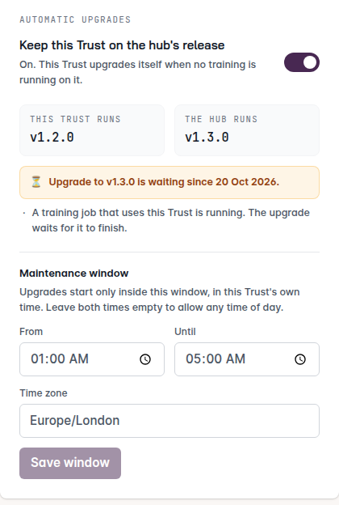
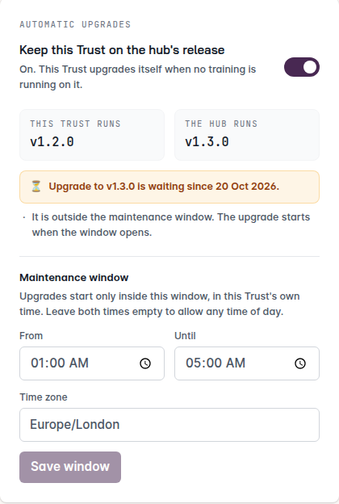
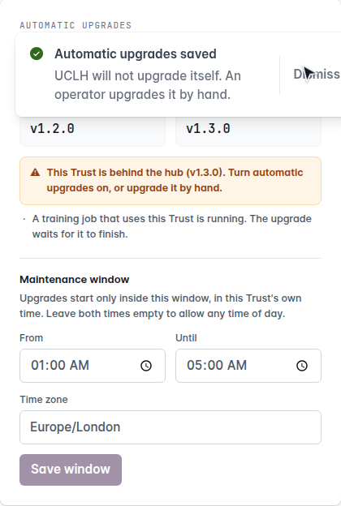

.. Copyright (c) 2026 Guy's and St Thomas' NHS Foundation Trust & King's College London
   Licensed under the Apache License, Version 2.0 (the "License");
   you may not use this file except in compliance with the License.
   You may obtain a copy of the License at
       http://www.apache.org/licenses/LICENSE-2.0
   Unless required by applicable law or agreed to in writing, software
   distributed under the License is distributed on an "AS IS" BASIS,
   WITHOUT WARRANTIES OR CONDITIONS OF ANY KIND, either express or implied.
   See the License for the specific language governing permissions and
   limitations under the License.

.. _admin-trust-auto-upgrade:

##############################
Automatic upgrades for a Trust
##############################

A Trust normally moves to a new FLIP release when its operator runs the upgrade command by hand (see
:ref:`admin-upgrading-sites`). With **automatic upgrades** switched on, the Trust does that itself: a small agent on
the Trust host notices that the hub has moved to a new release and runs the same upgrade command for the operator,
when it is safe to.

The switch lives on the **My Trust** page and belongs to the Trust. A Trust Admin controls it for their own Trust; a
FLIP admin can change it for support. Nothing on the hub can force an upgrade on a Trust that has it switched off.

.. admonition:: Who this page is for
   :class: note

   - **Trust Admins** — what the switch does, and what you see on My Trust in each state.
   - **Site operators and FLIP admins** — what the agent checks before it touches a host, and what happens on failure.

   The upgrade itself is the one described in :ref:`admin-upgrading-sites`. Automatic upgrades add *when* it runs and
   *who starts it*; they do not change *what* it does.

.. contents::
   :local:
   :depth: 2

*****************
The short version
*****************

.. list-table::
   :header-rows: 1
   :widths: 22 78

   * - Switch
     - What happens when the hub moves to a new release
   * - **On**
     - The Trust waits until no training job that uses it is running (and, if you set one, until the maintenance
       window opens), then upgrades itself to **the release the hub runs**. It reports the outcome on My Trust.
   * - **Off**
     - Nothing. My Trust shows that the Trust is behind the hub, and an operator upgrades it by hand, as before.

Two rules hold in both states:

- **A Trust never goes ahead of its hub.** The target is always the release the hub reports, never "the latest on
  GitHub". A Trust cannot be upgraded past a hub that has not moved yet.
- **A running training job is never interrupted.** The agent only starts when no job that involves this Trust is
  running. If the Trust is busy it waits and tries again on the next hourly check.

***********************
How the three parts fit
***********************

.. mermaid::
   :caption: Who decides what. The hub owns the setting and the target; the Trust host owns the execution.

   sequenceDiagram
       autonumber
       actor TA as Trust Admin
       box rgb(248, 234, 242) Central Hub
           participant Hub as Hub API and UI
       end
       box rgb(234, 237, 242) The Trust host
           participant Agent as Upgrade agent
           participant Stack as Trust services
       end
       TA->>Hub: Switch automatic upgrades on (My Trust)
       Note over Agent: Wakes up every hour
       Agent->>Hub: What is my policy?
       Hub-->>Agent: On, target v1.3.0, window, is a job running?
       Agent->>Hub: Claim the upgrade
       Hub-->>Agent: Granted, no new jobs are sent to this Trust
       Agent->>Stack: Pull v1.3.0, check it, recreate the services
       Stack-->>Agent: Healthy
       Agent->>Hub: Succeeded
       Hub-->>TA: My Trust shows v1.3.0

**1.** The Trust Admin switches the setting on. It is stored on the hub, next to the Trust.

**2–3.** Once an hour the agent on the Trust host asks the hub for the Trust's policy. The agent only makes outbound
requests to the hub, like the rest of the Trust, so no inbound port is opened. The hub answers with the setting, the
release it runs, the maintenance window and whether a job is running.

**4–5.** If everything lines up, the agent *claims* the upgrade. The claim is what closes the gap between "no job is
running now" and "the scheduler sends one a second later": while it is held, the hub sends no new job to this Trust,
and it refuses the claim if a job arrived in between. A claim that is never finished (the host died) expires by itself
after about two hours, so a dead agent cannot lock the Trust out of training.

**6–7.** The agent runs the same upgrade the operator would: it moves its own copy of FLIP to the release tag, pulls the
images, and recreates the services in place. Before anything is recreated it pulls the new images and health-checks
them, and stops with the Trust untouched if one fails.

**8–9.** The agent reports success or failure. My Trust shows the result.

****************
The three states
****************

On, with no window
==================

The default for a new install. The Trust upgrades at the first hourly check at which it is idle.

   Switch on. The hub is on v1.3.0, the Trust still on v1.2.0, and a training job is running: the upgrade waits for it.

.. mermaid::
   :caption: What the agent decides at each hourly check (switch on).

   flowchart TD
       A([Hourly check]) --> B{Switch on?}
       B -- no --> Z1([Do nothing])
       B -- yes --> C{Trust already on the hub's release?}
       C -- yes --> Z2([Do nothing])
       C -- no --> D{Inside the maintenance window?}
       D -- no --> W1([Wait for the next check])
       D -- yes --> E{A training job that uses this Trust is running?}
       E -- yes --> W2([Wait for the next check])
       E -- no --> F{Agent's copy of FLIP clean?}
       F -- no --> X([Stop and report 'local modifications'])
       F -- yes --> G[Claim the upgrade and upgrade in place]
       G --> H{Healthy afterwards?}
       H -- yes --> OK([Report success])
       H -- no --> BAD([Stop and report failure])

       classDef go fill:#F7F3F9,stroke:#61366E,color:#61366E
       classDef wait fill:#FFF8E6,stroke:#B7791F,color:#7B4A06
       classDef stop fill:#FDECEC,stroke:#B42318,color:#7A1A12
       classDef ok fill:#E8F5EC,stroke:#2F7D4F,color:#1F5A37
       class G go
       class W1,W2 wait
       class X,BAD stop
       class OK ok

A Trust that is busy all the time can fall behind, because it only ever waits for a quiet moment. That is why My
Trust shows **since when** an upgrade has been pending: if the date keeps getting older, schedule a gap for it (see
:ref:`auto-upgrade-busy-trust`).

On, with a maintenance window
=============================

Set a **From** and **Until** time and a time zone, in the Trust's own local time, and the agent starts an upgrade only
inside that window. A window is evaluated on the Trust host, so "01:00–05:00" means 01:00–05:00 where the Trust is,
including across daylight saving changes.

   Switch on, window 01:00–05:00 Europe/London. It is the afternoon, so the upgrade waits for the window.

- Set both times and the time zone, or clear all of them (any time of day). My Trust refuses a half-set window.
- The window only decides when an upgrade may *start*. An upgrade that has begun is not stopped when the window
  closes.
- A job running inside the window still holds the upgrade back. The window and the idle check must both be satisfied.

Installing it on a Trust host
=============================

On an on-prem Trust host, run once, as root:

.. code-block:: bash

   sudo -E make setup-auto-upgrade KIT=<name> HUB=prod            # asks, then does everything below
   sudo -E make setup-auto-upgrade KIT=<name> HUB=prod AUTO_UPGRADE=yes   # or no, to answer in advance

``make up-onprem-trust`` prints this command if it has not been run. The step:

#. creates the agent's own checkout at ``/opt/flip/releases/FLIP``, so your working tree is never moved;
#. moves the kit file to ``/etc/flip/trust/`` and leaves a symlink at the old path, so you and the agent read one file;
#. installs ``flip-trust-upgrade.timer`` (hourly) and its service, which runs ``scripts/trust_upgrade_agent.py``;
#. switches the Trust's setting ON at the hub with the Trust's own API key.

Answering ``no`` (or ``AUTO_UPGRADE=no`` later) stops the timer and switches the setting OFF. Either way the Trust
Admin can change it any time in My Trust. A Trust that is driven remotely (``DOCKER_HOST``/``DOCKER_CONTEXT`` over
``ssh://`` or ``tcp://``, which includes the EC2 Trust) is refused: the agent supports on-prem hosts only.

The agent runs ``make upgrade-onprem-trust`` itself, after moving its own checkout to the release tag, so what it
does is exactly what ``admin-upgrading-sites`` describes for an operator.

Off
===

Nothing is done for you. The Trust stays on its current release until an operator upgrades it by hand.

   Switch off. My Trust says the Trust is behind the hub and that it must be upgraded by hand.

The agent keeps checking in (so My Trust can still tell you the Trust is behind) but never acts. Turning the switch
on later takes effect from the next hourly check.

.. mermaid::
   :caption: The same hub release, with the switch on and off.

   flowchart LR
       R([Hub moves to a new release]) --> S{Switch}
       S -- on --> A1[Agent waits for an idle moment and the window]
       A1 --> A2[Trust upgrades itself]
       A2 --> A3([My Trust shows the new release])
       S -- off --> B1[My Trust shows 'behind the hub']
       B1 --> B2[Operator runs the upgrade command by hand]
       B2 --> B3([My Trust shows the new release])

       classDef auto fill:#F7F3F9,stroke:#61366E,color:#61366E
       classDef manual fill:#FFF8E6,stroke:#B7791F,color:#7B4A06
       class A1,A2 auto
       class B1,B2 manual

*******************
What My Trust shows
*******************

The **Automatic upgrades** card sits under the Trust detail on :doc:`My Trust </user-guides/user-trust-admin>`. Its
two version boxes show what the Trust runs and what the hub runs. The line under them tells you where things stand:

.. list-table::
   :header-rows: 1
   :widths: 22 78

   * - Status
     - Meaning
   * - **Runs the hub's release**
     - Nothing to do.
   * - **Waiting** (since a date)
     - A newer release exists and the switch is on. The reasons it has not started are listed beneath: a job is
       running, it is outside the window, the agent's copy of FLIP has local modifications, or the agent has not
       checked in recently.
   * - **Behind the hub**
     - A newer release exists and the switch is off.
   * - **Upgrading**
     - The agent holds the upgrade. No new training job is sent to this Trust until it finishes.
   * - **Failed**
     - The last attempt failed. See below.

.. list-table::
   :widths: 50 50

   * - .. figure:: ../assets/flip/trust-auto-upgrade/upgrading.png
          :width: 100%

          Upgrading.
     - .. figure:: ../assets/flip/trust-auto-upgrade/up-to-date.png
          :width: 100%

          Back on the hub's release, last attempt succeeded.

.. figure:: ../assets/generated/gifs/flip/trust-auto-upgrade.gif
   :align: center

   Switching automatic upgrades off and on, then the card as an upgrade waits, runs, fails and succeeds.

*************
When it fails
*************

.. mermaid::
   :caption: The agent stops and reports. It does not roll back, and it does not retry that release by itself.

   stateDiagram-v2
       [*] --> Checking
       Checking --> Waiting: newer release, not yet allowed
       Waiting --> Checking: next hourly check
       Checking --> PreFlight: allowed and idle
       PreFlight --> Checking: pull or health check fails (nothing recreated, retried next check)
       PreFlight --> Upgrading: new images are healthy
       Upgrading --> Succeeded: services healthy
       Upgrading --> Failed: a step fails
       Succeeded --> [*]
       Failed --> Blocked: stop
       Blocked --> Checking: operator clears the failure in the portal

An upgrade recreates database-backed services and runs XNAT's in-place schema upgrade. Rolling that back
automatically can do more damage than stopping, so the agent does not try. Instead it:

- stops, and reports **Failed** with the tail of the log, shown on My Trust (see the figure above);
- refuses to try that release again until an operator has looked at the Trust and **cleared the failure** in the
  portal;
- keeps retrying only when the problem was in the *pre-flight* phase (an image would not pull, or did not become
  healthy in a throwaway container), because nothing has been recreated by then.

To recover, follow the failure detail and the troubleshooting pages for your deployment, restore the Trust by hand
(see :ref:`admin-upgrading-sites`), then clear the failure.

********************
Turning it on or off
********************

- **Defaults.** A new installation has automatic upgrades **on**; the installer states this and says it can be turned
  off at any time from the portal. Trusts that existed before this feature was introduced start **off**, so no live
  site is surprised. A Trust Admin opts in from My Trust.
- **Who can change it.** The Trust Admin of that Trust, and FLIP admins for support.
- **Changing it during an upgrade.** An upgrade already running finishes. The new setting applies from the next
  release.
- **Not covered.** Snowflake-hosted Trusts are not upgraded automatically; they report that their mode is
  unsupported.

.. _auto-upgrade-busy-trust:

*********
Questions
*********

**My Trust says an upgrade has been waiting for weeks.**
   A training job that uses the Trust has been running at every check. Automatic upgrades never interrupt a job.
   Agree a gap with the researchers, or upgrade it by hand in a maintenance window.

**The card says "local modifications".**
   The agent keeps its own copy of FLIP and refuses to act if that copy has been changed. Restore the copy to a clean
   release tag; the next check retries.

**The card says the agent has not checked in.**
   The timer on the Trust host is not running. Check it on the host. The Trust keeps running normally, but it will
   not upgrade itself.

**Does this change what an upgrade does to my data?**
   No. It runs the same upgrade as the manual command, which keeps data directories and never re-seeds a live site.
