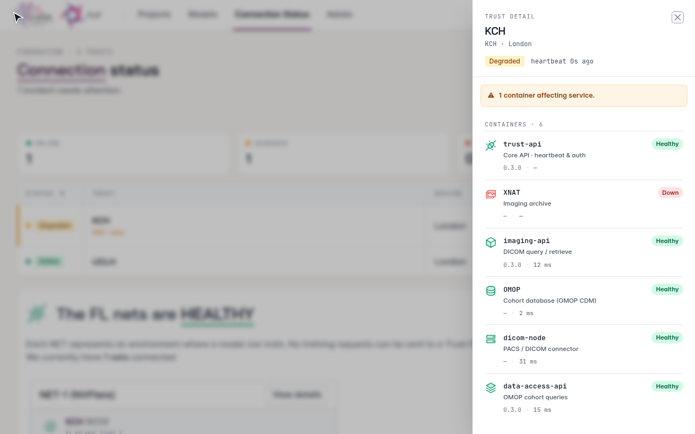

..  Copyright (c) 2026 Guy's and St Thomas' NHS Foundation Trust & King's College London
    Licensed under the Apache License, Version 2.0 (the "License");
    you may not use this file except in compliance with the License.
    You may obtain a copy of the License at
        http://www.apache.org/licenses/LICENSE-2.0
    Unless required by applicable law or agreed to in writing, software
    distributed under the License is distributed on an "AS IS" BASIS,
    WITHOUT WARRANTIES OR CONDITIONS OF ANY KIND, either express or implied.
    See the License for the specific language governing permissions and
    limitations under the License.

.. _user-training:

######################
Training and results
######################

FLIP trains several models at several Trusts at the same time, using :term:`NVIDIA FLARE` or the
:term:`Flower Framework` to train, test and aggregate at each site. This page covers starting and stopping a run,
following it, and downloading what it produces.

*************************
How training is scheduled
*************************

Training runs on **nets**. Each net is an FL server on the Central Hub plus an FL client at each Trust. When you start
training, a scheduler puts the model in a queue and hands it to the next free net, so you do not need to think about
GPU capacity or other users' jobs.

While a model waits, its status shows its place in the queue, for example ``Model Queued (2)``; position 1 starts next.
The status appears on the Models page and on the model's page, and the model's **Live activity** feed adds a line each
time the model moves up.

.. seealso::

   The :ref:`FL nets component page <flip-fl-nets>` for how a net is built and how the scheduler picks one.

.. _initiate-training:

*****************
Initiate training
*****************

Before you start, the model's required files must all be uploaded and checked (see :ref:`model-files`).

.. important::

   If your model trains on labels that are **not** in :term:`OMOP`, such as segmentation masks or other image-derived
   annotations, upload them into each Trust's XNAT **before** you confirm enrichment below. Otherwise training starts
   and then fails with no usable samples. Labels that are in OMOP, such as a lab result or a coded report finding, need
   no upload: select them as a column in your cohort query. See :ref:`data-enrichment` for both routes.

1. Open the model from the project page.
2. On the right-hand side, switch on **Dataset enriched**. You must confirm this even if your data needed no
   enrichment.
3. Under **Participating Trusts**, switch on each Trust the model should train at. Select at least one.
4. Optionally, switch on **GPUs per trust** to set how many GPUs this run needs at every selected Trust.

   - Left off, the run uses the GPUs your job's ``meta.json`` declares, or the platform default if it declares none.
   - A Trust that cannot provide the GPUs holds the run until it can, and the activity feed shows why. The request is
     never lowered to fit.
   - On a Flower deployment the request is recorded but not enforced.

5. Click **Initiate Training**.

The model page has two tabs. Once training starts it opens **Run**, where the **Live activity** feed lists each step
with a timestamp (queuing, net assignment, training in progress, training complete) and the stop and download buttons
sit at the top. The **Prepare** tab keeps a progress bar of the stages.

.. figure:: ../assets/generated/gifs/flip/initiate-training.gif
   :width: 600
   :align: center

   Initiating model training.

*************
Stop training
*************

The stop button appears at the top of the **Run** tab while the model is queued or training. Once training has ended it
disappears.

1. Click **Stop Training**.
2. Confirm.

The progress bar on the **Prepare** tab shows the stage at which training stopped.

.. figure:: ../assets/generated/gifs/flip/stop-training.gif
   :width: 600
   :align: center

   Stopping model training.

While the model is still queued (status *Model Queued*), the same button reads **Abort job**. Aborting removes the job
from the queue, marks the model as *Stopped* and frees its net for the next job straight away.

A stopped model produces no results, so **Download Results** stays disabled. It cannot be started again; to train
again, create a new model.

.. _view-results:

************
View results
************

**Download Results**, at the top of the model page, becomes available once training has finished and its results have
been uploaded.

1. Click **Download Results**.
2. Open the downloaded ``.zip`` file to view the results.

.. figure:: ../assets/generated/gifs/flip/download-results.gif
   :width: 600
   :align: center

   Downloading model training results.

.. _training-metrics:

*******
Metrics
*******

The model page shows graphs of the metrics your app reports, such as loss or average score, during and after training.
Hover over a graph to see the values.

.. figure:: ../assets/generated/gifs/flip/metrics.gif
   :width: 600
   :align: center

   Viewing model training metrics.

.. _connection-status:

*****************
Connection status
*****************

The **Connection Status** page shows the live state of the federation. Every signed-in user can open it, so if a
project stalls you can check whether a Trust holding your data has a failing service before you contact the platform
team.

Each Trust reports the health of its core services: trust-api, data-access-api, imaging-api, XNAT, OMOP and the
PACS/DICOM link. Its state follows from those reports:

.. list-table::
   :header-rows: 1
   :widths: 20 80

   * - State
     - Meaning
   * - Offline
     - The Trust has stopped sending heartbeats.
   * - Degraded
     - At least one service is down or degraded.
   * - Online
     - Everything else.

The list can also be shown as a radial topology. The **Services** column has one status dot per container. Click a
Trust's row to open a drawer listing each container's status, running version and probe response time, which tells you
*why* a Trust is degraded without access to its network.

   The Trust detail drawer: this Trust is Degraded because its XNAT is unreachable.

.. note::

   - A Trust that has not reported container health, or whose report is out of date, shows grey **No data** markers
     and falls back to heartbeat-only state.
   - The PACS/DICOM link is checked every five minutes, so a PACS outage can take that long to appear.

The **FL nets** card shows, for each net, whether each Trust's FL client is connected to the server. Training requests
cannot reach a Trust whose FL client is offline.

.. figure:: ../assets/generated/gifs/flip/fl-status.gif
   :width: 600
   :align: center

   Viewing the federation connection status and a Trust's container health.
