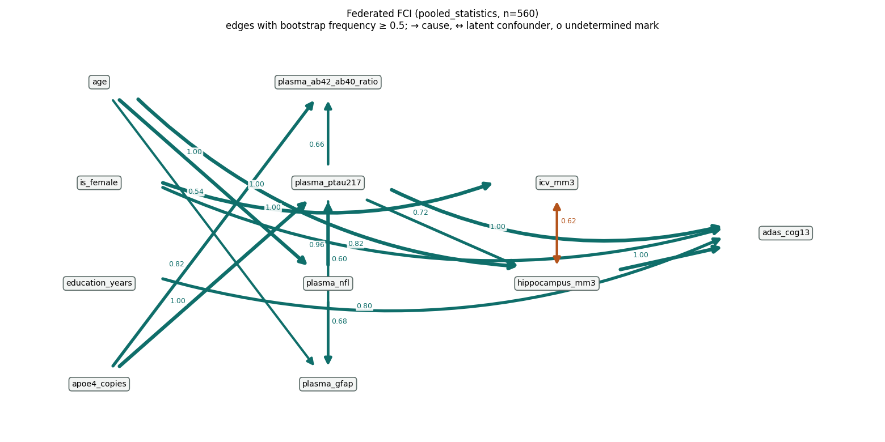
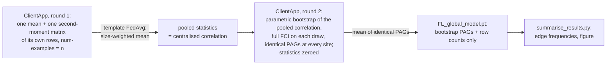

<!--
Copyright (c) 2026 Flower Labs GmbH
Copyright (c) 2026 Guy's and St Thomas' NHS Foundation Trust & King's College London
Licensed under the Apache License, Version 2.0 (the "License");
you may not use this file except in compliance with the License.
You may obtain a copy of the License at
    http://www.apache.org/licenses/LICENSE-2.0
Unless required by applicable law or agreed to in writing, software
distributed under the License is distributed on an "AS IS" BASIS,
WITHOUT WARRANTIES OR CONDITIONS OF ANY KIND, either express or implied.
See the License for the specific language governing permissions and
limitations under the License.
-->

# Biomarker causal discovery — FLIP tutorial (Flower)

Federated **bootstrapped FCI** over tabular Alzheimer's-disease biomarkers (plasma markers, brain
volumes, cognition, demographics; one row per person, no imaging), as a Flower app on FLIP's
`standard` template. Nothing is trained: the sites exchange the sufficient statistics of a
conditional-independence test — or, in the second mode, their votes on the graph skeleton — and
the template's FedAvg turns those into the pooled analysis. The result is a partial ancestral
graph with a bootstrap frequency on every edge. This is the Flower twin of the NVFLARE tutorial
of the same name; the method, the data and the results are documented once, in
[its README](../../nvflare/tabular_causal_discovery/biomarker_causal_discovery/README.md), and
this page covers what differs on Flower.



*The output: the partial ancestral graph the two simulated sites recover from the real ADNI
cohort (560 participants, 50 bootstraps), edges labelled with their bootstrap frequency. ADNI is
access-controlled, so the repository ships this summary figure and the converter that rebuilds the
cohort from a licence holder's own download, never the data.*



## Layout

```
biomarker_causal_discovery/
├── pyproject.toml          # flwr app definition for the local simulator only
├── query.sql               # the OMOP cohort query (not uploaded; set on the project)
├── summarise_results.py    # FL_global_model.pt -> edge-frequency table + PAG figure
├── docs/                   # the README figures + the script that draws the data one
└── app/                    # <- what you upload
    ├── client_app.py       # the ClientApp: the transport around federated_fci.client_round
    ├── federated_fci.py    # the federation: statistics, voting, FCI orientation, summaries
    ├── models.py           # get_model(): a parameter-free module holding the exchanged arrays
    ├── config.json         # federation mode, bootstraps, variables, background knowledge
    ├── config.toml         # run-config overrides fl-api applies at submit (rounds, DP off)
    ├── server_app.py       # byte-identical to fl-apps/flower/standard/app/  (platform-owned)
    └── strategy.py         # byte-identical to fl-apps/flower/standard/app/  (platform-owned)
```

`federated_fci.py`, `models.py`, `config.json`, `query.sql` and `summarise_results.py` are
byte-identical to the NVFLARE tutorial's copies
(`scripts/check_tutorial_sync.sh`; the NVFLARE side is the reference). `server_app.py` and
`strategy.py` are the template's: flip-api keeps its own copy of those and discards an uploaded
one, so editing them here would make the simulator run something the platform does not.

## Configuration: two files

- `app/config.json` — everything that defines the analysis (`FEDERATION`, `N_BOOTSTRAPS`,
  `ALPHA`, `VARIABLES`, `LOG_TRANSFORM`, `SCALE`, `KNOWLEDGE`, …; the table in the NVFLARE README).
  It is the only per-tutorial knob that rides through the upload flow, which is why the ClientApp
  reads it rather than `run_config`.
- `app/config.toml` — the run-config keys fl-api passes to `flwr run --run-config` at submit:
  `num-server-rounds = 2` (pooled mode; `largest conditioning set + 2` for voting) and
  `dp-enabled = false`. On the simulator the same values come from `pyproject.toml`'s
  `[tool.flwr.app.config]`.

`flip-utils` is deliberately not declared in `pyproject.toml` (FLIP#767: a declared copy would
shadow the checkout's); `causal-learn` *is*, because the per-run environment the simulator builds
needs it the same way it needs torch, and the FL image carries it through flip-utils' `full` extra.

## How the ClientApp maps onto the template

| Template expectation | What this app does |
|----------------------|--------------------|
| `get_model()` with no arguments, a torch `state_dict` to average | a module whose buffers are the seven exchanged arrays, sized from `config.json` |
| `@app.train` returns `arrays` + `metrics` with `num-examples` | returns the state the site wants the global one to become; `num-examples` is the site's row count (pooled mode) or 1 (voting mode), so the template's weighted mean is the pooled statistic or the vote share |
| `@app.evaluate` reports a `MetricRecord` | edge counts of the final PAGs (`stable_edges`, `mean_edges_per_pag`, …) |
| best-model selection by a reported metric | off (`best-model-metric = ""`): "best" has no meaning for a federated state |
| `flip_local_dp_mod` on training replies | registered as in every FLIP app, disabled by `dp-enabled = false` — see the privacy section of the NVFLARE README for why clipping and noising a covariance matrix is not a meaningful mechanism here; the mod logs a warning that the update is unprivatised, which is accurate |

Site identity comes from `flip.flower.identity.client_identity` (`SUPERNODE_NAME` when deployed,
`partition-id` under the simulator) and, under `LOCAL_DEV`, `partition_cohort` slices the shared
CSV per site. The same trailing site number picks the site's slot in `site_counts`, the array
through which every site learns the pooled sample size Fisher's z needs.

## Differential privacy

Off for this tutorial (`dp-enabled = false` in both `pyproject.toml` and `config.toml`). What
leaves a site in pooled mode is one `p × p` second-moment matrix and one mean vector, once, plus
its row count — not per bootstrap: the resamples are drawn after pooling — and the downloaded
model holds only graphs and counts. That is aggregate statistics rather than rows, but with no
formal guarantee and visible to the hub and the other sites. The NVFLARE README's "Privacy"
section says exactly what is and is not protected, why the per-resample design it replaced was
unsafe, and what a formal guarantee would add. Flower's per-update clip-and-noise mod is not that
mechanism, which is why it is off rather than tuned.

## Data

The cohort is real ADNI data, which you obtain under your own licence: apply for access, download
the five IDA tables and convert them exactly as the NVFLARE README's
["Running on real ADNI data"](../../nvflare/tabular_causal_discovery/biomarker_causal_discovery/README.md#running-on-real-adni-data)
describes. `make -C fl-tutorials convert-adni-cohort ADNI_DIR=~/adni_tables` writes
`dataframe.csv` to the gitignored `fl-tutorials/data/ad_biomarkers/`, which is where
`sim-tutorial.sh` maps `DEV_DATAFRAME` (`<data root>/ad_biomarkers/dataframe.csv`). To keep the
cohort elsewhere, pass `OUT=/secure/flip-data/ad_biomarkers` and run with
`SIM_DATA_ROOT=/secure/flip-data`:

```bash
SIM_DATA_ROOT=/secure/flip-data make -C fl-tutorials run-tutorial TUTORIAL=biomarker_causal_discovery FL_BACKEND=flower
```

Every ClientApp slices its own `person_id`-modulo partition from that `dataframe.csv`. The cohort
must never be committed, and the Data Use Agreement forbids putting its rows into third-party AI
tools; the NVFLARE README's section has the detail.

On the platform the cohort is `query.sql` on each trust's OMOP; it is not seeded on the dev trusts
yet.

## Expected performance

Same reference run as the NVFLARE README (the 560-participant ADNI cohort over two sites of 280,
50 bootstraps, pooled mode): the centralised analysis's stable set, 16 edges at frequency ≥ 0.5,
with the frequencies listed there, in well under a minute of compute once the per-run environment
exists (the first `flwr run` builds it, which downloads torch and takes several minutes). The two
backends compute the same statistics and the same PAGs — the module is byte-identical and the
test suite pins the pooled result to centralised FCI — so the edge table from
`summarise_results.py` matches the NVFLARE one up to the bootstrap streams, which are keyed on
the site index both backends resolve the same way.

Failure signatures are the NVFLARE README's; one is Flower-specific: `stable_edges` of 0 at the
end of a run whose `num-server-rounds` is right means the sites' `num-examples` was not forwarded
(the template's weighted mean then degenerates) — check that the reply's `MetricRecord` carries it.

## How to run

### Local run (the flwr simulator)

```bash
make -C fl-tutorials convert-adni-cohort ADNI_DIR=~/adni_tables   # once, from your own ADNI download (see Data)
make -C fl-tutorials run-tutorial TUTORIAL=biomarker_causal_discovery FL_BACKEND=flower
# layer_voting (after setting FEDERATION in app/config.json): the harness takes no extra arguments,
# so call the runner script, which passes anything after the tutorial name to `flwr run`:
bash fl-tutorials/flower/sim-tutorial.sh biomarker_causal_discovery --run-config 'num-server-rounds=6'
```

The ServerApp writes `FL_global_model.pt` under `$WORKING_DIR/<model-id>/training_outputs/`
(`fl-services/flower/runs/` by default); read it with

```bash
cd fl-tutorials/flower/biomarker_causal_discovery
uv run --project ../../../flip-utils --extra full --group dev python summarise_results.py \
    ../../../fl-services/flower/runs/<model-id>/training_outputs/FL_global_model.pt --figure docs/recovered_pag.png
```

### On the platform (or `make e2e_smoke`)

Upload `app/` as a `standard` job with imaging **off** (`has_imaging=false`), paste `query.sql` as
the cohort query, and keep `num-server-rounds` in `config.toml` at the mode's round count. There is
`make e2e_smoke_causal FL_BACKEND=flower` runs it on a local dev stack once your converted cohort is
loaded into the two dev trusts (`make -C trust load-adni-cohort …`, NVFLARE README "On the platform")
and the Flower FL images are built from this tree so they carry causal-learn (`make build-fl
FL_BACKEND=flower`, run with `DOCKER_FL_REGISTRY= DOCKER_FL_TAG=dev`). That run's downloaded model
summarises to the same 16 stable edges, with identical frequencies, as the simulator run.

## References

As in the [NVFLARE README](../../nvflare/tabular_causal_discovery/biomarker_causal_discovery/README.md#references):
FCI (Spirtes, Glymour & Scheines 2000; Zhang 2008; causal-learn), FedPC (Huang et al., *IEEE TBD*
2023 — the `layer_voting` mode), FedC²SL (Wang, Ma & Wang, *ECML PKDD* 2023 — the pooled-statistics
idea), and the centralised ADNI analysis this federates (N. Glazman, `adni_fci`, 2026). ADNI data
are used only by licence holders under the ADNI Data Use Agreement; the repository ships no data.
The ADNI acknowledgement and the data version (download dates, plasma release) behind the
real-cohort numbers quoted above are in the NVFLARE README's References section.
