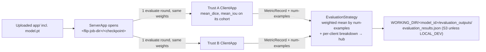

<!--
    Copyright (c) 2026 Flower Labs GmbH
    Licensed under the Apache License, Version 2.0 (the "License");
    you may not use this file except in compliance with the License.
    You may obtain a copy of the License at
        http://www.apache.org/licenses/LICENSE-2.0
    Unless required by applicable law or agreed to in writing, software
    distributed under the License is distributed on an "AS IS" BASIS,
    WITHOUT WARRANTIES OR CONDITIONS OF ANY KIND, either express or implied.
    See the License for the specific language governing permissions and
    limitations under the License.
-->

# 3D spleen segmentation evaluation (Flower)

Flower twin of the FLARE evaluation tutorial at
`fl-tutorials/nvflare/image_evaluation/3d_spleen_segmentation_evaluation`. It scores a pre-trained
MONAI UNet (the model the [3D spleen segmentation](../../image_segmentation/3d_spleen_segmentation)
tutorial trains) on each trust's cohort without training it: the `ServerApp` loads the checkpoint,
every `ClientApp` evaluates it on its own `input_`/`label_` NIfTI pairs, and the strategy averages the
metrics.



## At a glance

| | |
|---|---|
| What you upload | the `app/` package, with the `model.pt` that `make download-checkpoints` places in it (the e2e smoke uploads it as one of the model files) |
| Job type | `evaluation` (`job_type` in `app/config.json`; the `fl-apps/flower/evaluation` template) |
| Imaging | **on**, with **DICOM to NIfTI on** — the app pairs each converted `input_*.nii.gz` with the `label_*.nii.gz` uploaded as data enrichment and refuses to run when no pair exists (see the training tutorial's *data enrichment* section) |
| Cohort query | none of its own: the project uses the training tutorial's [`query.sql`](../../image_segmentation/3d_spleen_segmentation/query.sql) |
| Dataset | `make -C fl-tutorials download-spleen-data` (MSD images + the checkpoint, into `fl-tutorials/data/`) |
| Simulator | `make -C fl-tutorials run-tutorial TUTORIAL=3d_spleen_segmentation_evaluation FL_BACKEND=flower` (GPU) |

## Key Features

- **Evaluation-only**: No training, only evaluation of a pre-trained model
- **Customisable metrics**: the metrics are whatever `client_app`/`task.py` compute and return (this tutorial reports Dice and IoU); the server aggregates them natively
- **FLIP integration**: Uploads results to S3 and updates job status
- **WORKING_DIR environment variable**: Configurable output directory (default: `/app/runs`)

## Set up the project

### Folder structure

```shell
3d_spleen_segmentation_evaluation
├── app
│   ├── __init__.py
│   ├── client_app.py   # Defines your ClientApp (evaluation-only)
│   ├── config.json     # Configuration for evaluation job
│   ├── config.toml     # run-config overrides fl-api applies on a platform submit (the checkpoint name)
│   ├── data_loading.py # MONAI transforms + datalist (test data only)
│   ├── models.py       # Defines model creation
│   ├── server_app.py   # Defines your ServerApp with checkpoint loading
│   ├── strategy.py     # EvaluationStrategy: native FedAvg aggregation + FLIP forwarding
│   ├── task.py         # Defines evaluation functions
│   └── transforms.py   # MONAI transforms for preprocessing
├── pyproject.toml      # Project metadata like dependencies and configs
└── README.md
```

### Dependencies

Nothing to install by hand: the simulator path below runs in the `flip-utils` environment (the
package set the FL images install) and `flwr run` builds a per-run environment from `pyproject.toml`
on top of it. `flip-utils` is deliberately not declared there (FLIP#767: a local `flwr run` would
install a PyPI release over the checkout).

## Running this tutorial

> **Two paths.** `make -C fl-tutorials run-tutorial TUTORIAL=3d_spleen_segmentation_evaluation FL_BACKEND=flower`
> runs it on the flwr simulator (first below), as FLARE's tutorials do — what the release check
> runs. To run it on the Flower containers by hand, use `fl-services/flower` (second below). The
> deployment wiring (the FL images, fl-api submit, SuperNode registration) is exercised end to end
> by `make -C flip-api e2e_smoke_spleen_evaluation FL_BACKEND=flower` against the dev stack
> (FLIP#1435). Use the make target rather than invoking `flwr run` directly.

### Run on the flwr simulator (`make run-tutorial`)

```bash
make -C fl-tutorials download-spleen-data          # MSD images + the evaluation checkpoint
make -C fl-tutorials run-tutorial TUTORIAL=3d_spleen_segmentation_evaluation FL_BACKEND=flower
```

Runs every ClientApp in-process — no SuperLink container, no SuperNodes, no fl-api, no Docker —
with the same `app/` code the Flower containers run. The one thing the simulator has to supply
itself is what fl-api injects at submit time on the platform: the ServerApp opens
`<flip-job-dir>/<checkpoint>`, so `sim-tutorial.sh` passes a `--run-config` pointing
`flip-job-dir` at `fl-tutorials/data/model_checkpoints` (where `download-spleen-checkpoint`,
part of `download-spleen-data`, puts `model.pt`) and `checkpoint` at that file. Nothing in
`app/` knows which runtime it is in. The deployment wiring (the FL images, fl-api submit, SuperNode
registration) is exercised by `make -C flip-api e2e_smoke_spleen_evaluation FL_BACKEND=flower`
against the dev stack.

A raw `flwr run` has five sharp edges in this project — a long-lived SuperLink caches its
environment, the ClientApp's working directory is a snapshot under `~/.flwr/apps/`, and
`WORKING_DIR` defaults to a container path — which is why the path is a make target rather than
a command: `sim-tutorial.sh` handles them, and stops only its *own* stale simulator processes
(a blanket `pkill -f flower-superlink` would also kill the FLIP dev stack's fl-server, whose
processes are visible in the host PID namespace). Two more edges make it five: `flwr run . local`
adopts whatever already listens on the local Control API port, so the script refuses to hand the
run to a SuperLink another checkout left behind; and `flwr run --stream` returns 0 whatever became
of the run, so the script's exit status is the run's own terminal status as the SuperLink reports
it. See the
[3D spleen segmentation README](../../image_segmentation/3d_spleen_segmentation/README.md) for the details.

### On the Flower containers, by hand

From the repository root:

```bash
make -C fl-tutorials/flower/image_evaluation/3d_spleen_segmentation_evaluation download-checkpoints  # fetch model.pt into the app
make -C fl-services/flower build   # build the fl-base / superlink / supernode images
make -C fl-services/flower up      # start fl-api, superlink, supernode-1, supernode-2
```

`download-checkpoints` places `model.pt` in the `app/` folder, where the
evaluation ServerApp reads it (via the `flip-job-dir` run-config value).

Submit the evaluation run against the `fl-api` control plane:

```bash
make -C fl-services/flower submit APP=3d_spleen_segmentation_evaluation
```

The default stack publishes no host ports; `make submit` execs into the fl-api
container and POSTs to its loopback API. To POST from the host or open the
Swagger UI, publish the fl-api port by editing the compose file and re-running
`make up`.

The FLIP API will:

1. Load the model checkpoint named by the `checkpoint` run-config value
2. Run evaluation across all connected SuperNodes
3. Aggregate metrics using the `EvaluationStrategy`
4. Save results to `WORKING_DIR/{model_id}/evaluation_outputs/`
5. Upload results to S3 (unless `LOCAL_DEV="true"`)
6. Update job status via FLIP API

`fl-services/flower/compose.dev.yml` wires the containers:

- `DEV_DATAFRAME` and `DEV_IMAGES_DIR` come from your shell (Docker Compose's
  `${VAR}` substitutions in each SuperNode's `volumes:` block). Export them to this
  tutorial's data under `fl-tutorials/data/` before `make up`; unset, `make up` points
  them at empty placeholders (`/tmp/flwr-dev-images`, `/tmp/flwr-dev-dataframe.csv`).
  `WORKING_DIR` is fixed by the Makefile to `fl-services/flower/runs` (gitignored), the
  same directory `sim-tutorial.sh` uses.
- Inside the containers the mounts land at stable locations (`/images`,
  `/dataframe_file`, `/app/runs`), and the `environment:` blocks point the app at
  those paths, so paths in the app resolve consistently regardless of your host layout.
- `fl-tutorials/flower` is mounted at `/app/src` in both the FL API and the SuperLink,
  so a tutorial submitted by name runs from there and the evaluation ServerApp reads
  `model.pt` from the `flip-job-dir` the FL API injects at submission time (this
  tutorial's `app/`, where `download-checkpoints` put it). On the platform the same
  path holds the uploaded bundle, `/app/src/<model_id>`.
- `make up` runs the stack `--insecure`; `make up-secure` runs it with TLS and
  SuperNode auth after `make provision`.

## Data Location

By default, the app reads from:

- `data/spleen/dataframe.csv`
- `data/spleen/images`

## Architecture

### Strategy Pattern

`EvaluationStrategy` in [strategy.py](app/strategy.py) is a thin subclass of Flower's
`FedAvg`. `FedAvg` already distributes the model and aggregates every metric the clients
return — a weighted average by `num-examples` — so the subclass adds only:

1. **FLIP forwarding**: `handle_client_metrics` / `handle_client_exception` push each
   client's metrics and any exceptions to the Central Hub. These need the full reply
   message, so they live in the `aggregate_evaluate` override.
2. **Per-client breakdown**: captures `{client_name: {metric_name: value}}` for the
   `evaluation_results.json` artifact uploaded to S3.

The metrics themselves are simply whatever `client_app.py` puts in its `MetricRecord` —
there is no metric declaration or validation.

## Notes

- **Evaluation only** (no training or parameter updates)
- **Metrics**: `MetricRecord` only accepts numeric values; the server aggregates whatever metric keys the client returns
- **FLIP integration**: Automatically uploads results and updates job status
- **Environment-agnostic**: Uses `WORKING_DIR` instead of hardcoded paths

## Configuration

### Metrics

Metrics are not declared in config. The client computes them in [`task.py`](app/task.py)
and returns them in its `MetricRecord`; the server's `FedAvg` strategy averages whatever
keys arrive (weighted by `num-examples`). To change which metrics are reported, edit the
`_METRICS` registry in `task.py`:

```python
_METRICS = {
    "mean_dice": lambda: DiceMetric(include_background=False, reduction="mean_batch"),
    "mean_iou": lambda: MeanIoU(include_background=False, reduction="mean_batch"),
}
```

Each metric name becomes a key in the aggregated results and a `LABEL` on the FLIP
Central Hub (e.g. `MEAN_DICE`, `MEAN_IOU`). No server or `pyproject.toml` change is needed.

### Environment Variables

- `flip-job-dir`: run-config value (in `config.toml`, not an env var) injected by the FL API at submission time; points at the app directory (`/app/src/<model_id>/app` on the shared volume) where the evaluation ServerApp reads the pre-trained model `.pt` file
- `WORKING_DIR`: Output directory for evaluation results (default: `/app/runs`)
- `LOCAL_DEV`: Set to `"true"` to skip S3 uploads during local development
- `DEV_DATAFRAME`: Path to CSV file with test data metadata
- `DEV_IMAGES_DIR`: Path to directory containing NIfTI images

### Checkpoint Configuration

The checkpoint to evaluate is set with a single `checkpoint` key under
`[tool.flwr.app.config]`. `pyproject.toml` names `model.pt`, which is what a tutorial run uses;
on the platform the `app/config.toml` uploaded with the app sets it (the platform's evaluation
template carries only a placeholder):

```toml
[tool.flwr.app.config]
checkpoint = "model.pt"
```

The ServerApp loads that file from `flip-job-dir` and distributes its weights to the clients.
