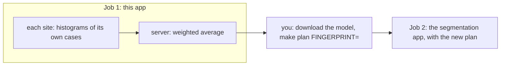

<!--
Copyright (c) 2026 Guy's and St Thomas' NHS Foundation Trust & King's College London
Licensed under the Apache License, Version 2.0 (the "License");
you may not use this file except in compliance with the License.
You may obtain a copy of the License at
    http://www.apache.org/licenses/LICENSE-2.0
Unless required by applicable law or agreed to in writing, software
distributed under the License is distributed on an "AS IS" BASIS,
WITHOUT WARRANTIES OR CONDITIONS OF ANY KIND, either express or implied.
See the License for the specific language governing permissions and
limitations under the License.
-->

# Planning an nnU-Net across sites: the federated dataset fingerprint

The [prostate segmentation tutorial](../3d_prostate_segmentation/README.md) trains a network that
nnU-Net *plans* from a fingerprint of the dataset, and every site has to build the same network, so
the plan must describe all sites together. That tutorial makes its plan on one workstation holding
every site's PI-CAI images, which works for public data and for nothing else. This tutorial is the
step a real federation runs first: a job that trains nothing, in which each site describes its own
cohort as a handful of histograms and the server's ordinary weighted average turns them into the
fingerprint of the pooled dataset. The plan is then made from that, and the training job runs as
before.

The job type is `fingerprint`, whose client is FLIP's own: you upload only the code that loads your
cases, and the platform's code decides what leaves a site.

On PI-CAI fold 0 the plan made this way is the same network as the committed one, see
[Agreement with the pooled plan](#agreement-with-the-pooled-plan).

## At a glance

| Item | Value |
|---|---|
| What you upload | `cases.py`, `config.json`, `data_loading.py` and `dataset.py` from `app/` |
| Job type | [fingerprint](../../../../fl-apps/flower/fingerprint/README.md) |
| Imaging | on, DICOM to NIfTI on; masks uploaded as data enrichment |
| Cohort query | [`../3d_prostate_segmentation/query.sql`](../3d_prostate_segmentation/query.sql) |
| Dataset | `make -C fl-tutorials prepare-prostate-local-data NUM_CASES=40` (simulator) |
| Simulator | `make -C fl-tutorials sim-tutorial TUTORIAL=3d_prostate_nnunet_fingerprint FL_BACKEND=flower` (CPU; Flower only) |

## How it works



nnU-Net's planner reads four things from the per-case lists of a fingerprint: the median (and, for a
thick-slice axis, the 10th percentile) of each axis's voxel spacing, the median of each axis's
cropped shape, the median shape the cases would have after resampling to the target spacing, and the
number of cases. Each is a per-axis quantile or a count, so a site sends, for each axis, **the share
of its cases** at each spacing, each shape and each physical extent (shape × spacing, which is what
the resampled shape depends on), together with its mean per-case histogram of the T2 intensities
inside the gland and the share of cases at each crop ratio. The reply is weighted by the site's case
count, so the server's average of the shares is the pooled dataset's own histogram. The site's case
count travels in a slot of its own, from which the pooled count is recovered.

Values are binned by rounding to a grid fixed in `app/config.json`. A spacing of exactly 0.5 mm or a
shape in voxels comes back unchanged; anything else is accurate to half a bin (0.0005 mm of spacing,
0.05 mm of extent, half an intensity unit).

Before it replies, a site applies a **small-cell rule**: a bin holding fewer than five of its cases is
not released, and those cases are counted in the nearest bin that holds at least five. The pooled
quantiles are therefore those of the pooled cases only up to that rule. The planner reads medians and
one 10th percentile, which sit in well-populated bins, and on PI-CAI the rule changes none of them.

One round is enough: what a site sends does not depend on what it receives.

## Folder structure

```text
3d_prostate_nnunet_fingerprint
├── app/
│   ├── cases.py              # UPLOAD: iter_cases(context), this cohort's studies in nnU-Net's axis order
│   ├── config.json           # UPLOAD: job_type, MODALITY, the floors and the histogram grids
│   ├── data_loading.py       # UPLOAD: byte-copy of the segmentation tutorial's (series selection, masks)
│   ├── dataset.py            # UPLOAD: byte-copy of the segmentation tutorial's (affine-matched loading)
│   ├── config.toml           # run-config overrides (one round; the template's default too)
│   ├── client_app.py         # byte-copy of fl-apps/flower/fingerprint: cases -> histograms -> reply
│   ├── fingerprint.py        # byte-copy: the per-case crop, the histograms, the floors, the way back
│   ├── models.py             # byte-copy: the "model", a module whose buffers are the histograms
│   ├── server_app.py         # byte-copy: FedAvg + FLIP status
│   └── strategy.py           # byte-copy: per-client metrics
├── docs/picai_fold0_geometry.csv   # PI-CAI fold 0's spacings and shapes, for the agreement test
├── export_fingerprint.py     # host-side: the downloaded model -> dataset_fingerprint.json
├── pyproject.toml            # flwr app config for the simulator
└── README.md
```

The five byte-copies are there for the simulator. On the platform the template's own copies run
whatever is uploaded under those names.

## Running this tutorial

### In the simulator

```bash
make -C fl-tutorials prepare-prostate-local-data NUM_CASES=40
make -C fl-tutorials sim-tutorial TUTORIAL=3d_prostate_nnunet_fingerprint FL_BACKEND=flower
```

Two simulated sites split the cohort; each needs at least ten usable studies (see
[Privacy](#privacy-what-leaves-a-site)), which is why the default `NUM_CASES` of 10 is not enough. The
ServerApp writes `FL_global_model.pt` under `$WORKING_DIR/<model-id>/training_outputs/`
(`fl-services/flower/runs/` by default). From the segmentation tutorial's directory, plan from it:

```bash
cd fl-tutorials/flower/image_segmentation/3d_prostate_segmentation
uv sync --group planning
make plan FINGERPRINT=../../../../fl-services/flower/runs/<model-id>/training_outputs/FL_global_model.pt
```

`make plan FINGERPRINT=` runs `export_fingerprint.py` (which prints the case count and the pooled
medians) and then the same planner the pooled route uses, and copies the plan into the segmentation
app. Set `PLAN_GPU_MEMORY_GB` to the smallest GPU in the federation.

### On the platform: two models in one project

A project holds several models that share its approved cohort, its trusts and the imaging already
pulled into XNAT, so the two jobs need no second approval and no second image pull.

1. Create the project with the segmentation tutorial's `query.sql`, wait for the image pull, and
   upload the masks as data enrichment, exactly as that tutorial describes.
2. Add a model, upload the four files marked UPLOAD above, and run it with **every** trust that will
   train: a site missing from this job is missing from the plan.
3. Download the result and run `make plan FINGERPRINT=<FL_global_model.pt>` as above.
4. Add a second model, choose the first under **Derived from**, upload the segmentation tutorial's
   `app/` with the new `nnUNetPlans_segmentation.json`, and train.

**Derived from** is how the hub records that the second model's plan came from the first: the
training model's page links to the fingerprint model. It is a record, not a check, so also note the
plan's provenance in the segmentation README as that tutorial asks.

## Agreement with the pooled plan

PI-CAI fold 0, 300 studies (ZGT 76, PCNN 69, RUMC 155), `t2w`, 24 GB budget. "Committed" is the
segmentation tutorial's plan. "Pooled" is `make plan` over the three site folders on one host, and
"federated" is this app in the simulator followed by `make plan FINGERPRINT=`, both on the same
`prepare-prostate-local-data` tree (runs of 2026-11-24 and 2026-11-25).

| | committed | pooled | federated |
| --- | --- | --- | --- |
| cases | 300 | 300 | 300 |
| median spacing (d, h, w) | `[3.0000007, 0.5, 0.5]` | `[3.0, 0.5, 0.5]` | `[3.0, 0.5, 0.5]` |
| target spacing (d, h, w) | `[2.9999986, 0.5, 0.5]` | `[3.0, 0.5, 0.5]` | `[3.0, 0.5, 0.5]` |
| median shape | `[21, 383, 383]` | `[21, 383, 383]` | `[21, 383, 383]` |
| patch size, stages, kernels, strides, batch size | `[24, 384, 384]`, seven stages | identical | identical |
| foreground intensity mean | 214.54 | 214.55 | 214.58 |
| foreground intensity std | 116.10 | 116.10 | 116.10 |
| foreground median, 0.5th and 99.5th percentile, min, max | 196, 28, 619, 0, 1484 | identical | identical |

The three plan files differ in nothing else. The committed plan's spacing carries float32 digits of
its dcm2niix headers, which neither run on this tree reproduces. The intensity mean moves in the
fourth digit because nnU-Net pools a random sample of each case's foreground voxels (a different
sample at each run) and this app pools every one; it is a normalisation constant and changes no
shape. So the federated plan is as close to the committed one as a second pooled run is.

The simulator split the 300 studies 127 / 173 over two sites, not by centre, and the federated column
is with the small-cell rule on: the plan file is byte for byte the one the job produced before the
rule existed. The job took 72 seconds on CPU.

`fl-tutorials/tests/test_prostate_fingerprint.py` holds the geometry half of this without the
dataset: it pools `docs/picai_fold0_geometry.csv` (each site's count of cases per spacing and cropped
shape, taken from the public data) through the histograms and requires every number the planner
reads to equal the one computed from the cases directly.

## Privacy: what leaves a site

A site sends six arrays of fixed size and its case count. No image, mask, voxel sample, study
identifier or per-case record is sent.

| Array | What it holds | Size with the shipped config |
| --- | --- | --- |
| `spacing`, `shape`, `extent` | per axis, the share of the site's cases in each bin | 3 × 10,001; 3 × 2,049; 3 × 10,001 |
| `intensity` | the mean over cases of each case's normalised histogram of T2 values inside the gland | 1 × 4,096 |
| `relative_size` | the share of cases at each crop ratio | 1,001 |
| `site_cases` | the site's case count, in its own slot | 64 |

What this does and does not protect:

- **No bin describes one or a few studies.** Each spacing, shape, extent and crop-ratio bin a site
  releases holds none of its cases or at least five (the small-cell rule above). Without it most bins
  would be small: on PI-CAI fold 0, 103 of the 163 occupied bins across the three centres hold fewer
  than five studies, and several hold one. What remains is acquisition geometry per axis, with the
  three axes unlinked and no identifier.
- **The intensity histogram is released as computed.** It is the mean of at least ten per-case
  histograms, so no bin of it is a count of studies, but it is not covered by the small-cell rule.
- **The hub sees each site's arrays in the clear.** FLIP has no secure aggregation, so the pooling
  hides a site from the researcher who downloads the result, not from the server.
- **No local differential privacy.** The platform's clip-and-noise step is calibrated for weight
  updates and would turn the histograms into noise without any error, so the job type's client does not
  apply it.

Three floors apply, enforced in different places:

| Floor | Enforced by | Value |
| --- | --- | --- |
| The trust's disclosure floor on the cohort (`COHORT_QUERY_THRESHOLD`, distinct patients) | the trust's own data-access-api, before the app sees a row | set by each trust, default 10 |
| A minimum number of usable studies before a site releases its histograms | the job type's client (platform code) | 10; `MIN_SITE_CASES` in `app/config.json` can raise it, not lower it |
| A minimum number of studies in any released geometry bin | the job type's client (platform code) | 5; `MIN_CELL_COUNT` can raise it, not lower it |

The last two floors are in the job type's `client_app.py` and `fingerprint.py`, which ship with the
platform and which an upload cannot replace: a file uploaded under either name is discarded. That is
a fixed code path, not a sandbox. `cases.py` runs in the same process, so reviewing it before approval
is still what stands between a site's data and anything else it might do. A refusal says only that the
site has too few usable cases; the count goes to the site's own log, since Flower forwards a client's
error text to the hub.

## Configuration

`app/config.json`:

| Key | Meaning |
| --- | --- |
| `MODALITY` | which of the study's series to fingerprint (`t2w`, `adc`, `hbv`); must match the training app's |
| `MIN_SITE_CASES` | the case floor above; values below 10 are ignored |
| `MIN_CELL_COUNT` | the small-cell floor above; values below 5 are ignored |
| `SPACING_BIN_MM`, `MAX_SPACING_MM` | spacing grid. A case beyond the maximum is refused, not clipped |
| `MAX_SHAPE` | largest cropped shape, in voxels, on any axis. Refused beyond it |
| `EXTENT_BIN_MM`, `MAX_EXTENT_MM` | physical-extent grid. Refused beyond the maximum |
| `INTENSITY_MIN`, `INTENSITY_MAX`, `INTENSITY_BIN` | intensity grid. Values outside are clipped into the end bins |
| `NUM_CHANNELS` | image channels (1: the app loads one series) |

The server and every site size their arrays from this file, so it must be the same upload everywhere;
a mismatch fails at the first round with a shape error. The intensity grid suits PI-CAI's T2 values
(foreground mean about 215). MR intensities have no fixed scale, so check the range for other data:
`export_fingerprint.py` prints the pooled mean and standard deviation, and a maximum equal to
`INTENSITY_MAX` means values were clipped.

## Limitations

- Flower only, like the segmentation tutorial. On NVFLARE the percentile-privacy filter would need
  to be kept off the histograms, as the local-DP mod is here.
- One image channel. nnU-Net's CT normalisation reads the intensity statistics per channel; a
  multi-channel fingerprint needs `cases.py` to yield several series.

## References

- Isensee F, Jaeger PF, Kohl SAA, Petersen J, Maier-Hein KH. nnU-Net: a self-configuring method for
  deep learning-based biomedical image segmentation. *Nature Methods* 18, 203–211 (2021).
  [doi:10.1038/s41592-020-01008-z](https://doi.org/10.1038/s41592-020-01008-z). The fingerprint and
  the planner are nnU-Net v2's.
- Skorupko G, et al. Federated nnU-Net for privacy-preserving medical image segmentation.
  *Scientific Reports* (2025). [doi:10.1038/s41598-025-22239-0](https://doi.org/10.1038/s41598-025-22239-0),
  [arXiv:2503.02549](https://arxiv.org/abs/2503.02549); code at
  [faildeny/FednnUNet](https://github.com/faildeny/FednnUNet). Its Federated Fingerprint Extraction is
  the closest prior work. Each site sends its whole nnU-Net fingerprint; the server concatenates the
  per-case spacing and shape lists, takes case-weighted means of the intensity statistics, and returns
  the result to every site, which plans locally.
- Hindawi S, et al. Federated learning for lesion segmentation in multiple sclerosis: a real-world
  multi-center feasibility study. *Frontiers in Neurology* (2025).
  [doi:10.3389/fneur.2025.1620469](https://doi.org/10.3389/fneur.2025.1620469). A three-site nnU-Net
  federation on Kaapana that shared "image sizes, voxel spacings, and intensity characteristics"
  before training; the paper does not say how they were merged.
- Kaapana's federated nnU-Net workflow,
  [`run_nnunet_federated.py`](https://github.com/kaapana/kaapana/blob/develop/data-processing/processing-pipelines/nnunet-federated/processing-containers/nnunet-federated/files/run_nnunet_federated.py)
  (read November 2026). It also concatenates the sites' per-case spacing and shape lists and writes
  the combined fingerprint back to every site; intensity statistics are estimated from the sites'
  summaries or, in its "accurate" mode, recomputed from sampled voxel values the sites send.

This tutorial departs from all three in what leaves a site. There, every case's spacing and shape goes
to the server and on to the other sites. Here a site sends per-axis histograms with small cells folded
away, so no per-case record leaves, the platform's ordinary weighted average does the merging, and
the pooled intensity median and percentiles are those of the pooled data, not an average of site
values. The plan is made by the researcher from the downloaded result, not at each site.

- Saha A, et al. Artificial intelligence and radiologists in prostate cancer detection on MRI
  (PI-CAI): an international, paired, non-inferiority, confirmatory study. *The Lancet Oncology* 25,
  879–887 (2024). The dataset.

To cite FLIP itself, see [`CITATION.cff`](../../../../CITATION.cff).
