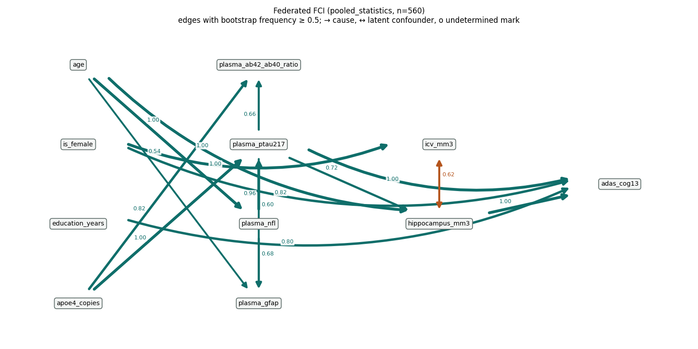
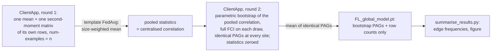

<!--
Copyright (c) 2026 Flower Labs GmbH
Copyright (c) 2026 Guy's and St Thomas' NHS Foundation Trust & King's College London
Licensed under the Apache License, Version 2.0 (the "License");
you may not use this file except in compliance with the License.
You may obtain a copy of the License at
    http://www.apache.org/licenses/LICENSE-2.0
Unless required by applicable law or agreed to in writing, software
distributed under the License is distributed on an "AS IS" BASIS,
WITHOUT WARRANTIES OR CONDITIONS OF ANY KIND, either express or implied.
See the License for the specific language governing permissions and
limitations under the License.
-->

# Biomarker causal discovery — FLIP tutorial (Flower)

> **Read the [NVFLARE README](../../../nvflare/tabular_causal_discovery/biomarker_causal_discovery/README.md) first.**
> This is the Flower twin of that tutorial. The method, the data and the results are documented
> there once; this page covers only what differs on Flower.

Federated **bootstrapped FCI** over tabular Alzheimer's-disease biomarkers (plasma markers, brain
volumes, cognition, demographics; one row per person, no imaging), as a Flower app on FLIP's
`standard` template. Nothing is trained: the sites exchange the sufficient statistics of a
conditional-independence test — or, in the second mode, their votes on the graph skeleton — and
the template's FedAvg turns those into the pooled analysis. The result is a partial ancestral
graph with a bootstrap frequency on every edge.



*The output: the partial ancestral graph the two simulated sites recover from the real ADNI
cohort (560 participants, 50 bootstraps), edges labelled with their bootstrap frequency. The
repository ships this summary figure and the converter, never data (see the NVFLARE README's
[Data](../../../nvflare/tabular_causal_discovery/biomarker_causal_discovery/README.md#data) section).*



## Layout

```
biomarker_causal_discovery/
├── pyproject.toml          # flwr app definition for the local simulator only
├── query.sql               # the OMOP cohort query (not uploaded; set on the project)
├── summarise_results.py    # FL_global_model.pt -> edge-frequency table + PAG figure
├── docs/                   # the README figure (summarise_results.py draws it)
└── app/                    # <- what you upload
    ├── client_app.py       # the ClientApp: the transport around federated_fci.client_round
    ├── federated_fci.py    # the federation: statistics, voting, FCI orientation, summaries
    ├── models.py           # get_model(): a parameter-free module holding the exchanged arrays
    ├── config.json         # federation mode, bootstraps, variables, background knowledge
    ├── config.toml         # run-config overrides fl-api applies at submit (rounds, DP off)
    ├── server_app.py       # byte-identical to fl-apps/flower/standard/app/  (platform-owned)
    └── strategy.py         # byte-identical to fl-apps/flower/standard/app/  (platform-owned)
```

`federated_fci.py`, `models.py`, `config.json`, `query.sql` and `summarise_results.py` are
byte-identical to the NVFLARE tutorial's copies. The NVFLARE copies are the reference;
`scripts/check_tutorial_sync.sh` fails if the two drift. `server_app.py` and
`strategy.py` are the template's: flip-api keeps its own copy of those and discards an uploaded
one, so editing them here would make the simulator run something the platform does not.

## Configuration: two files

`FEDERATION` in `app/config.json` selects one of two modes: `pooled_statistics` ("pooled mode" below) or `layer_voting` ("voting mode").

- `app/config.json` — everything that defines the analysis (`FEDERATION`, `N_BOOTSTRAPS`,
  `ALPHA`, `VARIABLES`, `LOG_TRANSFORM`, `SCALE`, `KNOWLEDGE`, …; the table in the NVFLARE README).
  It is the only per-tutorial knob that rides through the upload flow, which is why the ClientApp
  reads it rather than `run_config`.
- `app/config.toml` — the run-config keys fl-api passes to `flwr run --run-config` at submit:
  `num-server-rounds = 2` (pooled mode; the NVFLARE README's config table has the rounds formula)
  and `dp-enabled = false`. On the simulator the same values come from `pyproject.toml`'s
  `[tool.flwr.app.config]`.

`pyproject.toml` deliberately does not declare `flip-utils`: a declared copy would shadow the one
from your checkout (FLIP#767). It does declare `causal-learn`, because the per-run environment the
simulator builds needs it, just as it needs torch. On the platform, the FL image already carries
`causal-learn` through flip-utils' `full` extra.

## How the ClientApp maps onto the template

| Template expectation | What this app does |
|----------------------|--------------------|
| `get_model()` with no arguments, a torch `state_dict` to average | a module whose buffers are the seven exchanged arrays, sized from `config.json` |
| `@app.train` returns `arrays` + `metrics` with `num-examples` | returns the state the site wants the global one to become; `num-examples` is the site's row count (pooled mode) or 1 (voting mode), so the template's weighted mean is the pooled statistic or the vote share |
| `@app.evaluate` reports a `MetricRecord` | edge counts of the final PAGs (`stable_edges`, `mean_edges_per_pag`, …) |
| best-model selection by a reported metric | off (`best-model-metric = ""`): "best" has no meaning for a federated state |
| `flip_local_dp_mod` on training replies | registered as in every FLIP app, disabled by `dp-enabled = false` (why: the NVFLARE README's Privacy section); the mod logs a warning that the update is unprivatised, which is accurate |

Site identity comes from `flip.flower.identity.client_identity` (`SUPERNODE_NAME` when deployed,
`partition-id` under the simulator) and, under `LOCAL_DEV`, `partition_cohort` slices the shared
CSV per site. The same trailing site number picks the site's slot in `site_counts`, the array
through which every site learns the pooled sample size Fisher's z needs.

## Differential privacy

Off for this tutorial (`dp-enabled = false` in both `pyproject.toml` and `config.toml`); the
NVFLARE README's "Privacy" section is the one place that says why, what leaves a site and what is
and is not protected. What is Flower-specific:

- The upload path does not require `config.toml`, and without it the base bundle's
  `dp-enabled = true` would clip and noise the statistics silently. The ClientApp therefore refuses a
  run whose run config turns the mod on, reading it as the mod does (`LocalDpConfig.from_run_config`:
  a missing key means on).
- Flower forwards a client's exception text to the hub, which is why every refusal in
  `federated_fci` names neither a count nor a column nor a statistic. If a round fails after a site
  has released its statistics, the ClientApp still sends the payload that zeroes them, and the job
  fails at the next task.
- The ClientApp fetches the cohort once per run and keeps it in `context.state`, so a trust logs one
  row-level egress per run, not one per round.
- Flower's FedAvg sums exactly, so a finished run's statistics buffers are exactly zero (NVFLARE's
  float32 aggregation leaves ulps).

## Data

The cohort is real ADNI data, which you obtain under your own licence: apply for access, download
the five IDA tables and convert them exactly as the NVFLARE README's
["Running on real ADNI data"](../../../nvflare/tabular_causal_discovery/biomarker_causal_discovery/README.md#running-on-real-adni-data)
describes:

```bash
make -C fl-tutorials convert-adni-cohort ADNI_DIR=~/adni_tables
```

This writes `dataframe.csv` to the gitignored `fl-tutorials/data/ad_biomarkers/`, which is where
`sim-tutorial.sh` points `DEV_DATAFRAME` (`<data root>/ad_biomarkers/dataframe.csv`).

To keep the cohort elsewhere, convert with `OUT=` and run with `SIM_DATA_ROOT=` set to its parent:

```bash
make -C fl-tutorials convert-adni-cohort ADNI_DIR=~/adni_tables OUT=/secure/flip-data/ad_biomarkers
SIM_DATA_ROOT=/secure/flip-data make -C fl-tutorials run-tutorial TUTORIAL=biomarker_causal_discovery FL_BACKEND=flower
```

Every ClientApp slices its own `person_id`-modulo partition from that `dataframe.csv`. What the Data
Use Agreement requires of you is in the NVFLARE README's "Data" section.

On the platform the cohort is `query.sql`, run on each trust's OMOP database. Nothing ADNI-derived may be
published on the shared dev trusts. A licence holder loads their own converted cohort into a local dev stack (see
[On the platform](#on-the-platform-or-make-e2e_smoke_causal)).

## Expected performance

Reference run: the same as the NVFLARE README's (the 560-participant ADNI cohort over two sites of 280,
50 bootstraps, pooled mode).

- **Result:** 16 edges at frequency ≥ 0.5. These are all 14 stable edges of the centralised analysis,
  plus two pTau217 orientations near 0.5. The NVFLARE README lists the frequencies.
- **Time:** well under a minute of compute once the per-run environment exists.
- **Match with NVFLARE:** both backends compute the same statistics and the same PAGs. The module is
  byte-identical, the test suite pins the pooled result to centralised FCI, and the pooled bootstrap
  stream is `[SEED, 104729]` with no site term. So the `summarise_results.py` edge table matches the
  NVFLARE one, except where a test sits at α.
- **The one known difference:** NVFLARE's float32 aggregation moves the pooled statistics by ulps. On this
  cohort that flips one of 50 bootstraps of one weak edge (Aβ42/40 → ADAS-Cog13: 0.32 on NVFLARE,
  0.34 here). The stable edges are the same.

The NVFLARE README's "Graph metrics" scores the final graph against two centralised references
(SHD and skeleton / oriented precision, recall and F1); `summarise_results.py --reference <edges.csv>`
computes the same block for a Flower run.

## Troubleshooting

The failure signatures in the NVFLARE README apply here too. One is Flower-specific:

- **`stable_edges` is 0 at the end of a run with the correct `num-server-rounds`.** The sites'
  `num-examples` was not forwarded, so the template's weighted mean degenerates. Check that the reply's
  `MetricRecord` carries `num-examples`.

## How to run

### Local run (the flwr simulator)

The first `flwr run` builds the per-run environment, which downloads torch and takes several minutes.

```bash
make -C fl-tutorials convert-adni-cohort ADNI_DIR=~/adni_tables   # once, from your own ADNI download (see Data)
make -C fl-tutorials run-tutorial TUTORIAL=biomarker_causal_discovery FL_BACKEND=flower
# layer_voting mode: set FEDERATION in app/config.json, then call the runner script directly.
# `run-tutorial` takes no extra arguments; sim-tutorial.sh passes everything after the tutorial
# name to `flwr run`. The round count depends on the mode (rounds formula: NVFLARE README config table).
bash fl-tutorials/flower/sim-tutorial.sh biomarker_causal_discovery --run-config 'num-server-rounds=6'
```

The ServerApp writes `FL_global_model.pt` under `$WORKING_DIR/<model-id>/training_outputs/`
(`fl-services/flower/runs/` by default); read it with

```bash
cd fl-tutorials/flower/tabular_causal_discovery/biomarker_causal_discovery
# add --reference <edges.csv> to score the final graph against another run's edge table
uv run --project ../../../../flip-utils --extra full --group dev python summarise_results.py \
    ../../../../fl-services/flower/runs/<model-id>/training_outputs/FL_global_model.pt --figure docs/recovered_pag.png
```

### On the platform (or `make e2e_smoke_causal`)

Upload `app/` as a `standard` job with imaging **off** (`has_imaging=false`), paste `query.sql` as
the cohort query, and keep `num-server-rounds` in `config.toml` at the mode's round count (2 for
`pooled_statistics`; the rounds formula is in the NVFLARE README's config table).
`make e2e_smoke_causal FL_BACKEND=flower` runs it on a local dev stack once your converted cohort is
loaded into the two dev trusts (details: the NVFLARE README's "On the platform"):

```bash
make -C trust load-adni-cohort TRUST_INDEX=1 OMOP_DB_PORT=5434   # GSTT
make -C trust load-adni-cohort TRUST_INDEX=2 OMOP_DB_PORT=5436   # KCH
```

That run's downloaded model summarises to the same 16 stable edges, with identical frequencies, as
the simulator run.

## References

As in the [NVFLARE README](../../../nvflare/tabular_causal_discovery/biomarker_causal_discovery/README.md#references):
FCI (Spirtes, Glymour & Scheines 2000; Zhang 2008; causal-learn), FedPC (Huang et al., *IEEE TBD*
2023 — the `layer_voting` mode), FedC²SL (Wang, Ma & Wang, *ECML PKDD* 2023 — the pooled-statistics
idea), and the centralised ADNI analysis this federates (N. Glazman, `adni_fci`, 2026). The ADNI
acknowledgement and the data version (download dates, plasma release) behind the
real-cohort numbers quoted above are in the NVFLARE README's References section.
