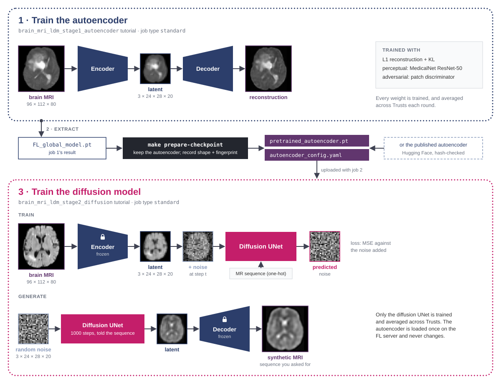
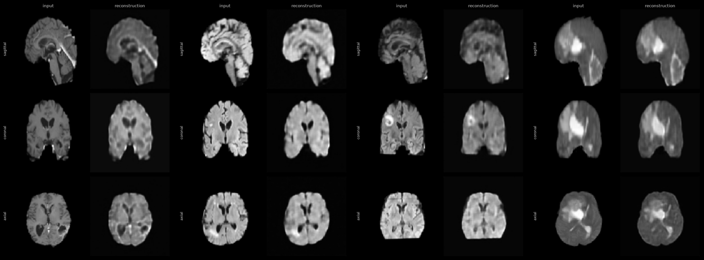

# Brain MRI autoencoder — FLIP tutorial

This tutorial trains a KL-regularised autoencoder (MONAI `AutoencoderKL`) and a patch discriminator
on 3-D brain MRI, using the **FLARE Client API** (`nvflare.client`), with the job defined in Python
via `FlipFedAvgRecipe`. It is the first of the two jobs that make a latent diffusion model for brain
MRI: the [latent diffusion tutorial](../brain_mri_ldm_stage2_diffusion/README.md) loads the autoencoder trained here and keeps it
frozen. The [index](../README.md) lists the other image-generation tutorials.

> **Only want to generate brain MRI? You can skip this tutorial.** We trained an autoencoder with it
> and published it on Hugging Face (`autoencoder/v3.1`), in
> [`aicentreflip/tutorials-brain-mri-latent-diffusion`](https://huggingface.co/aicentreflip/tutorials-brain-mri-latent-diffusion),
> whose model card says how it was trained and how it scores on held-out patients. The latent
> diffusion tutorial fetches and checks it for you: go straight to its
> [Getting the autoencoder](../brain_mri_ldm_stage2_diffusion/README.md#getting-the-autoencoder-do-this-first). Train your own
> here when you want one fitted to your own data or configuration.

Adapted from MONAI's 3-D latent diffusion example
([Project-MONAI/tutorials, `generation/3d_ldm`](https://github.com/Project-MONAI/tutorials/tree/d948baa25946d109556f4304ba999d7c74a97c4d/generation/3d_ldm),
Apache-2.0; Pinaya *et al.* [2022](https://arxiv.org/abs/2209.07162),
[2023](https://arxiv.org/abs/2307.15208)). The autoencoder is the configuration of its scripts,
[`config_train_32g.json`](https://github.com/Project-MONAI/tutorials/blob/d948baa25946d109556f4304ba999d7c74a97c4d/generation/3d_ldm/config/config_train_32g.json),
unchanged, 8 latent channels included; the example's notebook uses a smaller autoencoder with 3. We
changed the training for FLIP: federated across sites, all four MR sequences, whole-brain 2 mm
geometry, and a MedicalNet perceptual loss that loads uploaded weights instead of downloading them.

## How the two jobs fit together



A latent diffusion model has two parts, trained one after the other: an **autoencoder** that maps an
image to a much smaller latent volume and back, then a **diffusion model** that learns to generate
latents (Rombach *et al.* 2022). On FLIP they are separate jobs: this tutorial, then
[`brain_mri_ldm_stage2_diffusion`](../brain_mri_ldm_stage2_diffusion/). This job's result is extracted into a checkpoint, which the latent diffusion job
uploads and keeps **frozen**: only the diffusion model is trained, and only its weights are
aggregated. Keeping the jobs apart means one autoencoder can serve many diffusion runs, and that you
can skip this one by starting from the published autoencoder.

## Example outputs from this tutorial



Brain-MRI studies from one site, each shown as input vs reconstruction in the sagittal, coronal and
axial planes.

## Compatible job type

This tutorial is designed for `JOB_TYPE=standard`
([`fl-apps/nvflare/standard/`](../../../../fl-apps/nvflare/standard/)): an ordinary single-stage
FedAvg job, after which every site evaluates the final global model.

## Data requirements

The **brain MRI** cohort: MSD Task01_BrainTumour, the Medical Segmentation Decathlon's cut of BraTS
(see [`fl-tutorials/datasets/brain_mri/`](../../../datasets/brain_mri/)). On the platform,
`query.sql` selects up to 100 brain MR studies, one row per accession. Each study holds **four
co-registered MR sequences** (FLAIR, T1w, T1Gd and T2w), each a separate single-channel NIfTI
volume. The trainer reads NIfTI only, so create the project with **DICOM to NIfTI** on.

**Every sequence is a training sample.** One autoencoder learns to compress all four, which lets the
latent diffusion tutorial train a single model that is told which sequence to generate. Each file's
sequence is read from its name (`app_files/modality.py`), and `MODALITIES` in `config.json` selects
which sequences train:

```json
"MODALITIES": ["FLAIR", "T1w", "T1Gd", "T2w"]   // all four (shipped)
"MODALITIES": ["T1w"]                            // one sequence
```

Each volume is resampled to **2 mm voxels** (`voxel_spacing`), centre-cropped or padded to a
**96 × 112 × 80** grid (`spatial_shape`), then z-scored; training adds a small random affine. The
split into training and validation (`VAL_SPLIT`) is by accession, so the four sequences of one study
always land on the same side. The cohort's tumour labels are not used: training is unsupervised.

For a local run, download the data from the repository root:

```bash
make -C fl-tutorials download-brain-mri-msd-raw            # 7.6 GB MSD tar, once
make -C fl-tutorials download-brain-mri-data NUM_CASES=20  # -> fl-tutorials/data/brain_mri/
```

In the simulator the two sites train on different halves of these studies (the trainer splits on
the FLARE site name); on the platform each trust's cohort is already its own.

## The network

`app_files/models.py` builds two networks from `net_config` in `config.json`, trained and aggregated
together:

- **`AutoencoderKL`** (21.0 M parameters): an encoder of residual blocks at three resolutions (64,
  128 and 256 channels, two blocks per level, no attention) that maps a 96 × 112 × 80 volume to a
  **8 × 24 × 28 × 20** latent (8 latent channels, 8 times fewer values), and a mirror-image
  decoder that maps it back. The latent is a diagonal Gaussian, as in a variational autoencoder
  (Kingma & Welling 2014), but with a very small KL weight (`W_KL`, 1e-8), so it behaves almost like
  a plain autoencoder while keeping the latent space smooth enough to diffuse in.
- **`PatchDiscriminator`** (4 layers, 32 base channels, 11.2 M parameters; Isola *et al.* 2017),
  which scores local patches as real or reconstructed. It is 3-D by default; `net_config.discriminator.spatial_dims: 2` makes it score 12
  randomly chosen axial slices of each volume instead.

The autoencoder submodule must stay named `autoencoder`: the latent diffusion tutorial loads this
run's `autoencoder.*` weights by that prefix, and a renamed submodule would load nothing.

## The training logic

Each `train` task runs `LOCAL_ROUNDS` epochs on the received model and sends back the weight
difference. Per batch:

1. **Generator step.** `W_RECONSTRUCTION`·L1 + `W_PERCEPTUAL`·perceptual + `W_KL`·KL +
   `W_GAN`·adversarial: L1 between input and reconstruction, the MedicalNet perceptual distance
   (below), the KL divergence of the latent from a unit Gaussian, and the discriminator's verdict.
2. **Discriminator step.** The discriminator learns to tell real volumes from the (detached)
   reconstructions, with a least-squares adversarial loss scaled by `W_GAN`.

L1 alone gives blurry reconstructions; the perceptual and adversarial terms sharpen them. Both
critics exist only for training: the latent diffusion tutorial keeps the autoencoder alone.

The generator step runs under bfloat16 mixed precision and the discriminator step in float32.
bfloat16 has float32's range, so there is no gradient scaler. Under float16, whose largest value is
65504, the loss sometimes became NaN in the first iterations: at MONAI's clamp on the latent's
log-variance, sigma is about 22,000, and the latent passed to the decoder can overflow. The KL term is computed in float32. Gradients are accumulated over batches of
`BATCH_SIZE` to an effective batch of 8 volumes per optimiser step, and both networks use AdamW.

The learning rate starts at `LR_START`. Add `LR_END` and `LR_DECAY_EPOCHS` to `config.json` to
decay it along half a cosine over the job's first `LR_DECAY_EPOCHS` epochs, counted across rounds,
then hold it at `LR_END`. The other two image-generation tutorials use the same rule.

Validation runs on the held-out split after every epoch and reports the L1 loss and **foreground
SSIM**: the skull-stripped background, about 80 % of the grid, scores close to 1 for any
reconstruction, so it is excluded. On the `evaluate` task the trainer scores the global model the
same way and reports SSIM as `val_acc` (and L1 as `val_loss`).

## The perceptual loss (`make weights`)

The perceptual loss compares input and reconstruction in the features of **MedicalNet ResNet-50**, a
3-D network pretrained on 23 medical datasets: Chen, Ma & Zheng, *Med3D: Transfer Learning for 3D
Medical Image Analysis*, [arXiv:1904.00625](https://arxiv.org/abs/1904.00625) (2019), with weights
released by Tencent under the MIT licence
([`TencentMedicalNet/MedicalNet-Resnet50`](https://huggingface.co/TencentMedicalNet/MedicalNet-Resnet50)).
Cite the paper if you publish results that use this loss.

An FL app never downloads at run time (FLIP#1206): the FL server and a trust host may have no
internet route, and a downloaded file bypasses the scanned upload path. So the weights ship as an
uploaded file, prepared by:

```bash
make weights   # -> app_files/medicalnet_perceptual.pt (gitignored)
```

`make export` and `make sim` run it for you. **Upload the file with the other app files.** At 185 MB
it is too big to travel in the job bundle (FLARE gives each trust 10 s to acknowledge a deploy), so
`config.json` names it `SERVER_CHECKPOINT`, as the latent diffusion tutorial does its autoencoder: it
stays on the FL server, which loads it into the model's frozen `perceptual` submodule in the round-0
global model, and `AGGREGATE_ONLY_REGEX` leaves it out of aggregation. `make weights` checks the
published file's hash and converts it; each trust checks the weights it receives against
`MEDICALNET_FINGERPRINT` in `app_files/medicalnet_perceptual.py` before training.

## Training for real

The shipped `config.json` runs 2 rounds of 3 epochs (`GLOBAL_ROUNDS`, `LOCAL_ROUNDS`), like the
other tutorials: enough to run the whole job end to end in minutes, far too little to learn to
reconstruct a brain. The published autoencoder was trained with this tutorial for 10 rounds of 25
epochs, at the shipped constant learning rate, on 321 brain MR studies (1,284 volumes) split between
two simulated sites; the run took 12 h 28 min on one RTX 5090. To train your own, raise the two
counts in `config.json`:

```json
"GLOBAL_ROUNDS": 10,
"LOCAL_ROUNDS": 25
```

It is `autoencoder/v3.1` in [`aicentreflip/tutorials-brain-mri-latent-diffusion`](https://huggingface.co/aicentreflip/tutorials-brain-mri-latent-diffusion),
whose model card gives the full recipe and how it scores on held-out patients.

## Debugging

Sample images (tri-planar input vs reconstruction figures) need `"SAVE_DEBUG_SAMPLES": true` and a
local simulator run; loss curves come from `python ../dev/plot_utils.py`. Both are described in the
[Debugging](../README.md#debugging) section of the image-generation index.

## FLIP-specific values

`FLIP_PROJECT_ID` and `FLIP_QUERY` are read from environment variables (stubs in `.env.app`).
They are NOT passed as CLI flags because the SQL query contains spaces that don't survive
argparse whitespace-splitting. The trainer reads the query from `config_fed_client.json` at
runtime via `load_query()`. `.env.app` ships `FLIP_PROJECT_ID=dev`: LOCAL_DEV ignores the value,
but the `--project_id {project_id}` task arg needs a non-empty token to substitute.

## How to run

### Export (primary — no GPU needed)

Produces a complete FLARE job directory under `./fl_job/flip_fedavg/` including:
- `meta.json` with `custom_props.model_id` (dev UUID for local use)
- `app/config/config_fed_server.json` and `config_fed_client.json`
- `app/custom/` with the bundled `flip/` package and the app files staged alongside it

```bash
make export
```

or equivalently, after `make weights` (the **flip-utils** environment with the `full` extra the
`flare-fl-base` FL image installs, plus the `diffusion` group for the local plotting helper):

```bash
uv run --project ../../../../flip-utils --extra full --group diffusion python job.py --export --export-dir ./fl_job --n_clients 2 --num_rounds 1
```

> **Note:** `make run` (invoked by the tutorial runner `run-tutorial`/`run-all-tutorials`)
> delegates to `make sim`. Use `make export` (no GPU) or `make sim`/`make run` (GPU + data).

### Local simulation (requires a GPU + the dataset)

With the dataset downloaded (see *Data requirements*), run `make sim` here, or
`make -C fl-tutorials run-tutorial TUTORIAL=brain_mri_ldm_stage1_autoencoder` from the repository root. The simulator
runs one site at a time (a site peaks at about 20 GB of GPU memory) and writes its workspace, final
global model included, under `/tmp/nvflare/brain_mri_ldm_stage1_autoencoder/`.

### Overriding rounds and clients

`NUM_ROUNDS` (default `2`) and `N_CLIENTS` (default `2`) parameterise both `make export` and
`make sim`/`make run`, and propagate through the tutorial harness:

```bash
make sim NUM_ROUNDS=3
make export NUM_ROUNDS=3 N_CLIENTS=3
make -C fl-tutorials run-tutorial TUTORIAL=brain_mri_ldm_stage1_autoencoder NUM_ROUNDS=3
```

> **Local knob only.** `--num_rounds` governs local simulation and export. In production the FL API
> reads `GLOBAL_ROUNDS` from `config.json` at submit time and overrides whatever `job.py` baked into
> the exported config — deployed round counts come from `config.json`, never from these flags.

### On the platform

Run `make weights`, then upload through the FLIP UI, as a model with job type `standard`, every file
in `app_files/` (`trainer.py`, `config.json`, `models.py`, `transforms.py`, `modality.py`,
`medicalnet_perceptual.py`) **plus** the prepared `medicalnet_perceptual.pt`. Use
`query.sql` as the cohort query. The standalone FLARE submit path
(`make -C fl-services/nvflare submit`) is not wired, so the UI is the way in.

## References

- Rombach, R. *et al.* High-Resolution Image Synthesis with Latent Diffusion Models. CVPR 2022. [arXiv:2112.10752](https://arxiv.org/abs/2112.10752)
- Pinaya, W. H. L. *et al.* Brain Imaging Generation with Latent Diffusion Models. DGM4MICCAI 2022. [arXiv:2209.07162](https://arxiv.org/abs/2209.07162)
- Kingma, D. P. & Welling, M. Auto-Encoding Variational Bayes. ICLR 2014. [arXiv:1312.6114](https://arxiv.org/abs/1312.6114)
- Chen, S., Ma, K. & Zheng, Y. Med3D: Transfer Learning for 3D Medical Image Analysis. 2019. [arXiv:1904.00625](https://arxiv.org/abs/1904.00625)
- Isola, P. *et al.* Image-to-Image Translation with Conditional Adversarial Networks. CVPR 2017. [arXiv:1611.07004](https://arxiv.org/abs/1611.07004)
- Pinaya, W. H. L. *et al.* Generative AI for Medical Imaging: extending the MONAI Framework. 2023. [arXiv:2307.15208](https://arxiv.org/abs/2307.15208)
- Antonelli, M. *et al.* The Medical Segmentation Decathlon. *Nature Communications* 13, 4128, 2022. The brain MRI data, CC BY-SA 4.0.
