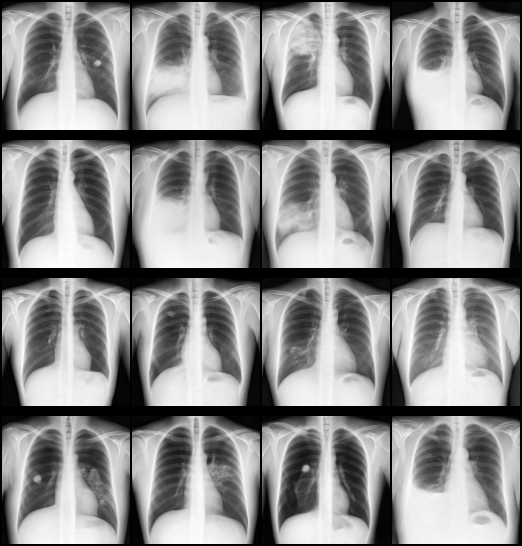

# Chest X-ray diffusion model — FLIP tutorial

This tutorial trains a denoising diffusion model (DDPM) that generates 2-D chest X-rays, using the
**FLARE Client API** (`nvflare.client`). A single network, MONAI's `DiffusionModelUNet`, learns to
remove noise from the images themselves, so there is one model, one loss and nothing to prepare
before training. The job is defined entirely in Python via `FlipFedAvgRecipe` — no hand-written
JSON configs required. It stands alone, and is the simplest of the
[image-generation tutorials](../README.md) to read.

The network, noise scheduler and inferer are MONAI's generative-model components: Pinaya *et al.*,
"Generative AI for Medical Imaging: extending the MONAI Framework",
[arXiv:2307.15208](https://arxiv.org/abs/2307.15208).

## Example outputs from this tutorial



Chest X-rays sampled from a model trained with this tutorial on Ark+.

## Compatible job type

This tutorial is designed for `JOB_TYPE=standard`: an ordinary single-stage FedAvg job, paired with
[`fl-apps/nvflare/standard/`](../../../../fl-apps/nvflare/standard/). That template requires
`trainer.py`, `config.json` and `models.py`; this app also needs its `transforms.py`.

## Data requirements

**A diffusion model needs thousands of images**, so a local run trains on Ark+ by default:

| `DATASET` | Images | Use it for | Download |
| --- | --- | --- | --- |
| `arkplus` (default) | ~1.9k per site, one folder per simulated site | training | `make -C fl-tutorials download-arkplus-finetuning-data` (~6.3 GB) |
| `mini` | 300 in total (`xrays_mini_300`), halved between the sites | testing code only | `make -C fl-tutorials download-xray-data` |

`DATASET=mini` leaves each site about 120 training images: enough to check that the job runs end to
end, not to learn to generate X-rays. Paths are in `.env.app` (`SITE{1,2}_*` for Ark+, `DEV_*` mini).

- Images must be DICOM (`.dcm`) in folders named by accession ID. Every `.dcm` under an accession's
  folder becomes one image; a file whose header does not parse is skipped.
- They are read with a pinned `PydicomReader(swap_ij=False)` (`app_files/transforms.py`): left to
  choose, MONAI picks `ITKReader` whenever `itk` is installed, and its default `swap_ij=True`
  transposes the radiograph, which no rotation or flip undoes.
- Each image is made grayscale (an RGB-stored radiograph is averaged), resized to `spatial_shape`
  (`[128, 128]`) and scaled to [0, 1]; training images also get a light random affine. The first
  `VAL_SPLIT` (0.2) of the image list is held out for validation.
- On the platform the cohort comes from `query.sql`, which returns each chest X-ray's `accession_id`
  with its OMOP findings. The trainer uses only `accession_id` and fetches that study's DICOM, so
  create the project with **DICOM to NIfTI** off: conversion would produce NIfTI nothing reads.

## The network

MONAI's `DiffusionModelUNet` in 2-D, built in `app_files/models.py` from `net_config` in
`app_files/config.json`. Each level halves the side of the feature map:

| Level | Channels | Feature map (128×128 input) | Self-attention |
| --- | --- | --- | --- |
| 0 | 64 | 128×128 | no |
| 1 | 128 | 64×64 | no |
| 2 | 192 | 32×32 | yes |
| 3 | 256 | 16×16 | yes |

Each level has two residual blocks (`num_res_blocks`; MONAI adds a third on the way up), and a middle
block adds self-attention at 16×16. `in_channels` and `out_channels` are 1: the input is a noisy
single-channel image and the output is the predicted noise. The model is unconditional (besides the
image, its only input is the noise step) and has 22.1 M parameters, trained from scratch.

## The training logic

Each `train` task runs `LOCAL_ROUNDS` epochs on the received global model. For every batch the
trainer draws a random timestep per image from a 1000-step DDPM schedule (`DDPMScheduler`,
scaled-linear β from 0.0015 to 0.0195), adds Gaussian noise at that step, asks the UNet to predict
the noise, and scores the prediction with MSE. Training runs in full precision with Adam, whose
state carries over between rounds. Gradients are clipped to a global norm of `GRAD_CLIP_NORM` (1.0;
`0` turns clipping off). The client then sends back its weight difference.

**Learning rate.** Half a cosine from `LR_START` (0.001) to `LR_END` (5e-05) over the first
`LR_DECAY_EPOCHS` (6) epochs, then held at `LR_END`. Epochs are counted across rounds (epoch `e`
of round `r` is epoch `r × LOCAL_ROUNDS + e` of the job). The shipped 6 is `GLOBAL_ROUNDS` ×
`LOCAL_ROUNDS`, so the decay spans the whole job; change it with them.

**Validation.** Every `VALIDATE_EVERY` (3) epochs, and on the last epoch of each round, the trainer
scores the same noise-prediction loss on the held-out split, and in local runs with
`"SAVE_DEBUG_SAMPLES": true` generates four sample images. The samples are the real check: the loss
barely moves between a model that generates radiographs and one that generates texture. Sampling
runs the full 1000-step reverse diffusion, so keep `VALIDATE_EVERY` well above 1 (`0` turns it off).
After the last round the server sends the final global model to every site as an evaluate task
(`validate`); the trainer scores it on the held-out split and reports `val_loss`.

### Cost, and sizing `BATCH_SIZE` and `net_config`

The UNet runs over every pixel at every step, so memory and compute grow with the image area:
doubling the side of `spatial_shape` roughly quadruples the activations, and self-attention grows
with the square of the positions at each attended level (at 256×256 the 32×32 level becomes 64×64,
16 times the attention work). If the GPU runs out of memory, lower `BATCH_SIZE` (shipped 6) first,
then narrow `channels` or drop attention at level 2. Channel counts must be multiples of 32
(`GroupNorm(32)`), and `spatial_shape` divisible by `2 ** (len(channels) - 1)` (8 here) so the skip
connections line up; `fl-tutorials/tests/` pins the latter.

## Training for real

The shipped `config.json` runs 2 rounds of 3 epochs, like the other tutorials: enough to run the
whole job end to end in minutes, not to learn to generate X-rays. We ran it with 2 rounds of 300
epochs on Ark+ (about 1.9k images per site), the learning rate decaying over the first 200, and
sample images saved every 25 epochs: they looked like chest X-rays from about epoch 150, much like
the ones at the top, and the run took 5 h 05 min on one RTX 5090. It is published in
[`aicentreflip/tutorials-xray-diffusion`](https://huggingface.co/aicentreflip/tutorials-xray-diffusion). The settings:

```json
"GLOBAL_ROUNDS": 2,
"LOCAL_ROUNDS": 300,
"LR_DECAY_EPOCHS": 200,
"VALIDATE_EVERY": 25,
"SAVE_DEBUG_SAMPLES": true
```

## Debugging

Sample images and loss curves for local runs: see [Debugging](../README.md#debugging) in the
image-generation index.
Here both go to `fl-tutorials/data/debug_samples/xray_diffusion/`.

## FLIP-specific values

`FLIP_PROJECT_ID` and `FLIP_QUERY` are read from environment variables (stubs in `.env.app`).
They are NOT passed as CLI flags because the SQL query contains spaces that don't survive
argparse whitespace-splitting. The trainer reads the query from `config_fed_client.json` at
runtime via `load_query()`. `.env.app` ships `FLIP_PROJECT_ID=dev`: LOCAL_DEV ignores the value,
but the `--project_id {project_id}` task arg needs a non-empty token to substitute.

## How to run

### Export (primary — no GPU needed)

```bash
make export
```

Writes a complete FLARE job to `./fl_job/flip_fedavg/` (`make clean` removes it). The Makefile runs
`job.py` in the **flip-utils** environment (`full` extra, `diffusion` group), equivalent to:

```bash
uv run --project ../../../../flip-utils --extra full --group diffusion python job.py --export --export-dir ./fl_job --n_clients 2 --num_rounds 1
```

### Local simulation (requires a GPU + the dataset)

```bash
make -C fl-tutorials download-arkplus-finetuning-data   # from the repository root, once
make sim                                                # trains on Ark+
make sim DATASET=mini                                   # testing code only
```

`DATASET=mini` needs `make -C fl-tutorials download-xray-data` first. `make run` runs `make sim`.

### Overriding rounds and clients

`config.json` carries `GLOBAL_ROUNDS` (federated rounds, 2) and `LOCAL_ROUNDS` (local epochs per
round, 3). Keep the name `LOCAL_ROUNDS`: with a single local-rounds key the FL API requires that
exact name and rejects the job otherwise.

`NUM_ROUNDS` (default `2`) and `N_CLIENTS` (default `2`) parameterise `make export` and `make sim`,
and propagate through the harness. They are **local knobs only**: on the platform the FL API applies
`config.json`'s `GLOBAL_ROUNDS` at submit time. The local datasets are split for `site-1` and
`site-2`, so keep `N_CLIENTS=2` for `make sim`.

```bash
make sim NUM_ROUNDS=3
make export NUM_ROUNDS=3 N_CLIENTS=3
make -C fl-tutorials run-tutorial TUTORIAL=xray_diffusion NUM_ROUNDS=3
```

### On the platform

Use `query.sql` as the project's cohort query, then upload **everything in `app_files/`**
(`trainer.py`, `config.json`, `models.py`, `transforms.py`) through the FLIP UI as a model with job
type `standard`.

## References

- Ho, J., Jain, A. & Abbeel, P. Denoising Diffusion Probabilistic Models. NeurIPS 2020. [arXiv:2006.11239](https://arxiv.org/abs/2006.11239)
- Dhariwal, P. & Nichol, A. Diffusion Models Beat GANs on Image Synthesis. NeurIPS 2021. [arXiv:2105.05233](https://arxiv.org/abs/2105.05233)
- Ronneberger, O., Fischer, P. & Brox, T. U-Net: Convolutional Networks for Biomedical Image Segmentation. MICCAI 2015. [arXiv:1505.04597](https://arxiv.org/abs/1505.04597)
- Pinaya, W. H. L. *et al.* Generative AI for Medical Imaging: extending the MONAI Framework. 2023. [arXiv:2307.15208](https://arxiv.org/abs/2307.15208)
