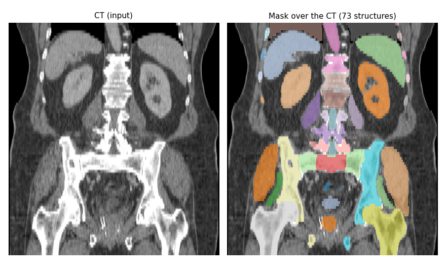

<!--
    Copyright (c) 2026 Guy's and St Thomas' NHS Foundation Trust & King's College London
    Licensed under the Apache License, Version 2.0 (the "License");
    you may not use this file except in compliance with the License.
    You may obtain a copy of the License at
        http://www.apache.org/licenses/LICENSE-2.0
    Unless required by applicable law or agreed to in writing, software
    distributed under the License is distributed on an "AS IS" BASIS,
    WITHOUT WARRANTIES OR CONDITIONS OF ANY KIND, either express or implied.
    See the License for the specific language governing permissions and
    limitations under the License.
-->

# Segmenting CT scans with TotalSegmentator

This tutorial runs [TotalSegmentator](https://github.com/wasserth/TotalSegmentator) on every CT scan of a cohort, at
each trust, and keeps the masks there. Nothing is trained and nothing is scored: there is no checkpoint to upload and
there are no labels. It is the worked example of the `inference` job type.

The server sends one task to every trust. Each trust predicts a mask per scan, stores it beside the scan, and replies
with three counts.

## At a glance

| Item | Value |
|---|---|
| What you upload | everything in `app_files/` |
| Job type | inference |
| Imaging | on, DICOM to NIfTI on; no labels |
| Cohort query | the spleen tutorial's [`query.sql`](../../image_segmentation/3d_spleen_segmentation/query.sql) |
| Dataset | `make -C fl-tutorials download-spleen-data` |
| Simulator | `make -C fl-tutorials run-tutorial TUTORIAL=totalsegmentator_inference` (GPU) |

## The use case



*One coronal slice of a CT from the local dataset, and the mask a simulator run stored for it. Each colour is one
structure; the twenty colours repeat.*

The `total` task outlines 117 structures: organs, bones, muscles and vessels. A mask holds one value per structure, in
TotalSegmentator's own numbering (`totalsegmentator.map_to_binary.class_map["total"]`), on the voxel grid of the image
it was predicted from.

The figure is built by `make overlay-figure` after a simulator run. It reads the voxels with nibabel directly, so it is
a picture of the data and of the stored mask, not of what the model was given.

## Where the model comes from

The model is not part of the app. TotalSegmentator and the weights of its `total` task are in the FLARE client image
(`flare-fl-client`), so a trust needs no route to the internet and the app uploads no checkpoint. That is what the
empty entry in `app_files/config.json` says:

```json
"models": { "totalsegmentator": {} }
```

Two rules follow for the app:

- **Import TotalSegmentator inside the function that uses it**, never at the top of a file. FLARE also loads app files
  on the server, and the server image does not have TotalSegmentator.
- **Never set `fast`.** It has its own weights, which the image does not hold, and an app cannot download anything at
  a trust. `fastest` (a 6 mm model that is in the image) is the quick option.

Only the `total` task is available. The weights of some other TotalSegmentator tasks need a licence and are not in the
image.

## Prerequisites

- Python 3.13+.
- A GPU, for the local simulator run (`make run`). Exporting the job with `make export` needs no GPU.
- The reference spleen dataset, for its CT scans only: run `make -C fl-tutorials download-spleen-data` (see the
  segmentation tutorial's [dataset setup](../../image_segmentation/3d_spleen_segmentation/README.md#dataset-setup-local-runs)).
  Its labels are not used.

## Weights setup

A local run has no FL image, so the weights are staged once on the host. From this folder:

```bash
make download-weights
```

This downloads 1.4 GB from TotalSegmentator's release assets into the gitignored `fl-tutorials/data/totalsegmentator/weights`,
with usage statistics switched off. `make run` runs this step for you. The app itself never downloads anything.

## App configuration

Default local development settings are in `.env.app`:

- `JOB_TYPE=inference`
- `DEV_IMAGES_DIR=../../../data/spleen/images`
- `DEV_DATAFRAME=../../../data/spleen/dataframe.csv`
- `TOTALSEG_HOME_DIR=../../../data/totalsegmentator/weights`
- `DEV_MASKS_DIR=../../../data/totalsegmentator/masks`

`make sim` resolves these to absolute paths so the simulator's client workers find them. The first two point at the
shared dataset. `TOTALSEG_HOME_DIR` is where TotalSegmentator looks for its weights; the FL image sets its own.
`DEV_MASKS_DIR` is where a local run keeps its masks, because the simulator has no XNAT.

The options in `app_files/config.json`:

| Key | Meaning |
|---|---|
| `totalsegmentator.task` | `total`, the only task whose weights are in the image |
| `totalsegmentator.roi_subset` | a list of structure names to predict, or `null` for all 117 |
| `totalsegmentator.fastest` | `true` for the 6 mm model: quicker and coarser |
| `totalsegmentator.device` | `gpu` or `cpu` |
| `mask_resource` | the XNAT resource the masks are stored in, `TOTALSEG` by default |

`app_files/meta.json` asks for one GPU at each trust.

`make sim`/`make export`/`make run` run `job.py` in the **flip-utils** environment with the `nvflare`, `full` and
`segmentation` extras, the package set the `flare-fl-client` FL image installs, so a local run matches the deployed image.

## Run the tutorial

`job.py` builds the recipe and either exports the job or runs it in the FLARE simulator. From this folder:

```bash
# Export the complete FLARE job for review or Docker deployment (no GPU, data or weights needed)
make export        # writes ./fl_job/flip_inference/

# SimEnv local simulation (requires GPU + data + weights)
make run           # downloads the weights if they are missing, then runs the simulator via `make sim`
```

To remove the exported job: `make clean` (deletes `./fl_job`).

## Where the masks go

At a trust, each mask is stored on the scan it was predicted from, in the trust's XNAT, as `pred_*.nii.gz` in the
`TOTALSEG` resource. The masks never leave the trust.

- **A second run on the same project does not replace them.** FLIP's imaging service refuses a file name the resource
  already holds, so the first run's mask stays and the second run reports `masks_saved` as 0.
- **The viewer cannot draw these files as they are.** XNAT's viewer shows DICOM segmentations, not NIfTI masks.

In the simulator the masks go to `DEV_MASKS_DIR`, and the two simulated sites each take half of the local scans.

## Output metrics

Each trust returns three counts, collected into `evaluation_results.json` and shown on the model page per trust:

- `studies_predicted`: scans for which a mask was predicted
- `studies_failed`: scans the model could not process
- `masks_saved`: masks that were stored

A scan that fails is counted and logged at the trust, and the other scans still run. No per-scan information is
returned.

## Expected performance

There is no curve: the job is one pass with no training. A normal simulator run on the first four scans of the dataset
(`download-spleen-data NUM_CASES=4`) looks like this:

| | Reference run |
|---|---|
| Result | `FINISHED:COMPLETED`, each site `studies_predicted: 2`, `studies_failed: 0`, `masks_saved: 2` |
| Time | 3 minutes in all; 57 to 100 s per scan with the two sites sharing one GPU |
| Hardware | one 24 GB NVIDIA TITAN RTX |

What a failed run looks like:

- **`No module named 'totalsegmentator'` at a trust**: the trust's FL client image is older than this job type.
- **A download error from `github.com` at a trust, or a read-only file system error**: the app asked for weights the
  image does not hold. Check that `task` is `total` and that `fast` is not set.
- **`masks_saved` is 0 with `studies_predicted` above 0**: the masks of an earlier run are still in the resource.

## Key files

- `app_files/inference.py`: the Client-API loop (find the scans, predict, store, reply with counts).
- `app_files/config.json`: the job type, the empty `models` entry and TotalSegmentator's options.
- `app_files/meta.json`: the GPU the job asks for at each trust.
- `job.py`: builds the inference recipe and runs export or the simulator.
- `docs/make_overlay_figure.py`: draws the figure above.

## References

TotalSegmentator is described in:

```bibtex
@article{wasserthal2023totalsegmentator,
  title   = {TotalSegmentator: Robust Segmentation of 104 Anatomic Structures in CT Images},
  author  = {Wasserthal, Jakob and Breit, Hanns-Christian and Meyer, Manfred T. and Pradella, Maurice and Hinck, Daniel
             and Sauter, Alexander W. and Heye, Tobias and Boll, Daniel T. and Cyriac, Joshy and Yang, Shan
             and Bach, Michael and Segeroth, Martin},
  journal = {Radiology: Artificial Intelligence},
  volume  = {5},
  number  = {5},
  year    = {2023},
  doi     = {10.1148/ryai.230024}
}
```

It is built on nnU-Net (Isensee et al., *Nature Methods*, 2021). This tutorial uses the released model as it is, in
version 2 with 117 structures, and changes nothing in it. The code and the `total` weights are under the Apache-2.0
licence (see `THIRD_PARTY_NOTICES.md`).
