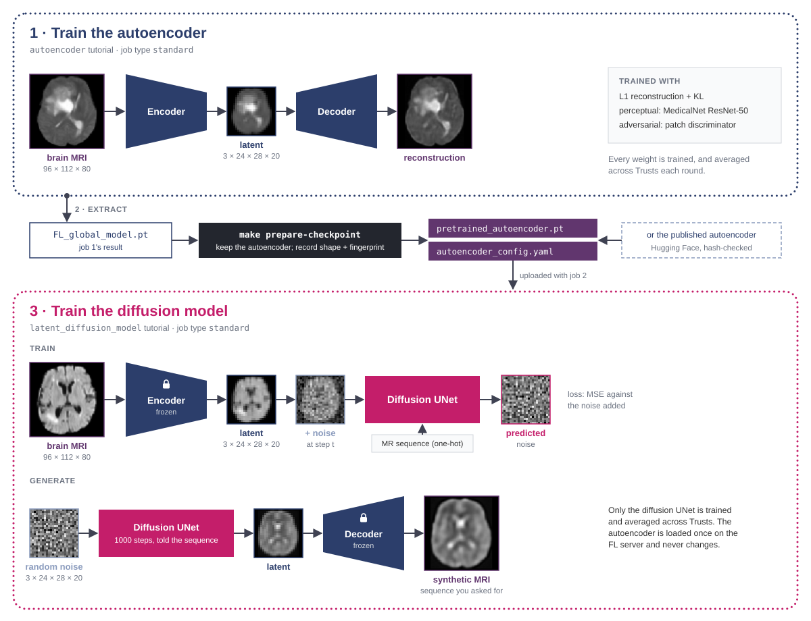

<!--
    Copyright (c) 2026 Guy's and St Thomas' NHS Foundation Trust & King's College London
    Licensed under the Apache License, Version 2.0 (the "License");
    you may not use this file except in compliance with the License.
    You may obtain a copy of the License at
        http://www.apache.org/licenses/LICENSE-2.0
    Unless required by applicable law or agreed to in writing, software
    distributed under the License is distributed on an "AS IS" BASIS,
    WITHOUT WARRANTIES OR CONDITIONS OF ANY KIND, either express or implied.
    See the License for the specific language governing permissions and
    limitations under the License.
-->

# Image synthesis tutorials (FLARE)

Three tutorials that train generative models on FLIP. Each is an ordinary federated-averaging job
(job type `standard`); two of them are the two halves of one latent diffusion model.

| Tutorial | Trains | Data | Needs before it runs |
| --- | --- | --- | --- |
| [`autoencoder`](autoencoder/) | an autoencoder that compresses 3-D brain MRI into a small latent volume | brain MRI (MSD Task01), four MR sequences | nothing |
| [`latent_diffusion_model`](latent_diffusion_model/) | a diffusion model that generates brain MRI *in that latent space*, told which MR sequence to make | brain MRI | an autoencoder: the published one, or your own from `autoencoder` |
| [`diffusion_model`](diffusion_model/) | a diffusion model that generates 2-D chest X-rays directly in pixels | chest X-rays (Ark+) | nothing |

## How they fit together



A latent diffusion model has two parts, trained one after the other: an **autoencoder** that maps an
image to a much smaller latent volume and back, then a **diffusion model** that learns to generate
latents. On FLIP the two are separate jobs. The autoencoder job's result is extracted into a
checkpoint, which the latent diffusion job uploads and keeps **frozen**: only the diffusion model is
trained, and only its weights are aggregated. Keeping the stages apart means one autoencoder can serve
many diffusion runs, and you can skip training it altogether by using the published one.

`diffusion_model` stands alone. It is the simplest of the three to read: no autoencoder, 2-D images,
the diffusion model works on pixels directly.

## The models

All three are built from MONAI's generative networks [7]. The two brain-MRI tutorials are adapted from
MONAI's 3-D latent diffusion example [10]: the autoencoder architecture, the noise schedule and the
latent scaling follow its configuration, and the training is changed for FLIP (federated across sites,
all four MR sequences with sequence conditioning, whole-brain 2 mm geometry, and a MedicalNet
perceptual loss that loads uploaded weights instead of downloading them).

### Autoencoder (`autoencoder`)

A **KL-regularised autoencoder**, the first stage of a latent diffusion model [1], in the 3-D form
used for brain MRI in [2]. MONAI's `AutoencoderKL` is a convolutional encoder of residual blocks at
three resolutions (64, 128 and 256 channels, two blocks each, no attention) that maps a
96 × 112 × 80 volume (2 mm voxels) to a 3-channel 24 × 28 × 20 latent, about 21 times fewer values,
and a mirror-image decoder that maps it back (20.9 M parameters). The latent is a diagonal Gaussian,
as in a variational autoencoder [3], but with a very small KL weight (1e-8), so it behaves almost like
a plain autoencoder while keeping the latent space smooth enough to diffuse in.

L1 reconstruction alone gives blurry volumes, so training adds two critics:

- a **perceptual loss**: the distance between input and reconstruction in the features of MedicalNet
  ResNet-50, a 3-D network pretrained on 23 medical datasets [4];
- an **adversarial loss** from a **patch discriminator** [5] (MONAI `PatchDiscriminator`, 11.2 M
  parameters) that judges local patches as real or reconstructed.

Both critics exist only for training. The latent diffusion tutorial keeps the autoencoder alone.

### Latent diffusion model (`latent_diffusion_model`)

A **denoising diffusion probabilistic model** (DDPM) [6] trained in the autoencoder's latent space
[1, 2]. MONAI's `DiffusionModelUNet` is a U-Net [8] of residual blocks at three resolutions (64, 128 and
256 channels) with self-attention at the two coarser ones. Given a noisy 3 × 24 × 28 × 20 latent and
the noise step, it predicts the noise that was added (49.3 M parameters). The schedule has 1000 steps
(scaled-linear β from 0.0015 to 0.0195), and latents are rescaled to unit variance before diffusion, as
in [1] (see *The latent scale factor* in its README).

The model is **conditioned on the MR sequence**: a one-hot vector over FLAIR, T1w, T1Gd and T2w enters
through cross-attention, so one model generates any of the four on demand. Generating runs the 1000
denoising steps from random latent noise and passes the result through the frozen decoder.

### Pixel-space diffusion model (`diffusion_model`)

The same DDPM recipe applied directly to 128×128 chest X-rays, with no autoencoder: a 2-D
`DiffusionModelUNet` at four resolutions (64, 128, 192 and 256 channels) with self-attention at the two
coarsest, unconditional (22.1 M parameters), on the same 1000-step schedule [6, 9]. It is the simplest of
the three, but its cost grows with the number of pixels, which is why the 3-D brain MRI tutorials work
in a latent space instead.

### References

1. Rombach, R. *et al.* High-Resolution Image Synthesis with Latent Diffusion Models. CVPR 2022. [arXiv:2112.10752](https://arxiv.org/abs/2112.10752)
2. Pinaya, W. H. L. *et al.* Brain Imaging Generation with Latent Diffusion Models. DGM4MICCAI 2022. [arXiv:2209.07162](https://arxiv.org/abs/2209.07162)
3. Kingma, D. P. & Welling, M. Auto-Encoding Variational Bayes. ICLR 2014. [arXiv:1312.6114](https://arxiv.org/abs/1312.6114)
4. Chen, S., Ma, K. & Zheng, Y. Med3D: Transfer Learning for 3D Medical Image Analysis. 2019. [arXiv:1904.00625](https://arxiv.org/abs/1904.00625)
5. Isola, P. *et al.* Image-to-Image Translation with Conditional Adversarial Networks. CVPR 2017. [arXiv:1611.07004](https://arxiv.org/abs/1611.07004)
6. Ho, J., Jain, A. & Abbeel, P. Denoising Diffusion Probabilistic Models. NeurIPS 2020. [arXiv:2006.11239](https://arxiv.org/abs/2006.11239)
7. Pinaya, W. H. L. *et al.* Generative AI for Medical Imaging: extending the MONAI Framework. 2023. [arXiv:2307.15208](https://arxiv.org/abs/2307.15208)
8. Ronneberger, O., Fischer, P. & Brox, T. U-Net: Convolutional Networks for Biomedical Image Segmentation. MICCAI 2015. [arXiv:1505.04597](https://arxiv.org/abs/1505.04597)
9. Dhariwal, P. & Nichol, A. Diffusion Models Beat GANs on Image Synthesis. NeurIPS 2021. [arXiv:2105.05233](https://arxiv.org/abs/2105.05233)
10. MONAI Consortium. 3-D latent diffusion example, Project-MONAI/tutorials `generation/3d_ldm`, Apache-2.0. [GitHub, commit d948baa](https://github.com/Project-MONAI/tutorials/tree/d948baa25946d109556f4304ba999d7c74a97c4d/generation/3d_ldm)

The brain MRI is the Medical Segmentation Decathlon's Task01 (Antonelli, M. *et al.* The Medical
Segmentation Decathlon. *Nature Communications* 13, 4128, 2022; CC BY-SA 4.0).

## Start here

Run these from the repository root. They use the FLARE simulator on your machine and need a GPU.

**1. Latent diffusion with the published autoencoder** — the shortest route to a generated brain MRI.

```bash
make -C fl-tutorials download-brain-mri-msd-raw           # 7.6 GB, once
make -C fl-tutorials download-brain-mri-data NUM_CASES=20
make -C fl-tutorials/nvflare/image_synthesis/latent_diffusion_model prepare-checkpoint   # fetch + verify the autoencoder
make -C fl-tutorials run-tutorial TUTORIAL=latent_diffusion_model
```

**2. Your own autoencoder, then latent diffusion.**

```bash
make -C fl-tutorials run-tutorial TUTORIAL=autoencoder
make -C fl-tutorials/nvflare/image_synthesis/latent_diffusion_model prepare-checkpoint \
    RAW_CHECKPOINT=/tmp/nvflare/autoencoder/flip_fedavg/server/simulate_job/FL_global_model.pt
make -C fl-tutorials run-tutorial TUTORIAL=latent_diffusion_model
```

**3. Pixel-space diffusion on chest X-rays.**

```bash
make -C fl-tutorials download-arkplus-finetuning-data     # ~6.3 GB
make -C fl-tutorials run-tutorial TUTORIAL=diffusion_model
```

A local run does `NUM_ROUNDS` rounds (default 1); `GLOBAL_ROUNDS` in `config.json` is what the platform
runs. Each tutorial's README has the knobs.

## On the platform

Each tutorial is uploaded as a model with job type `standard`. Upload **everything in its `app_files/`
directory** once it is prepared, not just the required `trainer.py`, `config.json` and `models.py`:
the apps import their other modules (`transforms.py`, `modality.py`, …), and two need files you
generate first.

| Tutorial | Prepare first | Cohort |
| --- | --- | --- |
| `autoencoder` | `make weights` (the MedicalNet perceptual-loss network) | brain MRI: the tutorial's own `query.sql` |
| `latent_diffusion_model` | `make prepare-checkpoint` (`pretrained_autoencoder.pt` + `autoencoder_config.yaml`) | brain MRI: the tutorial's own `query.sql` |
| `diffusion_model` | nothing | chest X-rays: the tutorial's own `query.sql` |

To feed your own platform-trained autoencoder into the latent diffusion tutorial, follow *Your own
autoencoder* in [its README](latent_diffusion_model/README.md#getting-the-autoencoder-do-this-first).

## Debugging

**Sample images.** A generative model's losses say little about its images, so in a local run the
tutorials can save them: reconstructions (autoencoder) or generated samples (both diffusion
tutorials). They are written only when all three hold:

| Condition | Set by |
| --- | --- |
| `"SAVE_DEBUG_SAMPLES": true` | you, in the tutorial's `config.json` (ships `false`) |
| `LOCAL_DEV=true` | the simulator (every trust sets `false`) |
| `DEBUG_SAMPLES_DIR` set | `make run` / `make sim` only |

On a trust the last two never hold, so nothing is written whatever `config.json` says, and the
plotting code (`dev/plot_utils.py`) is not even there: it is staged into simulator runs only, never
uploaded. Images land in `fl-tutorials/data/debug_samples/<tutorial>/` (gitignored); nothing sends
them anywhere.

**Loss curves.** After or during a local run, from the tutorial's directory:

```bash
DEBUG_SAMPLES_DIR=../../../data/debug_samples/<tutorial> python ../dev/plot_utils.py
```

It reads the simulator's logs and writes `losses_<site>.png` beside the samples.
