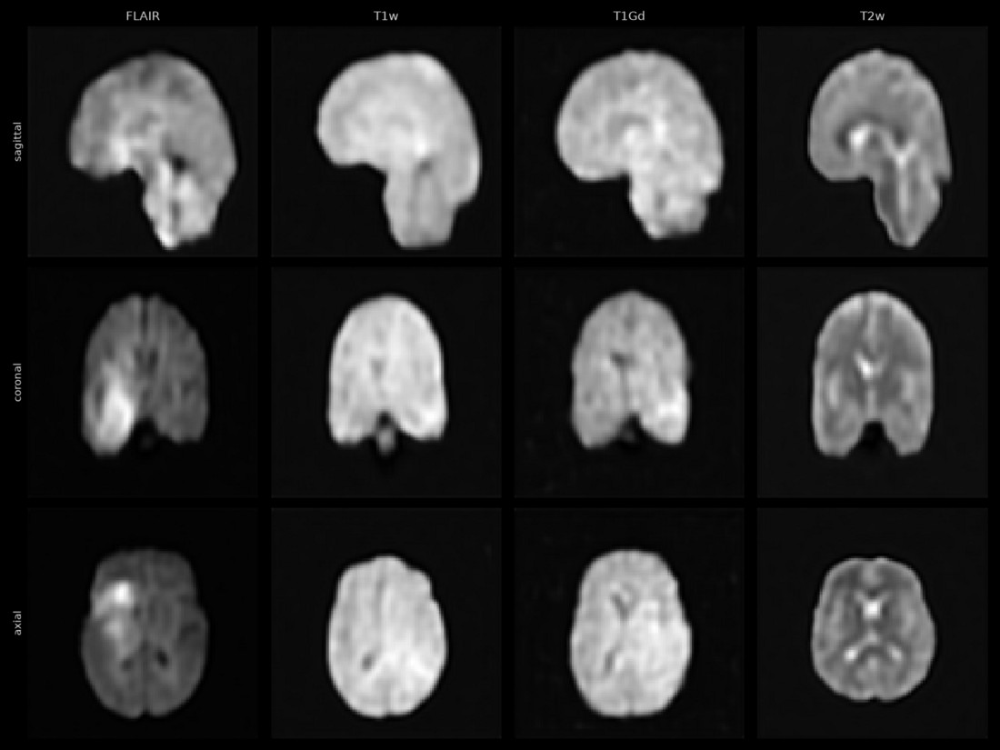

# Latent Diffusion Model — FLIP tutorial

This tutorial trains a diffusion UNet (MONAI `DiffusionModelUNet`) in the latent space of a frozen
autoencoder, on 3-D brain MRI, conditioned on the MR sequence, using the **FLARE Client API**
(`nvflare.client`). The job is defined entirely in Python via `FlipFedAvgRecipe`. The autoencoder is
not trained here: train it first with the [`autoencoder`](../autoencoder/) tutorial. How the three
image-synthesis tutorials fit together is in the [guide](../README.md).

Adapted from MONAI's 3-D latent diffusion example
([Project-MONAI/tutorials, `generation/3d_ldm`](https://github.com/Project-MONAI/tutorials/tree/d948baa25946d109556f4304ba999d7c74a97c4d/generation/3d_ldm),
Apache-2.0; Pinaya *et al.* [2022](https://arxiv.org/abs/2209.07162),
[2023](https://arxiv.org/abs/2307.15208)). The noise schedule, the latent scaling and MONAI's
`LatentDiffusionInferer` follow it. We changed the training for FLIP: federated across sites, all four
MR sequences with sequence conditioning, and an autoencoder that arrives frozen from a separate job.

## Example outputs from this tutorial



Volumes generated by this tutorial, one per MR sequence, in the sagittal, coronal and axial planes.

## Compatible job type

This tutorial is designed for `JOB_TYPE=standard`
([`fl-apps/nvflare/standard/`](../../../../fl-apps/nvflare/standard/)). The required files are
`trainer.py`, `config.json` and `models.py`; the other modules and the autoencoder are uploaded
alongside them (see *On the platform*).

## Data requirements

The brain MRI cohort (MSD Task01_BrainTumour, see
[`fl-tutorials/datasets/brain_mri/`](../../../datasets/brain_mri/)), with the same `transforms.py` as
the autoencoder tutorial: each study is four co-registered MR sequences (FLAIR, T1w, T1Gd, T2w), each
a single-channel NIfTI, resampled to 2 mm voxels (`voxel_spacing`), centre-cropped or padded to
96 × 112 × 80 (`spatial_shape`) and z-scored. The sequence is read from the filename
(`input_<sequence>_<case>.nii.gz`, see the autoencoder tutorial's *Data* section); the trainer stops
if no file matches `MODALITIES`. Studies are split by accession, so the four sequences of one study
all go to training or all to validation (`VAL_SPLIT`, 0.2). `query.sql` selects up to 100 brain MR
studies; the app reads NIfTI, so create its project with **DICOM to NIfTI** on. From the repository
root:

```bash
make -C fl-tutorials download-brain-mri-msd-raw            # 7.6 GB MSD tar, once
make -C fl-tutorials download-brain-mri-data NUM_CASES=20  # -> fl-tutorials/data/brain_mri/
```

## Getting the autoencoder (do this first)

A finished [`autoencoder`](../autoencoder/) run holds the whole training network (autoencoder and
discriminator) inside FLARE's persistor envelope, so extract the autoencoder from it first:

```bash
# 1. Train an autoencoder (from the repository root)
make -C fl-tutorials run-tutorial TUTORIAL=autoencoder

# 2. Extract it (from this directory)
make prepare-checkpoint \
    RAW_CHECKPOINT=/tmp/nvflare/autoencoder/flip_fedavg/server/simulate_job/FL_global_model.pt
```

`RAW_CHECKPOINT` is that run's `.pt`: the simulator's global model, as above, or the global model
downloaded from a platform run. If the run's `config.json` changed the network, also pass
`RAW_CONFIG=<that config.json>`; the default is the autoencoder tutorial's own.

`prepare-checkpoint` (`process_tools/extract_autoencoder.py`) keeps the `autoencoder.*` tensors,
loads them strictly into the recorded architecture, so weights from another network fail here
rather than in training, and writes two files that belong together:

| File | What it is | Where it goes |
| --- | --- | --- |
| `app_files/pretrained_autoencoder.pt` | the weights | the FL server only (`SERVER_CHECKPOINT`) |
| `app_files/autoencoder_config.yaml` | the architecture, and the weights' fingerprint | every client |

Clients never receive the checkpoint file: they build a bare autoencoder from the YAML and get its
weights in the round-0 broadcast. Each client recomputes the fingerprint on what arrived and refuses
to train on any other autoencoder ("The autoencoder this client received is not the one
autoencoder_config.yaml describes"). Every `prepare-checkpoint` overwrites the YAML, so always
generate the two files together and never mix them across runs.

**Checking the load.** The server loads the checkpoint with `strict=False`. Look for this line in the
server log:

```text
Loaded backbone into initial global model from <path> (missing=496, unexpected=0 keys).
```

`missing` counts the tensors the checkpoint did not supply. It should be the diffusion model's 496,
which start from scratch. The autoencoder has another 130, so a higher number means some of its
weights did not load; `missing=626, unexpected=130` means none did, which is what renaming the
`autoencoder` submodule in this tutorial's `models.py` causes. A missing file is logged as
`SERVER_CHECKPOINT '…' not found`.

## The network

MONAI `DiffusionModelUNet`, configured by `net_config` in `app_files/config.json`: 3-D, residual
blocks at three resolutions (`channels` 64, 128, 256; `num_res_blocks` 2 each), attention at the two
coarser ones (`attention_levels`), 49.3 M parameters. It denoises latents, so `in_channels` and
`out_channels` equal the autoencoder's `latent_channels` (3); `models.py` checks this, and that
`spatial_dims` agrees. A 96 × 112 × 80 volume becomes a 3 × 24 × 28 × 20 latent.

The UNet is told which sequence it is denoising: a one-hot vector over `MODALITIES` enters through
cross-attention (`app_files/modality.py`), so one model generates any of the four on demand. Keep
`with_conditioning` and `cross_attention_dim` consistent with `MODALITIES`:

- conditioned (shipped): `with_conditioning: true`, `cross_attention_dim` = `len(MODALITIES)` (4);
- unconditional, e.g. `["T1w"]` alone: `with_conditioning: false`, `cross_attention_dim: 0`.

Keep `MODALITIES` in the autoencoder tutorial's order too: the index is the one-hot position.
`fl-tutorials/tests/test_image_synthesis_config_parity.py` checks both rules.

The frozen autoencoder is MONAI `AutoencoderKL`, built from `autoencoder_config.yaml` rather than
`config.json`, on a submodule named `autoencoder` so the checkpoint's `autoencoder.*` keys land on
it. It has no gradients and stays in eval mode; its decoder only turns samples into images.

## The training logic

Each step encodes a batch with the frozen autoencoder, noises the latents at a random timestep of a
1000-step DDPM schedule (scaled-linear β from 0.0015 to 0.0195), and trains the UNet to predict that
noise (MSE), given the sequence. Adam updates the diffusion model only, in full precision.

- **Gradient clipping.** `GRAD_CLIP_NORM` (1.0) caps the UNet's global gradient norm before each
  optimiser step; `0` turns it off.
- **Learning rate.** Half a cosine from `LR_START` (1e-4) to `LR_END` (1e-6) over the first
  `LR_DECAY_EPOCHS` (6) epochs, then held. Epochs are counted across rounds, so round 2 continues the
  decay rather than restarting it. The shipped 6 is `GLOBAL_ROUNDS` × `LOCAL_ROUNDS`; change it with
  them. Leave out `LR_END`, or set `LR_DECAY_EPOCHS` to `0`, for a constant rate. Logged as
  `LR DM@epoch`.
- **Validation.** Every `VALIDATE_EVERY` (3) epochs and on each round's last epoch, the
  noise-prediction loss on the site's held-out accessions; `0` turns the in-loop pass off. The
  `evaluate` task scores the aggregated model the same way. In local runs with `SAVE_DEBUG_SAMPLES`,
  each pass also generates one volume per sequence: a full 1000-step reverse diffusion, so keep
  `VALIDATE_EVERY` above 1.

### The latent scale factor

Latents are multiplied by a scale factor before diffusion, to bring them to roughly unit variance.
With `LATENT_SCALE_FACTOR: null` (shipped), each site derives it once, from one of its training
batches, so sites train at slightly different scales. The value is logged
(`Latent scale factor: …`): read it off a first run and pin it for any real multi-site run.

### Only the diffusion model is aggregated

`AGGREGATE_ONLY_REGEX` (`^diffusion_model\.`) keeps the frozen autoencoder out of aggregation. The
recipe wires three filters from it, as the FL server does on the platform from the same key (see
`job.py`'s docstring):

- `KeepOnlyVars`: clients send back only the `diffusion_model.*` differences;
- `TrimBroadcastVars`: after round 0, the server broadcasts only those;
- `ReconstructFullModel`: each client rebuilds the full model from its cached round-0 broadcast.

It also keeps the autoencoder's all-zero differences out of the clients' `PercentilePrivacy` filter,
whose cutoff is computed over the whole update.

## Debugging

Sample images (one generated volume per sequence, local runs only) and loss curves are described in
the guide's [Debugging](../README.md#debugging) section.

## FLIP-specific values

`FLIP_PROJECT_ID` and `FLIP_QUERY` are read from environment variables (stubs in `.env.app`).
They are NOT passed as CLI flags because the SQL query contains spaces that don't survive
argparse whitespace-splitting. The trainer reads the query from `config_fed_client.json` at
runtime via `load_query()`. `.env.app` ships `FLIP_PROJECT_ID=dev`: LOCAL_DEV ignores the value,
but the `--project_id {project_id}` task arg needs a non-empty token to substitute.

## How to run

### Export (primary — no GPU needed)

```bash
make export
```

Writes a complete FLARE job to `./fl_job/flip_fedavg/` (`meta.json`, `app/config/`, `app/custom/`
with the bundled `flip/` package and the app files). It does not need the autoencoder checkpoint,
which is staged only when present. The Makefile runs `job.py` in the **flip-utils** environment with
the `full` ML extra, the same package set as the FL image.

### Local simulation (requires a GPU, the data and the autoencoder)

With the data downloaded and the autoencoder prepared (see above), from this directory:

```bash
make run      # checks app_files/pretrained_autoencoder.pt exists, then runs `make sim`
```

or, from the repository root, `make -C fl-tutorials run-tutorial TUTORIAL=latent_diffusion_model`.
In simulation the two sites train on different halves of the dataset; on the platform each trust's
cohort is its own.

### Overriding rounds and clients

`NUM_ROUNDS` (default `1`) and `N_CLIENTS` (default `2`) parameterise both `make export` and
`make sim`/`make run`, and propagate through the tutorial harness:

```bash
make run NUM_ROUNDS=2
make export NUM_ROUNDS=2 N_CLIENTS=3
make -C fl-tutorials run-tutorial TUTORIAL=latent_diffusion_model NUM_ROUNDS=2
```

> **Local knob only.** `--num_rounds` governs local simulation and export. In production the FL API
> reads `GLOBAL_ROUNDS` (federated rounds) and `LOCAL_ROUNDS` (epochs per round) from `config.json`
> at submit time. Keep the name `LOCAL_ROUNDS` exactly: a job whose only local-rounds key is named
> otherwise is rejected.

### On the platform

Upload **everything in `app_files/`** once prepared through the FLIP UI, as a model with job type
`standard`: `trainer.py`, `config.json`, `models.py`, `transforms.py`, `latent_utils.py`,
`modality.py`, `autoencoder_config.yaml` and `pretrained_autoencoder.pt`. The checkpoint is the model
file named by `SERVER_CHECKPOINT`: FLIP stages it on the FL server only, never on the trusts, and
loads it into the round-0 global model. There is no diffusion-model checkpoint to upload. The
standalone FLARE submit path (`make -C fl-services/nvflare submit`) is **not wired**.
