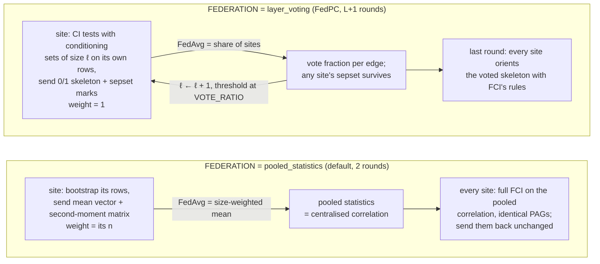

<!--
Copyright (c) 2026 Guy's and St Thomas' NHS Foundation Trust & King's College London
Licensed under the Apache License, Version 2.0 (the "License");
you may not use this file except in compliance with the License.
You may obtain a copy of the License at
    http://www.apache.org/licenses/LICENSE-2.0
Unless required by applicable law or agreed to in writing, software
distributed under the License is distributed on an "AS IS" BASIS,
WITHOUT WARRANTIES OR CONDITIONS OF ANY KIND, either express or implied.
See the License for the specific language governing permissions and
limitations under the License.
-->

# Biomarker causal discovery — FLIP tutorial (NVFLARE)

Federated **bootstrapped FCI** (Fast Causal Inference) over tabular Alzheimer's-disease biomarkers:
plasma markers, brain volumes, cognition and demographics, one row per person, no imaging. The
output is not a trained model but a **partial ancestral graph** (PAG) with a bootstrap frequency on
every edge — which markers drive which, allowing for unmeasured confounders — learned without any
site's rows leaving it. It is the federated form of a centralised analysis developed on ADNI, and
the first FLIP tutorial whose job trains nothing: the platform's ordinary `standard` (FedAvg) job
carries it, because what the sites average is chosen so that the average *is* the analysis.


*The output: the partial ancestral graph two simulated sites recover from the real ADNI cohort
(560 participants, 280 per site, 50 bootstraps), each edge labelled with its bootstrap frequency.
It is the centralised analysis's stable graph. ADNI is access-controlled, so the repository ships
this summary figure and the converter that rebuilds the cohort from your own download, never data.*

## The use case

The centralised analysis (`adni_fci`, Natalia Glazman) runs FCI 200 times on bootstrap resamples
of ~560 ADNI participants, with background knowledge that demographics are exogenous and the
cognitive score is a sink, and reports how often each edge appears. Its stable graph is what a
clinician would hope for: sex drives head size, age drives NfL and hippocampal volume, APOE4 drives
pTau217 and the Aβ42/40 ratio, pTau217 and hippocampal volume drive ADAS-Cog13, and intracranial
and hippocampal volume share a latent cause.

On FLIP each trust holds its own participants. A constraint-based algorithm needs one thing from
the data — conditional-independence (CI) tests — so federating it is a question of where the test
runs and what crosses the wire. This tutorial implements two answers, selectable in `config.json`:



**`pooled_statistics`** is the federated-CI-test idea of FedC²SL (Wang et al., 2023) specialised to
Fisher's z, whose test needs nothing but second moments and a sample size. Each site sends, per
bootstrap, the mean vector and second-moment matrix of its (log-transformed, fixed-scaled) variables,
weighted by its row count. The weighted mean of those is exactly the pooled cohort's statistics, so
the correlation matrix every site gets back in round 2 is the centralised one to machine precision,
and FCI on it — the complete algorithm, possible-D-sep stage and all, run identically at every site
— is exactly centralised Fisher-z FCI on the pooled rows (`tests/test_biomarker_causal_discovery.py`
pins this against causal-learn's own `fci()`). Two rounds, one `p × p` matrix per bootstrap on the
wire, no raw rows.

**`layer_voting`** is FedPC (Huang et al., 2023), whose MATLAB release the design was read from: one
global round per conditioning-set size ℓ. Each site tests every still-adjacent pair against subsets
of size ℓ of the neighbours in the *global* skeleton, on its own rows, and returns a 0/1 adjacency
matrix plus 0/1 separating-set membership with weight one. The plain average is the share of sites
that kept each edge; sites threshold it at `VOTE_RATIO` next round (FedPC's vote) and take the union
of separating sets. The last round orients the voted skeleton with FCI's test-free rules. This mode
runs any local CI test — `CI_TEST: "kci"` for the kernel test the centralised main analysis used —
at the cost of exactness: a vote is not a pooled test, small sites' tests are weak, and FedPC's own
paper discusses the inconsistent-separating-set problem the union creates (orientation errors on
otherwise correct adjacencies, visible in the comparison below).

Bootstrapping is stratified by site: bootstrap *b* at site *s* resamples that site's rows with the
stream `(SEED, s, b)`, all *B* resamples travel at once (arrays carry a bootstrap axis), so the
round count never depends on *B*.

## Data

The cohort is **real ADNI data** — the baseline plasma panel, FreeSurfer volumes, APOE genotype,
ADAS-Cog13 and demographics of the centralised analysis's 560 participants — and you obtain it under
your own ADNI licence. ADNI is access-controlled: every user signs a Data Use Agreement that forbids
redistributing participant-level data in any form, so this repository ships no rows, no per-site
split, no thinned fixture and no synthetic stand-in. What it ships is the **code** that turns an
ADNI download into the cohort, and the summary results of running on it. This is the
data-access-tier rule of the repo's tutorial skill.

### Running on real ADNI data

Four steps; the converter reproduces the cohort behind "Expected performance" exactly (560
participants with the April 2025 plasma release):

1. **Apply for access** at https://adni.loni.usc.edu/data-samples/adni-data/ → *Apply for
   access*. You accept the [Data Use Agreement](https://adni.loni.usc.edu/wp-content/themes/adni_2023/documents/ADNI_Data_Use_Agreement.pdf)
   and submit an online application through the LONI Image and Data Archive (IDA) naming your
   institution and the intended analysis ("federated causal discovery over plasma biomarkers, MRI
   volumes and cognition" is enough). Applicants must be affiliated with a scientific or
   educational institution. The Data and Publications Committee reviews within about two weeks and
   emails the decision; the account then needs an annual update to stay active.

2. **Download five study tables** from the IDA (*Download → Study Data*; each CSV is named
   `<TABLE>_<DDMonYYYY>.csv` after the download date). Put them in one directory outside the
   repository:

   | Table | IDA section | Columns the converter reads |
   |---|---|---|
   | `PTDEMOG` | Subjects → Demographics | `RID`, `PTGENDER`, `PTEDUCAT`, `PTDOB` |
   | `APOERES` | Biospecimen → ApoE Genotyping Results | `RID`, `GENOTYPE` |
   | `ADAS` (all phases) | Assessments → Neuropsychological → ADAS-Cog | `RID`, `VISCODE2`, `TOTAL13` |
   | `UCSFFSX7` | Imaging → UCSF Cross-Sectional FreeSurfer (7.x) | `RID`, `EXAMDATE`, `ST10CV`, `ST29SV`, `ST88SV` |
   | `UPENN_PLASMA_FUJIREBIO_QUANTERIX` | Biospecimen → Biospecimen Results → *UPENN Plasma Biomarkers (Aβ42, Aβ40, pTau217, NfL, GFAP) measured by Fujirebio & Quanterix* | `RID`, `VISCODE2`, `EXAMDATE`, `AB42_F`, `AB40_F`, `pT217_F`, `NfL_Q`, `GFAP_Q` |

3. **Convert** them into the tutorial's twelve-column cohort:

   ```bash
   make -C fl-tutorials convert-adni-cohort ADNI_DIR=~/adni_tables
   ```

   `datasets/ad_biomarkers/make_adni_cohort.py` applies the centralised analysis's cohort rules
   (the earliest FreeSurfer scan with a baseline plasma draw within ±3 months, `-4` and negative
   codes as missing, left + right hippocampus, APOE ε4 count from the genotype, age = scan year −
   birth year) and writes `dataframe.csv`, `site1/`, `site2/` and a counts-only
   `cohort_summary.json` to the gitignored `fl-tutorials/data/ad_biomarkers/`, where `.env.app`
   and the Flower wrapper already look. It prints the participant count, never a value. Pass the
   tables explicitly (`--demographics … --plasma …`) if your file names differ, and
   `OUT=/secure/flip-data/ad_biomarkers` to keep the cohort elsewhere (the target refuses a path
   inside the repository that git does not ignore).

4. **Run** the tutorial on it:

   ```bash
   make -C fl-tutorials run-tutorial TUTORIAL=biomarker_causal_discovery
   ```

   With a cohort kept elsewhere, pass `DEV_DATAFRAME=`, `SITE1_DATAFRAME=` and `SITE2_DATAFRAME=`
   pointing at its three CSVs. Then
   `make -C fl-tutorials/nvflare/tabular_causal_discovery/biomarker_causal_discovery summarise`
   gives the edge-frequency table to compare with "Expected performance". A newer plasma release
   adds participants, so expect the count and the weaker edges to move a little.

**What the agreement requires of you.** Keep the converted cohort out of git and out of any
shared drive the agreement does not cover; only summary results (such as edge frequencies) may be
reported, with the ADNI acknowledgement and your download date (see References). Clause 4 of the
agreement also forbids putting ADNI data into third-party AI tools, which includes pasting rows
or file contents into a coding assistant — run the converter and the simulator yourself, and let
such tools see code only. The author ran this path under their own access; the result is reported
in "Expected performance" as numbers only.

**On the platform.** `query.sql` pivots each person's *baseline* (earliest-dated) OMOP measurements
matched on `measurement_source_value` (`PLASMA_PTAU217`, `ICV_MM3`, …) and the education
observation into one row, deterministically ordered. `tests/datasets/ad_biomarkers/` runs it on SQLite
over OMOP tables written from an invented cohort of the same shape and diffs the two, so the
simulator CSV and a deployed fetch cannot drift. The cohort is **not seeded on the dev trusts** and
never will be from the shared trust-data set: nothing ADNI-derived can be published there. A licence
holder loads their own converted cohort into their **local** dev trusts instead — still their team's
copy under the agreement — and then the platform smoke runs end to end:

```bash
make -C trust load-adni-cohort TRUST_INDEX=1 OMOP_DB_PORT=5434   # GSTT (fl-tutorials/data/ad_biomarkers/dataframe.csv)
make -C trust load-adni-cohort TRUST_INDEX=2 OMOP_DB_PORT=5436   # KCH
make e2e_smoke_causal [FL_BACKEND=flower]                        # create project → cohort → run → download
```

The loader (`trust/omop-db/src/omop_db_tools/adni_cohort.py`) writes each trust's `person_id`-modulo
slice as `person` / `measurement` / `observation` rows, exactly the split the simulator's `site1/` and
`site2/` hold, and reloads idempotently. Run this way on a local Flower dev stack (two trusts of 280,
`has_imaging=false`), the smoke's downloaded `FL_global_model.pt` summarises to the same 16 stable
edges as the simulator run above with identical frequencies: the bootstrap streams are keyed on the
site index, which both paths resolve the same way. The FL images must carry causal-learn: build them from this
tree (`make build-fl`) and run the stack with `DOCKER_FL_REGISTRY= DOCKER_FL_TAG=dev`. There is no
demo-video profile, since a recording would show ADNI-derived values.

## Preprocessing and background knowledge (`config.json`)

| Key | Default | Meaning |
|-----|---------|---------|
| `FEDERATION` | `pooled_statistics` | or `layer_voting` |
| `GLOBAL_ROUNDS` | `2` | pooled mode needs exactly 2; voting needs (largest conditioning set + 2), e.g. 6 for sets up to size 4 |
| `N_BOOTSTRAPS` | `50` | bootstrap resamples per site (`0` = one unresampled fit); the centralised analysis used 200 |
| `ALPHA` | `0.05` | CI-test significance level |
| `CI_TEST` | `fisherz` | voting mode only (`kci`, `fastkci`, `rcit`, …); pooled mode is Fisher-z by construction |
| `VOTE_RATIO` | `0.5` | voting mode: keep an edge if at least this share of sites kept it (FedPC used 0.3) |
| `LOG_TRANSFORM` | the four plasma markers | fixed, site-independent transform of the right-skewed markers (the centralised analysis fitted Yeo-Johnson, which cannot be shared) |
| `SCALE` | volumes, age, education, ADAS | fixed divisors so second moments are O(1) — see "Privacy" for why this is load-bearing |
| `KNOWLEDGE.EXOGENOUS` | age, sex, education, APOE4 | nothing may cause these |
| `KNOWLEDGE.SINKS` | ADAS-Cog13 | may cause nothing |
| `KNOWLEDGE.NEVER_CONDITION_ON` | ADAS-Cog13 | dropped from every conditioning set (a downstream collider) |
| `STABLE_EDGE_PROB` | `0.5` | the frequency an edge needs to count as stable in the reported metrics |

APOE4 enters as the allele count (0/1/2) rather than the centralised analysis's two dummies: one
variable keeps the graph simple, and Fisher's z on an ordinal is the usual approximation.

## The "model" and what a run reports

`models.get_model()` returns a parameter-free `nn.Module` whose buffers are the exchanged arrays
(`site_counts, stats_mean, stats_moment, skeleton, sepsets, pag, padding`), sized from
`config.json`. The downloaded `FL_global_model.pt` therefore *is* the result: `summarise_results.py`
decodes it into the edge-frequency table and the figure below (`make summarise RESULTS=<path>`).
Per-round metrics streamed to the hub are `site_rows`, `pooled_rows`, `sites_seen`, `stable_edges`,
`mean_edges_per_pag`, `stable_adjacencies` (and `mean_edges_kept` per voting layer); the final
evaluation reports the same for the aggregated PAGs. There is no best-model selection — "best" has
no meaning for a federated state — so `BEST_MODEL_METRIC` is deliberately absent.

Two platform mechanics decide the wire format, and both are worth knowing before you change it:

- **No site knows how many sites there are**, yet Fisher's z needs the pooled sample size. Each
  site writes its row count into its own slot of `site_counts` (slot = the site's index, from the
  trailing number of `Trust_3` / `site-3`); after size-weighted averaging slot *j* holds `n_j² / N`,
  and `N = (Σ_j √slot_j)²` recovers the total exactly.
- **The standard template's percentile-privacy filter** zeroes the 10 % smallest entries of a
  site's update and clips the rest at ±0.01 per local step. Both are no-ops by construction: every
  array travels scaled by `ENCODING_SCALE`, a zero `padding` array keeps the 10th percentile at
  exactly zero, and `SCALE` keeps the moments small enough. A raw volume in mm³ overshoots by orders
  of magnitude — the first simulator run of this tutorial lost every hippocampus edge to the clip
  before `SCALE` existed — so `assert_within_filter_bounds` now refuses such a payload with an error
  naming the variable rather than letting the filter corrupt it silently.

## Expected performance

Reference run: the shipped config (`pooled_statistics`, 50 stratified bootstraps, α = 0.05) on the
560-participant ADNI cohort that `convert-adni-cohort` builds from the tables listed above (April
2025 plasma release), two `person_id`-modulo sites of 280, NVFLARE simulator on CPU (16-thread
i9-9900K): **under one minute** end to end, of which FCI on 50 bootstraps is about 10 s per site.
The federated run reports the centralised analysis's stable set — 16 edges at frequency ≥ 0.5 — and
a licence holder following the four steps gets these numbers to the second decimal. The second
column is the centralised Fisher-z analysis (200 whole-cohort bootstraps, APOE4 as two dummies):

| Edge | Federated | Centralised |
|------|-----------|-------------|
| sex → ICV, age → hippocampus, age → NfL, APOE4 → pTau217 | 1.00 | 1.00 |
| hippocampus → ADAS, pTau217 → ADAS | 1.00 | 1.00 |
| NfL → pTau217 | 0.92 | 0.85 |
| sex → ADAS | 0.84 | 0.98 |
| APOE4 → Aβ42/40 | 0.78 | 0.92 |
| education → ADAS | 0.74 | 0.88 |
| ICV ↔ hippocampus (latent head size) | 0.72 | 0.79 |
| NfL → GFAP | 0.68 | 0.57 |
| pTau217 → hippocampus | 0.64 | 0.69 |
| pTau217 → Aβ42/40 | 0.60 | 0.49 |
| age → GFAP | 0.56 | 0.50 |
| pTau217 → GFAP | 0.52 | 0.31 |

The differences sit on the weaker edges and come from the two things that genuinely differ — the
bootstrap scheme (stratified by site versus whole-cohort) and the APOE4 encoding — not from the
federation, which the exactness test shows adds nothing of its own. A newer plasma release or a
different site split moves the edges below 0.8 by a few hundredths.

The same cohort in `layer_voting` mode (`FEDERATION=layer_voting`, `GLOBAL_ROUNDS=6`,
`NUM_ROUNDS=6`, `VOTE_RATIO=0.5`) keeps only 8 of those 16 edges at ≥ 0.5 (age → NfL,
hippocampus → ADAS, sex → ICV, pTau217 → ADAS at 1.00; APOE4 → pTau217 0.94; age → hippocampus
0.84; NfL → GFAP 0.82; sex → ADAS 0.52): with 280 rows a site, an edge that one site's own test
cannot see at α = 0.05 loses the vote, and the union of separating sets then mis-orients some of
what survives — the two effects FedPC describes. That is the concrete reason pooled statistics is
the default.

**What a wrong run looks like.** `stable_edges` of 0 after the final round means the orientation
round never happened: `GLOBAL_ROUNDS` (or `--num_rounds`) is too small for the mode (2 for pooled;
largest conditioning set + 2 for voting). A graph missing every edge of one variable, with the rest
intact, is the percentile clip above — check that the variable is in `SCALE` or `LOG_TRANSFORM`
(a run on this release raises instead). Frequencies all exactly 0 or 1 with `N_BOOTSTRAPS > 1`
mean the sites' bootstrap streams collapsed: check that the site names end in distinct numbers.
Voting-mode frequencies that drop as rounds proceed are expected (edges are only ever removed);
a skeleton that empties by round 3 means `VOTE_RATIO` is above the share of sites that can
see the dependence (try 0.3, FedPC's value).

## Privacy

What leaves a site in pooled mode is, per bootstrap, a `p × p` second-moment matrix and a mean
vector of the transformed variables, plus its row count: aggregate statistics, not rows, and
exactly what a meta-analysis would publish. They are *not* differentially private — the NVFLARE
percentile filter is deliberately rendered inert (above) and the Flower twin sets `dp-enabled =
false` — because clipping and noising a covariance matrix is not a meaningful mechanism for it and
does break the arithmetic the federation relies on. With a handful of sites and small cohorts a
second-moment matrix does bound individual values somewhat loosely; a site that needs a formal
guarantee should look at FedC²SL's random-projection encoding of the statistics (the paper's
mechanism), which this tutorial does not implement. Voting mode releases less (0/1 decisions per
bootstrap and layer) but is not formally private either.

## How to run

```bash
make -C fl-tutorials convert-adni-cohort ADNI_DIR=~/adni_tables         # once, from your own ADNI download (see Data)
make -C fl-tutorials run-tutorial TUTORIAL=biomarker_causal_discovery  # NVFLARE simulator, CPU, < 1 min
make -C fl-tutorials run-tutorial TUTORIAL=biomarker_causal_discovery NUM_ROUNDS=6   # after setting FEDERATION=layer_voting
make -C fl-tutorials/nvflare/tabular_causal_discovery/biomarker_causal_discovery summarise   # edge table + PAG figure
make -C fl-tutorials/nvflare/tabular_causal_discovery/biomarker_causal_discovery export      # the job folder, no data needed
```

`WORKSPACE=<dir>` moves the simulator workspace (default `/tmp/nvflare/causal`), and `make
summarise RESULTS=<FL_global_model.pt>` reads a model downloaded from the hub. The job runs in the
flip-utils environment with its `full` extra, which includes causal-learn, the same set the FL image
installs.

**On the platform:** upload `app_files/` as a `standard` job with imaging **off**
(`has_imaging=false`; the cohort is tabular), paste `query.sql` as the cohort query, and set
`GLOBAL_ROUNDS` in `config.json` to the mode's round count. The result bundle's
`FL_global_model.pt` goes through `summarise_results.py` on your machine.

## Honest caveats

- Cross-sectional, baseline data; the arrows are ancestral claims under FCI's assumptions
  (faithfulness, no selection bias), and a bootstrap frequency is a stability measure, not a
  posterior probability.
- The pooled mode is exact for Fisher's z only — a linear-Gaussian test. The kernel test (KCI) of
  the centralised main analysis has no sufficient statistics, so it is available only in voting
  mode, whose approximations are its own.
- The sites' stratified bootstrap is not the centralised analysis's whole-cohort bootstrap; with
  very unequal sites the frequencies differ slightly.
- The reference run reproduces the centralised analysis's graph from the same 560 participants,
  so agreement between the two is a check of the federation machinery, not independent evidence
  about Alzheimer's disease.

## References

- **FCI**: Spirtes, P., Glymour, C., Scheines, R. *Causation, Prediction, and Search*, 2nd ed., MIT
  Press, 2000; Zhang, J. "On the completeness of orientation rules for causal discovery in the
  presence of latent confounders and selection bias", *Artificial Intelligence* 172(16–17), 2008.
  Implementation: causal-learn (Zheng, Y. et al., *JMLR* 25, 2024, https://github.com/py-why/causal-learn).
- **FedPC** (the `layer_voting` mode): Huang, J., Guo, X., Yu, K., Cao, F., Liang, J. "Towards
  Privacy-Aware Causal Structure Learning in Federated Setting", *IEEE Transactions on Big Data*,
  2023. https://arxiv.org/abs/2211.06919 (the MATLAB release's layer-wise `layer_federate` and
  union of separating sets are what this mode reproduces; its FedOrien p-value step is not).
- **FedC²SL** (the `pooled_statistics` idea): Wang, Z., Ma, P., Wang, S. "Towards Practical
  Federated Causal Structure Learning", *ECML PKDD 2023*, LNCS 14170. https://arxiv.org/abs/2306.09433,
  code https://github.com/wangzhaoyu07/FedC2SL. Their federated CI test is for discrete variables
  with a secure random-projection encoding; here the Gaussian case reduces to pooled moments.
- **Related**: Li, L. et al. "Federated Causal Discovery from Heterogeneous Data", *ICLR 2024*
  (FedCDH, https://github.com/lokali/FedCDH); Hahn, J. et al. "fedCI-IOD", arXiv:2603.05149, 2026
  (federated IOD under latent confounding).
- **The centralised analysis** this tutorial federates: N. Glazman, *Causal discovery on ADNI
  multimodal biomarkers* (`adni_fci`, bootstrapped FCI with KCI/Fisher-z and the background-knowledge
  rules reused here), 2026 — ask the author for the citable reference.
- **Data**: ADNI (https://adni.loni.usc.edu) is used under its Data Use Agreement by licence holders
  only; the repository ships no data, just the converter (`datasets/ad_biomarkers/`). Cite FLIP itself via the
  repository's `CITATION.cff`.

**ADNI acknowledgement.** The real-cohort numbers in "Expected performance" are summary results
(edge frequencies, never participant-level values), which the Data Use Agreement permits. Data used
in their preparation were obtained from the Alzheimer's Disease Neuroimaging Initiative (ADNI)
database (adni.loni.usc.edu). The ADNI was launched in 2003 as a public-private partnership, led by
Principal Investigator Michael W. Weiner, MD; its goal has been to test whether serial MRI, PET,
other biological markers, and clinical and neuropsychological assessment can be combined to measure
the progression of mild cognitive impairment and early Alzheimer's disease. Data collection and
sharing for ADNI is funded by the National Institute on Aging (National Institutes of Health Grant
U19AG024904); the grantee organization is the Northern California Institute for Research and
Education. The investigators within ADNI contributed to the design and implementation of ADNI and/or
provided data but did not participate in this analysis (full list:
https://adni.loni.usc.edu/wp-content/uploads/how_to_apply/ADNI_Acknowledgement_List.pdf).
*Data version:* ADNI study tables (demographics, APOE, ADAS, FreeSurfer volumes) downloaded
16 January 2026; plasma assays from the UPenn Plasma Quanterix release of 25 April 2025 (the
25 March 2026 release is the centralised analysis's `plasma_assays` sensitivity preset, not the
main run). Anyone reproducing these numbers under their own access should check the database for
updated tables first, as the agreement requires.

```bibtex
@article{huang2023fedpc,
  title   = {Towards Privacy-Aware Causal Structure Learning in Federated Setting},
  author  = {Huang, Jianli and Guo, Xianjie and Yu, Kui and Cao, Fuyuan and Liang, Jiye},
  journal = {IEEE Transactions on Big Data},
  year    = {2023},
  doi     = {10.1109/TBDATA.2023.3285477}
}
```
